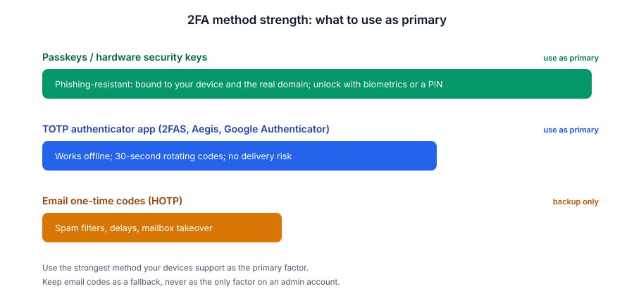
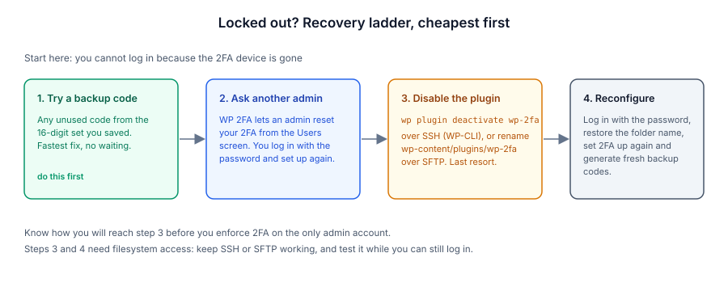

import { Picture } from "astro:assets";
import YouTubeEmbed from "../../components/widgets/YouTubeEmbed.astro";
import Button from "@components/widgets/Button.astro";
import Notice from "@components/widgets/Notice.astro";
import ListCheck from "@components/widgets/ListCheck.astro";
import Accordion from "@components/widgets/Accordion.astro";
import Tabs from "@components/widgets/Tabs.astro";
import Tab from "@components/widgets/Tab.astro";
import img2faSettings from "../../assets/images/wordpress/2fa-settings-727x1024.webp";

*Disclosure: this guide contains referral links. If you buy through them, I may earn a commission at no extra cost to you.*

Passwords alone aren't enough for WordPress. They get phished, leaked in other sites' breaches, or stuffed into `wp-login.php` by bots. Adding two-factor authentication for WordPress means a stolen password is no longer enough to get in: the attacker also needs a code or key that never leaves your device. And this is table stakes now. Since September 2025, WordPress.org demotes authors, editors, and admins without 2FA to contributor.

The easiest way to add a second factor is the WP 2FA plugin (free, by Melapress). It covers authenticator apps (TOTP), email codes, and passkeys, and it can enforce 2FA for specific user roles. Not all methods are equal: passkeys and hardware keys beat authenticator apps, which beat email codes. This guide covers all three, plus the parts most tutorials skip: backup codes, an end-to-end verification, and what to do when you get locked out.

Starting from an empty server? [Install WordPress with Docker Compose](/install-wordpress-docker/) first, then come back.

<YouTubeEmbed
  url="https://www.youtube.com/embed/WXKTEqH7gdw"
  label="How to Activate 2FA in WordPress with WP 2FA"
/>

_The video above shows the pre-4.0 interface. WP 2FA 4.0 (mid-2026) redesigned the dashboard screens, so some labels look different now. The steps below match the 4.x plugin._

## Why your WordPress login needs two-factor authentication

Credential stuffing and phishing do not care how long your password is. Bots replay leaked username and password pairs against `wp-login.php` around the clock, and a phishing page happily harvests whatever you type. A second factor kills both attacks: the code rotates every 30 seconds and lives on your device, and a passkey will not even authenticate to a fake domain.

WordPress login security is still a plugin problem. Core (7.1.4 as of November 2026) ships no native two-factor authentication. Two-step authentication (the phrasing the core docs use) is a plugin feature today; a "Secrets API" is proposed for 7.2, but that is encrypted credential storage groundwork, not a login second factor.

Here is the strength ranking I use when picking methods:



Use the strongest method your devices support as the primary factor. Keep email codes as a backup only, because your mailbox is itself an account protected by a password and a recovery flow.

## Before you start (prerequisites)

This is the "can I run this tonight?" gate. Have these in place before you touch login behavior:

<ListCheck>
<ul>
<li>Admin access to the WordPress dashboard. You are about to change how people log in.</li>
<li>WordPress 5.7+ and PHP 7.4+. WP 2FA 4.x requires both; the WordPress minimum went up from 5.5 to 5.7 in 4.2.0.</li>
<li>A phone or a password manager that can generate TOTP codes.</li>
<li>Working transactional email if you plan to use email codes. [Route WordPress email through a proper SMTP service with FluentSMTP](/send-emails-in-wordpress-zoho-smtp-fluentsmtp/) first, otherwise codes land in spam or nowhere.</li>
<li>10 to 15 spare minutes, and do not close your current admin session until the end-to-end test passes.</li>
<li>A fresh backup of the site before you change login enforcement. Any of the [free WordPress backup plugins](/best-free-wordpress-backup-plugins/) will do; just take one.</li>
</ul>
</ListCheck>

<Notice type="warning" title="Do not enforce 2FA on your only admin account yet">
Wait until backup codes exist and you know your recovery path. Locking yourself out of WordPress is the classic 2FA failure, and the fix is much easier to arrange before you need it than after.
</Notice>

## Install the WP 2FA plugin

In your WordPress dashboard, go to **Plugins → Add New**, search for "WP 2FA", and install **WP 2FA by Melapress** (the listing name is "WP 2FA - Two-factor authentication for WordPress"). The vendor used to be called WP White Security; on wordpress.org it is Melapress now. Activate it and follow the setup wizard. The wizard asks who needs 2FA: all users, admins only, or specific roles.

WP 2FA has 100,000+ active installs, and the free tier covers everything in this guide except the extras priced out at the end. Version 4.0 (mid-2026) shipped a completely redesigned interface. New installs get it automatically; if you upgraded from 3.x, you can switch to the new UI under General Settings. That switch is one-way.

<Notice type="info" title="Screenshots and menu labels reflect the 4.x interface">
This guide matches WP 2FA 4.3.x. If you are still on 3.x, the layout differs, but the flow is the same: policy settings decide who needs 2FA, then each user configures a method from their profile.
</Notice>

**Verify:** the wizard completes without errors and a **WP 2FA** menu entry appears in the dashboard.

## Set up 2FA with an authenticator app (TOTP)

This is the method I'd pick as default. It works offline, there is no delivery risk, and codes rotate every 30 seconds. After setup, every login asks for a 6-digit code from the app.

### Pick a TOTP app (Google Authenticator, 2FAS, Aegis)

Google Authenticator is still the mainstream pick and it is fine. It now offers optional cloud sync of your seeds. Convenient, but understand the tradeoff: your secrets live on someone else's server. If you want exportable, offline-first seeds, use 2FAS, Aegis (Android), or Ente Auth.

If you already keep secrets in a password manager, Bitwarden and 1Password both generate TOTP codes. That is where I'd put them if the manager is already the vault. The tradeoff: a compromised vault now holds both factors, so protect it accordingly.

Authy used to be the default recommendation. Its desktop apps hit end-of-life in March 2024, and the cloud-synced seed model has a checkered breach history, so I would not start a new setup there today.

<Tabs>
<Tab name="Android">
- **Aegis**: open source, encrypted vault, real exportable backups. My pick.
- **2FAS**: clean UI, easy seed export, optional browser extension.
- **Google Authenticator**: simplest setup, optional cloud sync.
</Tab>
<Tab name="iPhone">
- **2FAS**: same app as Android, easy backups.
- **Google Authenticator**: mainstream, optional cloud sync.
- **Ente Auth**: open source, end-to-end encrypted sync.
</Tab>
<Tab name="Password managers">
- **Bitwarden**: TOTP in the vault (Premium for the authenticator feature), exportable.
- **1Password**: built-in TOTP, one item per login.
- Keeps the seed in the vault you already back up, but see the both-factors-in-one-place tradeoff above.
</Tab>
</Tabs>

### Scan the QR code and verify

1. Go to **Users → Your Profile**, scroll to the WP 2FA section, and click **Set up two-factor authentication**.
2. Choose the authenticator-app method and click **Next**.
3. Open your TOTP app from the picks above.
4. Scan the QR code the plugin shows. No camera? Type the secret key manually. That is also the better path for desktop apps.
5. Enter the 6-digit code the app generates to confirm the link.

<Picture formats={["webp"]} fallbackFormat="webp" src={img2faSettings} alt="WP 2FA 2FA policies settings page in the WordPress admin, 4.x interface" />

**Verify:** the code is accepted at setup. Then log out and log back in once. The login form should now ask for the 6-digit code. Do this before you enforce anything for other users.

## Generate backup codes (before you log out)

<Notice type="warning" title="Do this before you log out">
WP 2FA generates 16-digit backup codes. Generate and store them the moment your first method works, not later. Losing the phone with the authenticator app and no backup code is the single most common self-lockout with 2FA.
</Notice>

Backup codes are what you fall back on when the device with the app is gone: lost, wiped, stolen, or replaced. Treat them like the spare key to the site:

- Print them or save them in your password manager.
- Do not store them only on the same phone as the authenticator app.
- Regenerate the set if you start dipping into it, and keep the fresh list somewhere offline.

**Verify:** the codes download or copy successfully. If the plugin offers a test, burn one code to confirm it is accepted, then store the rest.

## Set up 2FA with email codes

Email codes are the backup method, not the primary one. Two reasons: delivery is never guaranteed (spam filters, greylisting, SMTP outages), and your mailbox is itself protected by a password. Keep an authenticator app or a passkey as the primary factor.

Before you enable this, make sure WordPress actually sends mail. Codes that never arrive are almost always an SMTP problem. The fix is in the prerequisites above. Self-hosters who want the relay at server level instead of a plugin can [set up a server-side SMTP relay with ZeptoMail](/how-to-setup-smtp-relay-email-on-zeptomail/).

1. In the WP 2FA policy settings, enable **One-time code via email (HOTP)**.
2. Go to the WP 2FA section of your user profile and click **Set up two-factor authentication**.
3. Choose email, confirm your address, and click **Send code**.
4. Enter the code from your inbox to verify the method.

Since 4.1.0 the OTP validity window for email codes is configurable, which helps if your SMTP path is slow.

<Notice type="info" title="Codes can be delayed or land in spam">
Check spam, wait up to five minutes, and confirm your SMTP plugin's delivery log shows the message before you retry. Never rely on email alone for your only admin account.
</Notice>

**Verify:** a test email arrives, is not in spam, and shows up in the SMTP plugin's delivery log.

## Passkeys (passwordless login)

Passkeys (WebAuthn, sometimes called security keys) replace the password with a cryptographic key stored on your device. You unlock with Face ID, Touch ID, or a PIN. With nothing to type, there is nothing to phish and nothing to leak in a breach. This is the strongest option WordPress login security currently has.

To set it up, enable the passkey method in the WP 2FA settings, then register your device from the WP 2FA section of your user profile. After that you can log in with the passkey instead of the password.

<Notice type="info" title="Passkey support and device requirements">
Passkeys need a modern browser and a platform authenticator (Windows Hello, Touch ID, Face ID, Android biometrics) or a hardware key. On the tier question: the plugin readme lists passkey support in the free feature list, while Melapress's pricing page groups passkeys under Premium, and Premium explicitly adds multiple passkeys per user. The safe read is that free covers one passkey per user and Premium buys several. Check what your build's passkey screen offers before you plan around it. Register a second device or keep backup codes so a new laptop does not lock you out.
</Notice>

**Verify:** register a passkey, log out, and log back in with the passkey flow before you disable passwords anywhere.

## Enforce 2FA for other users

Now spread it. In the WP 2FA policy settings you can require 2FA for all users or only specific roles, set a grace period before the requirement kicks in, and new users get prompted on first login.

<ListCheck>
<ul>
<li>Enforce for admins. They have full control of the site; a compromised admin account is game over.</li>
<li>Enforce for editors. They publish content and can upload files.</li>
<li>Consider it for authors. They publish their own posts; lower blast radius, but still a foothold.</li>
<li>Optional for contributors and subscribers. They have no publishing or settings access.</li>
</ul>
</ListCheck>

I'd enforce at minimum for admin and editor. Anyone who can publish content or change settings is a real risk if their account gets compromised. WordPress.org itself demotes publishers without 2FA to contributor since September 2025; treat that as the baseline, not the ceiling.

Multisite: WP 2FA supports network-level policies, so you can enforce from the network admin instead of site by site.

<Notice type="info" title="What the free tier covers here">
Requiring 2FA with a grace period is in the free feature list. Fine-grained "policies per user role" (different methods or grace periods per role) are listed under Premium. The wizard's "who needs 2FA" options cover the usual cases on free; if you need per-role method policies specifically, that is Premium territory.
</Notice>

**Verify:** create a test user in a target role, confirm the first-login 2FA prompt and the grace-period behavior, then delete the test user.

## Verify your 2FA setup

Do not trust the happy path. Before enforcement goes live for anyone else, run this end to end:

<ListCheck>
<ul>
<li>Open a private or incognito window and log in with password plus second factor, end to end. Keep your original admin session open until this passes.</li>
<li>Confirm your backup codes are saved somewhere offline, not just on the phone with the app.</li>
<li>For the email method: send a test email, check spam, confirm the SMTP plugin's delivery log shows it, then test again after five minutes so you know what a real delay looks like.</li>
<li>For enforcement: the test user in the target role gets the first-login prompt, and the grace period behaves as configured.</li>
<li>Check one non-admin login path if you run one (for example WooCommerce My Account). WP 2FA 4.x shipped a bug that 404'd the WooCommerce My Account 2FA page (fixed in 4.2.0), which is a good example of a front-end path breaking while the dashboard looks fine.</li>
</ul>
</ListCheck>

If any step fails, fix it before you enforce. An unverified 2FA rollout is how support tickets start.

## If you get locked out

Everyone focuses on setup and skips the exit. Here is the recovery ladder, cheapest first:

1. **Use a backup code.** That is what they exist for.
2. **Ask another admin.** WP 2FA lets an admin reset another user's 2FA from the Users screen. You then log in with the password and set up again.
3. **Last resort: disable the plugin.** Over SSH with WP-CLI: `wp plugin deactivate wp-2fa`. Without shell access, rename `wp-content/plugins/wp-2fa` to something like `wp-2fa-off` over (S)FTP, log in normally, restore the folder name, and reconfigure.



<Notice type="warning" title="The last resort touches the filesystem">
Know how you will reach it before you enforce 2FA on the only admin account. If your host only gives you a file manager, test that you can rename plugin folders now, not when you are locked out. And [keep SSH access to your server properly locked down](/secure-ssh-server-linux/) so the recovery path itself is not the hole.
</Notice>

To remove 2FA cleanly rather than in an emergency: have each user disable their own 2FA (or reset them as admin), then deactivate the plugin. Enforcement policies do not survive deactivation, but user 2FA configuration may remain in the database. After re-enabling, check the user list to see who still has 2FA set up.

## 2FA ops notes (what breaks)

2FA changes login behavior for anything that is not a browser form. These are the 4.x changes that bite operators.

### Application passwords are blocked by default (4.3.0)

Since WP 2FA 4.3.0 (November 2026), Application Passwords are blocked by default for any user with 2FA enabled. If your automation logs into REST API endpoints, a headless setup, or a CLI tool with an app password, it stops working the moment you enable 2FA for that account.

<Notice type="warning" title="This breaks REST API and app-password logins">
Audit your app passwords first (**Users → your profile → Application Passwords**). Re-enable per user with the filter below if automation needs them. A settings toggle is planned for a later release; until then the filter is the way.
</Notice>

```php
add_filter( 'two_factor_user_api_login_enable', function ( $enabled, $user_id ) {
    return $enabled || 123 === (int) $user_id; // replace 123 with the user ID
}, 10, 2 );
```

This is the classic "2FA broke my automation" surprise. Check what logs in with app passwords before you enable 2FA for those accounts.

### Failed-attempt lockout after 5 tries (4.2.0)

Since 4.2.0, five failed 2FA verification attempts trigger a 15-minute lockout on that user. Good news against code-guessing bots; relevant for support desks and for anyone testing in a loop. The same release fixed a CSRF issue in REST request handling, so if you are on anything older than 4.2.0, update before doing anything else.

To layer on top, [add brute-force protection with CrowdSec](/crowdsec-secure-server/) or another IPS at the host level. 2FA covers the login form; volumetric attacks and `xmlrpc.php` are a different layer.

### Disable XML-RPC for extra login hardening

2FA plugins do not always cover the `xmlrpc.php` pingback and brute-force paths by themselves. Disable XML-RPC if nothing you run needs it, or use a plugin that does: Wordfence and miniOrange both ship a toggle. This is complementary hardening, not a replacement for 2FA. If you are on CloudPanel, [harden your CloudPanel install](/secure-cloudpanel/) while you are at it.

### What it costs: free vs premium

<Tabs>
<Tab name="Free">
- TOTP authenticator apps, email codes, 16-digit backup codes.
- Enforcement policies with a grace period.
- Passkey support (likely one passkey per user; see the passkeys section).
- **$0 recurring** if you use TOTP or passkeys and a free SMTP path. Enough for most single-site installs.
</Tab>
<Tab name="Premium ($79+/yr)">
- $79/yr for 1 site, $99 for 5, $109 for 10, $149 for 25 (melapress.com pricing, November 2026).
- SMS 2FA via Twilio or Clickatell, plus per-message carrier costs on top.
- Multiple passkeys per user, trusted devices, finer per-role policies.
</Tab>
<Tab name="Enterprise ($89+/yr)">
- $89/$109/$139/$199 per year for 1/5/10/25 sites.
- White labeling, a REST API tier, and priority support.
- REST API access is listed at Enterprise level, so do not promise it to free users.
</Tab>
</Tabs>

Operator takeaway: TOTP plus passkeys plus backup codes is the zero-recurring-cost path. SMS 2FA is the one with a per-message bill attached, and I would skip it unless a user genuinely has no smartphone.

## WP 2FA alternatives

WP 2FA is the plugin this guide uses, and the one I'd pick for a straightforward 2FA rollout. If you want something else, these are the real alternatives as of late 2026.

<Tabs>
<Tab name="Wordfence">
- Free 2FA, login CAPTCHA, and XML-RPC protection in the main Wordfence plugin.
- The standalone Wordfence Login Security plugin is discontinued (on or around August 12, 2026). Its features moved into the full Wordfence plugin.
- Still running it? WP 2FA 4.2+ migrates users' 2FA configs and backup codes automatically at login, then you uninstall it. Or just install full Wordfence.
</Tab>
<Tab name="miniOrange 2FA">
- Free for unlimited users: TOTP, email OTP, free passkeys (WebAuthn), trusted devices.
- SMS, WhatsApp, and push are premium and need a miniOrange account.
- Scope creep, fine if you want one plugin for everything: CAPTCHA, disable-XML-RPC toggle, brute-force lockout, IP blocking. Heavier than WP 2FA if you do not want those.
</Tab>
<Tab name="Two Factor (community)">
- Open source (WordPress/two-factor on GitHub): TOTP, email codes, backup codes.
- WP-CLI commands (`wp two-factor`) since 0.17.0.
- U2F hardware keys were removed in 0.16.0 (March 2026) when browser support died; no WebAuthn or passkeys yet. The most developer-oriented option, and the closest thing to a core-track feature plugin.
</Tab>
</Tabs>

## Common questions

<Accordion label="Does WordPress have built-in two-factor authentication?" group="faq" expanded="true">
No. As of WordPress 7.1.4 (November 2026), core ships no native 2FA. A "Secrets API" is proposed for 7.2, but that is encrypted credential storage groundwork, not a login second factor. Plugins remain the path; the community Two Factor plugin is the closest thing to a core-track feature.
</Accordion>

<Accordion label="Is the WP 2FA plugin really free?" group="faq">
Yes for the core flow: TOTP, email codes, backup codes, enforcement with a grace period, and passkey support are in the free tier. Premium (from $79/year) adds SMS, multiple passkeys per user, trusted devices, and finer per-role policies. See the cost breakdown in the ops notes above.
</Accordion>

<Accordion label="What if I lose my phone with my authenticator app?" group="faq">
Use a backup code first. If you do not have one, another admin can reset your 2FA. Last resort is disabling the plugin over SSH/WP-CLI or renaming its folder over SFTP. The full ladder is in [If you get locked out](#if-you-get-locked-out).
</Accordion>

<Accordion label="Authenticator app or email codes: which should I use?" group="faq">
The app, every time, as the primary factor: it works offline and there is no delivery risk. Keep email as a backup method only, and only with reliable SMTP behind it. If your devices support passkeys, those beat both.
</Accordion>

<Accordion label="Does 2FA work with WooCommerce or membership sites?" group="faq">
Yes. Test the non-admin login flows after enforcing anything. WooCommerce My Account had a broken 2FA page in WP 2FA 4.x (a 404, fixed in 4.2.0), which is exactly the kind of front-end breakage enforcement reveals. See the verification checklist above.
</Accordion>

## Wrapping up

Two-factor authentication is one layer, not the whole stack. Pair it with offsite backups, a locked-down SSH config, and server hardening and you have covered the realistic WordPress break-in paths. TOTP or passkeys as the primary method, backup codes somewhere offline, enforcement on the publishing roles: that is the boring, reliable default.

If you are running WordPress on an [affordable Hetzner VPS](https://go.bitdoze.com/hetzner), treat login hardening as part of the same checklist as firewall rules and updates. For the server side of that checklist, see [the server hardening checklist I run on my own Docker host](/bsi-security-report-docker-ufw/). And once login is locked down, [speed up WordPress with Cloudflare, Varnish and Redis](/speed-up-wordpress-with-cloudflare-varnish-and-redis/).

<Button text="Get WP 2FA free" link="https://wordpress.org/plugins/wp-2fa/" variant="solid" color="blue" size="md" icon="arrow-right" />
