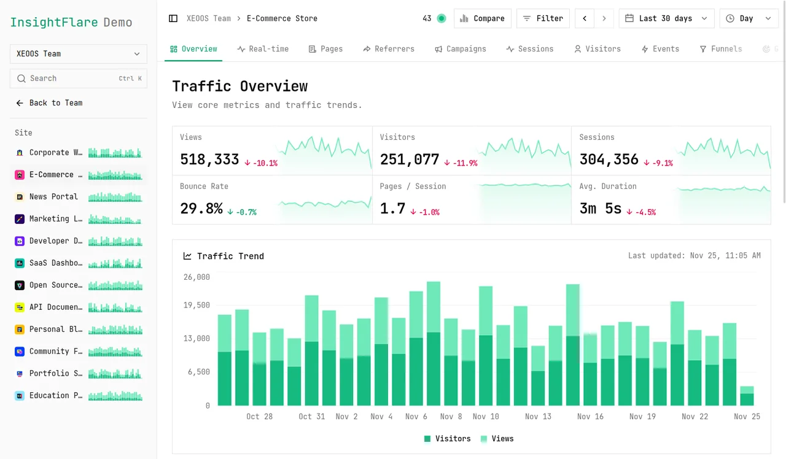
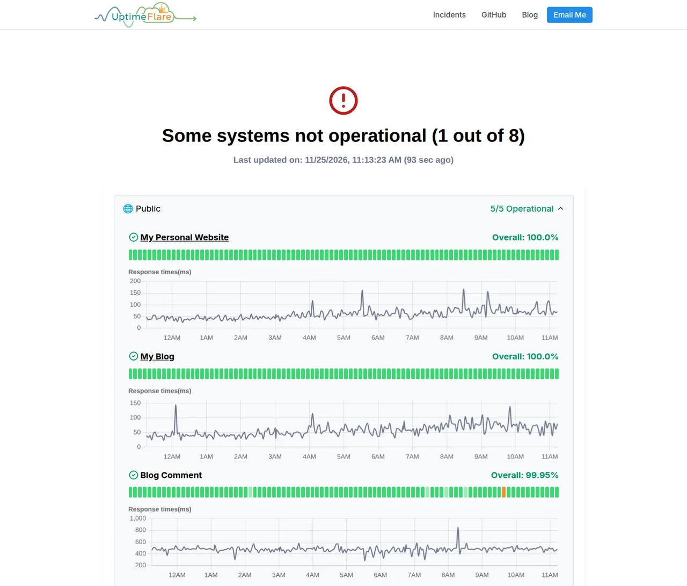
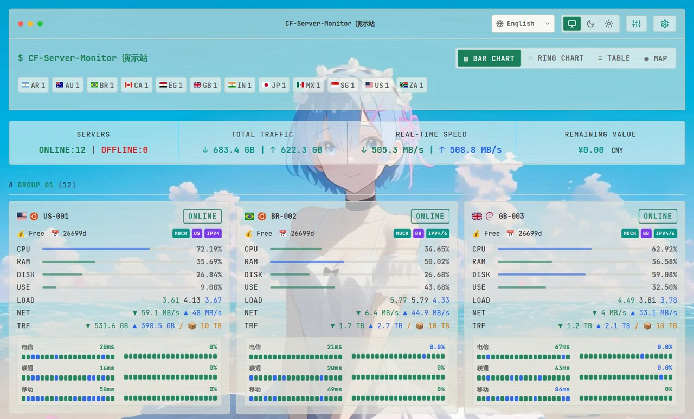
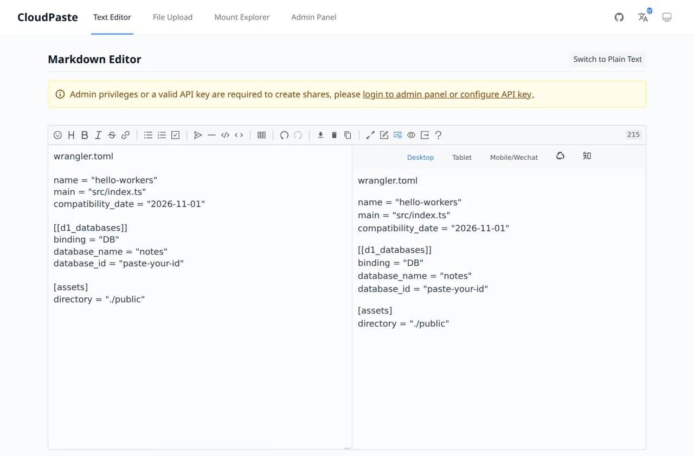
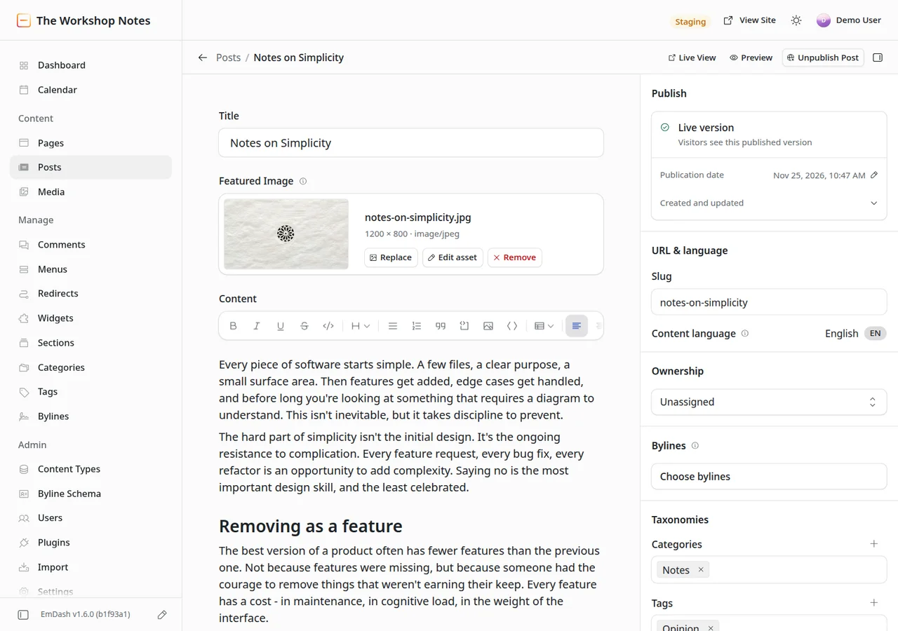
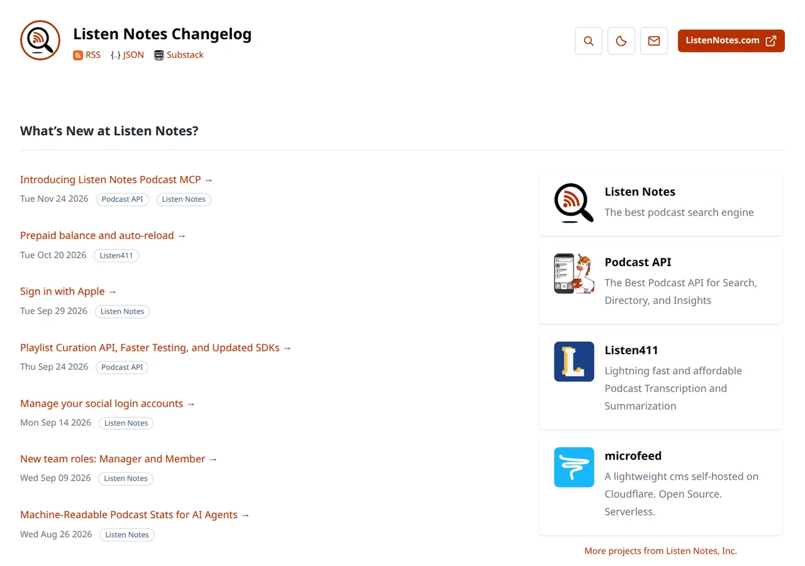
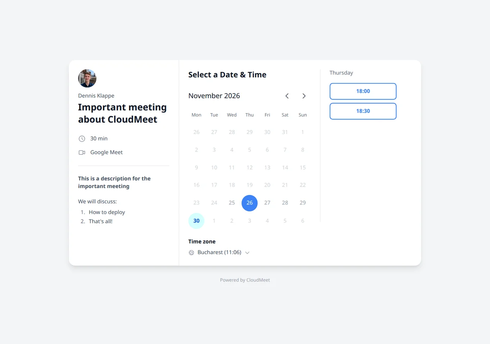
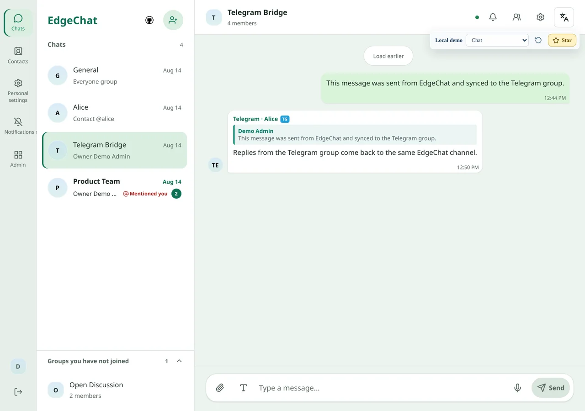

import Button from "../../components/widgets/Button.astro";
import Notice from "../../components/widgets/Notice.astro";
import Accordion from "../../components/widgets/Accordion.astro";
import ListCheck from "../../components/widgets/ListCheck.astro";

Cloudflare Workers has quietly become a self-hosting platform. Not a VPS replacement in the traditional sense, there's no SSH, no Docker, no persistent filesystem. But for apps that fit the serverless model (HTTP request in, response out, data in D1/R2/KV), it's a compelling option: global edge network, generous free tier, zero server maintenance, and your data stays in your own Cloudflare account.

This article catalogs 64 apps that run entirely on Cloudflare Workers, 63 open source, plus one source-available newcomer. Every project listed here was verified against its README, no "also supports Cloudflare" footnotes, these are Cloudflare-native applications built around Workers, D1, R2, KV, Durable Objects, and other Cloudflare primitives.

## Why self-host on Cloudflare Workers?

Before diving into the apps, here's why this model works:

<ListCheck>
<ul>
<li>**$0-5/month**, Cloudflare's free tier covers most personal use: 100k requests/day, 5 GB D1 storage, 10 GB R2 storage, 1 GB KV storage</li>
<li>**No server to maintain**, no OS patches, no Docker updates, no uptime monitoring, no disk space alerts</li>
<li>**Global edge network**, your app runs in 300+ data centers worldwide, sub-50ms latency everywhere</li>
<li>**Your data, your account**, everything lives in your Cloudflare account, not on someone else's SaaS</li>
<li>**Free HTTPS and custom domains**, automatic TLS certificates, bind any domain you own</li>
<li>**Scales to zero**, no idle costs when nobody's using your app</li>
</ul>
</ListCheck>

The tradeoff: no long-running processes, no WebSocket-heavy apps (Durable Objects help but have limits), and a 100 MB request body cap. Apps that need a persistent filesystem or heavy compute don't fit. But for CRUD apps, email clients, note-taking, analytics, and link shorteners, it's a sweet spot.

And if you outgrow the platform itself rather than the free tier, [OpenOrange](/open-orange-cloudflare-workers/) runs the same Worker and Durable Object code on your own servers, no rewrite required.

<YouTubeEmbed
  url="https://www.youtube.com/embed/PjgbkwzkWJw"
  label="Best Self Hosted Application for Cloudflare Workers"
/>

## Email Clients (13 apps)

The biggest category. Cloudflare Email Routing handles inbound mail, Email Sending handles outbound, and the Worker does everything in between.

### Cloud Mail, 16,565 ⭐

[maillab/cloud-mail](https://github.com/maillab/cloud-mail), Mail service for domains on Cloudflare. One domain is enough to create as many mailboxes as you like. Incoming mail reaches a Worker through Email Routing, and with catch-all pointed at the Worker every address on the domain can receive. Users read, reply and send attachments in a Vue web app, admins manage users and all mail with role-based permissions, and ECharts dashboards chart user and mail growth. Attachments default to KV, which caps writes on the free plan, so switch them to R2. The README comes in Chinese, English and Japanese.

**Stack:** Vue, Workers, D1, R2, KV, Email Routing, Turnstile
**License:** MIT

### Cloudflare Temp Email, 12,166 ⭐

[dreamhunter2333/cloudflare_temp_email](https://github.com/dreamhunter2333/cloudflare_temp_email), Temp mail service that grew into a full mail platform. The backend runs on Workers, the frontend on Pages, and a Rust WASM module parses incoming mail. Workers AI pulls verification codes and auth links out of messages. There is user registration with OAuth2 and passkeys, an admin panel, attachments, sending through SMTP or Resend, a Telegram bot, webhooks and a built-in skill that lets an AI agent use the mailbox.

**Stack:** Workers, Pages, D1, KV, R2, Email Routing, Workers AI
**License:** MIT

### Agentic Inbox, 8,637 ⭐

[cloudflare/agentic-inbox](https://github.com/cloudflare/agentic-inbox), Official Cloudflare project. A full email client with an AI agent that reads your inbox, searches conversations, and drafts replies. Each mailbox is isolated in its own Durable Object with SQLite storage. Attachments go to R2. Uses the Cloudflare Agents SDK and Workers AI (`@cf/moonshotai/kimi-k2.5`).

**Stack:** React 19, Hono, Durable Objects, R2, Email Routing, Workers AI
**License:** Apache-2.0

### Mailflare, 5,934 ⭐

[hieunc229/mailflare](https://github.com/hieunc229/mailflare), Full email client for your own domains, with an AI email agent (summaries, auto-triage, suggested replies) on the roadmap. The standout feature: domain onboarding through the Cloudflare API, adding a domain auto-provisions Email Routing DNS, SPF/DKIM, and sending subdomain records, and each mailbox you create gets its own routing rule automatically. Attachments live in R2 (10 MB per file), a Durable Object WebSocket hub pushes real-time inbox updates, and scheduled D1 backups run via Cloudflare Workflows. Also includes a send API with API keys, drafts, spam/trash, and full-text search. Paid Pro/Team licenses only unlock custom branding, everything else works without one.

**Stack:** Next.js (OpenNext), D1, R2, Queues, Durable Objects, Email Routing + Email Sending
**License:** Source-available (personal/internal use; free, with paid branding license)

### MoeMail, 2,835 ⭐

[beilunyang/moemail](https://github.com/beilunyang/moemail), Temporary addresses on domains you own. A mailbox lasts an hour, a day, three days or forever, and a scheduled Worker deletes expired ones with their mail. Users sign in with GitHub or Google, and roles decide who can create mailboxes, set up webhooks or get API keys. Inbound mail comes through Email Routing into D1, sending goes through Resend. English and Chinese interface.

**Stack:** Next.js, Pages, Workers, D1, KV, Email Routing, Resend
**License:** MIT

### mail2telegram, 912 ⭐

[tbxark/mail2telegram](https://github.com/tbxark/mail2telegram), Forwards a domain's mail to Telegram. Each message lands in your chat with the subject, sender and recipient, plus buttons to preview the body, get an AI summary or open the Mini App, where the history, R2 attachments and filter settings live. Reply to a pushed message in Telegram and it goes back to the sender through Resend. On the free plan keep attachments under about 2 MB, because parsing costs CPU time per MB.

**Stack:** Workers, D1, R2, Email Routing, Workers AI, Resend
**License:** MIT

### HQBase, 354 ⭐

[HQBase/hqbase](https://github.com/HQBase/hqbase), Shared email workspace for teams. Multi-domain setup, shared mailboxes, team access controls, drafts, audit history, and an OAuth-protected MCP server. Has a "Deploy to Cloudflare" button.

**Stack:** TypeScript, D1, R2, Better Auth
**License:** AGPL-3.0

### QuickInbox, 430 ⭐

[DivinPrince/quickinbox](https://github.com/DivinPrince/quickinbox), Self-hosted email for your own domain (formerly QuickMail). Supports both Resend and Cloudflare Email Service as providers. Features include threading, attachments (R2), safe HTML rendering, multiple domains/users, delivery status tracking, REST API, CLI, and MCP server. Desktop notifications via Web Push.

**Stack:** SvelteKit, D1, R2, Hono
**License:** MIT

### SaaSMail, 274 ⭐

[choyiny/saasmail](https://github.com/choyiny/saasmail), Centralized inbox for SaaS teams. One unified timeline per customer, marketing, notifications, and support emails collapsed into a single view. Features email sequencing (drip campaigns), templates with `{{variable}}` interpolation, suppressions/unsubscribe, per-inbox forwarding, and an MCP server. Supports Cloudflare Email Sending, Resend, Bavimail, and Postmark.

**Stack:** React, Hono, D1, R2, Queues, Durable Objects, Drizzle
**License:** Apache-2.0

### Email Explorer, 168 ⭐

[G4brym/email-explorer](https://github.com/G4brym/email-explorer), Full-stack email client with rich text editor, reply/forward, folder organization, contacts, full-text search, and multi-user support with RBAC. Each mailbox is its own Durable Object. Smart auth mode: first user becomes admin, registration closes after.

**Stack:** Vue.js 3, Hono, Durable Objects, R2, D1
**License:** MIT

### Tempik, 116 ⭐

[hirotomasato/tempik](https://github.com/hirotomasato/tempik), Disposable temp email service. Uses Cloudflare Email Workers to receive inbound email, D1 for storage, and serves a clean web UI from the edge. Zero cost on the free tier. Good for sign-up verification, testing, and privacy.

**Stack:** Hono, D1, Workers Static Assets
**License:** MIT

### ni-mail, 85 ⭐

[mskatoni/ni-mail](https://github.com/mskatoni/ni-mail), Minimal email receiver. A single Cloudflare Worker that receives emails via Email Routing and exposes an HTTP API to read them. Uses KV for storage (last 50 emails). No database, no frontend, no JWT, just `curl /latest` with an API key. Perfect for automation and scripts.

**Stack:** Workers + KV, postal-mime
**License:** Apache-2.0

### OmniMail, 275 ⭐

[mibgb65-cloud/OmniMail](https://github.com/mibgb65-cloud/OmniMail), Multi-domain webmail with a full permission model (super admin, admin, user, temporary). Features include iCloud Hide My Email integration, Chrome extension for floating email panel, Resend/SendFlare for sending, D1 backup/restore, and Turnstile protection. Chinese-first but has English UI.

**Stack:** React, Hono, D1, R2, Queues, Workflows
**License:** MIT

## Notes & Knowledge Management (6 apps)

### EdgeEver, 3,179 ⭐

[tianma-if/edgeever](https://github.com/tianma-if/edgeever), Open-source Evernote alternative. Classic three-pane layout, rich text + Markdown editor, MCP integration, native iOS/Android/Mac apps, PWA, web clipper (Chrome/Edge/Firefox), multi-account support, and ZIP backup/export. Runs within Cloudflare's free quotas. Also supports Docker deployment.

**Stack:** React, TipTap, Hono, D1, R2, Electron (desktop), Expo (Android), SwiftUI (iOS)
**License:** AGPL-3.0

### Second Brain, 857 ⭐

[rahilp/second-brain-cloudflare](https://github.com/rahilp/second-brain-cloudflare), One shared memory layer for Claude, ChatGPT, Cursor, and every other AI tool. Stores memories with semantic search (Vectorize), connects via MCP with OAuth, syncs from Notion, calendars, email, Obsidian, browser extension, and iOS shortcuts. Desktop app for Mac/Windows. Product Hunt #3 Product of the Day.

**Stack:** Workers, D1, Vectorize, KV, Workers AI
**License:** MIT

### YAOS, 1,077 ⭐

[kavinsood/yaos](https://github.com/kavinsood/yaos), Real-time sync engine for Obsidian powered by CRDTs (Yjs). No terminal needed, click "Deploy to Cloudflare" and you're syncing. Uses Durable Objects for live vault state, R2 for attachments and daily snapshots. Zero-config authentication. Replaces Obsidian Sync ($96/year) with a free, self-deployed alternative.

**Stack:** Workers, Durable Objects, R2, Yjs CRDT
**License:** 0BSD

### Inkstone, 1,180 ⭐

[shuaiplus/inkstone](https://github.com/shuaiplus/inkstone), Self-hosted Markdown notebook with bidirectional links, backlinks, wiki links, block references, relationship graph, offline editing, multi-device sync, semantic search (Workers AI), public sharing, and WebDAV/S3 backups. Full-featured editor with CodeMirror 6, focus mode, typewriter mode, and Mermaid diagram rendering.

**Stack:** React, Hono, D1, R2, KV, Durable Objects, CodeMirror 6
**License:** LGPL-3.0

### Memos Worker, 255 ⭐

[souvenp/memos-worker](https://github.com/souvenp/memos-worker), Cloudflare-powered notes and knowledge base inspired by Memos. Full Markdown support, file attachments (R2), public sharing, Telegram bot integration, full-text search, timeline/calendar views, contribution heatmap, and a knowledge base (docs) module. Highly customizable themes.

**Stack:** Workers, D1, R2, KV
**License:** Not specified

### FlareMo, 352 ⭐

[realchendahuang/FlareMo](https://github.com/realchendahuang/FlareMo), Cloudflare-native PKM with Memos-compatible API. Better Auth for authentication, PWA with offline support, MCP endpoint, and OpenAPI output. Designed to run on a free Cloudflare account: 5 GB D1 (2.5 million notes), 10 GB R2 (5,000-10,000 images). Chinese-first with English docs.

**Stack:** React, Vite, Hono, D1, R2, Drizzle, Better Auth
**License:** MIT

## Password Manager (1 app)

### NodeWarden, 4,137 ⭐

[shuaiplus/nodewarden](https://github.com/shuaiplus/nodewarden), Bitwarden-compatible server on Cloudflare Workers. Works with all official Bitwarden clients (desktop, mobile, browser extension). Features include TOTP (with Steam support), PWA/offline mode, passkey login, real-time push sync, attachments (R2 or KV), import/export, cloud backup center (WebDAV/S3), device management, and multi-user support. One-click deploy via Cloudflare dashboard.

**Stack:** TypeScript, D1, R2 (or KV), Preact (web vault)
**License:** LGPL-3.0

<Notice type="info" title="NodeWarden vs Vaultwarden">
NodeWarden replaces Vaultwarden for the Cloudflare-native stack. Vaultwarden needs a VPS with Docker; NodeWarden runs on Workers with D1. Same Bitwarden clients, zero server maintenance.
</Notice>

## Auth & 2FA (2 apps)

Sign-in for the apps you build, plus a two-factor code vault.

### Melody Auth, 657 ⭐

[ValueMelody/melody-auth](https://github.com/ValueMelody/melody-auth), OAuth and authentication server for your own apps. Ships an admin panel, a server-to-server REST API, an embedded auth flow, and SDKs for React, Angular, Vue and plain web that handle PKCE. Passwordless sign-in and refresh token revocation are supported. The same codebase also self-hosts on Node.js with Redis and PostgreSQL.

**Stack:** Workers, D1, KV
**License:** MIT

### 2FA, 465 ⭐

[wuzf/2fa](https://github.com/wuzf/2fa), TOTP and HOTP codes in a PWA backed by a Worker in your own account. Add secrets by scanning a QR code, pasting a screenshot or typing a Base32 key. Import from Google Authenticator, Aegis, 2FAS, Bitwarden, LastPass Authenticator, andOTP or Ente Auth, and export to TXT, JSON, CSV, HTML or Google migration QR codes. With `ENCRYPTION_KEY` set, the Worker encrypts secrets with AES-GCM. Works offline and comes in 15 languages. Chinese README with English docs.

**Stack:** Workers, KV, Durable Objects, Cron Triggers
**License:** MIT

## Link Shorteners & Analytics (5 apps)

### Sink, 7,262 ⭐

[miantiao-me/Sink](https://github.com/miantiao-me/Sink), The most-starred link shortener on this list. Link shortener with analytics, AI-powered slug generation (Workers AI), custom slugs, UTM builder, password protection, device/geo-based redirection, QR codes, real-time 3D globe analytics, and multi-language UI. Uses D1 as primary database with KV as read cache. Already covered in detail in our [Sink installation guide](/sink-install/).

**Stack:** Nuxt 4, D1, KV, R2, Workers Analytics Engine, Workers AI
**License:** AGPL-3.0

### Counterscale, 2,212 ⭐

[benvinegar/counterscale](https://github.com/benvinegar/counterscale), Cookie-free web analytics in the Umami mold. Pageviews go into Workers Analytics Engine, a CLI wizard deploys it, and a nightly job copies the data to R2 so history outlasts Analytics Engine's 90-day retention. Sites load `tracker.js` from your deployment or use the `@counterscale/tracker` npm package. The dashboard shows pageviews, referrers and engagement per site, with no cookies and no fingerprinting.

**Stack:** Workers, R2, Analytics Engine, Cron Triggers
**License:** MIT

### InsightFlare, 755 ⭐

[RavelloH/InsightFlare](https://github.com/RavelloH/InsightFlare), Analytics with more reporting than most Workers counters: funnels, user journeys, real-time visitors, performance metrics, custom events and AI-agent access. The tracking script is about 3 KB gzipped and never stores raw IP addresses. Geolocation comes from Cloudflare, and visitor identifiers expire sooner in regions with stricter privacy rules. The README puts the free quotas at about 100,000 visits a day.

**Stack:** Workers, D1, R2, KV, Durable Objects, Analytics Engine
**License:** MIT

*InsightFlare's demo workspace, on the site overview.*

### Relay, 70 ⭐

[YuriCrystal/relay](https://github.com/YuriCrystal/relay), Link shortener focused on marketing attribution. Cookieless conversion tracking via `/track` postback, A/B split testing, device/geo routing, `/suffix` source tracking, FB Pixel/GA4/GTM retargeting interstitials, unique visitor counting, and CSV export. Single-file admin dashboard (zero build, zero dependencies). Privacy-first: no cookies, no IP stored, no raw User-Agent.

**Stack:** Workers, D1 (single `worker.js` + `index.html`)
**License:** MIT

### Analytics, 39 ⭐

[fayazara/analytics](https://github.com/fayazara/analytics), Privacy-first, cookieless web analytics for personal projects. Single owner, unlimited sites. Uses D1 for storage, a Durable Object for live visitor count (WebSocket), and a Cron Trigger for daily rollups. Dashboard built with Kumo (`@cloudflare/kumo`). Tracks pages, referrers, UTM, devices, locations, and custom events. ~2KB tracking snippet.

**Stack:** TanStack Start, D1, Durable Objects, Drizzle ORM
**License:** Not specified

## Uptime & Status Monitoring (3 apps)

Your own UptimeRobot. Checks run from Cron Triggers, results land in D1 or KV, and the status page is served from the same account.

### UptimeFlare, 3,953 ⭐

[lyc8503/UptimeFlare](https://github.com/lyc8503/UptimeFlare), Checks websites and TCP ports every minute from a cron-triggered Worker and publishes the results on a status page with response-time charts, uptime percentages and incident history. Monitors live in a TypeScript config file, and downtime alerts go to Telegram and other webhooks. HTTP monitors accept custom methods, headers and bodies, and can require a status code or a keyword in the response. History goes back 90 days. Deploys through GitHub Actions.

**Stack:** Workers, Pages, D1, Durable Objects, Cron Triggers
**License:** Apache-2.0

*UptimeFlare's status page on the author's public instance.*

### CF-Server-Monitor, 3,692 ⭐

[huilang-me/CF-Server-Monitor](https://github.com/huilang-me/CF-Server-Monitor), Server monitoring with a reporting agent on each machine. Agents report CPU, memory, disk, network and latency to a Worker, which stores the data in D1 and pushes live updates to browsers over WebSocket through a Durable Object. It also alerts on resource use, monthly traffic and server expiry dates. The Go agent only reports metrics, has no remote command channel, runs without root and covers Linux, OpenWrt, Synology DSM, FreeBSD, macOS and Windows. The README sizes the default 60-second interval at about 60 servers on the free plan.

**Stack:** Workers, D1, Durable Objects, Cron Triggers
**License:** MIT

*CF-Server-Monitor's demo dashboard, filled with mock servers.*

### Uptimer, 493 ⭐

[VrianCao/Uptimer](https://github.com/VrianCao/Uptimer), Probes websites, APIs and TCP ports as often as once a minute and alerts Discord, Slack, ntfy or any webhook. The public status page shows uptime percentages, latency charts, active incidents and scheduled maintenance. Each monitor sets its own interval and timeout, and global thresholds decide how many failures flip a state, which damps flapping. Deploys from a GitHub Actions workflow in a fork.

**Stack:** Workers, Pages, D1, Cron Triggers
**License:** MIT

## File Sharing & Pastebin (4 apps)

Files go to R2 with zero egress fees, metadata to D1 or KV.

### CloudFlare ImgBed, 6,962 ⭐

[MarSeventh/CloudFlare-ImgBed](https://github.com/MarSeventh/CloudFlare-ImgBed), Self-hosted image and file host that doubles as a file manager. It brings Telegram, Discord, R2, S3-compatible storage, Hugging Face and WebDAV into one interface, with authentication, folders, a REST API and WebDAV. The same core runs on Pages, Workers or Docker and keeps metadata in KV or D1. README in Chinese and English.

**Stack:** Pages or Workers, KV, D1, R2
**License:** MIT

### CloudPaste, 2,732 ⭐

[ling-drag0n/CloudPaste](https://github.com/ling-drag0n/CloudPaste), Markdown pastebin paired with a file explorer that mounts S3-compatible buckets, OneDrive, Google Drive, Telegram and other backends side by side. Shares can carry a password, an expiry time and a view limit. The editor handles GitHub-style Markdown, math formulas, flowcharts and mind maps, and exports to PDF, HTML, PNG or Word. Raw links behave like GitHub Raw, which makes it handy for hosting config files. Also runs on Docker.

**Stack:** Workers, D1, R2, Workflows
**License:** Apache-2.0

*CloudPaste's editor on a local Docker run, with a `wrangler.toml` as the paste.*

### pastebin-worker, 1,065 ⭐

[SharzyL/pastebin-worker](https://github.com/SharzyL/pastebin-worker), Pastebin with a CLI. Shares as few as four characters or a custom URL, syntax highlighting through highlight.js, client-side encryption, rendered Markdown, and a `/live#` mode where everyone on the link posts text and files to each other in real time, end to end encrypted. A Python `pb` script and an HTTP API cover the command line, and `doc/skill.md` packages the API for coding agents. The README has a cost table per Cloudflare free tier.

**Stack:** Workers, KV, R2, Durable Objects
**License:** MIT

### R2-Explorer, 658 ⭐

[g4brym/r2-explorer](https://github.com/g4brym/r2-explorer), Google Drive interface for your R2 buckets. Drag and drop uploads with multipart for large files and whole folders, right-click actions, in-browser preview for PDFs, images, text, Markdown and CSV, and in-place text editing. A share link publishes one file at a public URL with optional password, expiry and download limit. It can also receive mail through Email Routing and show the messages with their attachments.

**Stack:** Workers, R2, Email Routing, Cloudflare Access
**License:** MIT

## Blog & CMS (5 apps)

### EmDash, 14,584 ⭐

[emdash-cms/emdash](https://github.com/emdash-cms/emdash), Cloudflare's open-source Astro CMS, pitched as a spiritual successor to WordPress. It is an Astro integration that adds an admin panel, media library, passkey sign-in and plugins to a TypeScript site. Each plugin declares capabilities such as `content:read` or `email:send` in a manifest and runs in its own Worker isolate, so it can touch only what it declared. Content sits in D1, media in R2, and Cloudflare runs its own blog on it. Also works on any Node.js server with SQLite.

**Stack:** Astro, Workers, D1, R2, KV, Cron Triggers
**License:** MIT

*The EmDash post editor, captured from the project's local demo with its sample content.*

### microfeed, 4,143 ⭐

[microfeed/microfeed](https://github.com/microfeed/microfeed), Lightweight CMS from the Listen Notes team. Each site is one feed of items (podcast episodes, blog posts, image galleries, videos, documents or curated URLs) that shows up on a themeable website, in an RSS feed with Podcasting 2.0 tags and in a JSON Feed, so one install can run a podcast, a changelog or a link page. Content is edited in a browser dashboard or pushed by a local AI agent through `@microfeed/cli`. The README says hosting on Cloudflare is essentially free apart from the domain.

**Stack:** Workers, D1, R2, Queues, Cron Triggers
**License:** AGPL-3.0

*The Listen Notes changelog, an example microfeed site from the project's README.*

### Rin, 3,152 ⭐

[openRin/Rin](https://github.com/openRin/Rin), Personal blog from one Worker backed by D1. Posts are public, unlisted or visible only to the author, so the private ones double as synced drafts and notes. The browser editor autosaves a local draft per article, uploads pasted images to R2 or another S3 bucket, and turns inline tags like `#Blog` into post tags. Comments come with moderation and webhook notifications, and the blogroll checks friend links every 20 minutes. Sign-in is GitHub OAuth, deploys go through a GitHub Actions workflow in your fork.

**Stack:** Workers, D1, R2, Queues, Workers AI
**License:** MIT

### SonicJS, 1,808 ⭐

[SonicJs-Org/sonicjs](https://github.com/SonicJs-Org/sonicjs), Headless CMS built for Workers on Hono, TypeScript, D1, R2 and HTMX. You define the content model in TypeScript and SonicJS generates the REST API and admin UI. Content comes with a TinyMCE editor, version history with restore, scheduling, and a draft to published workflow with role-based permissions. A native MCP server lets Claude Code or Cursor read, create and publish content. MIT licensed with no paywalled features, and a Docker image with SQLite for running it elsewhere.

**Stack:** Hono, TypeScript, D1, R2, KV, HTMX
**License:** MIT

### Monolith, 351 ⭐

[one-ea/Monolith](https://github.com/one-ea/Monolith), Edge-native blog system on Cloudflare. Immersive Markdown editor, multi-platform import (WordPress/Ghost/Hexo/Hugo/Jekyll/Halo), dark/light themes, `⌘K` search, reaction emojis, reading progress bar, RSS, sitemap, JSON-LD SEO. Storage adapters for D1/Turso/PostgreSQL and R2/S3. MCP companion for AI-assisted writing.

**Stack:** Hono, React, Drizzle ORM, D1, R2, Vite
**License:** MIT

## Backend as a Service (1 app)

### Frostbase, 243 ⭐

[frostbase-dev/frostbase](https://github.com/frostbase-dev/frostbase), Open-source Firebase/Supabase alternative on Cloudflare (formerly Cloudflarebase). Each project gets its own Durable Objects for physical tenant isolation. Features: Better Auth (email/password, social sign-in, roles), JSON collections + typed SQL tables with live queries, remote config (feature flags), R2 file storage with signed URLs, and static site hosting. Use it hosted or self-host on your own Cloudflare account.

**Stack:** SvelteKit, Durable Objects, R2, Better Auth, Drizzle
**License:** Apache-2.0

## AI & Agents (6 apps)

### OpenSEO, 28,829 ⭐

[every-app/open-seo](https://github.com/every-app/open-seo), Open source alternative to Semrush and Ahrefs that also covers backlinks, competitor insights and AI visibility. Keyword research shows search volume, CPC and SERP analysis. It exposes an MCP server and ships Agent Skills that walk Claude Code, OpenClaw or Hermes through SEO tasks. Google Search Console and Google Analytics can be connected through a Google OAuth client. Each install brings its own DataForSEO API key, so the data is billed to you by DataForSEO. JavaScript-rendered site audits need Workers Paid.

**Stack:** Workers, D1, R2, KV, Durable Objects, Workflows
**License:** MIT

### ChatGPT-Telegram-Workers, 3,815 ⭐

[TBXark/ChatGPT-Telegram-Workers](https://github.com/TBXark/ChatGPT-Telegram-Workers), Telegram AI bot on one Worker and a single KV namespace. Providers, prompts, permissions, plugins and custom commands are managed in an admin panel instead of environment variables. Message it privately or add it to a group, it streams answers, keeps history per chat and can generate images. It speaks OpenAI Chat Completions, OpenAI Responses, Anthropic Messages and Workers AI formats, so any OpenAI-compatible endpoint such as DeepSeek, Groq or Mistral works. Chat history goes to KV, which caps writes on the free plan.

**Stack:** Workers, KV, Workers AI
**License:** MIT

### Talorys, 1,481 ⭐

[rociiu/talorys](https://github.com/rociiu/talorys), Single-user personal AI assistant. It chats with streaming responses, keeps a memory of facts you can view, edit and delete, and manages tasks, notes and projects from the UI or from chat. Describe a goal and it proposes a task plan as a card you can edit. Reminders, daily digests and routines run on Durable Object alarms and arrive as push notifications. All data lives in one SQLite-backed Durable Object, and everything except chat keeps working once the daily Workers AI quota is used up. Install with `npx create-talorys@latest`.

**Stack:** Pages, Workers, Durable Objects (SQLite), Workers AI, Agents SDK
**License:** MIT

### Company Brain, 1,139 ⭐

[supermemoryai/company-brain](https://github.com/supermemoryai/company-brain), Slack bot that remembers what people say in your channels. It answers with each asker's own permissions: questions in a public channel use the shared workspace memory, private channels add their own, and DMs can draw on your personal memory. It opens issues, reads pull requests or runs code in a sandbox, and write actions run under the asker's connection. It was a paid supermemory product and is now open source. The built-in sandbox needs Workers Paid, a Daytona key is the free alternative.

**Stack:** Workers, D1, KV, Durable Objects, Workers AI
**License:** Apache-2.0

### Open Managed Agents, 351 ⭐

[openma-ai/open-managed-agents](https://github.com/openma-ai/open-managed-agents), Open-source alternative to Claude Managed Agents. Drop-in compatible API, runs on Cloudflare Workers + Durable Objects or Docker. Features: sessions, sandboxes, tools, memory stores, encrypted vaults, MCP servers, Slack/GitHub/Linear integrations, and crash recovery. Write a harness, deploy, and the platform runs it.

**Stack:** Workers, Durable Objects, KV, R2, Hono
**License:** Apache-2.0

### Codra, 125 ⭐

[devarshishimpi/codra](https://github.com/devarshishimpi/codra), Self-hosted AI code review for GitHub pull requests. Listens to PR webhooks, runs AI-powered review jobs via Cloudflare Queues, posts inline findings back to the PR. Dashboard for inspecting jobs, repositories, model routing, and review history. Supports OpenAI, OpenRouter, Anthropic, Google, NVIDIA, and Cloudflare models.

**Stack:** Workers, Hono, React, Queues, Hyperdrive, KV, PostgreSQL
**License:** AGPL-3.0

## Dev Tools (5 apps)

### durable-git, 276 ⭐

[littledivy/durable-git](https://github.com/littledivy/durable-git), Git server written in TypeScript for Workers, also called dgit. Each repository is a Durable Object with its own SQLite database holding objects and refs. It speaks git smart HTTP to a stock client, renders a cgit-style web interface, and implements packfile parsing, delta resolution and Myers diff itself. Reads are public, pushes authenticate, and pushing to a name that doesn't exist creates the repository. Bind an R2 bucket and the packfiles move there, so storage isn't capped by the per-object database.

**Stack:** Workers, Durable Objects (SQLite), R2
**License:** MIT

### bicho, 213 ⭐

[bicho-fyi/bicho](https://github.com/bicho-fyi/bicho), Self-hosted error tracker, a Sentry replacement on one Worker. Send exception and error logs over OTLP/HTTP (JSON or protobuf), or straight from Sentry SDKs by swapping the DSN. Issues are grouped and inspected through the API or an MCP client, so it works without a dashboard or an OpenTelemetry Collector. Evidence stays in your own D1 database and R2 bucket, and the deploy button provisions both.

**Stack:** Workers, D1, R2
**License:** Apache-2.0

### ripgit, 172 ⭐

[deathbyknowledge/ripgit](https://github.com/deathbyknowledge/ripgit), Self-hosted Git remote built with Durable Objects. One DO per repo, SQLite storage, FTS5 search, delta compression (5-20x). Standard git operations (`push`, `clone`, `fetch`), web UI with file browser, commit history, diffs, syntax highlighting, and code search. Built in Rust with `workers-rs`. Agent-first: browsable pages negotiate `text/markdown` for curl and scripts.

**Stack:** Rust, WASM, Durable Objects, KV
**License:** AGPL-3.0

### ShareHTML, 137 ⭐

[jonesphillip/sharehtml](https://github.com/jonesphillip/sharehtml), Deploy HTML, Markdown, or code files from the CLI, get a shareable URL with live comments, reactions, and presence. Re-deploy to update content at the same URL. Uses R2 for storage, Durable Objects for per-document collaboration (comments, reactions, real-time presence via WebSocket). Cloudflare Access optional.

**Stack:** Bun (CLI), Workers, Durable Objects, R2
**License:** Apache-2.0

### Seeder, 124 ⭐

[danielsyauqi/Seeder](https://github.com/danielsyauqi/Seeder), Personal project manager with kanban tasks, client requests, a public client board, and a built-in MCP server. Features: rich text (TipTap), activity feed, roles/invites/notifications, white-labeling, and daily planner. Runs on Cloudflare Workers (D1 + R2) or a single Node VM.

**Stack:** Next.js, Drizzle ORM, Better Auth, D1, R2
**License:** MIT

## Browser SSH (3 apps)

SSH from a browser tab. The Worker opens a TCP socket to your server, each session lives in a Durable Object, and no relay VPS is needed.

### ternssh, 658 ⭐

[haradakashiwa/ternssh](https://github.com/haradakashiwa/ternssh), Draggable dashboard with a server list, xterm.js terminals, an SFTP file manager and live CPU, memory, disk, network and process panels. Servers and layouts are stored in D1. Servers sit in a tree with password or private-key auth, open in several terminal tabs each, and the SFTP panel edits remote files up to 2 MB in CodeMirror. A Docker image runs the same app outside Cloudflare. Long SSH sessions burn Durable Object duration, which the free plan caps per day.

**Stack:** Workers, D1, Durable Objects, Cloudflare Access
**License:** GPL-3.0-or-later

### CloudSSH, 522 ⭐

[newbietan/cloudssh](https://github.com/newbietan/cloudssh), Browser SSH client that implements SSH-2.0 itself in TypeScript on the Web Crypto API, over Cloudflare TCP sockets. Password, keyboard-interactive and key auth (Ed25519, ECDSA, RSA), host key verification on first connect, and it can reach machines without a public IP through a Cloudflare Tunnel. Each session runs in its own Durable Object, and idle sessions close after 30 minutes by default. Adds an SFTP file manager, saved servers and one-time share links. Chinese README.

**Stack:** Workers, Durable Objects, TCP Sockets, Turnstile
**License:** Apache-2.0

### EdgeSSH, 435 ⭐

[aozorae/EdgeSSH](https://github.com/aozorae/EdgeSSH), Single-admin SSH workspace through a Durable Object in your own account, with no relay server. Hosts, keys and saved commands are stored encrypted in D1, and sign-in is GitHub or Cloudflare Access. The terminal is xterm.js with keepalive, several text encodings and a shortcut bar for phones. Each host fingerprint has to be confirmed before any credentials are sent, and the keychain imports or generates Ed25519 keys. It also monitors processes and previews remote HTTP services. Chinese README.

**Stack:** Workers, D1, Durable Objects, TCP Sockets, Cloudflare Access
**License:** Apache-2.0

## Notifications (2 apps)

### bark-worker, 719 ⭐

[cwxiaos/bark-worker](https://github.com/cwxiaos/bark-worker), Bark server on a Worker. Bark is an iOS app that turns a simple HTTP request into a push notification, and this gives you the backend for it instead of the public one. It implements the full Bark API, with a D1 version (recommended) and a KV version. One deploy button, no server to keep alive.

**Stack:** Workers, D1 (or KV)
**License:** GPL-3.0

### Kukuroo, 131 ⭐

[saiday/kukuroo](https://github.com/saiday/kukuroo), Self-hosted Web Push service on a Cloudflare Worker. iOS and macOS notifications via Declarative Web Push (Safari only, iOS 18.4+, macOS 18.5+). No server to keep alive, no notification vendor, no native app. One `curl` POST sends a notification. Can be mounted inside an existing Worker. Claude Code plugin available.

**Stack:** Workers, KV
**License:** MIT

## Feedback & Roadmap (1 app)

### FeedLog, 207 ⭐

[linkcraftstudio/feedlog](https://github.com/linkcraftstudio/feedlog), Open-source feedback and roadmap tool (Canny/Featurebase alternative). Feedback boards with voting, public roadmap, AI-assisted changelog drafting, similar-idea detection via vector embeddings, and notifications. Deploys to Cloudflare Workers, Vercel, or Docker. Requires PostgreSQL 17+ with pgvector (Neon or Supabase work out of the box).

**Stack:** Nuxt 4, Drizzle ORM, PostgreSQL + pgvector, R2, Better Auth
**License:** MIT

## Scheduling & Reminders (2 apps)

### CloudMeet, 561 ⭐

[dennisklappe/CloudMeet](https://github.com/dennisklappe/CloudMeet), Calendly alternative that runs entirely on the free tier. It publishes a booking page where guests pick a slot checked against the host's Google or Outlook calendar. Each event type has its own duration, buffer, minimum notice and booking window, and bookings land in the calendar with a Google Meet or Teams link. Deploys from a GitHub template to Pages with D1 and KV, and a small cron Worker sends reminder emails.

**Stack:** Pages, Workers, D1, KV, Cron Triggers
**License:** MIT

*CloudMeet's public booking page with a date picked.*

### RenewHelper, 416 ⭐

[ieax/renewhelper](https://github.com/ieax/renewhelper), Renewal reminders for domains, servers and SaaS plans. One Worker, one KV namespace and a Cron Trigger that checks every item twice an hour. Reminders go out through Telegram, ntfy, Gotify, Bark, Resend email or webhooks. Each item runs on a day, month or year cycle, and when it comes due the app rolls the date forward or marks it disabled after a set number of days overdue. README in Chinese and English.

**Stack:** Workers, KV, Cron Triggers
**License:** MIT

## Media (1 app)

### CiviVideo, 26 ⭐

[bitoceango/civideo](https://github.com/bitoceango/civideo), Self-hosted, ad-free kids video streaming player with parental controls. Parents upload videos to Cloudflare R2; kids watch in a closed player, no recommendations, ads, comments, or external links. Native apps for iOS/iPadOS/macOS (SwiftUI) and Windows/Android (Tauri). Features: daily time limits, allowed time periods, eye protection reminders, audiobook support (text-to-speech via Doubao), and a commercial-grade video player.

**Stack:** Workers, R2, D1, SwiftUI, Tauri v2
**License:** MIT

## Team Chat (3 apps)

### EdgeChat, 1,472 ⭐

[aozorae/edgechat](https://github.com/aozorae/edgechat), Chat site for a team, project or small community: public and private groups, direct messages, file sharing and an admin console. Admins can bridge any group with a Telegram group in both directions. Message bodies and attachments are encrypted at rest on the server. Groups and DMs update in real time over WebSockets held by Durable Objects, with replies, @ mentions and voice messages. The Vue interface ships English and Chinese translations, and an Android app is published as an APK. Deploys through GitHub Actions. Chinese README.

**Stack:** Vue, Workers, D1, R2, KV, Durable Objects
**License:** GPL-3.0

*EdgeChat's public demo, in a group bridged to Telegram.*

### NodeCrypt, 906 ⭐

[shuaiplus/NodeCrypt](https://github.com/shuaiplus/NodeCrypt), End-to-end encrypted chat with a zero-knowledge server. The Worker relays ciphertext over WebSocket and keeps nothing, there is no database and no history, so a server admin can't read messages and late joiners see nothing from before they arrived. Rooms mix a password into the key exchange, members are notified when someone joins or leaves, and private DMs are invisible to the rest of the room. From the author of NodeWarden and Inkstone. One-click deploy, Docker image also available.

**Stack:** Workers, Durable Objects, WebSocket
**License:** ISC

### Ember, 184 ⭐

[NYLLON-SOFTWARE/ember-cloudflare](https://github.com/NYLLON-SOFTWARE/ember-cloudflare), Open-source team chat in the Slack/Campfire mold (rebuilt from 37signals' Campfire). Rooms, private rooms, DMs, threads, mentions, reactions, edits, rich text with code blocks and link previews, and file uploads up to 250 MB. Each room is its own Durable Object with its own SQLite database, so quiet rooms hibernate and an idle workspace costs almost nothing. Bots get Slack-compatible incoming webhooks, point Alertmanager, Grafana, or your CI at them and existing payloads just work. An optional @ember assistant answers in-chat on Workers AI, or Claude/GPT/Gemini through AI Gateway. Installable PWA with Web Push, custom branding and CSS, join links, email-domain invites, Memberful support, and Turnstile for open sign-ups. Has a "Deploy to Cloudflare" button; the README estimates the free plan covers roughly 100 people sending 30 messages a day.

**Stack:** React 19, Durable Objects (SQLite per room; optional D1 backend), R2, Workers AI, Web Push, Turnstile
**License:** MIT

## App Store (1 app)

### Appflare, 258 ⭐

[appflare/appflare](https://github.com/appflare/appflare), An app store for your own Cloudflare account. Browse a catalog of 100+ open-source apps (several from this list, Sink included), install them from the browser, then manage updates, custom domains, and Cloudflare Access from one dashboard. Appflare provisions each app's D1/R2/KV resources, streams a live install log, supports version rollback, and installed apps keep running even if you remove Appflare itself. Three ways in: a hosted install page (no API token or repo copy needed), Cloudflare's Deploy button, or `npx create-appflare`.

**Stack:** TanStack Start (React), D1, KV, Workflows, Better Auth (passkeys), Drizzle
**License:** Apache-2.0

## Quick Comparison Table

| App | Category | ⭐ | D1 | R2 | KV | DO | Deploy Button |
|---|---|---|---|---|---|---|---|
| [OpenSEO](https://github.com/every-app/open-seo) | SEO | 28,829 | ✅ | ✅ | ✅ | ✅ |, |
| [Cloud Mail](https://github.com/maillab/cloud-mail) | Email | 16,565 | ✅ | ✅ | ✅ |, |, |
| [EmDash](https://github.com/emdash-cms/emdash) | CMS | 14,584 | ✅ | ✅ | ✅ |, | ✅ |
| [Cloudflare Temp Email](https://github.com/dreamhunter2333/cloudflare_temp_email) | Email | 12,166 | ✅ | ✅ | ✅ |, | ✅ |
| [Agentic Inbox](https://github.com/cloudflare/agentic-inbox) | Email | 8,637 |, | ✅ |, | ✅ | ✅ |
| [Sink](https://github.com/miantiao-me/Sink) | Links | 7,262 | ✅ | ✅ | ✅ |, | ✅ |
| [CloudFlare ImgBed](https://github.com/MarSeventh/CloudFlare-ImgBed) | Files | 6,962 | ✅ | ✅ | ✅ |, |, |
| [Mailflare](https://github.com/hieunc229/mailflare) | Email | 5,934 | ✅ | ✅ |, | ✅ | ✅ |
| [microfeed](https://github.com/microfeed/microfeed) | CMS | 4,143 | ✅ | ✅ |, |, |, |
| [NodeWarden](https://github.com/shuaiplus/nodewarden) | Passwords | 4,137 | ✅ | ✅ | ✅ |, | ✅ |
| [UptimeFlare](https://github.com/lyc8503/UptimeFlare) | Uptime | 3,953 | ✅ |, |, | ✅ |, |
| [ChatGPT-Telegram-Workers](https://github.com/TBXark/ChatGPT-Telegram-Workers) | AI | 3,815 |, |, | ✅ |, | ✅ |
| [CF-Server-Monitor](https://github.com/huilang-me/CF-Server-Monitor) | Uptime | 3,692 | ✅ |, |, | ✅ | ✅ |
| [EdgeEver](https://github.com/tianma-if/edgeever) | Notes | 3,179 | ✅ | ✅ |, |, | ✅ |
| [Rin](https://github.com/openRin/Rin) | Blog | 3,152 | ✅ | ✅ |, |, |, |
| [MoeMail](https://github.com/beilunyang/moemail) | Email | 2,835 | ✅ |, | ✅ |, | ✅ |
| [CloudPaste](https://github.com/ling-drag0n/CloudPaste) | Files | 2,732 | ✅ | ✅ |, |, |, |
| [Counterscale](https://github.com/benvinegar/counterscale) | Analytics | 2,212 |, | ✅ |, |, |, |
| [SonicJS](https://github.com/SonicJs-Org/sonicjs) | CMS | 1,808 | ✅ | ✅ | ✅ |, | ✅ |
| [Talorys](https://github.com/rociiu/talorys) | AI | 1,481 |, |, |, | ✅ |, |
| [EdgeChat](https://github.com/aozorae/edgechat) | Chat | 1,472 | ✅ | ✅ | ✅ | ✅ |, |
| [Inkstone](https://github.com/shuaiplus/inkstone) | Notes | 1,180 | ✅ | ✅ | ✅ | ✅ |, |
| [Company Brain](https://github.com/supermemoryai/company-brain) | AI | 1,139 | ✅ |, | ✅ | ✅ | ✅ |
| [YAOS](https://github.com/kavinsood/yaos) | Sync | 1,077 |, | ✅ |, | ✅ | ✅ |
| [pastebin-worker](https://github.com/SharzyL/pastebin-worker) | Files | 1,065 |, | ✅ | ✅ | ✅ |, |
| [mail2telegram](https://github.com/tbxark/mail2telegram) | Email | 912 | ✅ | ✅ |, |, | ✅ |
| [NodeCrypt](https://github.com/shuaiplus/NodeCrypt) | Chat | 906 |, |, |, | ✅ | ✅ |
| [Second Brain](https://github.com/rahilp/second-brain-cloudflare) | AI Memory | 857 | ✅ |, | ✅ |, | ✅ |
| [InsightFlare](https://github.com/RavelloH/InsightFlare) | Analytics | 755 | ✅ | ✅ | ✅ | ✅ | ✅ |
| [bark-worker](https://github.com/cwxiaos/bark-worker) | Push | 719 | ✅ |, | ✅ |, | ✅ |
| [R2-Explorer](https://github.com/g4brym/r2-explorer) | Files | 658 |, | ✅ |, |, | ✅ |
| [ternssh](https://github.com/haradakashiwa/ternssh) | SSH | 658 | ✅ |, |, | ✅ | ✅ |
| [Melody Auth](https://github.com/ValueMelody/melody-auth) | Auth | 657 | ✅ |, | ✅ |, |, |
| [CloudMeet](https://github.com/dennisklappe/CloudMeet) | Scheduling | 561 | ✅ |, | ✅ |, |, |
| [CloudSSH](https://github.com/newbietan/cloudssh) | SSH | 522 |, |, |, | ✅ |, |
| [Uptimer](https://github.com/VrianCao/Uptimer) | Uptime | 493 | ✅ |, |, |, |, |
| [2FA](https://github.com/wuzf/2fa) | 2FA | 465 |, |, | ✅ | ✅ | ✅ |
| [EdgeSSH](https://github.com/aozorae/EdgeSSH) | SSH | 435 | ✅ |, |, | ✅ |, |
| [QuickInbox](https://github.com/DivinPrince/quickinbox) | Email | 430 | ✅ | ✅ |, |, | ✅ |
| [RenewHelper](https://github.com/ieax/renewhelper) | Reminders | 416 |, |, | ✅ |, | ✅ |
| [HQBase](https://github.com/HQBase/hqbase) | Email | 354 | ✅ | ✅ |, |, | ✅ |
| [FlareMo](https://github.com/realchendahuang/FlareMo) | Notes | 352 | ✅ | ✅ |, |, | ✅ |
| [Monolith](https://github.com/one-ea/Monolith) | Blog | 351 | ✅ | ✅ |, |, |, |
| [Open Managed Agents](https://github.com/openma-ai/open-managed-agents) | AI | 351 |, | ✅ | ✅ | ✅ |, |
| [durable-git](https://github.com/littledivy/durable-git) | Git | 276 |, | ✅ |, | ✅ |, |
| [OmniMail](https://github.com/mibgb65-cloud/OmniMail) | Email | 275 | ✅ | ✅ |, |, | ✅ |
| [SaaSMail](https://github.com/choyiny/saasmail) | Email | 274 | ✅ | ✅ |, | ✅ |, |
| [Appflare](https://github.com/appflare/appflare) | App Store | 258 | ✅ |, | ✅ |, | ✅ |
| [Memos Worker](https://github.com/souvenp/memos-worker) | Notes | 255 | ✅ | ✅ | ✅ |, |, |
| [Frostbase](https://github.com/frostbase-dev/frostbase) | BaaS | 243 |, | ✅ |, | ✅ | ✅ |
| [bicho](https://github.com/bicho-fyi/bicho) | Errors | 213 | ✅ | ✅ |, |, | ✅ |
| [FeedLog](https://github.com/linkcraftstudio/feedlog) | Feedback | 207 |, | ✅ |, |, | ✅ |
| [Ember](https://github.com/NYLLON-SOFTWARE/ember-cloudflare) | Chat | 184 | ✅ | ✅ |, | ✅ | ✅ |
| [ripgit](https://github.com/deathbyknowledge/ripgit) | Git | 172 |, |, | ✅ | ✅ |, |
| [Email Explorer](https://github.com/G4brym/email-explorer) | Email | 168 | ✅ | ✅ |, | ✅ | ✅ |
| [ShareHTML](https://github.com/jonesphillip/sharehtml) | Sharing | 137 |, | ✅ |, | ✅ |, |
| [Kukuroo](https://github.com/saiday/kukuroo) | Push | 131 |, |, | ✅ |, |, |
| [Codra](https://github.com/devarshishimpi/codra) | Code Review | 125 |, |, | ✅ |, |, |
| [Seeder](https://github.com/danielsyauqi/Seeder) | Projects | 124 | ✅ | ✅ |, |, |, |
| [Tempik](https://github.com/hirotomasato/tempik) | Email | 116 | ✅ |, |, |, |, |
| [ni-mail](https://github.com/mskatoni/ni-mail) | Email | 85 |, |, | ✅ |, | ✅ |
| [Relay](https://github.com/YuriCrystal/relay) | Links | 70 | ✅ |, |, |, | ✅ |
| [Analytics](https://github.com/fayazara/analytics) | Analytics | 39 | ✅ |, |, | ✅ |, |
| [CiviVideo](https://github.com/bitoceango/civideo) | Video | 26 | ✅ | ✅ |, |, |, |

## What Cloudflare services these apps use

Understanding the building blocks helps you evaluate what fits your needs:

<Accordion label="Cloudflare D1, SQLite database" group="services">
D1 is Cloudflare's serverless SQLite database. Free tier: 5 GB storage, 5 million row reads/day, 100k row writes/day. Used by most apps on this list for structured data, user accounts, notes, links, email metadata, analytics rows. Think of it as the "Postgres of Cloudflare" for simple workloads.
</Accordion>

<Accordion label="Cloudflare R2, Object storage" group="services">
S3-compatible object storage with zero egress fees. Free tier: 10 GB storage, 1 million Class A operations/month, 10 million Class B operations/month. Used for file attachments, email bodies, images, video files, backups, and static assets. The zero egress fee is the killer feature, serving files to users costs nothing.
</Accordion>

<Accordion label="Cloudflare KV, Key-value store" group="services">
Global, low-latency key-value store. Free tier: 1 GB storage, 100k reads/day, 1,000 writes/day. Best for read-heavy, eventually-consistent data: configuration, session tokens, redirect caches, subscription data. Not suitable for data that needs strong consistency.
</Accordion>

<Accordion label="Durable Objects, Stateful compute" group="services">
The most powerful primitive on this list. Each Durable Object is a single-instance actor with its own SQLite database (up to 10 GB), WebSocket support, and hibernation. Used for per-user mailboxes, per-document collaboration, per-repo git storage, and live visitor counts. Free tier: 1 million requests/month, 400,000 GB-seconds of compute.
</Accordion>

<Accordion label="Cloudflare Queues, Message queues" group="services">
Pub/sub message queues for async processing. Used by email apps (SaaSMail, OmniMail, Mailflare) for sequence email scheduling and inbound email parsing. Free tier: 100k operations/month.
</Accordion>

## How to deploy any of these apps

The deployment pattern is the same for almost every project on this list:

1. **Fork the repo** to your GitHub account
2. **Connect to Cloudflare Workers & Pages**, import the fork
3. **Create resources**, D1 database, R2 bucket, KV namespace (the deploy button or setup script usually handles this)
4. **Set secrets**, auth tokens, API keys via `wrangler secret put`
5. **Deploy**, `wrangler deploy` or let Workers Builds handle it

Most projects have a "Deploy to Cloudflare" button that automates steps 1-4. The whole process takes 5-15 minutes.

An alternative for catalog apps: install [Appflare](#appflare--258-) first and use it as an app store, it provisions resources, tracks updates, and rolls back bad versions for you.

<Notice type="warning" title="Custom domains recommended">
The default `*.workers.dev` domain is blocked in some regions. For production use, bind a custom domain you own. Cloudflare handles TLS automatically.
</Notice>

## What doesn't work on Cloudflare Workers

Not every self-hosted app fits the serverless model. Here's what to avoid:

- **Docker-based apps**, no container runtime on Workers (use a VPS or [Dokploy](/dokploy-docker-compose-app/))
- **Database-heavy apps** needing Postgres/MySQL, D1 is SQLite-only; apps like FeedLog work around this with external Postgres via Hyperdrive
- **Long-running processes**, no background daemons, no cron longer than a few seconds (use Queues + Durable Objects for async work)
- **Apps needing a filesystem**, no persistent disk; use R2 for files
- **Real-time collaboration at scale**, Durable Objects have a 30-second timeout and memory limits; fine for small teams, not for Google Docs-scale editing

## Final thoughts

The Cloudflare self-hosting ecosystem has matured fast. A year ago, Sink and a handful of experiments were all there was. Now there are production-quality email clients, password managers, note-taking apps, uptime monitors, file hosts, browser SSH clients, a team chat, an app store for installing everything else, AI agent platforms, and even a Git remote, all running on Workers.

The common thread: these apps are built by developers who wanted to self-host something without running a server. The Cloudflare free tier is generous enough for personal use, and the paid plan ($5/month for Workers Paid) unlocks Durable Objects and higher limits for team use.

If you're already running a [Docker-based self-hosting stack](/docker-containers-home-server/), these apps complement it, they handle the lightweight, always-on services (email, notes, link shortening) while your VPS handles the heavy lifting (media servers, databases, CI/CD).

<Button text="Star this article on GitHub" link="https://github.com/bitdoze/bitdoze.com" variant="outline" color="blue" size="md" />
