import Button from "@components/widgets/Button.astro";
import Notice from "@components/widgets/Notice.astro";
import ListCheck from "@components/widgets/ListCheck.astro";
import Accordion from "@components/widgets/Accordion.astro";

On October 17, someone posted a before-and-after photo of their parents' Xiaomi TV. The "before" was the usual wall of sponsored rows and app tiles nobody installed. The "after" looked like an Apple TV home screen, and the whole cleanup had been done by Claude Code over Wi-Fi. That post hit 7.4 million views, and in about a week the repo behind it ([cleanyourtv](https://github.com/Gathin23/cleanyourtv)) became the #1 trending project on GitHub with 36,000+ stars and press coverage in 197 articles.

It also started a wave. Free-my-tv, aerial-tv, dumbtv, tv-detox, Tigris, CleanFrame and a phone-app companion all appeared or blew up in the same window. The pitch is the same everywhere: your TV's home screen is ad inventory the manufacturer sells, and on most sets you can take it back without rooting anything.

This article sorts the repos by TV operating system, shows what each interface looks like, and gives you the exact steps to run them (or to build your own).

## Pick your repo

| Repo | TV OS | What it does | Stars |
|---|---|---|---|
| [cleanyourtv](https://github.com/Gathin23/cleanyourtv) | Android TV, Google TV, Fire TV | Debloat over ADB + Apple TV-style launcher | 36.7k |
| [aerial-tv](https://github.com/pengchujin/aerial-tv) | Android TV (China-market sets) | tvOS-style launcher, takes over on boot | 5.6k |
| [free-my-tv](https://github.com/simbasjungles/free-my-tv) | Google TV, LG webOS, Samsung Tizen | Ad-free home screen with weather and picks | 4.7k |
| [dumbtv](https://github.com/humblemuzzu/dumbtv) | Fire TV, Android TV | Debloat + on-device DNS filter + 54 KB launcher | 1.6k |
| [tv-detox](https://github.com/Ansub/tv-detox) | Android TV, Google TV | A paste-able agent prompt + tiny launcher | 1.6k |
| [cleanyourtv-app](https://github.com/udhaykumarbala/cleanyourtv-app) | Android TV, Google TV, Fire TV | Run the cleanyourtv cleanup from your phone | 653 |
| [CleanFrame](https://github.com/nthnclrk/CleanFrame) | Samsung Tizen (The Frame) | Personal home screen, built to fork | 627 |
| [Tigris](https://github.com/lesnolie/Tigris) | Android TV, LG webOS (preview) | tvOS 27-style launcher, Liquid Glass dock | 492 |

Roku and Apple TV aren't in the table on purpose. Neither allows a third-party home screen, and nothing below works on them. More on that at the end.

## How all of these actually work

Every Android-based repo uses the same three moves:

1. **Enable ADB on the TV.** Android TVs run the same debug bridge as Android phones. Go to Settings → Device Preferences → About, press OK on **Build** seven times, then turn on **USB debugging** (and **Network/Wireless debugging** if it exists) in Developer options. On a Fire TV it's Settings → My Fire TV → About → press the device name 7 times → Developer Options → ADB debugging.
2. **Disable the junk, don't delete it.** The scripts run `pm disable-user` on the manufacturer's telemetry, ad services, sponsored rows and preloaded apps. Nothing is uninstalled, so a restore script can put every byte back.
3. **Install a new launcher.** A small APK (54 KB to ~500 KB) registers as a HOME app and becomes the screen you see when you press the home button.

That middle step is why this works at all. Modern TVs ship 20 to 60 packages that exist only to show ads, count what you watch (ACR fingerprinting) or push sponsored content. Turning them off is reversible and needs no root.

<Notice type="warning" title="Read this before you start">

- **ADB on Wi-Fi is plaintext on port 5555.** Anyone on your LAN can ask to control the TV while it's on. Accept the prompt once, do the work, then turn USB/Network debugging back off.
- **On Google TV and Chromecast, never disable the stock home screen** (`com.google.android.apps.tv.launcherx`). Several people got boot-loops that only a factory reset fixed. Every tool below keeps it enabled by default; the new launcher just sits on top.
- **Don't disable Xiaomi's PatchWall** (`com.mitv.tvhome`) either. Same failure mode: black screen at boot.
- **OLED owners: keep a screensaver on.** A static launcher left on for hours can burn in.
- **Boot-time ads can't be removed by any of this.** The video some TVs play while the firmware loads is baked in. What you're replacing is everything after it.

</Notice>

## Android TV and Google TV

This is where almost everything works, because Google's platform allows third-party home screens. Sony, TCL, Hisense, Philips, Xiaomi/Redmi global models, Chromecast with Google TV, Google TV Streamer, NVIDIA Shield, onn/Walmart boxes and most Android projectors are all covered.

### cleanyourtv (36.7k stars, the one that started it)

[cleanyourtv](https://github.com/Gathin23/cleanyourtv) is the viral repo, renamed from tv-vibehack on October 19. It's not a binary you run. It's a `PROMPT.md` you paste into a coding agent (Claude Code, Codex or Gemini CLI), plus tested disable lists for 316 TV models across 89 brands in `examples/`.

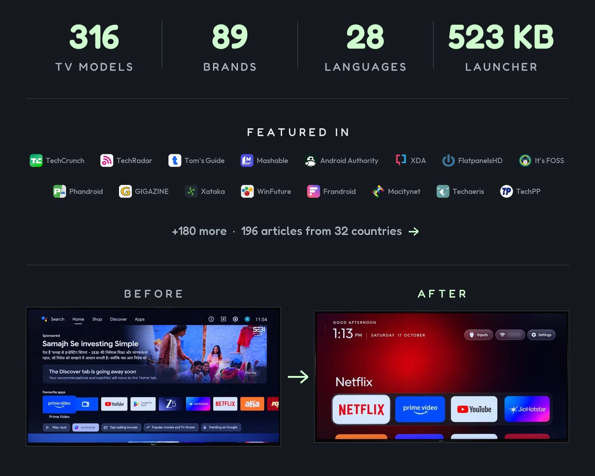

The flow takes about fifteen minutes:

1. Enable USB debugging on the TV as described above. Keep the TV on.
2. `git clone https://github.com/Gathin23/cleanyourtv` on a computer on the same Wi-Fi, and open that folder in your coding agent. Cloning matters: the agent reuses the repo's `tools/disable.sh` and `launcher/build-and-install.sh`, which is where the backup and restore logic lives.
3. Paste `PROMPT.md` and fill in your TV model. Accept "Allow USB debugging?" on the TV, then answer the checklist: which apps you use, dock size, whether to keep the voice assistant, Chromecast and updates.

The agent backs up your package list, disables the brand-specific junk, builds the 523 KB launcher and verifies each step by pulling screenshots off the TV. One line restores everything.

What you get is a pitch-black home screen: a four-app dock, a top shelf that names the focused app with an ambient glow, a grid that slides up on the Down key, Inputs/Wi-Fi/Settings buttons, and a thin clock. Themes (colors, wallpaper, dock size, column count) install without a rebuild, and there's an app library screen to add hidden apps back.

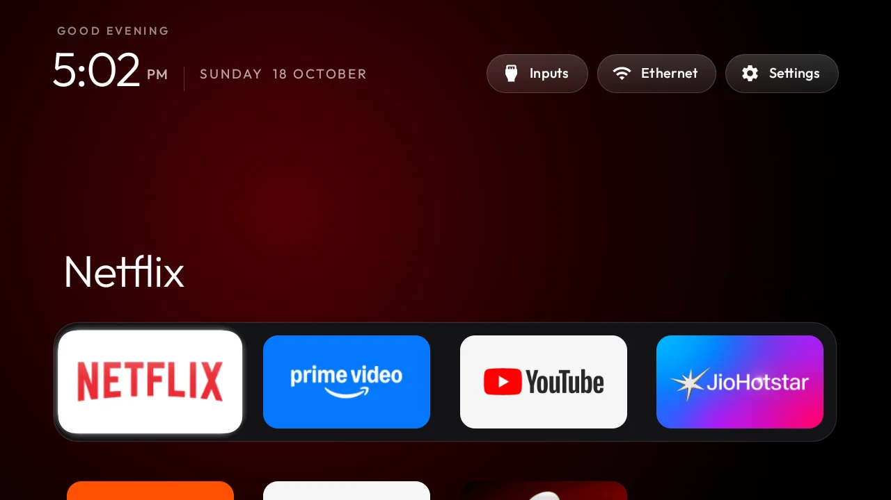

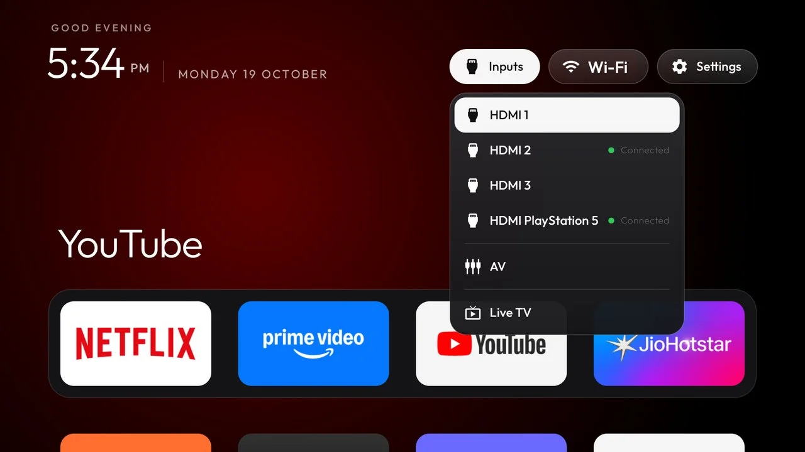

<Button text="Gathin23/cleanyourtv" link="https://github.com/Gathin23/cleanyourtv" variant="solid" color="blue" size="md" icon="github" />

### tv-detox (the cautious version)

[tv-detox](https://github.com/Ansub/tv-detox) is the same idea pushed furthest toward "just paste this." The README is one long prompt that tells the agent exactly what to do: back up, list every package in plain English before touching it, ask before every change, never disable Google Play services or the stock launcher, and remind you to turn debugging off at the end.

It's the best-documented of the bunch on failure modes (the launcherx boot-loop warning above comes from this repo), and it ships a small home screen plus `install.sh` / `undo.sh` if you'd rather run scripts directly. If the fully-automated cleanyourtv flow makes you nervous, this is the conservative entry point.

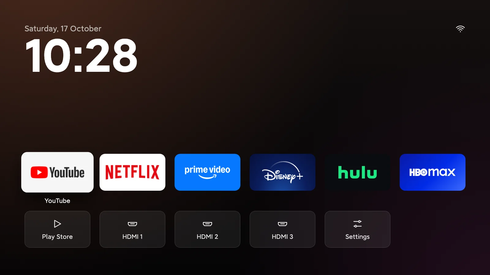

<Button text="Ansub/tv-detox" link="https://github.com/Ansub/tv-detox" variant="solid" color="blue" size="md" icon="github" />

### free-my-tv (Google TV, and the only real LG/Samsung option)

[free-my-tv](https://github.com/simbasjungles/free-my-tv) is a single home screen that runs on three platforms: Google TV/Android 8+, LG webOS 3+ and Samsung Tizen 2.4+ (2016 and newer Samsung sets). On Android it installs over ADB like everything else here; on LG and Samsung it goes through each vendor's official Developer Mode, covered in the OS sections below.

The feature list is longer than the others: a glass shelf of your apps, trending picks pulled from TMDB (you bring a free API key), a weather-and-crypto drawer, a light/dark theme that follows your city's real sunset, a screensaver that shows what you're watching, and your own photos pushed from a computer. The README claims 60 fps and 96 MB of RAM vs 242 MB for the stock home screen, measured on a 98" TCL.

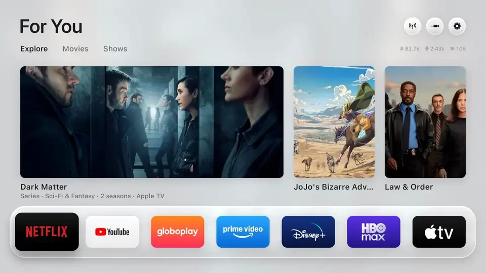

Undo is one button (Home Screen → Original), and if the launcher crashes three times in five minutes it hands control back to the stock UI by itself. For the trending picks you'll want to build it yourself with a free [TMDB](https://www.themoviedb.org/settings/api) key in `config.properties`; the release APK skips them.

<Button text="simbasjungles/free-my-tv" link="https://github.com/simbasjungles/free-my-tv" variant="solid" color="blue" size="md" icon="github" />

### Tigris (tvOS 27 look, heaviest feature set)

[Tigris](https://github.com/lesnolie/Tigris) is a Kotlin launcher that copies tvOS hard: five-column rounded icons that tilt and lift on focus, a Liquid Glass dock, a Control Center (network, standby, reboot, free memory, brightness, volume, HDMI inputs), app folders, Bing/Wallhaven/your-own wallpapers, photo-frame and Apple-style aerial video screensavers, and an update center that pulls releases from GitHub. It needs Android 9+ and is agent-installable.

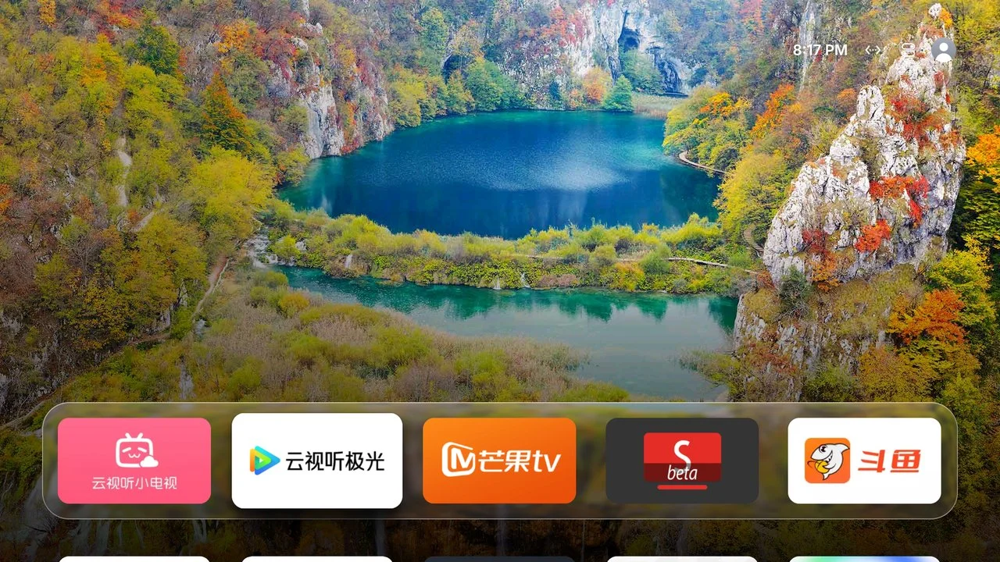

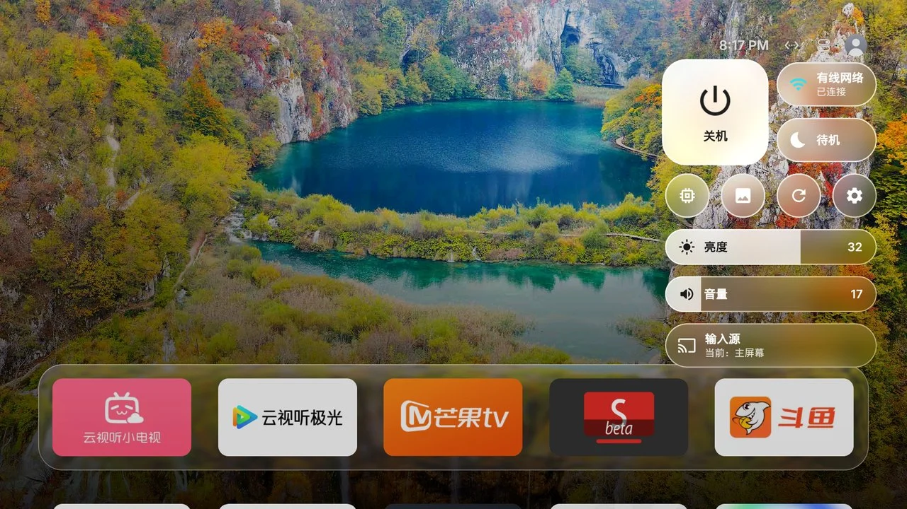

Two cautions from its own README: don't disable the stock launcher (the Xiaomi black-screen trap), and keep ADB on your LAN only. The repo is in Chinese with partial English docs, and its Top Shelf rows pull content from Chinese services (Bilibili, Douyu), so it's most useful if you're on those or just want the launcher mechanics.

<Button text="lesnolie/Tigris" link="https://github.com/lesnolie/Tigris" variant="solid" color="blue" size="md" icon="github" />

### aerial-tv (China-market Xiaomi, TCL and friends)

China-market Android TVs run heavily skinned systems (MIUI TV/PatchWall on Xiaomi, the TCL/FFalcon shell) where the normal "press Build 7 times" doesn't apply. [aerial-tv](https://github.com/pengchujin/aerial-tv) exists for those: per-brand instructions for opening ADB (Xiaomi hides it under Settings → Account & Security; TCL wants a directional-pad combo in a factory menu; Haier needs a button sequence on the set itself), a one-line install script, and a guard service that keeps the launcher as the boot home screen.

The launcher itself is another tvOS-style surface: clean grid, folders, Control Center, aerial video screensavers, wallpaper panel. It leaves the original launcher in the app list, so PatchWall or the TCL shell is one tile away.

| Stock Xiaomi home | Aerial after install |
|---|---|
| 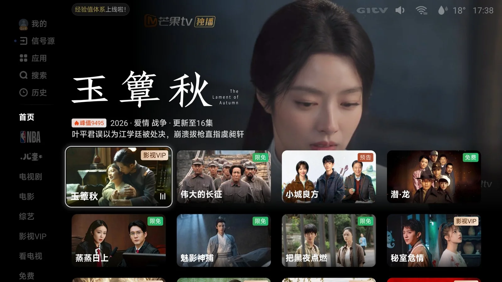 | 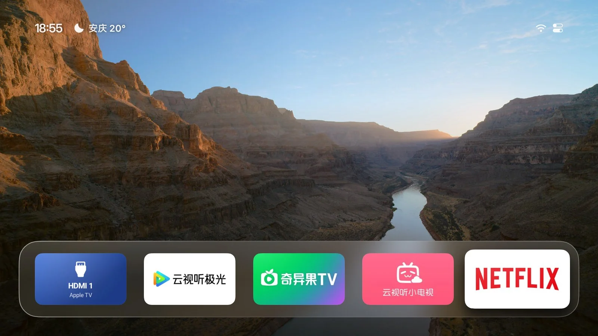 |

Worth knowing even if you don't read Chinese: the project's [`agent.md`](https://aerial.qust.me/agent.md) is a written install spec a coding agent can execute end-to-end, including a verification step (`mCurrentFocus` must show `app.orchard.tv` after pressing Home). That's the same "repo as agent context" pattern cleanyourtv uses.

<Button text="pengchujin/aerial-tv" link="https://github.com/pengchujin/aerial-tv" variant="solid" color="blue" size="md" icon="github" />

## Fire TV

Fire OS is Android underneath, so the debloat works. The catch: Amazon won't hand the home screen to a third-party launcher the way Google does, so your options are "remove the ads" (fully supported) or "remove the ads and wrestle the home screen away" (works, more fragile).

### dumbtv (made for Fire TV)

[dumbtv](https://github.com/humblemuzzu/dumbtv) was built on a Fire TV Edition set that had 129 MB of free memory and a home screen that was mostly ads. It's the most thorough Fire-specific option:

- Disables ~50 Amazon packages: sponsored rows, ad services, ACR screen fingerprinting, telemetry, update nags.
- Installs **personalDNSfilter** on the TV itself, blocking ~400 Amazon telemetry/ad hosts for the protected packages that refuse `pm disable-user`. Your streaming apps are untouched.
- Replaces the home screen with **dumbtv home**, a 54 KB launcher with no internet permission and no permissions at all on Fire OS 7/8. It literally cannot phone home.
- Optionally swaps the stock YouTube app for SmartTube (no ads, no Shorts).

Fire OS blocks the normal route (`set-home-activity` prints Success and changes nothing), so dumbtv home uses a workaround worth stealing for your own project: an accessibility service called Guard watches for Amazon's home window appearing and covers it before it draws, launching dumbtv home through an alarm `PendingIntent` that's exempt from Android's 5-second post-HOME launch delay. On Fire OS 6, which refuses third-party accessibility services, a foreground service called Keeper does the same job via UsageStats. Result: pressing HOME lands on dumbtv home after about 0.3 s of black instead of Amazon's ad screen.

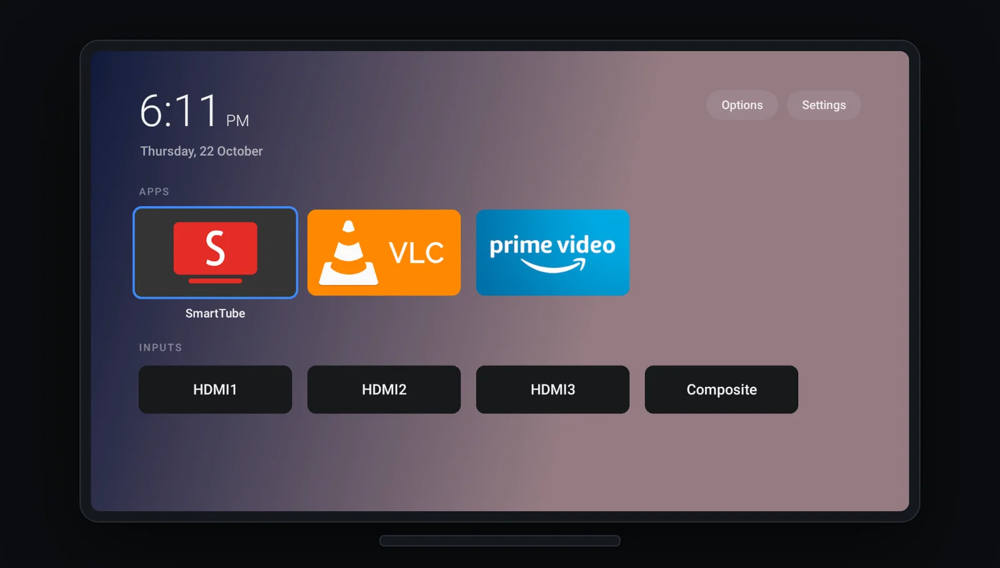

You need `adb` on your computer (the platform-tools package) and ten minutes. Enable ADB debugging on the TV, then:

```sh
git clone https://github.com/humblemuzzu/dumbtv && cd dumbtv
adb connect <tv-ip>:5555        # press Allow on the TV
./scripts/preflight.sh          # reports what the TV is and what would change; changes nothing
./scripts/configure.sh          # asks questions: keep Prime? keep Alexa? replace home screen?
./scripts/all.sh                # runs the pass, asks before each step, reboots twice
./scripts/verify.sh             # checks the result
```

`restore.sh` puts back the exact snapshotted state. Its docs also include an honest list of what the tool can't touch (Samsung, LG, Roku) and why, which is refreshing after a week of repos promising the world.

<Button text="humblemuzzu/dumbtv" link="https://github.com/humblemuzzu/dumbtv" variant="solid" color="blue" size="md" icon="github" />

### The phone-only option

No laptop? [cleanyourtv-app](https://github.com/udhaykumarbala/cleanyourtv-app) is a community Android app (Kotlin, needs Android 9+) that runs the cleanyourtv debloat from your phone. You enable ADB on the TV, open the app, and it walks connect → analyse → clean in about five minutes, covering 131 TV models from 46 brands. It won't install a launcher on Fire TV (Fire OS doesn't allow setting a third-party home screen), but the debloat half works fine.

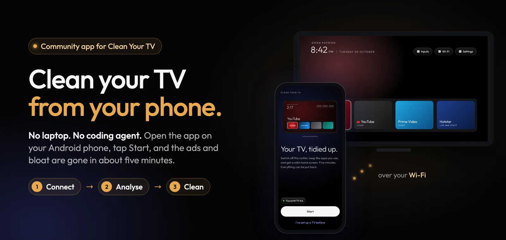

## Samsung Tizen

Samsung doesn't run Android and doesn't allow ADB or home-screen replacement. The door that exists is Tizen's own Developer Mode plus [TizenBrew](https://github.com/reisxd/TizenBrewInstaller), the community sideloading pipeline. Two projects use it.

### free-my-tv on Tizen

This is currently the closest thing to a custom home screen on a Samsung TV. You need a 2016-or-newer set (Tizen 2.4+):

1. On the TV, open **Apps** and type `1 2 3 4 5` on the remote. Turn on **Developer mode**, enter your computer's IP as **Host PC IP**, restart the TV.
2. On your computer, run [TizenBrew Installer](https://github.com/reisxd/TizenBrewInstaller/releases/latest), connect to the TV, and install `simbasjungles/free-my-tv`. On 2023+ models it asks you to sign in to your Samsung account once, to sign the app for your set.
3. In the TV's settings, enable **Autorun Last App** under Start Screen Options. The TV now boots into Free My TV.

The stock Samsung home isn't replaced (Tizen doesn't allow that); the app just runs first and behaves like home, with the same shelf, picks, weather and day/night theme as the Google TV build. For your own city and the TMDB picks, build it with `config.properties` and install via `python3 tizen/install.py <tv-ip>`.

### CleanFrame (Samsung The Frame, and the best "build your own" base)

[CleanFrame](https://github.com/nthnclrk/CleanFrame) is one person's home screen for their Samsung The Frame (LS03D, Tizen 9): your apps, a photograph, and the time, navigable by remote. The interesting part is that it was published explicitly as a starting point to fork, with an agent-readable setup.

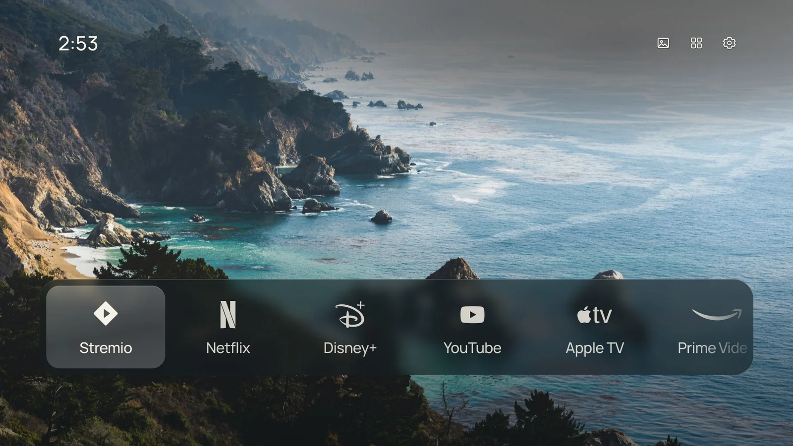

You can try the whole UI in a browser before touching a TV:

```sh
git clone https://github.com/nthnclrk/CleanFrame.git
cd CleanFrame
npm ci
npm run dev:public        # then open http://localhost:4795/home/
```

The repo splits the work into three tiers: tweaking the interface (safe, browser-only), installing the app to a TV (needs your own Samsung certificates and a staged setup guide), and taking over the physical Home button (undocumented helpers, can break after firmware updates, optional). The docs are unusually honest about which parts are verified on real hardware. If you want to build a custom Samsung interface, start here rather than from scratch.

## LG webOS

Same story as Samsung: no ADB, no real home-screen takeover, but LG's Developer Mode lets you sideload webOS apps.

**free-my-tv** is the practical option. On the TV, install LG's **Developer Mode** app from the Content Store, sign in with a free LG developer account, enable **Dev Mode Status** and **Key Server**, note the passphrase. Then on your computer (Python 3 only, no Tizen Studio equivalent needed):

```sh
git clone https://github.com/simbasjungles/free-my-tv && cd free-my-tv
python3 webos/build.py
python3 webos/install.py 192.168.1.50    # your TV's IP
```

Hold a number key on the remote while Free My TV is open to bind it as a Quick Access shortcut. If you already run the [webOS Homebrew Channel](https://github.com/webosbrew/webos-homebrew-channel) on a rooted set, you can skip the computer entirely: add `https://freemytv.io/webos/apps.json` as a repository and it appears in the app list. Two LG quirks: Developer Mode expires roughly every 40 days (open the app and press EXTEND occasionally), and on webOS 6+ the app needs a one-time permission grant to see your installed apps.

Also in this space: Tigris has a webOS port in the repo (`webos/` directory), but it's a development preview with no released IPK and unverified Home-button takeover. And cleanyourtv's SHOWCASE.md tracks three community webOS ports. All early-stage; free-my-tv is the one that's actually usable today.

## Roku and Apple TV

Dead ends, for different reasons.

**Roku** only lets you build channels, not replace the home screen, and the OS has no debug bridge you can reach from a laptop. Its ad removal options are limited to network-level blocking (Pi-hole/AdGuard on your router) and turning off "Use info from TV inputs" in privacy settings to disable ACR. The company did just migrate all its developer repos from GitHub to GitLab (October 15), but that's SDK housekeeping, not a change in what you can modify.

**Apple TV** doesn't need any of this. tvOS has no sponsored rows to remove, which is exactly why half these projects imitate its home screen. The open-source scene is doing to Android TV what Apple already shipped.

If your TV is a Roku set or an old LG/Samsung that can't run any of this, the standard move is a $30-50 Google TV/Chromecast or Onn box on HDMI. You get an Android target for everything in this article, plus a faster UI than the decade-old panel inside the TV.

## Build your own

If you'd rather write the launcher than run someone else's, the shape of these projects is simpler than it looks:

<ListCheck>
<ul>
<li><strong>The launcher is one Android activity</strong> with `android.intent.category.HOME` in its manifest. A grid of icons, D-pad focus handling, and a wallpaper. dumbtv home is 54 KB of plain Java with no libraries; CleanFrame is plain JavaScript in an ES5 runtime; Tigris is Kotlin if you want the fancy focus animations.</li>
<li><strong>The debloat is a text file.</strong> A per-model list of package names passed to `pm disable-user --user 0`. The work is knowing which packages are safe per brand, which is why the community lists in cleanyourtv's `examples/` (316 models) are worth reusing instead of starting blank.</li>
<li><strong>The restore script runs first.</strong> Snapshot `pm list packages` and the relevant settings before you disable anything, and write the undo path before the do path. Every reputable project here does it this way.</li>
<li><strong>The guard is optional but useful.</strong> aerial-tv and Tigris run a small watchdog service (accessibility listener or boot receiver) that re-asserts your launcher as home after updates or reboots, because some OEMs silently reset the default.</li>
</ul>
</ListCheck>

The fastest route is the one these repos were designed around: clone one of them and point a coding agent at it. CleanFrame's docs literally include the prompt to use ("Read AGENTS.md... my first change is: ..."), aerial-tv ships `agent.md` as an install spec, and cleanyourtv's whole architecture is "give the agent the repo so it reuses tested scripts instead of improvising." For a TV-side UI experiment, fork CleanFrame and iterate in its browser preview; for an Android launcher, fork Tigris or free-my-tv and let the agent handle the Gradle/signing chores.

## What's left on the TV when you're done

<ListCheck>
<ul>
<li>Gone: sponsored rows, autoplay promo tiles, ad services, ACR screen fingerprinting, telemetry uploads, preloaded apps you never opened.</li>
<li>Kept: your streaming apps, HDMI inputs, Chromecast/AirPlay, the stock launcher (still there, just not default), voice assistant if you asked for it.</li>
<li>Can't be removed: the boot-logo/boot-ad some brands play from firmware, and ads inside streaming apps themselves (that's what SmartTube or app-level settings are for).</li>
<li>Reversible: everything, via each project's restore script or one-button undo, as long as you let the backup step run.</li>
</ul>
</ListCheck>

<Accordion label="Is this legal / does it void the warranty?" group="faq">
You're toggling debug features the OS ships with and disabling packages, not flashing firmware or unlocking bootloaders. Nothing here modifies /system. That said, follow each repo's warnings; a botched disable list can boot-loop a TV (factory-reset fix), and the repos are explicit that it's at your own risk.
</Accordion>

<Accordion label="Will a TV update undo it?" group="faq">
Sometimes. A firmware update can re-enable disabled packages, which is why dumbtv includes a DNS filter and aerial-tv keeps a guard service. Worst case, you re-run the same script.
</Accordion>

<Accordion label="What if it goes wrong?" group="faq">
Run the backup/preflight step first (every project has one), keep the restore script, and never disable the stock launcher or Google TV's launcherx. If the new home screen misbehaves, the stock UI is still installed underneath.
</Accordion>

<Accordion label="Do I need a computer?" group="faq">
For Android/Google TV, no: cleanyourtv-app runs the whole debloat from an Android phone. For LG and Samsung you need a computer once, to sign and push the app through Developer Mode.
</Accordion>

My take after a week of watching this unfold: cleanyourtv if you have an Android/Google TV and a coding agent, dumbtv if you're on Fire TV, free-my-tv if you're on LG or Samsung. The interesting thing isn't any single repo. It's that "paste a prompt, agent talks to your TV over Wi-Fi, fifteen minutes later the ads are gone" turned out to be a real workflow, and TV manufacturers are about to discover what happens when debloating stops requiring a forum guide.
