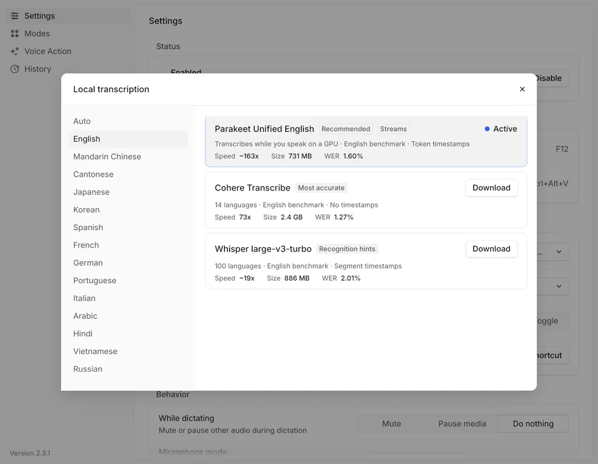
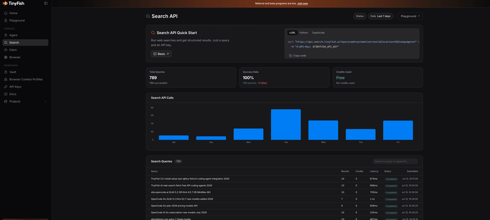
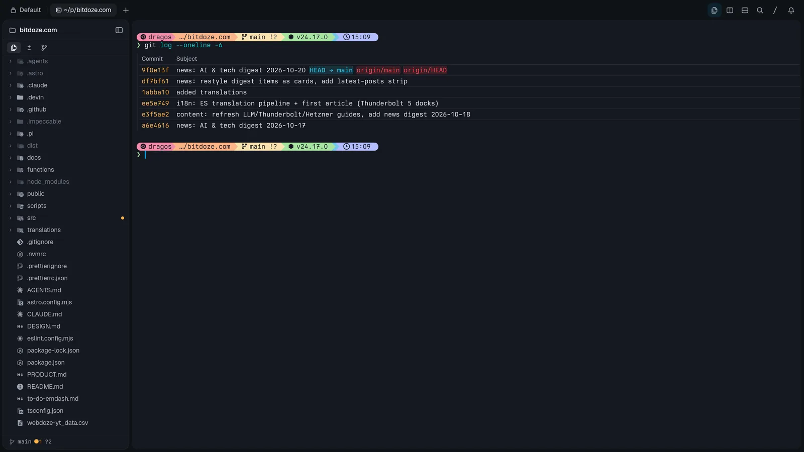
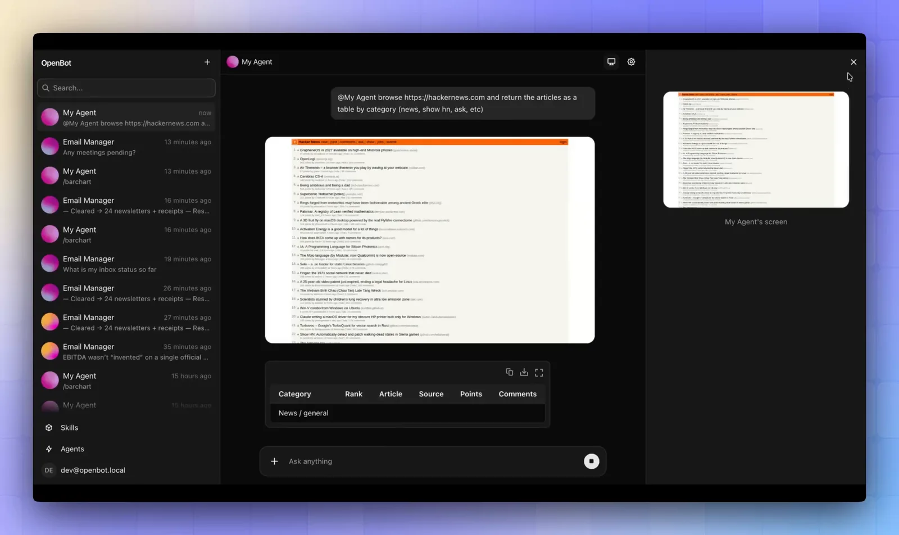

import YouTubeEmbed from "@components/widgets/YouTubeEmbed.astro";
import Button from "@components/widgets/Button.astro";
import Notice from "@components/widgets/Notice.astro";
import ListCheck from "@components/widgets/ListCheck.astro";
import Accordion from "@components/widgets/Accordion.astro";

I used to pay for my AI workflow in pieces. A dictation subscription here, an API key there, a terminal that felt like a spreadsheet with a shell bolted onto it. The monthly bill was fine. The annoyance was the maintenance: every tool wanted its own account, its own quota page, and its own renewal date.

In the video below I walk through the five free tools (plus one bonus) that replaced most of that stack on my laptop and desktop PC. Watch it first if you want the live tour. The guide below adds the install links, screenshots, free-tier limits, and how the pieces connect so you can pick where to start.

<YouTubeEmbed
  url="https://www.youtube.com/embed/4PNaBd7pDjk"
  label="Stop Wasting Time: Free AI Tools You Didn't Know Existed, full walkthrough"
/>

## The free AI team at a glance

| Tool | What it does | Platforms | Price | Why it is on my desk |
|---|---|---|---|---|
| [1. Hex](#1-hex-local-voice-dictation-on-your-machine) | Local voice dictation | macOS, Windows, Linux | Free, MIT | Dictates long agent prompts in seconds with zero cloud upload |
| [2. T3 Code](#2-t3-code-one-gui-for-every-coding-agent) | GUI for coding agents | macOS, Windows, Linux, web, mobile | Free, MIT | Unifies all my agents, subscriptions, and browser previews in one window |
| [3. OpenCode](#3-opencode-200-free-llm-calls-a-day) | Free LLM models & coding agent | Cross-platform CLI & API | ~200 calls/day free ($10 Go optional) | Free access to DeepSeek, GLM, MiniMax, and LongCat models |
| [4. TinyFish](#4-tinyfish-free-web-search-and-fetch-for-agents) | Web search and clean page fetch | CLI, MCP, API | Free (30 search/min, 150 fetch/min) | Stops agents from hallucinating new releases or burning tokens on raw HTML |
| [5. Tern](#5-tern-the-persistent-terminal-workspace) | Terminal workspace with blocks | macOS, Windows, Linux, Android | Free in beta | Keeps running sessions alive when closed, with built-in files and browser panes |
| [Bonus: OpenBot](#bonus-openbot-a-self-hosted-team-of-ai-bots) | Multi-agent Grok Bot alternative | Self-hosted web & Docker | Free, MIT | Runs background routines and daily project briefs on my home PC |

If you only install one thing today, start with **Hex**. Speaking prompts instead of typing them changes how you use every other tool on this list.

## 1. Hex: local voice dictation on your machine

Hex is a free, MIT-licensed dictation app built by Anomaly, the team behind OpenCode. Hold a hotkey, speak, release, and the text lands wherever your cursor sits. Transcription runs locally on your GPU or CPU (Metal on macOS, Vulkan on Windows and Linux), so your audio never leaves your machine.

In the video I press my shortcut and ask the agent for details on **Claude Fable 5.2**, Anthropic's newly released model. I hit Enter and the full prompt is already in the input box. That sounds minor until you do it twenty times an afternoon. Typing multi-sentence context is the slowest part of working with coding agents, and local speech-to-text removes that bottleneck for free.

The local model picker is the part I keep coming back to. You pick the speech model that fits your hardware and language once, and it stays out of your way.

Hex also includes **Modes**, which let you scope formatting rules to specific apps, plus optional cleanup and transformations when paired with OpenCode. I covered the platform quirks (including Wayland paste permissions on Linux and Vulkan drivers on Windows) in the full review.

<Button text="Read the Hex review" link="/hex-dictation/" variant="solid" color="blue" size="md" icon="arrow-right" />

<Button text="Compare free dictation apps" link="/best-free-dictation-apps/" variant="outline" color="gray" size="md" />

<Notice type="info" title="Hex vs FluidVoice">
I tested [FluidVoice](/fluidvoice-mac-dictation/) on macOS first. Hex is the one to install on Windows or Linux, and it holds its own on Apple silicon too. If you are on a Mac and want to compare both local dictation workflows, read both guides before you pick.
</Notice>

## 2. T3 Code: one GUI for every coding agent

T3 Code puts your coding agents and LLM subscriptions behind one clean interface on macOS, Windows, Linux, web, and mobile. It is free and open source under the MIT license, built by Theo Browne and the T3 Tools team ([pingdotgg/t3code](https://github.com/pingdotgg/t3code)). You can grab the desktop app from [t3.codes](https://t3.codes) or spin it up directly with `npx t3@latest` on Node 22+.

What hooked me is that it lets me keep all my agent harnesses and subscriptions in one place. In the video you can see my sidebar wired up with **Factory Droid**, **Muse**, **Local MCP**, **Codex**, **Google Antigravity** models, and **OpenCode**. T3 Code does not mark up tokens or lock you into a proprietary cloud; you bring the logins and local tools you already have. You can also link your other PCs and connect from your phone to check on running threads.

In the video demo, I gave T3 Code a single prompt to build a **solar panel website in Astro**. About twenty minutes later the site was done. Without leaving T3 Code, I opened the built-in browser preview to test the live layout and inspected the generated Astro files right inside the app. No terminal tabs, no port forwarding headaches.

<Notice type="info" title="Reusing your existing AI subscriptions">
T3 Code has no standalone Bitdoze tutorial yet because the setup takes two minutes. To get the most out of the model side, pair it with our [OpenCode setup guide](/opencode-setup-guide/) and the [VibeProxy guide](/vibeproxy-ai-subscriptions-guide/), which shows how to route your existing Claude, Codex, or Gemini subscriptions into any third-party tool.
</Notice>

For a broader look at how GUI and CLI coding agents stack up right now, check the [AI coding tools roundup](/ai-coding-tools/).

## 3. OpenCode: 200 free LLM calls a day

A nice interface still needs models behind it, and that is where **OpenCode** comes in as the third member of the team. Inside T3 Code, Tern, and OpenBot, I connect the OpenCode provider because it includes a generous pool of free models that work without a credit card.

You get roughly **200 calls a day for free** across open models like **DeepSeek**, **GLM**, **MiniMax**, and **LongCat** (including **LongCat 2.5 Preview Free**). For everyday coding tasks, quick refactors, and news summaries, that free daily quota covers a surprising amount of ground at zero cost.

When you eventually burn through the daily free allowance on a heavy build day, OpenCode also offers the **$10/month OpenCode Go** subscription. It unlocks 31 models under one key, where high-volume options like **DeepSeek V4.1 Flash** (~34,670 requests per 5 hours) and **GLM 5.3 Flash** (~6,320 requests per 5 hours) stretch a $10 bill further than almost anything else I have tested.

<Button text="Read the OpenCode Go review" link="/opencode-go-plan/" variant="solid" color="blue" size="md" icon="arrow-right" />

<Button text="Try OpenCode Go" link="https://go.bitdoze.com/opencode-go" variant="outline" color="green" size="md" />

## 4. TinyFish: free web search and fetch for agents

Coding agents guess when they cannot look things up. Ask an offline model about a framework release from yesterday and it will hand you a confident hallucination. **TinyFish** is the fourth tool in the video, and it fixes that problem by giving your agents live web search and clean page fetching for free.

The free tier gives you **30 searches per minute** and **150 page fetches per minute** with no credit card required. In the video, I asked my agent for the latest AI and tech news and had it pull the release details for Anthropic's newly announced **Claude Fable 5.2** model. TinyFish ran the search and fetched the articles in milliseconds.

Why use TinyFish instead of a standard browser tool? **Context bloat.** A raw web page stuffs thousands of tokens of navigation menus, scripts, and cookie banners into your agent's context window. TinyFish renders the page in a real Chromium session, strips the boilerplate, and hands clean Markdown or JSON back to the LLM.

I have TinyFish wired into T3 Code, OpenCode, and OpenBot, and my request counter barely dents the free limit.

<Button text="Set up TinyFish for agents" link="/tinyfish-free-search-coding-agents/" variant="solid" color="blue" size="md" icon="arrow-right" />

<Button text="Get a free TinyFish API key" link="https://go.bitdoze.com/tinyfish" variant="outline" color="gray" size="md" />

## 5. Tern: the persistent terminal workspace

If you prefer living in a terminal over a GUI like T3 Code, the fifth tool in my stack is **Tern**. Built in Rust by Stencil (the team behind the `omp` agent CLI), Tern is currently in free beta with desktop builds for macOS, Windows, and Linux, plus an Android mobile app and an iPhone client on the way.

Tern looks like a fast terminal emulator and acts like a full workspace. Beside your shell prompt, you can split native blocks for a **file tree and code editor**, a **git graph**, a **SQLite browser**, **Jupyter notebooks**, a **kanban board**, and a **live web browser**.

In the video I open **OpenCode** inside a Tern terminal pane, select **LongCat 2.5 Free** from the model picker, and use **Hex** to dictate: *"Please go ahead and review this project and tell me what I could enhance."* While the agent works in the terminal, I browse and edit project files in the left sidebar and preview the site in Tern's built-in browser block without switching windows.

Two things make Tern stick for me:

1. **Daemon persistence:** A background daemon owns your running processes. In the video I close the Tern app completely and reopen it; every pane, running process, and active agent conversation is still right where I left it.
2. **Mobile access:** You can pair your phone and attach to the exact same live terminal session from the couch.

<Button text="Read the Tern hands-on review" link="/tern-terminal/" variant="solid" color="blue" size="md" icon="arrow-right" />

If you want a pure shell multiplexer across remote VPS boxes, I also use [Herdr](/herdr-agent-multiplexer/). My [phone control setup with Moshi and Herdr](/control-ai-agents-from-phone-moshi-herdr/) shows how to approve agent runs from your lock screen. Tern and Herdr solve session persistence from two angles: Tern gives you a graphical block workspace, while Herdr stays strictly inside the terminal grid.

## Bonus: OpenBot, a self-hosted team of AI bots

At the end of the video I showed the bonus tool running on my home PC: **OpenBot**. It is a free, MIT-licensed open-source alternative to xAI's Grok Bot, built by the CopilotKit team. You run it on your own machine or server, organize channels by project, and spin up a roster of AI coworkers that each get their own isolated browser and persistent memory.

What makes OpenBot click in this workflow is that it reuses the exact same free stack:

- My bots (like **Drago** in the video) connect to **OpenCode** and run on the free models alongside my existing subscriptions.
- When I ask Drago *"What are the latest news today from AI?"* on November 10, it reaches for **TinyFish** to search the live web and opens its built-in browser to verify current stories.
- You can assign recurring **routines**. I have a daily routine that tracks new releases and updates around [Emdash CMS](/deploy-emdash-cloudflare-workers/) and posts a morning brief automatically, plus another bot that opens my websites in a real browser to audit layouts and suggest improvements.

If you want to compare OpenBot against other self-hosted bot rosters like Rakazo, OpenMausBot, and Lorca, I tested ten of them side by side.

<Button text="Compare 10 open source Grok Bot alternatives" link="/best-open-source-grok-bot-alternatives/" variant="solid" color="blue" size="md" icon="arrow-right" />

## How the whole workflow fits together

None of these tools exist in a vacuum on my machine; each one hands off to the next:

- **Hex** turns voice into clean prompts locally so I stop typing paragraphs by hand.
- **T3 Code** gives me a visual dashboard (and mobile view) when I want an agent to build an Astro site in the background.
- **Tern** gives me a persistent terminal + file editor + browser workspace when I want hands-on control.
- **OpenCode** supplies the ~200 free daily LLM calls (DeepSeek, GLM, MiniMax, LongCat) that power both T3 Code and Tern.
- **TinyFish** gives every agent live search and stripped-down page fetches so they know what shipped today without wasting tokens.
- **OpenBot** runs scheduled routines and project bots on my home PC using those same OpenCode models and TinyFish searches.

<ListCheck>
- **Dictate** prompts locally with Hex instead of typing long instructions
- **Pick your surface**: T3 Code for a clean GUI, or Tern for a persistent terminal workspace
- **Power the agents** with OpenCode's free daily models (and step up to the $10 Go plan only if you hit the cap)
- **Ground every answer** in live docs and news with TinyFish Search and Fetch
- **Automate daily briefs** and site reviews on your own hardware with OpenBot routines
</ListCheck>

<Notice type="success" title="What to install first">
Install **Hex** first. It takes two minutes and speeds up everything else. Grab a free **TinyFish** API key second. Then pick **T3 Code** (if you prefer a GUI) or **Tern** (if you live in the terminal) and connect **OpenCode's** free models. Save **OpenBot** for last once you have a recurring daily task you want to automate.
</Notice>

## FAQ

<Accordion label="Is this entire AI workflow really free?" group="faq" expanded="true">
Yes. Hex, T3 Code, and OpenBot are free and open source under the MIT license. TinyFish provides 30 searches/min and 150 fetches/min on its free tier with no credit card. Tern is free during its beta. OpenCode gives you around 200 free model calls per day across models like DeepSeek, GLM, and LongCat; the $10/month [OpenCode Go plan](/opencode-go-plan/) is completely optional for heavy usage after you finish your daily free quota.
</Accordion>

<Accordion label="Should I use T3 Code or Tern?" group="faq">
Use both or pick based on how you like to work. T3 Code is a GUI control panel that unifies all your agent subscriptions (OpenCode, Codex, Factory Droid, Muse, Google Antigravity) with a built-in browser preview and file viewer. Tern is a Rust-native terminal workspace where your shell sits next to file, git, database, and browser blocks, backed by a daemon that keeps processes alive when you close the window.
</Accordion>

<Accordion label="How do the 200 free LLM calls a day work?" group="faq">
When you connect OpenCode inside T3 Code, Tern, or OpenBot, you get access to OpenCode's free model tier, including models from DeepSeek, GLM, MiniMax, and LongCat (such as LongCat 2.5 Free), for roughly 200 calls a day without paying anything. Model availability shifts over time, so check our [OpenCode Go review](/opencode-go-plan/) for the current roster and request limits.
</Accordion>

<Accordion label="Do my agents stop if I close the terminal window?" group="faq">
In Tern, no. Tern runs a background daemon that owns your shell and agent processes, so closing the app window and reopening it restores your exact session state and running tasks. In T3 Code, the session stays live as long as the host computer remains on.
</Accordion>

## Where to go next

Start with the [Hex review](/hex-dictation/) to get local voice dictation running, grab a free search key in the [TinyFish setup guide](/tinyfish-free-search-coding-agents/), and check the [OpenCode Go review](/opencode-go-plan/) to see which free and low-cost models perform best right now. If you want to explore the terminal and bot side deeper, read our [Tern terminal hands-on](/tern-terminal/) and the [10 open source Grok Bot alternatives](/best-open-source-grok-bot-alternatives/).
