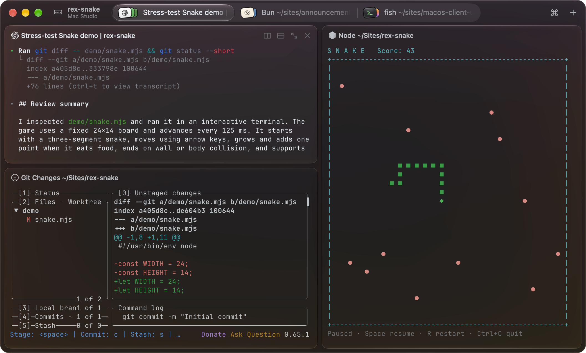
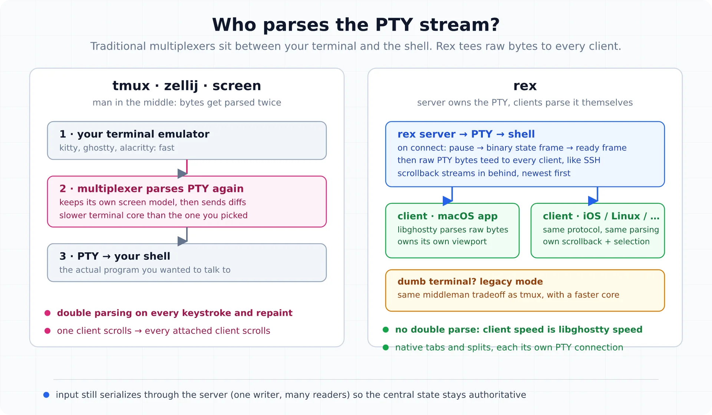

import Notice from "@components/widgets/Notice.astro";
import Accordion from "@components/widgets/Accordion.astro";
import ListCheck from "@components/widgets/ListCheck.astro";
import Button from "@components/widgets/Button.astro";
import YouTubeEmbed from "@components/widgets/YouTubeEmbed.astro";

Rex is the terminal multiplexer Mitchell Hashimoto has been building at Superlogical since HashiCorp and Ghostty. It is a terminal emulator and a multiplexer in one native application: you open the app, you are in a terminal, and sessions, splits, and persistence are already there. Public testing [opened on October 5](https://www.superlogical.com/updates/public-testing-beginning) on macOS first; by November, the macOS client, iOS TestFlight app, and Linux and FreeBSD servers are in testers' hands, the docs are public, and Hashimoto has published long walkthroughs of how it works.



<Notice type="info" title="Already in the beta?">
  The November follow-up covers real tester workflows: agents drawing Kitty graphics diagrams in split panes, Claude Code on an iPhone over Tailscale, disposable cloud VMs with rex-cloud, and custom Lua sidebars.

  <Button text="Rex beta use cases" link="/rex-use-cases/" variant="solid" color="blue" size="sm" icon="arrow-right" iconPosition="right" />
</Notice>

<Notice type="info" title="Still picking a multiplexer?">
  Rex is one of seven tools in my best terminal multiplexers comparison, next to tmux, Zellij, Herdr, TuiOS, Tern, and Muxy. If Rex's current desktop beta does not fit your setup, that guide has a pick for every workflow.

  <Button text="Compare all 7 multiplexers" link="/best-terminal-multiplexers/" variant="solid" color="blue" size="sm" icon="arrow-right" iconPosition="right" />
</Notice>

## What Rex is

You do not run Rex inside another terminal the way [tmux](/tmux-basics/) runs inside Kitty or [Ghostty](/ghostty-terminal/); it is the terminal. Superlogical's pitch is "a drop-in replacement for whichever terminal you use today," with persistent sessions, remote connections, and program activity status ([OSC 7501](https://www.superlogical.com/rex/docs/build/program-status)) on top. When a build, Terraform prompt, or coding agent is working, blocked on input, finished, or failed, unfocused tabs and the session list badge that state automatically.

The vocabulary is four nouns, and they show up everywhere in the CLI and config:

- A **session** is a group of work, usually one project. The server keeps it alive whether or not anything is looking at it.
- A **window** is a tab inside a session. It holds a layout of blocks (and optional scriptable floating panes).
- A **block** is one application in a window. Today that means a terminal.
- A **client** is a program connected to the server, like the macOS or iOS app.

The server owns everything. Clients attach, render, detach. Close the app mid-build, reopen it, and you are back in the same session where you left it.

<YouTubeEmbed
  url="https://www.youtube.com/embed/2UNVvp-Xebw"
  label="Superlogical Rex: Ghostty's Creator Rethinks the Terminal Multiplexer"
/>

## Why the architecture is different (and why it matters)

This is the part worth understanding, because it is the reason Rex exists instead of being another tmux skin.

A traditional multiplexer sits between your terminal emulator and the PTY. Terminal → [tmux](/tmux-basics/) → shell. Every byte gets parsed twice: once by the multiplexer's internal terminal model, once by your emulator. And historically, the terminal cores inside tmux, screen, and zellij are slow next to modern emulators. Hashimoto puts it bluntly in his architecture walkthrough: Ghostty, Kitty, and Alacritty are sometimes 100x faster at terminal IO than the emulator inside a multiplexer, so bolting one in front of your fast terminal gives you, in his words, "that slow experience in a fast terminal."



Rex flips who does the parsing:

1. **The server owns the PTY.** When a client connects, the server pauses PTY processing for a moment and sends a custom binary frame carrying just enough state (dimensions, cursor, current screen) for the client to render. Then a ready frame: you can type, select, and scroll while everything else loads.
2. **Raw bytes, not screen diffs.** Instead of tracking a shared screen model and shipping diffs, the server tees raw PTY bytes to every client, like SSH. Each client runs libghostty and parses independently. If the server ever parses slowly, your client does not care.
3. **Scrollback streams in behind.** Newest chunk first, with a loading state while history backfills. And because the client owns its viewport, two attached clients can scroll the same session independently, which fixes the famous tmux behavior where one person scrolling moves everyone's screen.

Two consequences worth knowing:

- **No in-window multiplexing.** Each split is its own PTY connection rendered as a native tab, split, or window. That is what makes iOS and browser clients possible, and it is why a tmux-style pane tree is not the model. A legacy compatibility mode for dumb terminals (a libghostty layer in the middle, the same tradeoff tmux makes but with a faster core) is still being discussed.
- **Input stays centralized.** Keystrokes serialize through the server, one writer and many readers, so the authoritative state never forks even if a client drifts out of sync. A drifted client just re-runs the handshake.

Since the client is the terminal emulator, feature support follows libghostty. The Kitty graphics protocol gap that tmux never closed is the kind of thing that works out of the box here, including over remote connections.

## Remote hosts: quietly an SSH replacement

The second demo is the one that made me sit up. Rex is not just local persistence. The macOS server has Tailscale built in (`tsnet`), and on Linux and FreeBSD you can run a Rex server in three modes ([server modes docs](https://www.superlogical.com/rex/docs/linux/server-modes)): **Personal** (`rex server start` as your user), **Shared** (`rex.service` under a shared `rex` account), or **Login** (`rex-login-server.service` / `rex-login-server.socket` running as root).

When you connect to a remote host from the Mac or iOS app, what opens looks like SSH but is not SSH:

- **It does a real system login via PAM.** In Login mode, `rex-login-server` checks `/etc/rex/accounts.jsonc` (or `services.rex.loginServer` on NixOS), opens a login session for that OS account through `/etc/pam.d/rex-login-server`, applies per-user resource limits and `systemd-logind`, and starts or attaches to that user's personal Rex server. The session shows up in `who` and your login shell loads. Each user's sessions keep running even when `rex-login-server` restarts or upgrades.
- **`rex whoami` reports the identity chain.** Today, Rex trusts the caller based on network identity (such as your Tailscale login, e.g. `tailscale:alice@example.com`), which is why Superlogical recommends Tailscale or an SSH-forwarded Unix socket. Full built-in authentication and support for existing SSH keys are planned on the roadmap, not active yet.
- **It feels local.** Hashimoto describes borrowing architectural ideas from Mosh for responsiveness, without claiming full Mosh parity. Killing a remote session via `rex session kill` propagates before you can reopen the app.
- **Everything local works remote.** The `Cmd+Shift+G` go-to-directory jump and Kitty graphics work on remote hosts too. "Everything that works local should work remote" is a stated design rule.

Local sessions need no remote anything. Remote hosts are for when you want the same persistence on a Linux/FreeBSD VPS or a disposable [Vercel Sandbox VM via `rex-cloud`](https://github.com/vercel-labs/rex-cloud).

## The rex CLI and agent skill are the control surface

Every terminal Rex opens gets `rex` on its PATH automatically, plus three environment variables that tell the CLI where it is:

| Variable | Holds |
|---|---|
| `REX_SESSION` | ID of the session the terminal belongs to |
| `REX_BLOCK` | ID of the terminal's own block |
| `REX_SERVER` | Address of the server running the terminal |

So `rex split` inside a pane splits that pane. To act somewhere else, target with `-s` (session), `-w` (window), `-b` (block), `-C` (client), or `-S` (server). Targets resolve in a fixed order: full ID, then label, then position, then a 4+ character ID suffix. An ambiguous target changes nothing: it lists the matches and exits with status 3.

```sh
rex ls                              # list sessions
rex session inspect                 # details of the session you're in
rex send -s build -w 2 'make test'  # type into window 2 of the "build" session
rex capture -b logs --trim          # print the screen of the block labeled "logs"
rex -S root@build.example.ts.net ls # sessions on a remote login server
```

Most commands take `--json` (stable output with full IDs, made for scripts) and return meaningful exit codes: `0` ok, `1` failed, `2` bad command line, `3` target missing or ambiguous, `4` server unreachable, `130` interrupted. `rex wait` and `rex run --wait` adopt the wrapped program's exit status, so scripts compose cleanly.

For AI coding agents, `rex skill setup` installs a built-in Rex skill and session-start hook into Claude Code (`~/.claude/skills/rex`), Codex, OpenCode, and Pi (`~/.agents/skills/rex`). Instead of burning tokens discovering CLI flags, the agent already knows how to split panes, start a background dev server, or read test failures off a neighboring block. Any other agent can read the same instructions by running `rex skill show`.

## Configuration is Lua, with custom actions and event listeners

Config lives in one file: `~/.config/rex/init.lua` on macOS and Linux, `%AppData%\rex\init.lua` on Windows, `REX_CONFIG` overrides both. Rex needs no config at all, and `require` or `dofile` lets you split a big one into modular files.

```lua
rex.bind("cmd+d", "pane.split", { direction = "right" })
rex.bind("ctrl+b>c", "window.new")  -- tmux-style prefix chords work
```

Two details the docs make clear that are easy to miss: the **server** reads the file, so `rex config reload` must run on the server machine and is refused over a remote connection. And there is no file watching; reload is manual. `rex config check` validates a file without applying it, a bad `rex.*` call is skipped with an error while the rest of the file still loads, and a hard Lua syntax error keeps the last good config.

Custom actions are named Lua functions defined with `rex.action`. Once defined they behave like built-ins: bindable to keys, searchable in the command palette, runnable from the CLI with `rex do`:

```lua
rex.action{
  name  = "scratch",
  title = "Open Scratch Window",
  run   = function(ctx, args)
    rex.session.new_window{
      layout = rex.layout.block{
        flavor = "com.superlogical.terminal.shell",
      },
    }
  end,
}
rex.bind("shift+cmd+n", "scratch")
```

Actions take typed `args` (or a full JSON Schema as a Lua table), receive a `ctx` (`session_id`, `block_id`, `client_id`, `origin`), call other actions through `rex.invoke`, and queue client-side actions with `rex.client.queue`. Two gates to know: the app only accepts client actions from the CLI when **Remote Control** is on in settings, and `rex do ~/.config/rex/init.lua --action scratch` runs an action from a file against the live session without touching the running config.

A Lua script run via `rex do` can also subscribe to live server events with [`rex.on`](https://www.superlogical.com/rex/docs/automate/lua-events) (such as `terminal.pwd_changed`) and stay running in the background to auto-label blocks or manage panes. See my [Rex use cases guide](/rex-use-cases/) for how testers use Lua actions and event scripts to build GitHub PR panels, Claude Code quota bars, and auto-resumed SSH tabs.

## Where you can run it, and what it costs

<ListCheck>
  <ul>
    <li>**macOS app and iOS TestFlight client.** The macOS app self-hosts a local Rex server (with embedded Tailscale) and connects to remote servers; the iOS app pairs via QR code over Tailscale to view and control the same live sessions.</li>
    <li>**Linux and FreeBSD servers are available now; Linux/Windows desktop apps are next.** Official server packages ship for Debian/Ubuntu, RHEL/Fedora, SUSE, Alpine, NixOS, and FreeBSD. The Windows client (previewed in pre-alpha in early November) and Linux desktop app are still in internal testing.</li>
    <li>**Free, no account, self-hostable.** Superlogical states that "Rex is and will always be free," clients and servers "are not going to be directly monetized," and no telemetry is collected. The commercialization plan is promised before the stable release.</li>
    <li>**Access via the mailing list.** Invites have been rolling out in waves since October; once inside the Rex Beta Discord, testers can also join the iOS TestFlight alpha and connect agents to Superlogical's Community MCP.</li>
  </ul>
</ListCheck>

To get a seat, join the mailing list on the [announcement page](https://www.superlogical.com/updates/public-testing-beginning). The [docs](https://www.superlogical.com/rex/docs/installation) are public and worth reading even without access; the CLI, Linux server, and Lua references tell you most of what the product is.

## Rex vs tmux vs Herdr vs Tern

| | Rex | tmux / zellij | Herdr | Tern |
|---|---|---|---|---|
| What it is | Terminal app + multiplexer | Multiplexer inside your terminal | Agent control plane | Terminal + workspace (native blocks) |
| How it renders | Native tabs/splits, per-client libghostty | Internal screen model diffed to your terminal | TUI over a session server | Native UI, blocks drawn over the Tern Surface Protocol |
| Remote story | Built-in Tailscale, PAM login server, Mosh-style responsiveness | SSH in, then attach | SSH attach, web/mobile clients | `tern remote serve` over QUIC, web and mobile clients |
| Config | Lua (`init.lua`) + `rex.on` events | tmux.conf / KDL | `~/.config/herdr` | Settings UI + omp themes |
| Scripting | `rex` CLI, `rex skill`, Lua actions, `--json` | CLI + shell scripts | Socket API + CLI | `tern` CLI, events, `tern ctl`/`shot` |
| Status | Public beta (macOS + iOS clients, Linux/FreeBSD servers) | Everywhere, decades mature | Open source, active | Closed beta, waitlist |

Honest framing: these are different tools solving different problems. tmux is the incumbent with decades of muscle memory behind it. Rex bets that the multiplexer should be the terminal. Herdr is not a terminal at all; it is a control plane for AI coding agents (agent-state sidebar, socket API, marketplace plugins). Tern is the terminal-as-workspace bet: same server-owned-session model as Rex, but cross-platform and with git, SQLite, Jupyter, and kanban blocks plus a native omp agent pane. If agents are your actual problem, start with my [Herdr review](/herdr-agent-multiplexer/) and the guides to the [best Herdr clients](/best-herdr-clients/) and [best Herdr plugins](/best-herdr-plugins/). If terminal ergonomics are the problem, Rex is the most interesting thing in this space since zellij, and my [Tern hands-on](/tern-terminal/) covers the other serious contender. For the complete field including Zellij and TuiOS, see the [terminal multiplexer comparison](/best-terminal-multiplexers/).

## Rough edges to know about

- **Desktop client is still macOS-only.** Linux and FreeBSD servers and the iOS TestFlight client are in testers' hands, but the Linux and Windows desktop clients are still in internal testing.
- **Local server restarts keep the layout and drop the shells.** Updating or restarting the local Mac server restores your window and split arrangement as fresh shells (unlike Linux's `rex-login-server`, which keeps per-user servers running across upgrades). Community extensions like `sshtab` in [rex-extensions](https://github.com/luongnv89/rex-extensions) work around this by auto-resuming Claude Code and Codex sessions after a restart.
- **The tmux workflow does not port 1:1.** No in-window pane tree; splits are separate connections in native containers. Prefix chords like `ctrl+b>c` work in `rex.bind`, your `.tmux.conf` does not.
- **Config reload is manual.** No file watching yet; `rex config reload` runs on the server machine only.
- **Remote auth relies on network identity today.** `rex-login-server` authenticates callers via network identity (such as Tailscale) mapped in `/etc/rex/accounts.jsonc` and PAM; native password/key auth and legacy SSH key support are still on the roadmap.

## FAQ

<Accordion label="Is Rex free?" group="faq">
  Yes. Superlogical says "Rex is and will always be free," no account required, servers are self-hostable, and they do not collect or share your data. Whatever the eventual commercialization is, they have committed it will not be the client or server itself.
</Accordion>

<Accordion label="Can I run Rex on Linux, FreeBSD, iOS, or Windows today?" group="faq">
  For **servers**, yes: Linux (Debian/Ubuntu, RHEL/Fedora, SUSE, Alpine, NixOS) and FreeBSD server packages are available to testers now, and you can also boot disposable Linux sandboxes with [rex-cloud](https://github.com/vercel-labs/rex-cloud). For **clients**, the macOS app and iOS TestFlight app are in testing today, while the Linux and Windows desktop clients are still in internal development.
</Accordion>

<Accordion label="Does Rex replace tmux?" group="faq">
  It replaces the job tmux does (persistence, sessions, splits, remote attach) with a different model: raw PTY bytes streamed to per-client terminal emulators instead of one shared screen model. What you lose is in-window pane nesting and decades of ecosystem plugins. What you gain is per-client scrollback, native UI, Kitty graphics over remote links, first-class Tailscale/PAM remoting, and a scriptable Lua and CLI surface. Our [tmux basics guide](/tmux-basics/) shows what the incumbent workflow looks like.
</Accordion>

<Accordion label="Does Rex work with my Ghostty config or theme?" group="faq">
  Not via direct file import. Rex is built on libghostty and includes built-in theme and font settings alongside `~/.config/rex/init.lua`, so expect engine familiarity rather than a Ghostty config import path.
</Accordion>

## The short version

Rex is Mitchell Hashimoto arguing that a terminal multiplexer should not emulate a terminal in the middle of your terminal. The client parses, the server streams, sessions persist, remotes log in through PAM over Tailscale, and the whole thing is scriptable in Lua and via `rex skill setup`. [Join the mailing list](https://www.superlogical.com/updates/public-testing-beginning) if you want in, or read the [Rex beta use cases](/rex-use-cases/) to see what testers are building with it.

Also worth a look: my [Ghostty setup guide](/ghostty-terminal/) (the same engine sits under Rex's hood), the [cmux guide](/cmux-terminal/), another libghostty-based terminal with an automation CLI for macOS, and [Tern](/tern-terminal/), Stencil's Rust-native terminal with the same server-owned-session idea, already running on Linux, Windows, and Android in closed beta.
