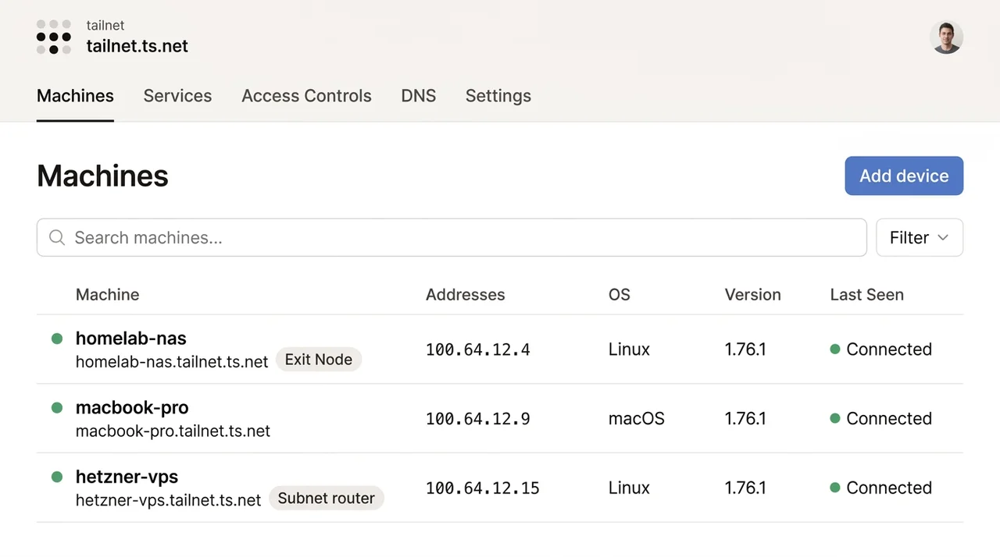
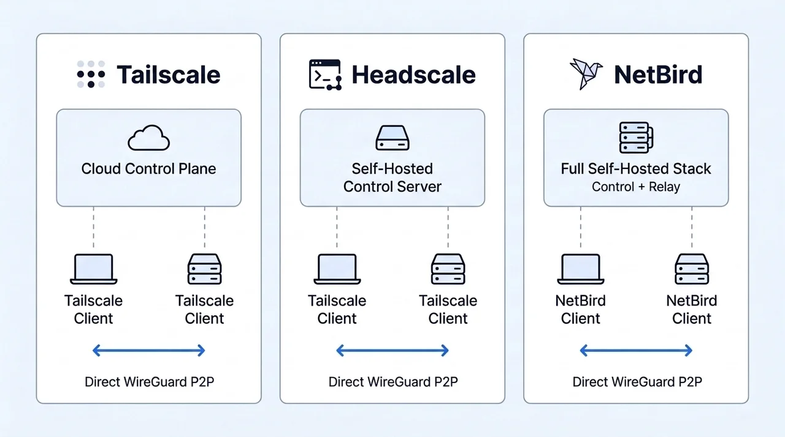

import ListCheck from "@components/widgets/ListCheck.astro";
import Notice from "@components/widgets/Notice.astro";
import Accordion from "@components/widgets/Accordion.astro";
import Tabs from "@components/widgets/Tabs.astro";
import Tab from "@components/widgets/Tab.astro";

If you have ever tried to expose a home server or NAS to the internet, you know how quickly port forwarding turns into a chore. You deal with dynamic home IPs, CGNAT from your ISP, router firewalls, and keeping OpenVPN or raw WireGuard configs synced across every laptop and phone.

Tailscale sidesteps all of that. You install a small client on each machine, sign in once, and every device gets a stable `100.x.y.z` IP address over encrypted WireGuard tunnels. No open router ports required, even if your ISP puts you behind CGNAT.

I use Tailscale whenever I want remote access working in five minutes without babysitting another VPS. Here is how to set it up properly, including the features that actually matter once your first two machines are connected.



## What you get on the free Personal plan

Tailscale's free Personal tier is unusually generous for homelabs:

- **Up to 6 users** in one tailnet
- **Unlimited user-owned devices** (your laptops, phones, and desktops)
- **Up to 50 tagged nodes** (headless servers, Raspberry Pis, VPS boxes)
- **MagicDNS, Subnet Routers, Exit Nodes, Tailscale SSH, and Taildrop** included

You only run into paid plans ($8/user/month on Standard) if you need team-wide admin controls, more than 3 ACL groups, or commercial multi-user access.

<Notice type="info" title="Want to self-host the control server instead?">
Tailscale manages the coordination server on their cloud. If you want to own the control plane yourself, check our [Headscale setup guide](/headscale-self-hosted-tailscale-setup/) or [NetBird self-hosted guide](/netbird-self-hosted-setup/), or read our [NetBird vs Headscale vs Tailscale comparison](/netbird-vs-headscale-vs-tailscale/).
</Notice>

## Step 1: Install Tailscale on your devices

<Tabs>
<Tab name="Linux">

On Ubuntu, Debian, or most Linux distributions, the official install script sets up the package repository and starts `tailscaled`:

```bash
curl -fsSL https://tailscale.com/install.sh | sh
sudo tailscale up
```

Open the URL printed in your terminal, sign in with Google, GitHub, Microsoft, or email, and the machine appears in your Admin Console immediately.

</Tab>
<Tab name="Docker">

If you run services in containers on a NAS or home server, you can run Tailscale in a container or as a sidecar. For a standard host-networked container:

```yaml
services:
  tailscale:
    image: tailscale/tailscale:latest
    container_name: tailscale
    hostname: docker-host
    network_mode: host
    restart: unless-stopped
    environment:
      - TS_AUTHKEY=tskey-auth-xxxxx
      - TS_STATE_DIR=/var/lib/tailscale
    volumes:
      - ./tailscale-state:/var/lib/tailscale
      - /dev/net/tun:/dev/net/tun
    cap_add:
      - NET_ADMIN
      - SYS_MODULE
```

Generate the `TS_AUTHKEY` in the Tailscale Admin Console under **Settings > Keys**.

</Tab>
<Tab name="macOS & Windows">

- **macOS**: Download Tailscale from the Mac App Store or install via Homebrew (`brew install --cask tailscale`), then click **Log in** from the menu bar icon.
- **Windows**: Download the installer from `tailscale.com/download/windows` and sign in from the system tray icon.
- **iOS & Android**: Install the official Tailscale app from the App Store or Google Play and sign in with the same account.

</Tab>
</Tabs>

Verify the connection from any terminal:

```bash
tailscale status
tailscale ping <device-name>
```

If `tailscale ping` says `via 192.168.x.x` or `via <public-ip>`, you have a direct peer-to-peer WireGuard tunnel. If it says `via DERP(...)`, traffic is going through a relay because both sides are behind strict NAT.

## Step 2: Use MagicDNS instead of memorizing IPs

Typing `100.84.12.9` gets old fast. **MagicDNS** is enabled by default on new tailnets and maps every machine's hostname to its Tailscale IP.

Once connected, you can SSH, mount shares, or open web dashboards by name:

```bash
ssh dragos@homelab-nas
```

Or use the full domain (`homelab-nas.tailnet-name.ts.net`), which is handy when you want valid HTTPS certificates inside your private network.

If you run a local DNS server like NextDNS or Pi-hole, you can set it as a global nameserver under **DNS > Nameservers** in the Admin Console so every device on your tailnet uses it automatically.

## Step 3: Set up a Subnet Router for your home LAN

You cannot install Tailscale on everything. Printers, IP cameras, smart home hubs, and some NAS appliances don't have a Tailscale package. A **subnet router** solves this by letting one always-on Linux box (a mini PC, Raspberry Pi, or Proxmox LXC) advertise your entire local network (`192.168.1.0/24`) to your tailnet.

Enable IP forwarding on the Linux host first:

```bash
echo 'net.ipv4.ip_forward = 1' | sudo tee -a /etc/sysctl.d/99-tailscale.conf
echo 'net.ipv6.conf.all.forwarding = 1' | sudo tee -a /etc/sysctl.d/99-tailscale.conf
sudo sysctl -p /etc/sysctl.d/99-tailscale.conf
```

Then advertise your LAN subnet:

```bash
sudo tailscale up --advertise-routes=192.168.1.0/24
```

Open the Tailscale Admin Console, click the three-dot menu next to that machine, choose **Edit route settings**, and toggle the subnet on.

<Notice type="warning" title="Linux clients need --accept-routes">
macOS, Windows, iOS, and Android accept advertised subnet routes automatically once approved. Linux clients do not. On any Linux laptop or server that should reach `192.168.1.0/24`, run `sudo tailscale up --accept-routes`.
</Notice>

Now your laptop at a coffee shop can reach `192.168.1.50` as if it were sitting on your home Wi-Fi. This pairs nicely with [NFS shares on Linux](/setup-nfs-linux/) or [Samba file sharing](/setup-samba-linux/) when you need to mount a home NAS remotely without exposing SMB or NFS ports to the internet.

### Don't forget to disable key expiry on servers

By default, Tailscale expires node keys every 180 days. That is fine for a laptop where you can click re-authenticate, but it will silently lock you out of a remote NAS, Raspberry Pi, or cloud VPS six months from now.

For any always-on server or subnet router, open **Machines** in the Admin Console, click the three-dot menu beside the machine, and select **Disable key expiry** (or enroll the server with a tag like `tag:server`, which disables key expiry automatically).

## Step 4: Configure an Exit Node for untrusted Wi-Fi

A subnet router only forwards traffic destined for your home LAN. An **exit node** forwards *all* internet traffic through a specific Tailscale machine, just like a commercial VPN.

On your home server or a cheap cloud VPS:

```bash
sudo tailscale up --advertise-exit-node
```

Approve **Use as exit node** in the Admin Console under **Edit route settings**. On your laptop or phone, select that machine from the Tailscale **Exit Node** menu (or run `sudo tailscale up --exit-node=homelab-nas` on Linux).

If you travel often and want this for hotel rooms without installing Tailscale on every single device in your bag, a pocket router from our [best travel router for WireGuard and Tailscale](/best-travel-router-wireguard-tailscale/) guide can connect to your exit node at the router level.

## Step 5: Enable Tailscale SSH

Managing SSH keys across five servers and three laptops is tedious. **Tailscale SSH** lets Tailscale handle SSH authentication using your tailnet identity, so you don't need `~/.ssh/authorized_keys` files on your servers.

Enable it on a Linux server:

```bash
sudo tailscale up --ssh
```

Then from any authorized device on your tailnet:

```bash
ssh root@my-server
```

Tailscale checks your ACL policy and opens the session directly over WireGuard. For traditional port forwarding tricks over SSH, see our [Linux SSH tunneling guide](/ssh-tunneling-linux/).

## Tailscale Serve, Funnel, and Taildrop

Tailscale includes two built-in reverse proxy commands for sharing local ports (enable **HTTPS Certificates** under **DNS** in the Admin Console first, or both commands will prompt you to turn it on):

- **`tailscale serve`**: Exposes a local port (like `localhost:3000`) over HTTPS with a valid certificate, **only** to devices inside your tailnet. Great for internal dashboards like [Dockhand](/dockhand-docker-install/) or [Termix](/termix-self-host/).
- **`tailscale funnel`**: Exposes a local port to the **public internet** through Tailscale's edge relays. Useful for testing webhooks or sharing a quick demo, though for permanent public self-hosting a dedicated tunnel proxy like [Pangolin](/pangolin-cloudflare-tunnels-alternative/) gives you more control.

```bash
# Private to your tailnet only
tailscale serve --bg 3000

# Public on the internet
tailscale funnel --bg 3000
```

For quick peer-to-peer file transfers without setting up `scp` or Samba, **Taildrop** moves files directly between your devices over WireGuard:

```bash
# Send a file from Linux to your MacBook
tailscale file cp backup.tar.gz macbook-pro:

# Pull incoming files on a Linux machine
sudo tailscale file get .
```

## Diagnostics: checking direct vs relayed tunnels

If transfers feel slower than expected, run `tailscale netcheck` and `tailscale status` to see whether UDP hole-punching succeeded or if your connection fell back to a DERP relay:

```bash
tailscale netcheck
tailscale status
```

`netcheck` prints your NAT type (`MappingVariesByDestIP: false` means easy direct connections) and latency to every nearby DERP region.

## Basic ACLs to lock down untrusted nodes

By default, Tailscale's policy lets all of your devices reach each other. If you add a VPS or a friend's laptop, you should restrict what it can touch.

Under **Access Controls** in the Admin Console, you can tag servers (`tag:server`) and restrict SSH or web ports:

```json
{
  "tagOwners": {
    "tag:server": ["autogroup:admin"]
  },
  "acls": [
    {
      "action": "accept",
      "src": ["autogroup:admin"],
      "dst": ["*:*"]
    },
    {
      "action": "accept",
      "src": ["tag:server"],
      "dst": ["tag:server:443"]
    }
  ]
}
```

## Tailscale vs Headscale vs NetBird



Tailscale wins on speed of setup and mobile polish. Where it falls short is control plane ownership: Tailscale's servers coordinate your keys and know your network graph. If you want to move that control plane onto your own VPS, read our [Headscale setup guide](/headscale-self-hosted-tailscale-setup/) or our [NetBird self-hosted setup guide](/netbird-self-hosted-setup/), or compare all three in [NetBird vs Headscale vs Tailscale](/netbird-vs-headscale-vs-tailscale/).

## FAQ

<Accordion label="Does Tailscale slow down my internet speed?" group="tailscale-faq" expanded="true">
Only when traffic routes through an exit node or a DERP relay. Direct peer-to-peer WireGuard connections run near line speed on modern CPUs. If you are on a home server with gigabit fiber, CPU overhead is rarely the bottleneck.
</Accordion>

<Accordion label="Can Tailscale bypass CGNAT?" group="tailscale-faq">
Yes. Tailscale uses NAT traversal (STUN/ICE) and falls back to its global DERP relay network when both peers sit behind symmetric NAT or CGNAT. You do not need a public IPv4 address or router port forwarding.
</Accordion>

<Accordion label="Is Tailscale safe for exposing a home NAS?" group="tailscale-faq">
Yes, much safer than opening SMB, NFS, or SSH ports on your home router. Only authenticated devices on your tailnet can see the NAS, and all traffic is encrypted end to end with WireGuard.
</Accordion>

<Accordion label="What happens if I outgrow Tailscale's free plan?" group="tailscale-faq">
You can either upgrade to a paid Tailscale plan ($8/user/month), move your control plane to [Headscale](/headscale-self-hosted-tailscale-setup/) while keeping the same Tailscale clients, or switch to [NetBird](/netbird-self-hosted-setup/) for a fully self-hosted stack.
</Accordion>
