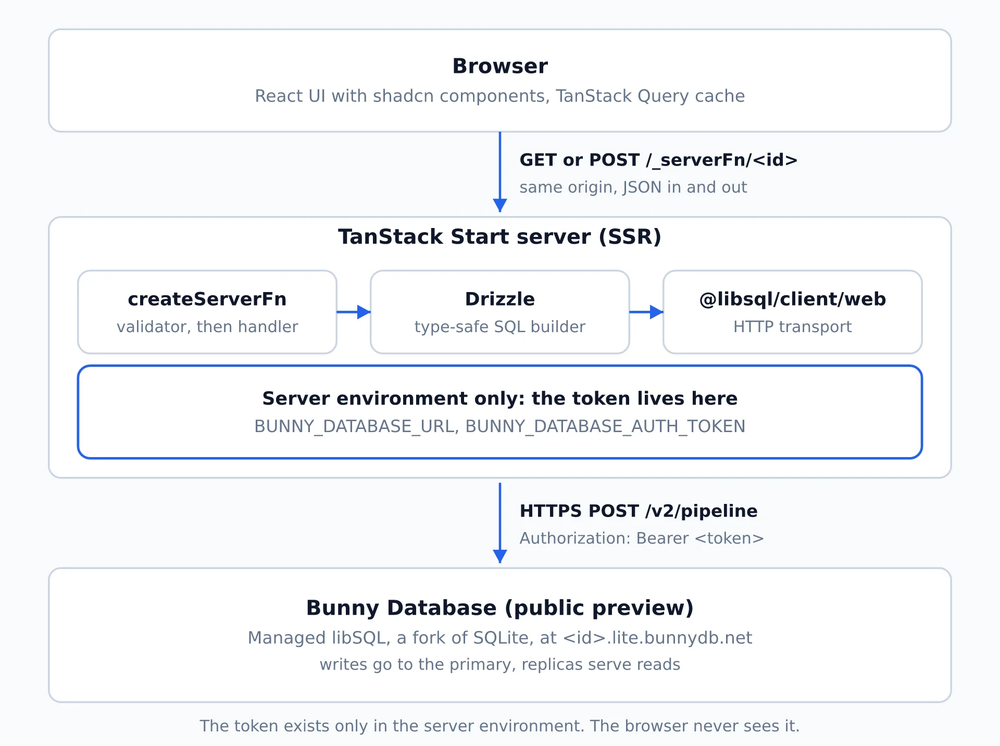
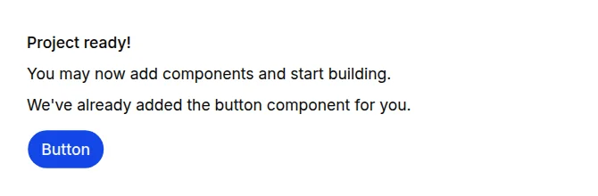
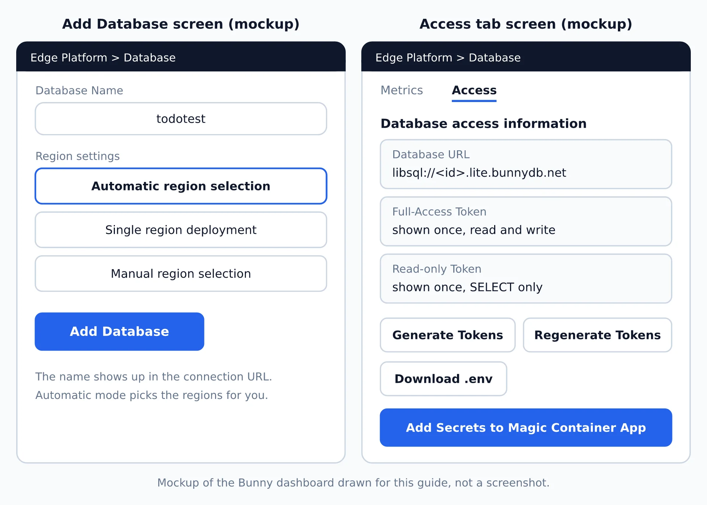
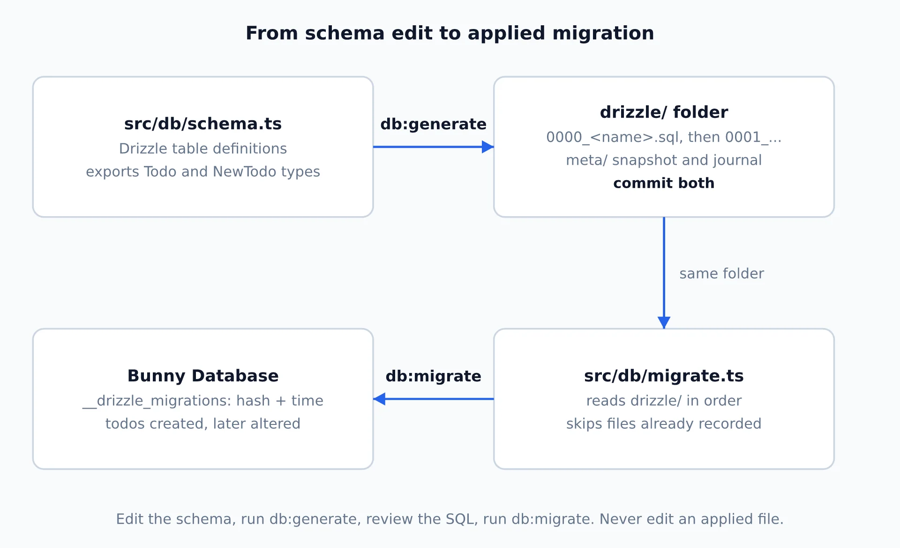
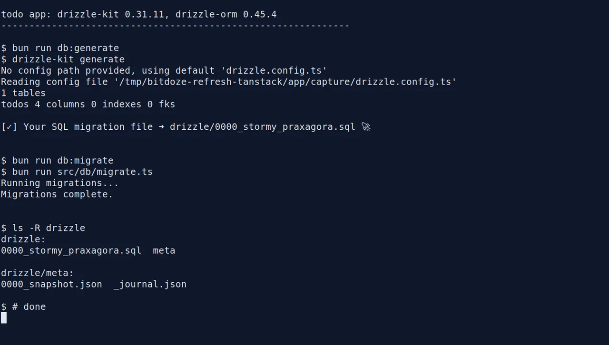
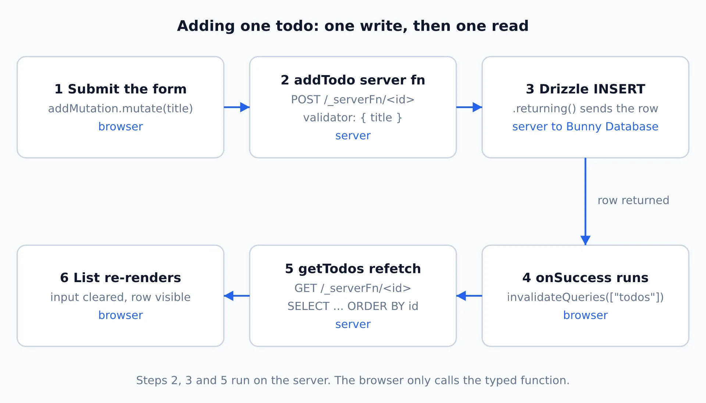
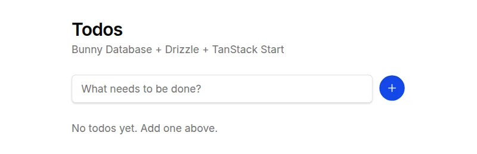
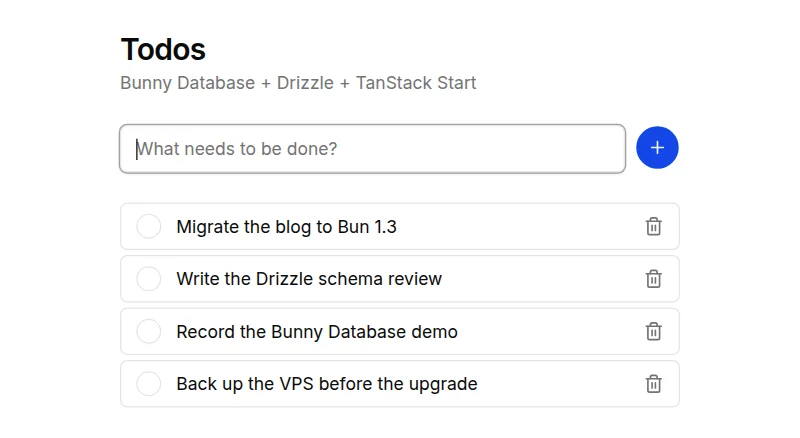
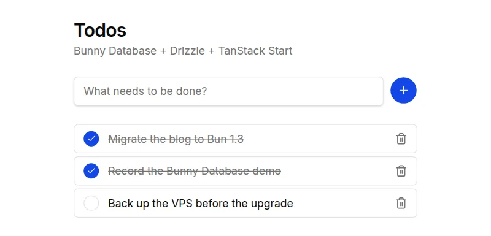

import Button from "@components/widgets/Button.astro";
import Notice from "@components/widgets/Notice.astro";
import ListCheck from "@components/widgets/ListCheck.astro";
import Accordion from "@components/widgets/Accordion.astro";
import YouTubeEmbed from "@components/widgets/YouTubeEmbed.astro";

*Disclosure: this guide contains referral links. If you buy through them, I may earn a commission at no extra cost to you.*

A todo app with TanStack Start server functions, Drizzle migrations and Bunny Database, a managed libSQL service, takes about an hour to build. The November 28, 2026 run used TanStack Start 1.169.7, drizzle-kit 0.31.11 and @libsql/client 0.18.0.

I wanted a way to ship a small full-stack TypeScript app without standing up a Postgres box or paying for a database that bills me while it sits idle. TanStack Start gives me server-side rendering and type-safe server functions, and Drizzle gives me a schema I can trust. [Bunny.net](https://go.bitdoze.com/bunny) has a managed libSQL database that spins down to zero when nobody's hitting it. Put the three together and you get type safety from the database row all the way to the button in the browser.

This is the exact setup I ran myself: create the database in the dashboard, scaffold a TanStack Start project with shadcn, define a Drizzle schema, generate and run migrations, then build a UI that lists, adds, toggles, and deletes todos. Nothing fancy, just a clean walkthrough you can copy line for line.

<Notice type="info" title="Checked on November 28, 2026">
  The app and migration commands below were re-run on November 28, 2026, with a local libSQL server standing in for Bunny Database. The outputs shown come from that run. The dashboard steps and the Bunny CLI commands come from Bunny's docs, because they need an account.
</Notice>

<Notice type="success" title="Try Bunny.net free for 14 days">
  You'll need a Bunny account to follow along. [Sign up at Bunny.net](https://go.bitdoze.com/bunny) with no credit card and get a 14-day trial. My [full Bunny.net review](/bunny-net-review/) covers the rest of the platform if you want the bigger picture first.
</Notice>


<YouTubeEmbed
  url="https://www.youtube.com/embed/ry0oQlbm_mc"
  label="The Ultimate Modern Stack? TanStack Start, Bunny DB, Drizzle, & Shadcn UI"
/>

## What we're building

A single-page todo app with:

<ListCheck>
- A live `todos` table stored in Bunny Database (managed libSQL)
- A Drizzle ORM layer with generated, versioned SQL migrations
- Server functions through TanStack Start's `createServerFn`, so database access never leaves the server
- A React UI styled with shadcn and Tailwind, hydrated from an SSR render
</ListCheck>

The end result is a small interface where you type a todo, hit enter, tick it off, or delete it. Every action round-trips to Bunny Database.



*The browser never talks to Bunny Database. It calls a server function, and the server holds the token and makes the HTTPS request.*

## Prerequisites

Before you start, you need:

- A [Bunny.net account](https://go.bitdoze.com/bunny). Bunny Database is still in public preview, with a cap of [50 databases and 1 GB each](https://bunny.net/docs/database/limits)
- Node.js or Bun installed. I used Bun here because installs and scripts run fast. The [Bun package manager guide](/bun-package-manager/) covers the setup
- Working knowledge of TypeScript, React, and SQL

The November 28 run used Bun 1.3.14 and Node 24.17.0. `bun run db:generate` starts `drizzle-kit` on Node, not on Bun, so both runtimes matter.

## Step 1: Scaffold the TanStack Start project with shadcn

The shadcn CLI has a TanStack Start template. One command gives you a TanStack Start project with Tailwind, the shadcn components and file-based routing, and on November 28 it finished in 7 seconds.

```bash
bunx --bun shadcn@latest init \
  --preset b1aIcEaeG \
  --base base \
  --template start \
  --pointer
```

The CLI asks for a project name (`start-app` by default) and creates the project in a folder with that name. The `--name` flag sets that name on the command line.

What each flag does:

- `--preset b1aIcEaeG` applies a shared configuration. With this preset it writes the `base-luma` style and the `neutral` base color into `components.json`
- `--base base` picks Base UI as the component library. The other options are `radix` and `aria`
- `--template start` scaffolds TanStack Start rather than Next.js or plain Vite
- `--pointer` turns on the pointer cursor for buttons

When it's done, the project looks roughly like this:

```
start-app/
├── src/
│   ├── components/
│   │   └── ui/           # shadcn components (button, etc.)
│   ├── lib/
│   │   └── utils.ts      # cn() helper for class merging
│   ├── routes/
│   │   ├── __root.tsx    # root layout + providers
│   │   └── index.tsx     # home route
│   ├── router.tsx
│   ├── routeTree.gen.ts  # generated, do not edit
│   └── styles.css        # Tailwind entry
├── components.json  # shadcn configuration
├── package.json
├── vite.config.ts
└── tsconfig.json
```

The CLI also runs `git init`, makes an initial commit and lists `.env*` in the starter's `.gitignore`.

Install dependencies and start the dev server to confirm it boots:

```bash
bun install
bun run dev
```

The command already installed the dependencies, so `bun install` only checks them. On November 28 the dev server printed `VITE v8.4.0 ready in 1259 ms`. Open the Local URL it shows and you should see this:



*The starter page right after scaffolding, before any database code.*

That gives you a styled, SSR-ready app. The only thing missing is a database.

<Notice type="info" title="Deploying TanStack Start elsewhere">
  This guide hosts the database on Bunny. If you'd rather run the whole app on your own box, I have a separate guide on [deploying TanStack Start on a VPS with Dokploy](/tanstack-start-dokploy-deploy/) that uses Postgres instead.
</Notice>

## Step 2: Create your Bunny Database

Bunny Database is a managed relational database built on libSQL, a fork of SQLite. You get standard SQL, optional global replication, usage-based billing (it idles when nothing's querying it), and several ways to connect: HTTP API, native SDKs, and ORMs like Drizzle.

It was still in [public preview](https://docs.bunny.net/database) on November 28, 2026, and free while the preview lasts. The published units after that are $0.30 per billion rows read, $0.30 per million rows written and $0.10 per GB per active region per month ([Bunny Database pricing](https://bunny.net/database)).

### Create the database in the dashboard

1. Log in to the [Bunny.net dashboard](https://go.bitdoze.com/bunny)
2. In the left sidebar, click **+ Add**, then **Database** under the Edge Platform group
3. Name it (for example `todotest`). This name shows up in your connection URL
4. Pick an option under **Region settings**:
   - **Automatic region selection**: Bunny picks the regions it expects to perform best for your location
   - **Single region deployment**: no replication, the cheapest option, and best for development or for users in one area
   - **Manual region selection**: you pick the storage location, the primary and any replica regions, for latency or compliance requirements
5. Click **Add Database**



*Mockup of the two dashboard screens, drawn for this guide: the Add Database form and the Access tab.*

Prefer the terminal? `bunny db create --name todotest --primary FR --link --token --save-env` creates the database, links the folder and writes both variables to `.env` ([CLI reference](https://bunny.net/docs/cli/commands/db)). It comes from the Bunny docs and was not run.

### Grab your credentials

Open the database and go to the **Access** tab:

- **Database URL**: looks like `libsql://<your-database-id>.lite.bunnydb.net`. Every client library uses this endpoint
- **Access Token**: click **Generate Tokens**. You get a **Full Access** token (read and write, use this for the app) and a **Read Only** token (limited to `SELECT`, handy for analytics)

Copy the URL and the Full Access token right away. Tokens show once. **Generate Tokens** creates a new pair and leaves older tokens valid, so use it when you lose one. **Regenerate Tokens** invalidates every existing token, so use it only after a leak ([Auth & Access](https://bunny.net/docs/database/connect/authorization)).

<Notice type="warning" title="Never commit credentials">
  Keep tokens out of version control. We'll put them in a `.env` file that's gitignored.
</Notice>

### Store credentials in .env

Create a `.env` in the project root:

```bash
BUNNY_DATABASE_URL="libsql://your-database-id.lite.bunnydb.net/"
BUNNY_DATABASE_AUTH_TOKEN="your-full-access-token"
BUNNY_DATABASE_READ_ONLY_AUTH_TOKEN="your-read-only-token"
```

Add a `.env.example` (safe to commit) so the next person knows what the app expects:

```bash
BUNNY_DATABASE_URL="libsql://your-database-id.lite.bunnydb.net/"
BUNNY_DATABASE_AUTH_TOKEN="your-full-access-token"
BUNNY_DATABASE_READ_ONLY_AUTH_TOKEN="your-read-only-token"
```

The starter's `.gitignore` has an `.env*` line, and that pattern also hides `.env.example`. Add one negation line so the example file can be committed:

```gitignore
# .gitignore
.env*
!.env.example
```

## Step 3: Install Drizzle and the libSQL client

Bunny Database speaks libSQL, so we use the official `@libsql/client` as the driver and Drizzle's libSQL adapter for type-safe queries.

```bash
bun add drizzle-orm @libsql/client
bun add -d drizzle-kit
```

- `drizzle-orm` is the ORM
- `@libsql/client` is the driver that talks the libSQL protocol over HTTP
- `drizzle-kit` is a dev dependency for generating migrations, pushing schema, and opening Drizzle Studio

The starter does not include TanStack Query, and Steps 10 and 11 import it. Add it now:

```bash
bun add @tanstack/react-query
```

Add three lines inside the `scripts` object of `package.json`. Leave the starter's other scripts alone, since the build and preview scripts are used later:

```json
"db:generate": "drizzle-kit generate",
"db:migrate": "bun run src/db/migrate.ts",
"db:studio": "drizzle-kit studio"
```

The starter ships `"dev": "vite dev --port 3000"`. Add `--host` to that line when you develop on a VPS and want to reach the server from a browser on your laptop. It binds Vite to your network interfaces instead of localhost.

On November 28, `bun run db:studio` printed `Drizzle Studio is up and running on https://local.drizzle.studio`, with a beta warning in front of it.

## Step 4: Configure Drizzle

Create `drizzle.config.ts` in the project root. It tells drizzle-kit where the schema lives, where migrations go, and how to reach the database:

```ts
// drizzle.config.ts
import { defineConfig } from "drizzle-kit"

export default defineConfig({
  schema: "./src/db/schema.ts",
  out: "./drizzle",
  dialect: "turso",
  dbCredentials: {
    url: process.env.BUNNY_DATABASE_URL!,
    authToken: process.env.BUNNY_DATABASE_AUTH_TOKEN!,
  },
})
```

Four settings matter:

- `dialect: "turso"` tells drizzle-kit to emit SQLite-compatible SQL, which is what libSQL (and Bunny Database) wants
- `libsql` is not a valid `dialect` value. drizzle-kit 0.31.11 and 1.0.0-rc.6 both reject it, with `postgresql`, `mysql`, `sqlite`, `turso` and `singlestore` on the accepted list
- `out: "./drizzle"` is where migration files land
- `dbCredentials` reads the same environment variables from `.env`, because drizzle-kit loads that file itself

drizzle-kit 1.0.0-rc.6, the release candidate current on November 28, still accepts `turso` but writes one folder per migration (`drizzle/<timestamp>_<name>/migration.sql`). The layout described here is the one `bun add -d drizzle-kit` produced that day, version 0.31.11.

## Step 5: Define the schema

Create `src/db/schema.ts`. This is the single source of truth for the database shape:

```ts
// src/db/schema.ts
import { sqliteTable, integer, text } from "drizzle-orm/sqlite-core"

export const todos = sqliteTable("todos", {
  id: integer("id").primaryKey({ autoIncrement: true }),
  title: text("title").notNull(),
  completed: integer("completed", { mode: "boolean" }).notNull().default(false),
  createdAt: integer("created_at", { mode: "timestamp" })
    .notNull()
    .$defaultFn(() => new Date()),
})

export type Todo = typeof todos.$inferSelect
export type NewTodo = typeof todos.$inferInsert
```

The `todos` table has four columns:

- `id` is an auto-incrementing integer primary key
- `title` holds the todo text and cannot be null
- `completed` is stored as 0/1 in SQLite, and Drizzle returns it as a `boolean` through `mode: "boolean"`
- `created_at` is an integer Unix timestamp that Drizzle returns as a JavaScript `Date` through `mode: "timestamp"`

Drizzle infers the two exported types, `Todo` and `NewTodo`, from the schema. You never hand-write them, and they stay in sync as the schema changes.

## Step 6: Create the database client

Create `src/db/index.ts`. It initializes the libSQL client and wraps it with Drizzle:

```ts
// src/db/index.ts
import { drizzle } from "drizzle-orm/libsql"
import { createClient } from "@libsql/client/web"
import * as schema from "./schema"

const client = createClient({
  url: process.env.BUNNY_DATABASE_URL!,
  authToken: process.env.BUNNY_DATABASE_AUTH_TOKEN!,
})

export const db = drizzle(client, { schema })
export { schema }
```

We use `@libsql/client/web` (the HTTP transport) rather than the native socket one, because you reach Bunny Database over HTTPS. The November 28 run used it under Bun for the migrations and under Node for the server.

The browser bundle stays clean as well. On November 28 the build of this code put none of the strings `libsql`, `drizzle`, `createClient` or `BUNNY_DATABASE` in the client bundle. They appeared only in the server chunk.

## Step 7: Generate the first migration

With the schema in place, generate the SQL migration:

```bash
bun run db:generate
```

drizzle-kit reads `src/db/schema.ts`, diffs it against the migration history, and writes a new file under `./drizzle/`. For the `todos` table it produces something like:



*The whole pipeline: edit the schema, generate the SQL, apply it with the migrate script, and commit the SQL folder with its meta files.*

```sql
-- drizzle/0000_certain_bug.sql
CREATE TABLE `todos` (
  `id` integer PRIMARY KEY AUTOINCREMENT NOT NULL,
  `title` text NOT NULL,
  `completed` integer DEFAULT false NOT NULL,
  `created_at` integer NOT NULL
);
```

That's plain SQLite syntax, which Bunny Database takes without changes. The number prefix orders the files, and the random suffix (`certain_bug` here) keeps the names unique.

The command also writes `drizzle/meta/`, with a `0000_snapshot.json` of the schema and a `_journal.json` that lists the migrations in order. Commit that folder with the SQL, since drizzle-kit diffs the next change against the snapshot.

## Step 8: Apply the migration

To run migrations programmatically, create `src/db/migrate.ts`:

```ts
// src/db/migrate.ts
import { migrate } from "drizzle-orm/libsql/migrator"
import { db } from "./index"

async function main() {
  console.log("Running migrations...")
  await migrate(db, { migrationsFolder: "./drizzle" })
  console.log("Migrations complete.")
  process.exit(0)
}

main().catch((err) => {
  console.error("Migration failed:", err)
  process.exit(1)
})
```

Run it:

```bash
bun run db:migrate
```

You should see:

```
Running migrations...
Migrations complete.
```



*The two commands in a lab run on November 28, 2026, against a local libSQL server with drizzle-kit 0.31.11 and drizzle-orm 0.45.4.*

The `todos` table now exists in Bunny Database. You can confirm it through the HTTP API:

```bash
HTTP_URL=$(echo $BUNNY_DATABASE_URL | sed 's/^libsql:/https:/')
curl -X POST "${HTTP_URL%/}/v2/pipeline" \
  -H "Authorization: Bearer $BUNNY_DATABASE_AUTH_TOKEN" \
  -H "Content-Type: application/json" \
  -d '{"requests":[{"type":"execute","stmt":{"sql":"SELECT name FROM sqlite_master WHERE type='"'"'table'"'"' ORDER BY name"}},{"type":"close"}]}'
```

The November 28 run answered with three rows and a closed session (the timing numbers vary):

```json
{"baton":null,"base_url":null,"results":[{"type":"ok","response":{"type":"execute","result":{"cols":[{"name":"name","decltype":"TEXT"}],"rows":[[{"type":"text","value":"__drizzle_migrations"}],[{"type":"text","value":"sqlite_sequence"}],[{"type":"text","value":"todos"}]],"affected_row_count":0,"last_insert_rowid":null,"replication_index":"7","rows_read":7,"rows_written":0,"query_duration_ms":0.059}}},{"type":"ok","response":{"type":"close"}}]}
```

Keep the `close` request in the payload. Without it the response carries a `baton`, which leaves a session open on the server.

The response lists `todos`, `__drizzle_migrations`, and `sqlite_sequence`. That `__drizzle_migrations` table is how Drizzle tracks which migrations have run.

Run `bun run db:migrate` again and it changes nothing; a repeat run on November 28 added no row to `__drizzle_migrations`. The Bunny CLI can also apply the `drizzle/` folder with `bunny db migrations apply`, but it records runs in its own `__bunny_migrations` table ([Bunny migrations](https://bunny.net/docs/database/migrations)). Pick one runner and stay with it. It comes from the Bunny docs and was not run.

<Notice type="info" title="The bsql shell">
  Bunny also ships an interactive SQL shell called `bsql`, a separate package: `npm install -g @bunny.net/database-shell`. With `BUNNY_DATABASE_URL` and `BUNNY_DATABASE_AUTH_TOKEN` in `.env`, a bare `bsql` connects, and `.tables` or `SELECT * FROM todos;` is quicker than writing code. The Bunny CLI has the same shell as `bunny db shell` ([Database Shell](https://bunny.net/docs/database/connect/database-shell)). Both come from the Bunny docs and were not run.
</Notice>

## Step 9: Build the server functions

With the database layer ready, we expose operations to the frontend through TanStack Start's server functions. These run only on the server, even though you import and call them like normal async functions from client code. That keeps the database client and your credentials off the browser bundle.

Create `src/db/queries.ts`:

```ts
// src/db/queries.ts
import { eq } from "drizzle-orm"
import { createServerFn } from "@tanstack/react-start"
import { db, schema } from "./index"
import type { NewTodo } from "./schema"

export const getTodos = createServerFn({ method: "GET" }).handler(async () => {
  const rows = await db.select().from(schema.todos).orderBy(schema.todos.id)
  return rows
})

export const addTodo = createServerFn({ method: "POST" })
  .validator((title: string) => ({ title }))
  .handler(async ({ data }) => {
    const newTodo: NewTodo = { title: data.title }
    const [created] = await db.insert(schema.todos).values(newTodo).returning()
    return created
  })

export const toggleTodo = createServerFn({ method: "POST" })
  .validator((input: { id: number; completed: boolean }) => ({
    id: input.id,
    completed: input.completed,
  }))
  .handler(async ({ data }) => {
    const [updated] = await db
      .update(schema.todos)
      .set({ completed: data.completed })
      .where(eq(schema.todos.id, data.id))
      .returning()
    return updated
  })

export const deleteTodo = createServerFn({ method: "POST" })
  .validator((id: number) => ({ id }))
  .handler(async ({ data }) => {
    await db.delete(schema.todos).where(eq(schema.todos.id, data.id))
    return { id: data.id }
  })
```

Every function follows the same shape:

1. `.validator()` parses and validates the incoming argument and hands you a typed `data` object
2. `.handler()` runs the Drizzle query against Bunny Database and returns the result
3. The function is async and returns the typed result, so the React caller gets full type safety

The TanStack Start docs suggest splitting this into a `.server.ts` file for the database code and a `.functions.ts` file for the wrappers ([Server Functions](https://tanstack.com/start/latest/docs/framework/react/guide/server-functions)). One file works as well. In the November 28 build the database code stayed in the server chunk, as Step 6 shows.

## Step 10: Wire up the QueryClientProvider

TanStack Start does SSR by default. Since the UI uses TanStack Query for data fetching, you need a `QueryClientProvider` at the root so both the server and client renders share the same query client.

Update `src/routes/__root.tsx`. Against the starter file that is four changes: import `QueryClient` and `QueryClientProvider`, create one client above the route, set the page title to `Todos`, and wrap `{children}` with the provider. Leave `defaultPreload: "intent"` out of this file, because the starter already sets it in `src/router.tsx` and the root route type rejects it.

```tsx
// src/routes/__root.tsx
import { HeadContent, Scripts, createRootRoute } from "@tanstack/react-router"
import { TanStackRouterDevtoolsPanel } from "@tanstack/react-router-devtools"
import { TanStackDevtools } from "@tanstack/react-devtools"
import { QueryClient, QueryClientProvider } from "@tanstack/react-query"

import appCss from "../styles.css?url"

const queryClient = new QueryClient()

export const Route = createRootRoute({
  head: () => ({
    meta: [
      { charSet: "utf-8" },
      { name: "viewport", content: "width=device-width, initial-scale=1" },
      { title: "Todos" },
    ],
    links: [{ rel: "stylesheet", href: appCss }],
  }),
  notFoundComponent: () => (
    <main className="container mx-auto p-4 pt-16">
      <h1>404</h1>
      <p>The requested page could not be found.</p>
    </main>
  ),
  shellComponent: RootDocument,
})

function RootDocument({ children }: { children: React.ReactNode }) {
  return (
    <html lang="en">
      <head>
        <HeadContent />
      </head>
      <body>
        <QueryClientProvider client={queryClient}>
          {children}
        </QueryClientProvider>
        <TanStackDevtools
          config={{ position: "bottom-right" }}
          plugins={[
            { name: "Tanstack Router", render: <TanStackRouterDevtoolsPanel /> },
          ]}
        />
        <Scripts />
      </body>
    </html>
  )
}
```

Skip the provider and the server render fails with `No QueryClient set, use QueryClientProvider to set one`. The terminal shows `Error in renderToReadableStream`, and the page displays that message instead of the todo UI. `bun run typecheck` catches the other two mistakes from the November 28 run: `Cannot find module '@tanstack/react-query'` and `'defaultPreload' does not exist in type RootRouteOptions`.

## Step 11: Build the todo UI

The last step replaces `src/routes/index.tsx` with the todo interface. It uses `useQuery` to load the list and `useMutation` for each action, and it invalidates the `todos` query after every mutation so the list refreshes.

The layout is a centered column: a heading, an input-and-button row to add todos, and the list below. Each item has a circular toggle button, the todo text (struck through when complete), and a trash icon. Every mutation calls `queryClient.invalidateQueries({ queryKey: ["todos"] })` on success, which refetches through the server function so the list shows what is in the database.



*One add is two requests: the write that inserts the row, then the read that refreshes the list.*

<Accordion label="Full src/routes/index.tsx" group="code" expanded="false">

```tsx
// src/routes/index.tsx
import { useState } from "react"
import { createFileRoute } from "@tanstack/react-router"
import { useQuery, useMutation, useQueryClient } from "@tanstack/react-query"
import { Check, Plus, Trash2 } from "lucide-react"
import { getTodos, addTodo, toggleTodo, deleteTodo } from "@/db/queries"
import { Button } from "@/components/ui/button"
import { cn } from "@/lib/utils"

export const Route = createFileRoute("/")({ component: TodoApp })

function TodoApp() {
  const queryClient = useQueryClient()
  const [newTitle, setNewTitle] = useState("")

  const { data: todos = [], isLoading } = useQuery({
    queryKey: ["todos"],
    queryFn: () => getTodos(),
  })

  const addMutation = useMutation({
    mutationFn: (title: string) => addTodo({ data: title }),
    onSuccess: () => {
      queryClient.invalidateQueries({ queryKey: ["todos"] })
      setNewTitle("")
    },
  })

  const toggleMutation = useMutation({
    mutationFn: (vars: { id: number; completed: boolean }) =>
      toggleTodo({ data: vars }),
    onSuccess: () => queryClient.invalidateQueries({ queryKey: ["todos"] }),
  })

  const deleteMutation = useMutation({
    mutationFn: (id: number) => deleteTodo({ data: id }),
    onSuccess: () => queryClient.invalidateQueries({ queryKey: ["todos"] }),
  })

  return (
    <div className="flex min-h-svh justify-center p-6">
      <div className="flex w-full max-w-md flex-col gap-6">
        <div>
          <h1 className="text-2xl font-semibold tracking-tight">Todos</h1>
          <p className="text-sm text-muted-foreground">
            Bunny Database + Drizzle + TanStack Start
          </p>
        </div>

        <form
          className="flex gap-2"
          onSubmit={(e) => {
            e.preventDefault()
            const title = newTitle.trim()
            if (!title) return
            addMutation.mutate(title)
          }}
        >
          <input
            value={newTitle}
            onChange={(e) => setNewTitle(e.target.value)}
            placeholder="What needs to be done?"
            className="flex-1 rounded-md border border-input bg-background px-3 py-2 text-sm shadow-sm placeholder:text-muted-foreground focus-visible:outline-none focus-visible:ring-1 focus-visible:ring-ring"
          />
          <Button type="submit" disabled={addMutation.isPending} size="icon">
            <Plus className="size-4" />
          </Button>
        </form>

        {isLoading ? (
          <p className="text-sm text-muted-foreground">Loading...</p>
        ) : todos.length === 0 ? (
          <p className="text-sm text-muted-foreground">
            No todos yet. Add one above.
          </p>
        ) : (
          <ul className="flex flex-col gap-1">
            {todos.map((todo) => (
              <li
                key={todo.id}
                className="flex items-center gap-3 rounded-md border border-border px-3 py-2"
              >
                <button
                  type="button"
                  onClick={() =>
                    toggleMutation.mutate({
                      id: todo.id,
                      completed: !todo.completed,
                    })
                  }
                  className={cn(
                    "flex size-5 shrink-0 items-center justify-center rounded-full border transition-colors",
                    todo.completed
                      ? "border-primary bg-primary text-primary-foreground"
                      : "border-input hover:border-primary",
                  )}
                  aria-label={todo.completed ? "Mark incomplete" : "Mark complete"}
                >
                  {todo.completed && <Check className="size-3" />}
                </button>

                <span
                  className={cn(
                    "flex-1 text-sm",
                    todo.completed && "text-muted-foreground line-through",
                  )}
                >
                  {todo.title}
                </span>

                <button
                  type="button"
                  onClick={() => deleteMutation.mutate(todo.id)}
                  className="text-muted-foreground hover:text-destructive"
                  aria-label="Delete todo"
                >
                  <Trash2 className="size-4" />
                </button>
              </li>
            ))}
          </ul>
        )}
      </div>
    </div>
  )
}
```

</Accordion>

Run `bun run typecheck` before anything else. On November 28 it came back clean only after `bun add @tanstack/react-query` and after the `defaultPreload` line left `__root.tsx`. Then start `bun run dev` and open the page: an empty list, the same list after four todos, and the result of ticking two and deleting one.



*The empty state. The heading and the form come from the server render, and the message appears after the first query.*



*Four todos added through the form.*



*Two todos ticked and one deleted, each change written through a server function.*

Curl the page and the first HTML contains the heading, the form and `Loading...`, not the rows. SSR does not await `useQuery`, so the list arrives right after hydration from the `getTodos` call. The TanStack Start docs name the route `loader` as the place to fetch data, with a `loader` that calls the server function ([Server Functions](https://tanstack.com/start/latest/docs/framework/react/guide/server-functions)).

## How do you run a TanStack Start app on a VPS?

Run the output of a Nitro build with `node .output/server/index.mjs` on the VPS or in a container, and pass the two database variables to that process. Server functions need a Node or Bun runtime, so a static host cannot serve the app.

When you develop on the VPS itself, the `--host` flag binds Vite to `0.0.0.0` so you can reach it from your laptop:

```bash
bun run dev
# Local:   http://localhost:3000/
# Network: http://your-vps-ip:3000/
```

Check the production build and serve it once with the preview command:

```bash
bun run build
bun run preview
```

`vite preview` is for checking a build on your own machine. The Vite docs say not to use it as a production server ([Vite CLI](https://vite.dev/guide/cli)). For a long-running process, add the Nitro plugin so the build also emits a Node server:

```bash
bun add nitro
```

```ts
// vite.config.ts: two additions to the starter file
import { nitro } from "nitro/vite"

plugins: [devtools(), tailwindcss(), tanstackStart(), nitro(), viteReact()],
```

On November 28, `bun run build` then wrote `.output/server/index.mjs`, and the Drizzle and libSQL code sat in its server chunks. The [TanStack Start hosting guide](https://tanstack.com/start/latest/docs/framework/react/guide/hosting) pairs that file with a `"start": "node .output/server/index.mjs"` script.

`node` does not read `.env`, so the two variables have to come from the process environment:

```bash
BUNNY_DATABASE_URL="libsql://your-database-id.lite.bunnydb.net" \
BUNNY_DATABASE_AUTH_TOKEN="your-full-access-token" \
node .output/server/index.mjs
```

Without them the list request returns a 500 and the log shows `LibsqlError: URL_INVALID: The URL 'undefined' is not in a valid format`. Wrap that command in systemd or PM2, or put it in a container. Bunny's own Magic Containers fit here, because you can attach the database credentials as environment variables straight from the database dashboard.

<Notice type="info" title="Attaching credentials to a Magic Container">
  Deploy to a Bunny Magic Container and you can skip the `.env` file. From the database **Access** tab, click **Add Secrets to Magic Container App**, pick your container app, and Bunny injects `BUNNY_DATABASE_URL` and `BUNNY_DATABASE_AUTH_TOKEN` for you ([Magic Containers](https://bunny.net/docs/database/connect/magic-containers)). Your code already reads `process.env`, so nothing changes.
</Notice>

## Why use TanStack Start with Bunny Database and Drizzle?

The Drizzle schema types every query and server function, Bunny Database takes plain SQLite syntax over HTTPS, and an idle database bills only for storage.

<ListCheck>
- **A column rename becomes a compile error**: the Drizzle schema is the source of truth, and TypeScript derives the server function results and the data the React components render from it
- **`dialect: "turso"` is all drizzle-kit needs**: Bunny Database speaks libSQL, a SQLite fork, so the SQL you know and the SQLite tools you have keep working
- **An idle database bills only for storage**: reads cost $0.30 per billion rows and writes $0.30 per million rows when traffic returns, so a quiet side project stays cheap
- **The first HTML carries the page shell**: TanStack Start renders the heading and the form on the server, and the rows arrive right after hydration, as Step 11 shows
- **shadcn components sit in `src/components/ui`**: the starter ships them as plain files in the project, so you edit them like any other file
- **Two commands per schema change**: edit `schema.ts`, run `db:generate` then `db:migrate`, and on November 28 a new column came out as one `ALTER TABLE` file
- **The same two variables in development and production**: `.env` holds them locally and Magic Containers inject them in production, while the code reads `process.env` either way
</ListCheck>

The [Astro vs Next.js vs TanStack Start comparison](/astro-vs-nextjs-vs-tanstack-start-which-wins/) has the framework trade-offs. For the same framework with a hosted database and no migrations to run, there is [getting started with TanStack Start and Convex](/tanstack-start-get-start/).

## Troubleshooting

A handful of things tripped me up while building this:

<Accordion label="No QueryClient set during SSR" group="troubleshoot" expanded="true">

You forgot to wrap the app in `QueryClientProvider` inside `__root.tsx`. The server log shows `Error in renderToReadableStream: Error: No QueryClient set, use QueryClientProvider to set one`, and the page shows that message instead of the todo UI. Add the provider as shown in Step 10.

</Accordion>

<Accordion label="Cannot find module '@tanstack/react-query'" group="troubleshoot">

The starter does not include TanStack Query. Run `bun add @tanstack/react-query`; the November 28 run installed 5.108.4. The same typecheck also reports `'defaultPreload' does not exist in type RootRouteOptions` while that line is still in `__root.tsx`, so delete it.

</Accordion>

<Accordion label="Protocol libsql not supported in libcurl" group="troubleshoot">

This shows up when you try to curl the database URL directly. curl answers `Protocol "libsql" not supported or disabled in libcurl`. The `libsql://` scheme is only for client libraries. For raw HTTP calls, convert it to `https://` and POST to `/v2/pipeline`, as in Step 8.

</Accordion>

<Accordion label="Tokens shown only once" group="troubleshoot">

Lose a Bunny access token and you click **Generate Tokens** on the **Access** tab. That creates a new pair and keeps older tokens valid. **Regenerate Tokens** is the kill switch. It invalidates every existing token, so update each app that used one ([Auth & Access](https://bunny.net/docs/database/connect/authorization)).

</Accordion>

<Accordion label="Migration fails with an error" group="troubleshoot">

Two errors showed up on November 28. ``Invalid enum value. Expected 'postgresql' | 'mysql' | 'sqlite' | 'turso' ... received 'libsql'`` means `dialect` must be `"turso"` in `drizzle.config.ts`, because Bunny Database uses the libSQL/SQLite dialect. ``SQL_INPUT_ERROR: SQL input error: table `todos` already exists`` means the table exists while `__drizzle_migrations` has no record of its file, as after `drizzle-kit push` created it. Use `push` or `generate` with `migrate` on one database, not both.

</Accordion>

<Accordion label="Port already in use" group="troubleshoot">

Vite moves to the next free port. On November 28 the lab run printed `Port 55945 is in use, trying another one...` and started on the next port; with the default script the number is 3000. Read the startup output for the port it picked. A second `bun run dev` in the same project stops with `Found another Vite dev process for this project`; close the first one or pass `--bypass-lock`.

</Accordion>

<Accordion label="Production page shows an empty list" group="troubleshoot">

`node .output/server/index.mjs` does not read `.env`. Without `BUNNY_DATABASE_URL` the list request returns a 500, the server log shows `LibsqlError: URL_INVALID: The URL 'undefined' is not in a valid format`, and the UI says `No todos yet`. Export both variables in the process environment, as in the VPS section.

</Accordion>

## Wrapping up

In about an hour I went from an empty folder to a type-safe, SSR todo app backed by a managed database. It costs next to nothing when idle, with versioned migrations and a UI I fully own. Growing the schema is a two-command operation, and the server function pattern keeps credentials and query logic where they belong.

If you want to push it further, start with user auth and per-user todos. Other next steps are due dates and filtering, optimistic updates instead of query invalidation, and a Magic Container deploy with credentials injected automatically. The [Bunny Database docs](https://docs.bunny.net/database) and the [Drizzle libSQL guide](https://orm.drizzle.team/docs/get-started-sqlite) cover the corners I didn't.

<Button text="Try Bunny.net Free for 14 Days" link="https://go.bitdoze.com/bunny" variant="solid" color="blue" size="lg" />

## Related articles

- [Bunny.net review](/bunny-net-review/): the full platform after a year in production
- [Astro DB with Bunny Database](/astro-db-bunny-database/): the same database with Astro's local-first workflow
- [Deploy TanStack Start on a VPS with Dokploy](/tanstack-start-dokploy-deploy/): the same stack with Postgres, fully self-hosted
- [Getting started with TanStack Start and Convex](/tanstack-start-get-start/): the same framework with a hosted database
- [Bun package manager](/bun-package-manager/): the runtime and package manager used here
- [Mount an S3 bucket as a filesystem](/s3-bucket-filesystem-vps/): ZeroFS and JuiceFS on Bunny Storage
- [Bunny Storage vs S3 vs Backblaze](/bunny-storage-vs-s3-vs-backblaze/): cloud storage pricing compared
- [Deploy an Astro site to Bunny.net](/deploy-astro-bunny-net/): static hosting on Bunny storage and CDN
- [Bunny Stream guide](/bunny-stream-guide/): video hosting on Bunny

## FAQ

<Accordion label="Is Bunny Database production-ready?" group="faq">

It's in public preview, so I'd treat it like any preview product. That means side projects, internal tools and read-heavy apps are fair game, but read the current terms before you put critical workloads on it. Bunny documents a loss window of up to 10 seconds or 4096 WAL frames on a primary failover, and hourly snapshots plus a snapshot on idle ([Durability and Consistency](https://bunny.net/docs/database/durability-and-consistency)). Since it's libSQL, the schema and queries here are plain SQLite. My [Bunny.net review](/bunny-net-review/) has more on where the platform is mature and where it's still maturing.

</Accordion>

<Accordion label="Can I use Postgres instead?" group="faq">

Not with Bunny Database, which is libSQL only. If you want Postgres with TanStack Start and Drizzle, my [Dokploy deployment guide](/tanstack-start-dokploy-deploy/) walks through that on a self-hosted VPS.

</Accordion>

<Accordion label="Why server functions instead of a REST API?" group="faq">

Server functions keep your database client and credentials on the server while letting you call them like plain async functions from the client. You skip writing and maintaining a separate API layer, and the types carry through. For a small app like this, that's a lot less boilerplate.

</Accordion>

<Accordion label="Does Bunny charge per query?" group="faq">

Bunny Database bills on usage, not per query. On November 28, 2026 it was free while in public preview. The published units are $0.30 per billion rows read, $0.30 per million rows written and $0.10 per GB per active region per month. Only storage is charged while idle ([Bunny Database pricing](https://bunny.net/database)). Preview limits cap an account at 50 databases of 1 GB each ([Limits](https://bunny.net/docs/database/limits)).

</Accordion>

<Accordion label="Can I add more tables later?" group="faq">

Yes, that's the nice part. Add a table or a column to `src/db/schema.ts`, run `bun run db:generate` to create the migration, then `bun run db:migrate` to apply it. On November 28, adding a nullable `due_at` column produced `drizzle/0001_brief_captain_cross.sql` with one `ALTER TABLE` statement, and the migrator recorded the second file next to the first in `__drizzle_migrations`.

</Accordion>

<Accordion label="Which versions did this guide run with?" group="faq">

The November 28, 2026 run used TanStack Start 1.169.7, React Router 1.170.46, React Query 5.108.4, drizzle-orm 0.45.4, drizzle-kit 0.31.11, @libsql/client 0.18.0 and Bun 1.3.14. `bun add drizzle-orm` and `bun add -d drizzle-kit` installed those two Drizzle versions, so the migration layout shown is the `0000_<name>.sql` one.

</Accordion>

<Accordion label="Why does view-source show Loading instead of the list?" group="faq">

The server renders the shell: the heading, the input and `Loading...`. SSR does not await `useQuery`, so the rows arrive from the `getTodos` server function right after hydration. The TanStack Start docs name the route `loader` as the place to fetch data.

</Accordion>

<Accordion label="Is turso the right drizzle-kit dialect for Bunny Database?" group="faq">

Yes. `dialect: "turso"` makes drizzle-kit emit SQLite-compatible SQL, and drizzle-kit 0.31.11 and 1.0.0-rc.6 both reject `libsql` as an invalid value. The migrator from `drizzle-orm/libsql/migrator` then applies the files with the same client the app uses.

</Accordion>
