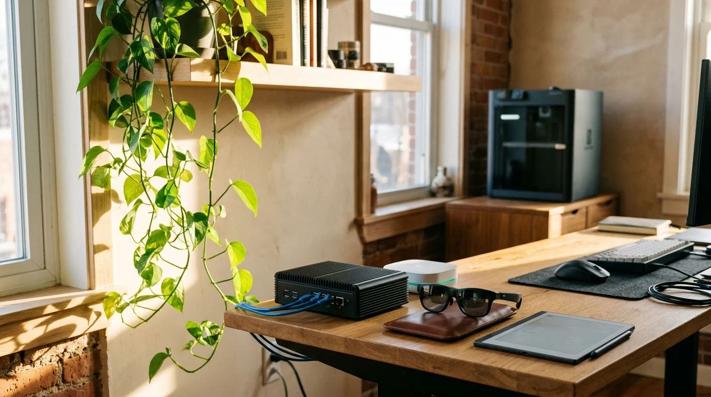

import Notice from "@components/widgets/Notice.astro";
import Accordion from "@components/widgets/Accordion.astro";
import Button from "@components/widgets/Button.astro";
import AmazonProduct from "@components/widgets/AmazonProduct.astro";

Buying a gift for someone who runs a home server is tricky because their actual wishlist reads like an invoice from a datacenter liquidator. They don't want a "There's No Place Like 127.0.0.1" t-shirt. They want 8U of desktop rack space to clean up the mini PCs sitting on their bookshelf, a KVM dongle so they stop dragging a monitor into the hall closet, or a pure-sine UPS before the next winter storm corrupts their ZFS pool.

Every item on this list solves a real infrastructure headache in a home lab. I sorted all 14 picks into three budget tiers—under $100 utilities, $100 to $250 rack and power upgrades, and $300+ group gifts—with live Amazon pricing checked on November 18, 2026. If the person you're shopping for is more into software engineering or pocket electronics than self-hosting, check our companion [gifts for programmers guide](/gifts-for-programmers/); this page stays focused on the server closet.

<Notice type="warning" title="Affiliate disclosure">
Some links below use `/go/` affiliate redirects to Amazon. Buying through them earns a small commission at no extra cost to you and helps fund the hardware tested on this site.
</Notice>

## Quick picks by budget

| Gift | Tier | Price (Nov 18) | What it fixes in their lab | Link |
| --- | --- | :---: | --- | --- |
| **Thermal Cable Label Maker** | Under $100 | ~$30 | Mystery Ethernet cables and unlabeled drive caddies | — |
| **PINECIL V2 Smart Soldering Iron** | Under $100 | $39.99 | Repinning fan headers and soldering ESP32 sensors | [Check Price](/go/pinecil-v2/) |
| **GeeekPi 10-Inch 12-Port Patch Panel** | Under $100 | ~$59 | Cable spaghetti at the front of a mini rack | [Check Price](/go/geeekpi-10in-patch-panel-12/) |
| **UGREEN 6-Port 2.5GbE + 10G SFP+ Switch** | Under $100 | ~$65 | The 1GbE bottleneck between their NAS and desktop | [Check Price](/go/ugreen-2-5gbe-switch/) |
| **iFixit Pro Tech Toolkit (64-Bit)** | Under $100 | ~$75 | Opening mini PCs, laptops, and server caddies cleanly | [Check Price](/go/ifixit-pro-tech-toolkit/) |
| **GL.iNet Comet (GL-RM1) KVM-over-IP** | Under $100 | $99.99 | Hauling a spare monitor to a headless server on boot failure | [Check Price](/go/glinet-comet-kvm/) |
| **GeeekPi DeskPi RackMate T1 (8U 10")** | $100–$250 | ~$130 | The pile of loose mini PCs, switches, and power bricks on a shelf | [Check Price](/go/geeekpi-rackmate-t1-8u/) |
| **JONSBO N3 8-Bay Mini-ITX NAS Case** | $100–$250 | $142.49 | Building a compact 8-bay hot-swap TrueNAS or Unraid box | [Check Price](/go/jonsbo-n3/) |
| **TerraMaster D4-320 4-Bay USB-C DAS** | $100–$250 | $189.99 | Adding 4 bulk 3.5-inch HDD bays to an existing mini PC | [Check Price](/go/terramaster-d4-320/) |
| **Home Assistant Green** | $100–$250 | $219.00 | Moving smart home automations off the main experimental server | [Check Price](/go/home-assistant-green/) |
| **CyberPower CP1500PFCLCD Pure-Sine UPS** | $100–$250 | $239.95 | Power flickers crashing ZFS pools and corrupting databases | [Check Price](/go/cyberpower-cp1500pfclcd/) |
| **Beelink Mini S13 (Intel N150, 16GB)** | $300+ Splurge | $349.00 | A silent, 10W dedicated Proxmox, Docker, or Frigate node | [Check Price](/go/beelink-mini-s13/) |
| **UGREEN NASync DXP2800 (2-Bay N100)** | $300+ Splurge | $379.98 | A turnkey x86 NAS with Docker, VMs, and 2.5GbE | [Check Price](/go/ugreen-dxp2800/) |
| **Seagate IronWolf 12TB CMR NAS Drive** | $300+ Splurge | ~$450 | Expanding a nearly full storage pool without SMR rebuild traps | [Check Price](/go/seagate-ironwolf-12tb/) |

---

## Stocking stuffers & under-$100 lab fixes

### 1. GL.iNet Comet (GL-RM1) KVM-over-IP ($99.99)

Every self-hoster has a headless box tucked behind a couch or up on a closet shelf that refuses to boot right after a kernel or BIOS update. Normally that means crawling around with a spare monitor and a wired USB keyboard to see where GRUB hung.

The [GL.iNet Comet](/go/glinet-comet-kvm/) plugs permanently into the server's HDMI port and a USB port, then exposes the raw BIOS screen and virtual keyboard/mouse inside any web browser. Because it ships with **Tailscale support built into the firmware**, they can even power-cycle or fix a stuck BIOS remotely from a laptop away from home. It requires zero cloud subscriptions and works on any x86 mini PC, custom NAS, or rack server.

<AmazonProduct
  productName="GL.iNet Comet (GL-RM1) Remote KVM-over-IP Console"
  productDescription="Hardware KVM-over-IP gateway with HDMI video capture, virtual USB keyboard/mouse/mass-storage emulation, and native Tailscale VPN support for out-of-band server management."
  productFeatures={[
    "BIOS-level HDMI capture + virtual USB keyboard and mouse in a browser",
    "Mount ISO images remotely as a virtual USB thumb drive to reinstall an OS",
    "Native Tailscale client built in for zero-port-forward remote access",
    "Compact aluminum body, zero recurring license fees"
  ]}
  productLink="/go/glinet-comet-kvm/"
  productImage="https://m.media-amazon.com/images/I/51OtDmQhdoL._AC_SL1500_.jpg"
  productRating={4.5}
  recommendedBadge="Best Gift Under $100"
  pros={[
    "Ends the 'drag a monitor into the closet' ritual permanently",
    "Half the price of older DIY PiKVM hats once you factor in a Pi and case"
  ]}
  cons={[
    "Target server needs an HDMI output (or a cheap DisplayPort-to-HDMI adapter)",
    "ATX power button header control requires the optional ATX adapter board"
  ]}
/>

### 2. UGREEN 6-Port 2.5GbE + 10G SFP+ Switch (~$65)

The most common bottleneck in a home lab isn't the CPU or the hard drives; it's the five-year-old 1GbE switch capping every file transfer at 112MB/s. Almost every modern mini PC and NAS ships with 2.5GbE ports now. Dropping a fanless [UGREEN 6-port 2.5GbE switch](/go/ugreen-2-5gbe-switch/) (five 2.5G RJ45 ports plus one 10G SFP+ uplink) into the middle of the desk immediately jumps LAN transfers to ~280MB/s on existing Cat5e/Cat6 cables. If you want to compare managed VLAN options, see our [2.5GbE and 10GbE homelab switch guide](/best-2-5-10gbe-switch-homelab/).

### 3. iFixit Pro Tech Toolkit (~$75)

Cheap screwdriver sets strip the tiny Phillips and Torx screws on NVMe heatsinks and mini PC bottom plates. The [iFixit Pro Tech Toolkit](/go/ifixit-pro-tech-toolkit/) includes the 64-bit precision driver set, ESD wrist strap, anti-static tweezers, nylon spudgers, and case-opening picks wrapped in a magnetic canvas roll that doubles as a parts tray. Even if they already own a basic household screwdriver, this becomes the kit that lives permanently next to the server rack.

### 4. PINECIL V2 Smart USB-C Soldering Iron ($39.99)

Sooner or later, a homelab project calls for soldering a 4-pin PWM fan header, flashing a Sonoff Zigbee dongle over UART, or wiring a BME280 temperature sensor to an ESP32. The open-source [PINECIL V2](/go/pinecil-v2/) runs off any 65W USB-C Power Delivery laptop charger, reaches 350°C in about six seconds, and packs into the size of a fountain pen. Just pair it with a braided silicone USB-C cable if they don't already have one on the workbench.

### 5. GeeekPi 10-Inch 12-Port Keystone Patch Panel (~$59)

If they already own a 10-inch mini rack (or if you're pairing this with the RackMate T1 below), a [10-inch 12-port keystone patch panel](/go/geeekpi-10in-patch-panel-12/) is the finishing touch that makes a home lab look like a miniature datacenter. Short 6-inch patch cords hop cleanly from the patch panel to the switch ports instead of having twelve stiff wall cables yanking directly on the front of the switch.

### 6. Thermal Cable & Drive Bay Label Maker (~$30)

Walk up to any unlabelled homelab rack and ask the owner which blue Ethernet cable goes to the Proxmox node and which one goes to the living-room Apple TV. A $30 Bluetooth or QWERTY thermal label printer with laminated wrap-around tape labels every Cat6 cable, wall wart voltage ("12V 3A — TerraMaster DAS"), and hot-swap drive bay with its last four serial digits (`ZFS-sda-8F2A`). It's the cheapest gift on this page and gets used every single month.

---

## The middle tier: racks, storage & power ($100–$250)

### 7. GeeekPi DeskPi RackMate T1 8U 10-Inch Mini Rack (~$130)

Most modern homelabs don't use 30-inch-deep enterprise 19-inch racks anymore; they run on a cluster of three quiet mini PCs, a 2.5GbE switch, a JetKVM/Comet, and a Raspberry Pi sitting in a messy stack on an IKEA Kallax shelf.

The [GeeekPi DeskPi RackMate T1](/go/geeekpi-rackmate-t1-8u/) is an 8U, **10-inch-wide** translucent-sided desktop server rack designed specifically for mini PCs, Raspberry Pi clusters, and compact switches. It has a whole ecosystem of 10-inch 1U shelves, brush pass-through plates, keystone patch panels, and mini PDUs, plus hundreds of free 3D-printable custom faceplates on Printables and MakerWorld for Beelink, Minisforum, and Lenovo Tiny nodes.

<AmazonProduct
  productName="GeeekPi DeskPi RackMate T1 (8U 10-Inch Server Cabinet)"
  productDescription="Desktop 8U 10-inch open-frame mini server rack with acrylic side panels, carrying handles, and standard rack mounting rails for mini PCs, SBC clusters, and compact network switches."
  productFeatures={[
    "8U height in the compact 10-inch width standard (~11 × 11 × 15 inches overall)",
    "Includes rack frame, acrylic side panels, and mounting hardware",
    "Huge ecosystem of 10-inch shelves, patch panels, SBC blades, and 3D-printed mounts",
    "Sits cleanly on a corner of a desk or standard 12-inch bookshelf"
  ]}
  productLink="/go/geeekpi-rackmate-t1-8u/"
  productImage="https://m.media-amazon.com/images/I/61aJd+USIXL._AC_SL1500_.jpg"
  productRating={4.6}
  recommendedBadge="Most Fun Homelab Gift"
  pros={[
    "Turns a messy pile of mini PCs and power bricks into a showpiece desktop rack",
    "Quiet, open airflow without the bulk of a 19-inch telecommunications cabinet"
  ]}
  cons={[
    "Uses the 10-inch mini-rack standard (full-width 19-inch enterprise switches will not fit)",
    "Order an extra 10-inch 1U vented shelf or two if they have several mini PCs"
  ]}
/>

### 8. JONSBO N3 8-Bay Mini-ITX NAS Case ($142.49)

For the homelaber who prefers building their own storage server over buying a locked-down appliance, the [JONSBO N3](/go/jonsbo-n3/) is the standout mini-ITX NAS chassis of the last two years. The lower chamber holds **eight 3.5-inch hot-swap SATA bays** cooled by twin 100mm fans, while the top chamber houses a standard mini-ITX motherboard and SFX power supply. If they've been talking about building a TrueNAS SCALE or Unraid box, pair this case with our [NAS build under $500 parts list](/nas-build-under-500/) and you've handed them their favorite weekend project of the year.

### 9. TerraMaster D4-320 4-Bay 10Gbps USB-C DAS ($189.99)

If their home server is already a capable Beelink, Minisforum, or Mac mini, they don't necessarily need a separate NAS with its own CPU and RAM—they just need somewhere to put four 3.5-inch hard drives. The [TerraMaster D4-320](/go/terramaster-d4-320/) attaches four hot-swap SATA bays over a single 10Gbps USB-C cable, passes individual disk SMART data and serial numbers cleanly to Linux/Proxmox/TrueNAS, and tops out around 1,000MB/s across four disks. We tested the full category in our [best DAS enclosures for homelab guide](/best-das-enclosure-homelab/).

### 10. Home Assistant Green ($219.00)

Every experienced self-hoster eventually learns a painful lesson: **do not run the house's lights and thermostat inside the same experimental Proxmox cluster you tear down on Tuesday nights.** Moving Home Assistant onto Nabu Casa's dedicated, fanless [Home Assistant Green](/go/home-assistant-green/) decouples household smart-home uptime from lab maintenance. It draws ~3W, boots Home Assistant OS out of the box, and pairs with a Zigbee/Thread dongle (and our [favorite local Zigbee sensors](/best-zigbee-sensors-home-assistant/)). If they also plan to run local AI camera detection with Frigate, check the beefier options in our [Home Assistant hardware guide](/best-home-assistant-hardware/).

### 11. CyberPower CP1500PFCLCD Pure Sine Wave UPS ($239.95)

Nobody gets excited about buying a battery backup for themselves—until a two-second summer brownout hard-resets their NAS mid-write. That is why a [CyberPower CP1500PFCLCD](/go/cyberpower-cp1500pfclcd/) (1500VA / 1000W pure sine wave) is secretly one of the highest-impact gifts you can give a homelab owner.

Modern mini PCs and NAS power supplies use Active PFC circuits that can buzz or shut off abruptly on cheap simulated-sine-wave battery backups. The CP1500PFCLCD outputs clean pure sine wave power, runs a typical 60W homelab (NAS + two mini PCs + switch + router) for 45+ minutes during an outage, and exposes a USB monitoring port that speaks natively to **Network UPS Tools (NUT)** so every server in the rack shuts down gracefully before the battery drains.

<AmazonProduct
  productName="CyberPower CP1500PFCLCD 1500VA/1000W Pure Sine Wave UPS"
  productDescription="Line-interactive 1500VA/1000W pure sine wave UPS with Automatic Voltage Regulation (AVR), 12 outlets, tilting color LCD panel, and USB communication for NUT/apcupsd graceful server shutdown."
  productFeatures={[
    "1500VA / 1000W pure sine wave output safe for Active PFC power supplies",
    "12 total outlets (6 battery backup + surge, 6 surge-only) plus front USB charge ports",
    "Native USB HID support for Network UPS Tools (NUT), Synology DSM, UGOS, and TrueNAS",
    "3-year warranty including the internal battery pack + $500,000 connected equipment guarantee"
  ]}
  productLink="/go/cyberpower-cp1500pfclcd/"
  productImage="https://m.media-amazon.com/images/I/617WOwlPeDL._AC_SL1500_.jpg"
  productRating={4.5}
  recommendedBadge="Best Infrastructure Upgrade"
  pros={[
    "Protects thousands of dollars of drives and ZFS pools from dirty power and blackouts",
    "Quiet operation (fan stays off during normal line power)"
  ]}
  cons={[
    "Weighs 25 lbs—sits on the floor next to the desk or rack",
    "Lead-acid battery cartridge needs a ~$60 swap every 3–5 years"
  ]}
/>

---

## The $300+ splurge tier (group gifts & starter labs)

### 12. Beelink Mini S13 (Intel N150, 16GB RAM, 500GB SSD — $349.00)

If they've been running all their Docker containers on a desktop PC or an aging Raspberry Pi 4, a [Beelink Mini S13](/go/beelink-mini-s13/) is a massive leap forward. Built around Intel's 6W Twin Lake N150 processor with 16GB of RAM, a 500GB NVMe SSD, and room for a second M.2 drive, it idles under 10W, stays whisper-quiet on a desk, and has Intel QuickSync hardware transcoding for Plex or Jellyfin. It works equally well as a first standalone Ubuntu/Docker server or as the third quorum node in an existing Proxmox cluster (compare the heavier Ryzen and dual-NIC nodes in our [home server mini PC roundup](/best-mini-pc-home-server/)).

### 13. UGREEN NASync DXP2800 2-Bay NAS ($379.98)

For someone ready to ditch cloud photo subscriptions and self-host their own backups, Immich photo library, and media server, the [UGREEN NASync DXP2800](/go/ugreen-dxp2800/) is the standout entry-level NAS of 2026. Inside an anodized aluminum two-bay chassis, it packs a 4-core x86 Intel N100 CPU, 8GB of DDR5 RAM, **two M.2 NVMe slots** (so Docker apps and databases run at SSD speeds while the hard drives hold bulk files), and a 2.5GbE port. If you want to step up to four bays and 10GbE networking, check the $619.99 DXP4800 Plus in our [best NAS for Docker and Proxmox guide](/best-nas-homelab-docker-proxmox/).

<AmazonProduct
  productName="UGREEN NASync DXP2800 2-Bay Desktop NAS (Diskless)"
  productDescription="2-bay x86 desktop NAS powered by an Intel N100 4-core CPU with 8GB DDR5 RAM, dual M.2 NVMe SSD slots, 2.5GbE LAN, 4K HDMI output, and native Docker/VM support in UGOS Pro."
  productFeatures={[
    "Intel N100 (4C/4T) x86 processor with QuickSync 4K hardware transcoding",
    "2× 3.5/2.5-inch SATA bays + 2× M.2 NVMe 2280 slots (up to 76TB total)",
    "8GB DDR5 SODIMM (upgradable to 16GB) + 2.5GbE network port",
    "Runs UGOS Pro (Docker Compose & VM Manager included) or third-party TrueNAS/Unraid"
  ]}
  productLink="/go/ugreen-dxp2800/"
  productImage="https://m.media-amazon.com/images/I/61Fn--f27TL._AC_SL1500_.jpg"
  productRating={4.6}
  recommendedBadge="Best Starter NAS Gift"
  importantConsiderations={[
    "Sold diskless—pair with one or two 3.5-inch CMR NAS hard drives",
    "Inventory moves fast around holiday sales (down to 2 units at our Nov 18 check)"
  ]}
  pros={[
    "Real x86 CPU and DDR5 memory at a price where competitors still ship weak ARM chips",
    "Dual NVMe slots keep Docker containers snappy and quiet"
  ]}
  cons={[
    "Two 3.5-inch bays limit you to RAID 1 mirroring for redundancy",
    "UGOS software ecosystem is newer than Synology DSM"
  ]}
/>

### 14. Seagate IronWolf 12TB CMR NAS Hard Drive (~$450)

Ask any homelab owner what they actually need most right now and nine out of ten will say "more terabytes." With 3.5-inch drive pricing roughly double where it sat in 2024, unwrapping a fresh [Seagate IronWolf 12TB CMR NAS drive](/go/seagate-ironwolf-12tb/) feels like unwrapping gold bars.

One critical rule when buying a hard drive as a gift: **only buy CMR (Conventional Magnetic Recording) NAS drives**—Seagate IronWolf / IronWolf Pro, WD Red Plus / Red Pro, or Toshiba N300/MG series. Never buy a bare desktop drive or a non-Plus "WD Red," which uses slower SMR tracks that stall out during RAID and ZFS rebuilds. Not sure what size or brand fits their array? Check our [2026 NAS hard drive comparison](/best-hard-drives-for-nas/).

---

## FAQ

<Accordion label="What is the safest homelab gift if I have no idea what hardware they already run?" group="faq" expanded="true">
Go with the **GL.iNet Comet KVM-over-IP** ($99.99), the **iFixit Pro Tech Toolkit** (~$75), the **PINECIL V2 soldering iron** ($39.99), or a **thermal cable label maker** (~$30). All four work alongside any server brand—whether they run a tiny Raspberry Pi cluster, three Beelink mini PCs, a Synology NAS, or a full 42U enterprise rack in the basement.
</Accordion>

<Accordion label="Can I gift a diskless NAS like the UGREEN DXP2800 without buying the hard drives too?" group="faq">
Absolutely. In fact, many homelab owners prefer picking their own drive capacities and RAID layout (or moving existing drives over with a migration plan). A diskless DXP2800 can even boot and run Docker containers immediately using a single inexpensive M.2 NVMe SSD while they wait to add 3.5-inch spinning drives.
</Accordion>

<Accordion label="Should I buy smart home gadgets for someone with a homelab?" group="faq">
Only if the hardware runs 100% locally without a mandatory cloud account or monthly fee. **Home Assistant Green** ($219) and local Zigbee/Matter sensors are huge hits with the self-hosting crowd; cloud-tethered Wi-Fi cameras or smart plugs that force you to install a proprietary smartphone app will usually stay in the box.
</Accordion>

## Bottom line

Match the gift to the complaint you hear most often:
- **"I hate dragging a monitor over to the server when it hangs"** → [GL.iNet Comet KVM-over-IP ($99.99)](/go/glinet-comet-kvm/).
- **"My shelf of mini PCs and cables looks like a fire hazard"** → [GeeekPi DeskPi RackMate T1 (~$130)](/go/geeekpi-rackmate-t1-8u/) + [10-inch patch panel (~$59)](/go/geeekpi-10in-patch-panel-12/).
- **"Our power flickered and my server rebooted again"** → [CyberPower CP1500PFCLCD Pure-Sine UPS ($239.95)](/go/cyberpower-cp1500pfclcd/).
- **"I want to get started with a real home NAS"** → [UGREEN NASync DXP2800 ($379.98)](/go/ugreen-dxp2800/) or the DIY [JONSBO N3 8-bay case ($142.49)](/go/jonsbo-n3/).

Shopping during November deal weeks? Check our live [Black Friday Home Server & Homelab Deals tracker](/black-friday-home-server-deals/) to see which of these picks have dropped below their target buy price.
