import YouTubeEmbed from "@components/widgets/YouTubeEmbed.astro";
import Notice from "@components/widgets/Notice.astro";
import ListCheck from "@components/widgets/ListCheck.astro";
import Accordion from "@components/widgets/Accordion.astro";
import Button from "@components/widgets/Button.astro";

Tern is the new terminal from [Stencil](https://stencil.so/tern), the team behind the [omp](https://omp.sh/) agent CLI. After a few hours inside it I understand the tagline: "a neoterminal for the Electron-weary." It's a Rust-native app where the shell is only one kind of pane. A git client, a SQLite browser, Jupyter notebooks, a kanban board over your `TODO.md`, a file editor, a task manager, even a web browser are all "blocks" that split, tab and float next to your prompt. And since Stencil also makes omp, the AI agent is a first-class block rather than a bolted-on plugin.

Tern is in **closed beta**. Access goes through the waitlist on the site (mine took about two days). Builds exist for macOS, Windows, Linux and Android, and an iPhone client is next — the session you leave on your desk can follow you to your phone.

<YouTubeEmbed
  url="https://www.youtube.com/embed/G6F1ASwMEUU"
  label="Tern hands-on: workspace tour and an agent-built Astro site"
/>

## What Tern actually is

Two ideas, layered:

1. **A daemon owns the processes, the window is just a client.** Quit Tern, reboot, reopen — every pane comes back in its directory over its old scrollback, with an agent mid-conversation. `tern remote serve` exposes the same session daemon on a server over QUIC, and `tern web serve` puts it in a browser tab. Multiple clients can attach to one daemon at once — desktop app, browser tab, phone — and typing on one shows on the others.
2. **Blocks, not just panes.** Everything you'd normally ⌘-Tab to another app for exists as a native block one ⌘K away: git, a database browser, a notebook, a kanban board. Programs describe their UI over the Tern Surface Protocol and Tern draws it natively: no bundled Chromium, and Stencil claims ~150 ms to a live prompt on a cold launch (151 ms p95, 153 ms to reopen six tabs).

The vocabulary: a **session** holds tabs, a tab holds **panes**, a pane runs a **block** — a shell, an agent, or one of the app blocks below. Sessions persist in the daemon (`tern daemon`, auto-started by any window and installable as a login item), so windows are disposable views onto work that doesn't stop.

The AI part is omp running as a native block with its own renderer instead of ANSI art in a terminal grid. Agent blocks get model pickers, slash commands, skills and a context inspector. A normal shell pane still runs any other agent CLI — Codex, Devin, whatever you already use — because at the end of the day it's still a terminal.

## The window: panes, tabs, layouts

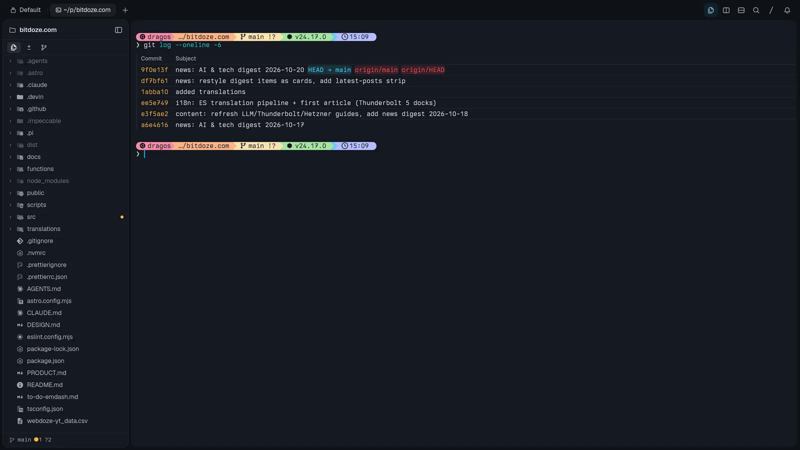

Splits, tabs and layouts behave like a modern multiplexer: split right or down, zoom a pane to fill the tab, equalize the tree, drag a pane into another tab or session. The Files pane on the left is a project sidebar that follows whatever block has focus — git-aware, filterable, and it reveals what the agent just touched. Everything has a shortcut, and the shortcuts are remappable.

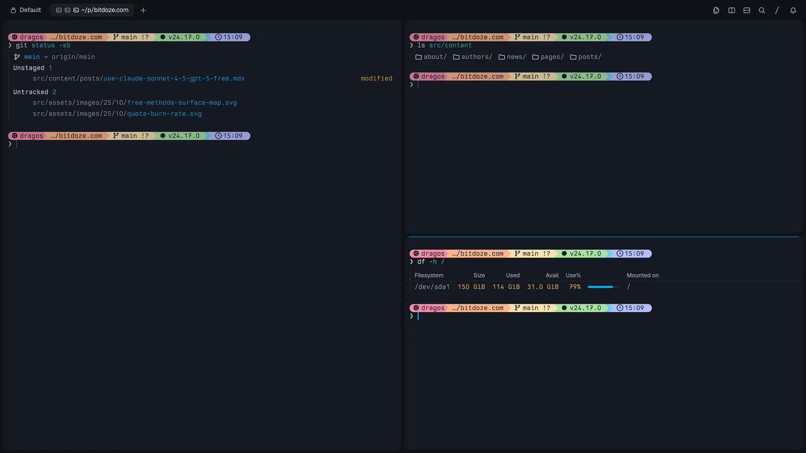

Any pane can pop out into picture-in-picture — a small always-on-top frame you can drag, dock back into the split tree, stash against a window edge, or fan out when you have several. I use it to keep a running agent visible while working underneath it.

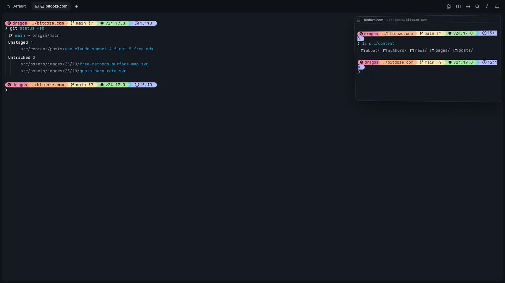

The command palette (⌘K) is where everything lives, with scoped tabs: **All, Commands, Files, Branches, Commits, Sessions, Hosts**. That means fuzzy-opening files, checking out a branch, jumping to a commit or switching a host are all the same gesture.

There's also a real notification system: a "Needs attention" inbox collects bell rings, finished builds, exited programs and agents waiting for input — each entry deep-links back to the pane that raised it. When a long agent run ends, it lands here instead of silently scrolling off.

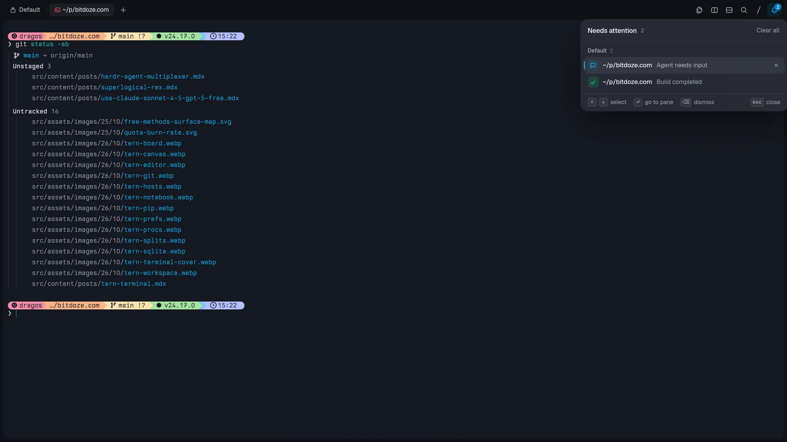

## The blocks

### Files and the editor

`tern open file` (or ⌘O) opens code with syntax highlighting and git changes in the gutter, Markdown in a rendered/source toggle, images, SVGs, PDFs and media in real viewers — video files even get a frame-strip preview. It autosaves, and `EDITOR='tern open --wait'` works for `git commit`-style flows because the CLI blocks until you close the block.

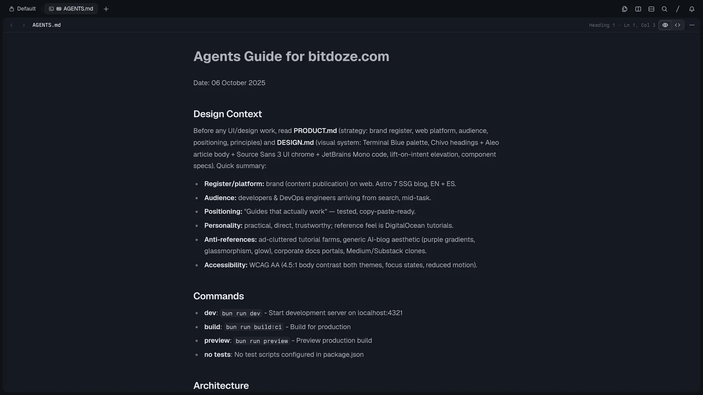

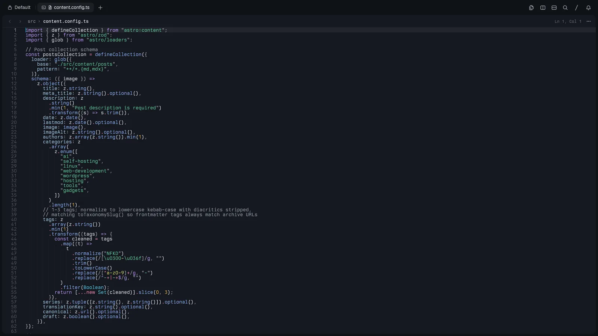

### Git (⌥⌘G)

A real git client: branch and tag lanes on a commit graph, a working-tree view with staged/unstaged groups and per-file +/− counts, diffs with line staging and fold/unfold of unchanged context, `git peek` on any commit, a refs tab covering branches/remotes/tags/stashes/worktrees/submodules, undo, and AI-assisted commit messages ("Generate message", AI explain, AI staging).

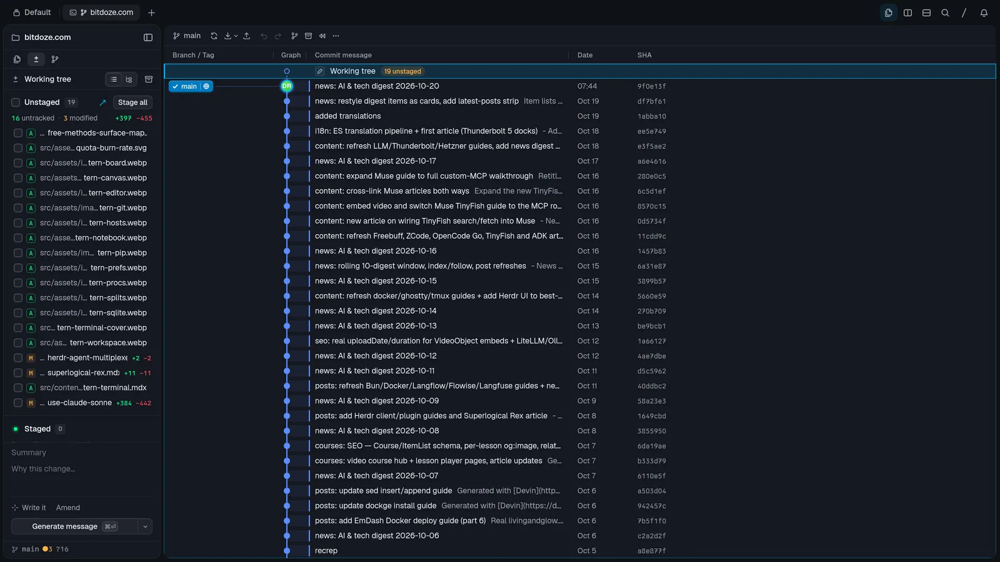

### Database

SQLite ported from DB Browser, as a block. Four areas: **Structure** (schema tree, create/edit tables and indexes, attach, import CSV/SQL), **Browse** (data grid with per-column filters, sorting, inline cell editors — text, hex, JSON, XML, image — New Record, saved views, export to CSV/JSON), **Execute** (SQL tabs with completion, results grid, a SQL log, even result plotting) and **Pragmas**. Changes stage as "Write Changes"/revert instead of auto-committing, and in-memory databases are one click away for scratch work.

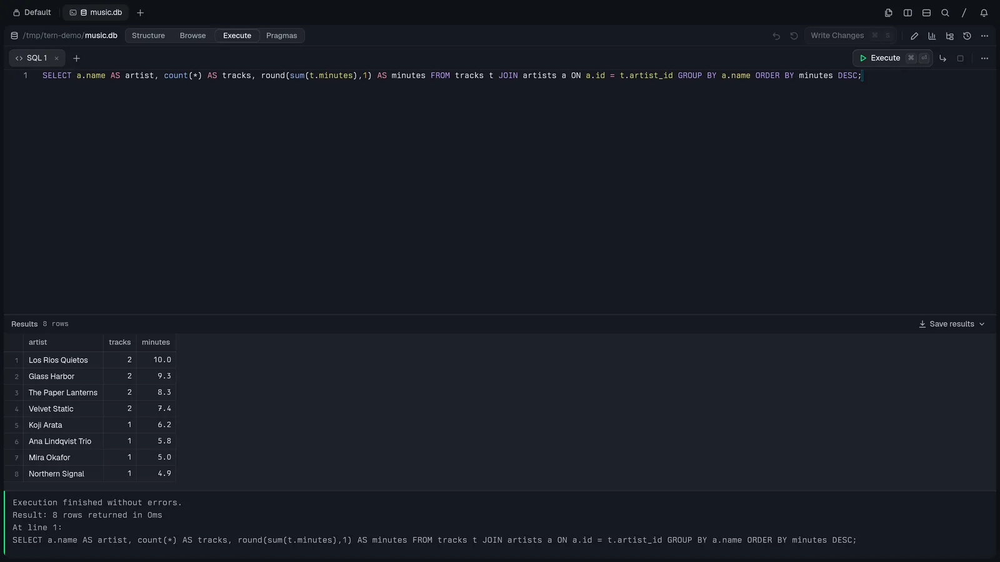

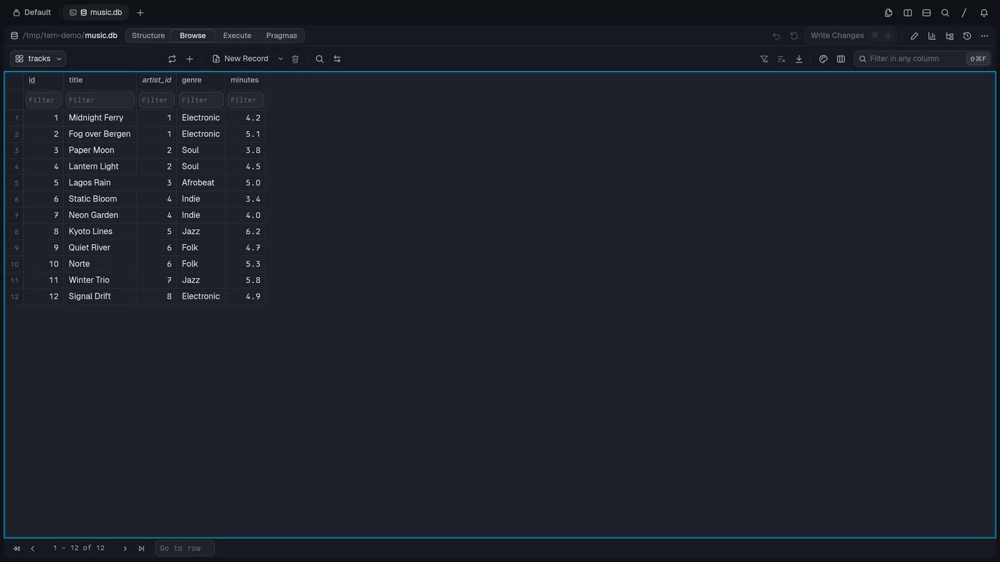

### Board (⌥⌘K)

Point it at a `TODO.md` and it becomes a kanban: Todo/Doing/Done lanes from the headings, cards from the checkboxes, board and list views, drag between lanes, tags and dates on cards. Agents can read and update the file, which makes it a cheap shared task list between you and the model — I used exactly this to hand an agent a work queue.

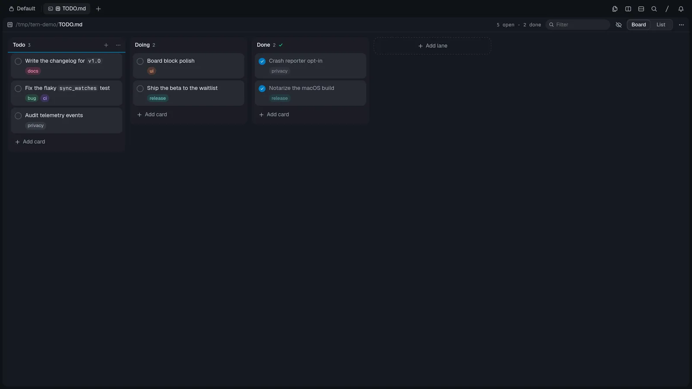

### Notebook

Jupyter on a plain Python kernel — no server to run. Code and Markdown cells, real outputs, completion, inspection, a variables sheet, restart/interrupt. My test cell ran on the system's Python 3.12.

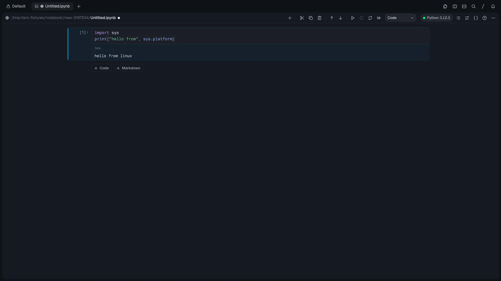

### The rest of the block shelf

- Canvas: a freeform sketch block (draw, shapes, arrows, text) beside your shell — good for annotating screenshots for a video.
- Task manager: process list or tree with CPU, memory and GPU gauges, filtering, and quit/force-quit per row.
- Browser (⇧⌘B): real pages in a block; the point is that omp can drive it to inspect what it just built, including page snapshots.
- Screen share: see and drive another machine's display, fit or actual size, with a control toggle. I haven't exercised this one yet.
- Notes: a scratch text block for quick jotting.
- Carly: Stencil's built-in assistant with a realtime voice mode — its own settings page, still early.

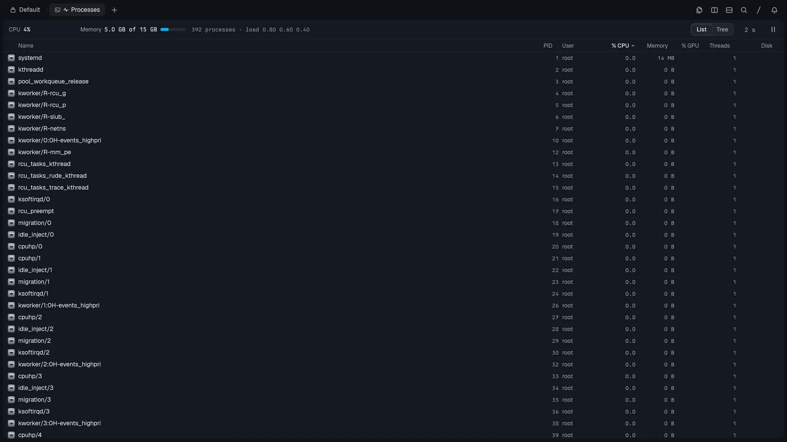

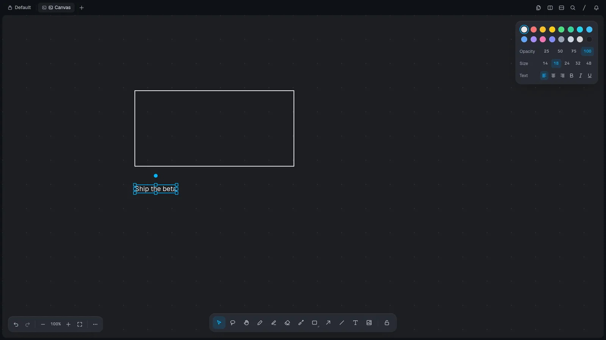

## Sessions outlive the window — and travel

The persistence story is the same promise [Herdr](/herdr-agent-multiplexer/) makes, taken further: close the window mid-build and nothing stops, reopen and you're exactly where you left it. I killed the app with a remote session running on a VPS — everything, including the agent conversation, was still there when I came back.

The Hosts scope of the command palette is the switcher: your machine, remote Tern daemons reachable directly or over a tailnet, and "Connect from mobile" which pairs a phone by scanning a code. Adding a host is a dialog, not a config file: give it an ssh host, hostname or `IP:port` (or a Tern endpoint id), say which user to act as, and Tern sets up `tern remote serve` for you — it can also pick hosts straight out of `~/.ssh/config`.

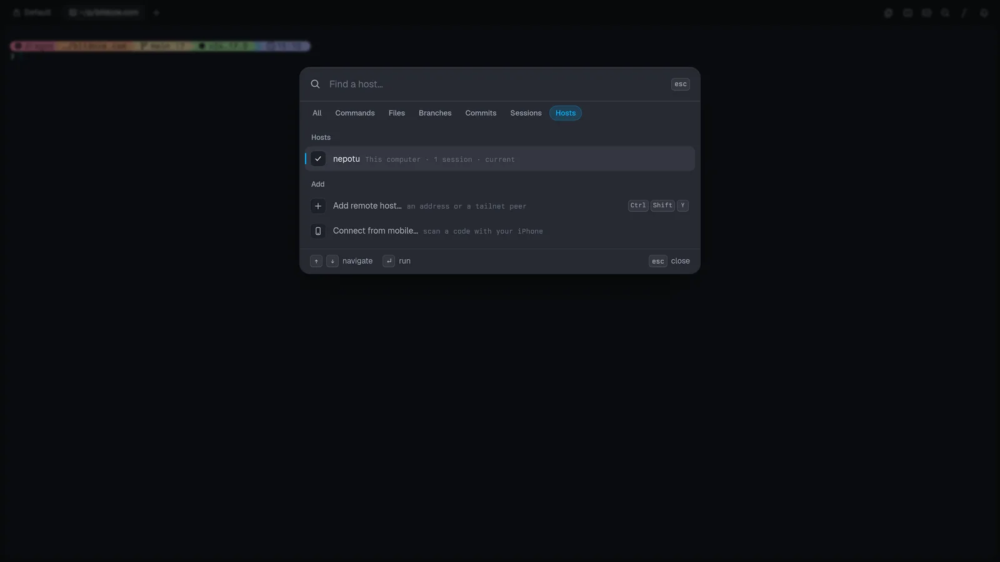

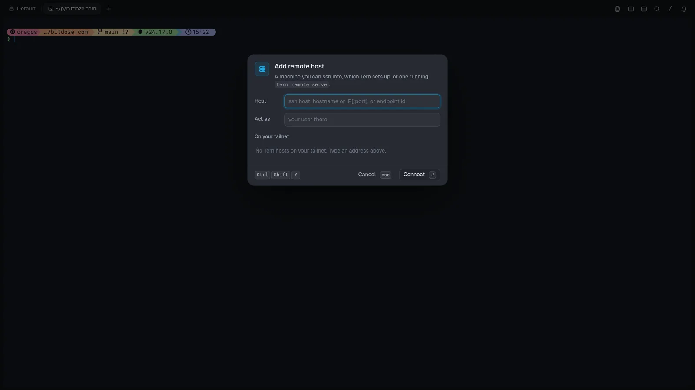

Each host keeps its own session state, so hopping between the laptop and a VPS doesn't disturb either side. `tern whoami --json` reports the identity chain of the pane you're in (which user, through which host). And `tern web serve` exposes the daemon on a token URL (`http://127.0.0.1:8377/?token=…`) — the browser client is a wasm build rendering on WebGPU, so a browser tab really is another client, not a remote-desktop hack.

It's the same model I described in the [Superlogical Rex briefing](/superlogical-rex/) (server owns the session, clients attach), except Tern ships it for Linux, Windows and Android today, not just macOS.

## Agents are native, not embedded

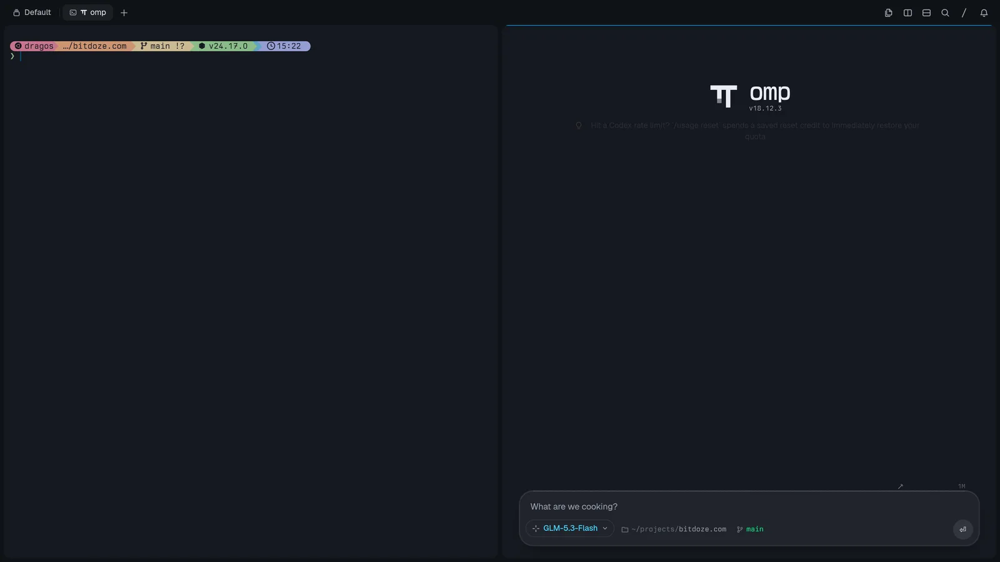

The agent block is omp drawn natively — the contrast the site makes is an omp session as ANSI text in a 48×37 grid versus the same session rendered by Tern: a model picker (mine was on GLM-5.3-Flash), slash commands with skills, a thinking toggle, a task-agents panel that shows subagents it spawned, and a context inspector that breaks the window down. In my session that showed a 1M-token budget split across the system prompt (~3k), tools, skills and messages — MCP servers would show there too. You get a notification when a run finishes, which matters when you bounce between panes.

Other agent CLIs run as ordinary terminals. I opened Devin and Codex in panes and chatted normally; they just don't get omp's native chrome. What an "agent block" launches is configurable (`agent-command`), so you're not locked to omp either.

Then the plugin layer: **Luau plugins** add blocks, command lenses, commands and styles — locally *and on remote hosts you connect to*, which is unusual. There's a `tern plugin` manager (`list|install|remove|link|reload`), a documented [Plugin SDK](https://docs.stencil.so/tern/), and a community list at [awesome-tern](https://github.com/theblazehen/awesome-tern). Someone already wrote a Herdr plugin — I have it installed (v0.4.0, two blocks), so if you're invested in [Herdr clients](/best-herdr-clients/) and its agent-state sidebar, you can nest Herdr inside a Tern pane and keep both worlds.

## Scriptable, down to the screenshots

`tern` doubles as the control CLI, and every attached window follows live:

```sh
tern ls                              # sessions, tabs, panes
tern new | split | move | pip | dock # window surgery
tern run 'make test'                 # run a command in a pane
tern send / capture / wait           # type into, read back, block on panes
tern events --filter pane_spawned    # stream daemon events
tern whoami --json                   # identity chain of this pane
tern ssh user@host                   # ssh with Tern's terminfo installed
tern register                        # become the OS handler for its URL schemes
```

There's a dev layer too (`tern help dev`): `tern serve` runs a headless session on a control socket, `tern ctl` sends it commands — `dump`, `tree`, `pick`, `state`, `stats`, `layers`, `css reload`, `perf`, `trace`, even `record` to film a document into mp4 — and `tern shot` renders scenario files offscreen. Every screenshot in this article was produced with `tern shot` scenario files, the same harness they test the app with.

If you liked the `rex` CLI's "everything is automatable" philosophy in the [Rex article](/superlogical-rex/), this is the same instinct.

## Customization and speed

Four window layouts (rail, float, tiles, studio), the whole omp theme gallery with live preview, and your actual powerlevel10k config drawn natively. Built-in prompt styles (Tern, Lean, Classic, Rainbow, Pure, Starship, Spaceship, Robby Russell, Agnoster) need nothing installed. Fonts are separate for terminal, UI and code; window decorations can be the system's or Tern's own traffic lights/buttons; status bar and pane headers are toggles. Settings is one fast panel with a search field and pages for general, agents, appearance, terminal, databases, notebooks, carly, keyboard, git, plugins, sessions, hosts and advanced.

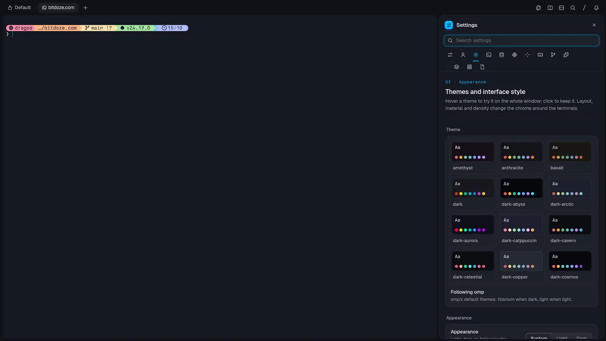

Performance was the first thing I noticed: pane operations, the file viewer and the settings UI are all immediate — no Electron startup tax, no Chromium bundled in the browser block. Even my headless screenshot renders (CPU-drawn on llvmpipe, no GPU) produced full frames in a few seconds.

## The MiniMax M3.1 test

While touring, I pointed an omp agent running the free MiniMax M3.1 Flash model at a board full of tasks: "use the to-do and create my website." It built a complete Astro site (about 2,000 lines across 72 files), spawned task agents, iterated on its own mediocre SVGs after eyeballing them in the browser block, previewed the site at localhost and earned a 100 Lighthouse performance score. The model is genuinely fast, but it thought a lot, the design was basic, and it only updated the kanban file at the end instead of as it went. The tool did its job; the model is middling. A free model inside a terminal this capable is still a nice combo for boilerplate work.

## Tern vs Herdr vs Rex vs tmux

| | Tern | Herdr | Rex | tmux |
|---|---|---|---|---|
| What it is | Terminal + workspace app | Agent multiplexer inside your terminal | Terminal + multiplexer | Multiplexer inside your terminal |
| Persistence | Daemon-owned sessions | Session server | Server-owned PTYs | Server (detach/attach) |
| Remote story | `tern remote serve` (QUIC), web + mobile clients | SSH attach / thin client | Built-in remoting, real login | SSH in, then attach |
| AI agents | omp native block + any CLI | State sidebar + socket API | None specific | None |
| Extra surface | git/SQLite/Jupyter/kanban/browser blocks | Plugin marketplace | Lua config + `rex` CLI | Huge plugin ecosystem |
| Extends with | Luau plugins (local + remote) | Community plugins | Lua actions | tmux plugins |
| Platforms | macOS, Windows, Linux, Android | Linux, macOS (Windows beta) | macOS (others built) | Everywhere |
| Status | Closed beta (waitlist) | Open source, pre-1.0 | Public testing, macOS first | Everywhere, mature |

Different tools, honestly. Tern is a terminal that wants to absorb your whole workflow (closest in spirit to [Ghostty](/ghostty-terminal/)'s native-UI philosophy crossed with an IDE). [Herdr](/herdr-agent-multiplexer/) is a control plane for agent fleets that runs inside any terminal (including Tern, via plugin). [Rex](/superlogical-rex/) is the terminal-as-multiplexer bet from Ghostty's creator, macOS-only for now. [tmux](/tmux-basics/) remains the incumbent you already have everywhere. The [six-way multiplexer comparison](/best-terminal-multiplexers/) adds Zellij and TuiOS to the picture.

## Rough edges to know about

- **Closed beta.** Waitlist access only, no pricing announced, features moving fast.
- **Files pane lag.** Files created by the agent didn't show up in the sidebar without a refresh in my run — early-beta stuff.
- **Board sync is on the model.** The kanban file only reflects progress if the agent writes it; MiniMax did it at the end, not continuously.
- **Young plugin ecosystem.** The SDK is documented and awesome-tern exists, but it's days old.
- **Closed source.** Luau plugins extend it, but the app itself isn't open like Herdr or tmux.
- **iOS isn't out yet.** Android shipped first; the phone client and screen share are the two pieces I couldn't fully verify.

## FAQ

<Accordion label="Is Tern free?" group="faq" expanded="true">
  It's in closed beta with no pricing announced. Access is through the waitlist at stencil.so/tern with a Stencil account. Approval took about two days for me.
</Accordion>

<Accordion label="What platforms does Tern run on?" group="faq">
  macOS, Windows, Linux and Android builds exist today. An iPhone client is in the works, and `tern web serve` already exposes a session in a browser tab.
</Accordion>

<Accordion label="Does Tern replace tmux or Herdr?" group="faq">
  Different layers. Tern <em>is</em> the terminal; tmux and <a href="/herdr-agent-multiplexer/">Herdr</a> run inside one (Herdr literally runs inside Tern via a community plugin — v0.4.0 adds two blocks). If your problem is tracking many agents' states, Herdr's sidebar and socket API still do something Tern doesn't. See the <a href="/tmux-basics/">tmux basics guide</a> for the incumbent workflow.
</Accordion>

<Accordion label="What is omp?" group="faq">
  Stencil's agent CLI — <a href="https://omp.sh/">omp.sh</a> — that works with models from multiple providers (and can ride subscriptions like Codex's). Tern's agent blocks run it natively, but any agent CLI works in a regular pane.
</Accordion>

<Accordion label="How does Tern handle remote servers?" group="faq">
  The session daemon is the product: `tern remote serve` exposes a server's daemon over QUIC, hosts are added through a dialog (ssh address or tailnet peer, act-as user, `~/.ssh/config` import), and each host keeps its own session state. `tern web serve` gives a browser client; mobile pairing is a QR-code scan.
</Accordion>

<Accordion label="Can I script Tern?" group="faq">
  Yes — the `tern` binary is also the control CLI (`split`, `run`, `send`, `capture`, `wait`, `events`), `tern serve`/`ctl` drive headless sessions, and `tern shot` renders scripted scenario screenshots. Agents can drive it the same way.
</Accordion>

## Verdict

Tern is the most interesting terminal release I've tried this year. The daemon-persisted sessions, the block model (git, SQLite, Jupyter, kanban as native panes), first-class omp agents, remote hosts and a scriptable CLI add up to something that's closer to an IDE-shaped terminal than a terminal with tabs. It's a beta: the waitlist, the refresh hiccups, the unknown pricing. But the foundation is fast and genuinely different. If you're already running agents in [Herdr](/herdr-agent-multiplexer/) or watching [Rex](/superlogical-rex/) from the sidelines, Tern is worth the two-day waitlist.

<Button text="Join the Tern waitlist" link="https://stencil.so/tern" variant="solid" color="blue" size="lg" icon="arrow-right" />
<Button text="awesome-tern plugins" link="https://github.com/theblazehen/awesome-tern" variant="outline" color="blue" size="md" />
