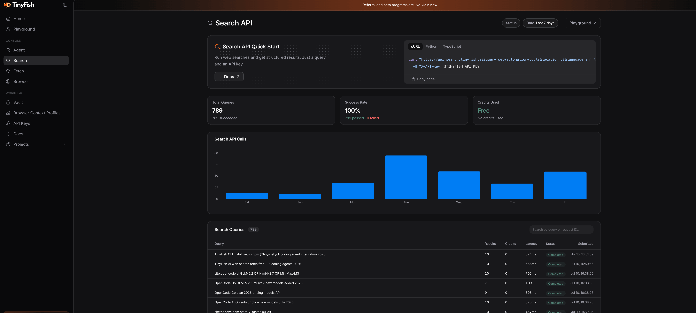
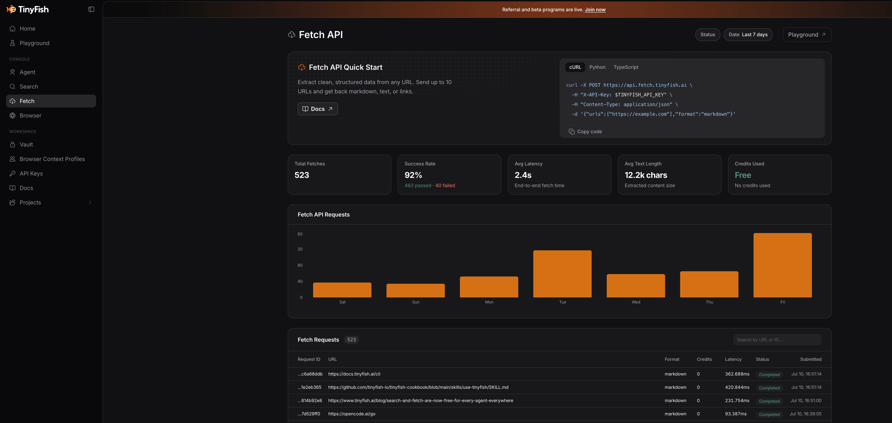

import Button from "@components/widgets/Button.astro";
import Notice from "@components/widgets/Notice.astro";
import ListCheck from "@components/widgets/ListCheck.astro";
import Accordion from "@components/widgets/Accordion.astro";
import Tabs from "@components/widgets/Tabs.astro";
import Tab from "@components/widgets/Tab.astro";

*Disclosure: this guide contains referral links. If you buy through them, I may earn a commission at no extra cost to you.*

TinyFish gives AI coding agents live web search and page fetching through one API key. Both are free up to 30 searches per minute and 1,000 fetched URLs per day, with no credit card.

Every AI coding agent hits the same wall eventually. You ask it something about a library's latest API, a Docker image that changed its tagging scheme, or a config format that got updated last week. The model's training data stops in 2025 (or earlier), and it either hallucinates or tells you to check the docs yourself. Not helpful.

The fix is giving your agent access to the live web. And that is where [TinyFish](https://tinyfish.ai/) comes in. TinyFish provides structured web search and clean page fetching through a single API key. Search and Fetch are free within a daily allowance, with no credit card and no trial period. Sign up and go, but read the limits below first.

I have been using TinyFish through the [pi-tinyfish](https://github.com/x1any/pi-tinyfish) package in [Pi coding agent](/pi-coding-agent-setup-guide/) and in [Mastra](/build-ai-agent-mastra/) for months now. It works well enough that I want to lay out what it does, how to set it up, and why it matters for agents like [Hermes](/hermes-agent-setup-guide/), [OpenClaw](/clawdbot-setup-guide/), and [OpenCode](/opencode-setup-guide/) too.

<Button text="Get a free TinyFish API key" link="https://go.bitdoze.com/tinyfish" variant="solid" color="blue" size="md" icon="arrow-right" />

<Notice type="warning" title="Free fetch now has a daily cap">
TinyFetch (the Fetch API) is free up to 150 URLs per minute and 1,000 successfully fetched URLs per day. TinySearch is free up to 30 requests per minute and 12,000 per day per the docs (the pricing page lists 500 per hour). Both keep working at a $0 Wallet balance inside those limits, and the daily allowance resets at 00:00 UTC. Failed URLs are not counted. Beyond the allowance you need a positive Wallet balance, otherwise the API returns HTTP 402 (INSUFFICIENT_CREDITS). If wallet spending is disabled on your account you get HTTP 429 (RATE_LIMIT_EXCEEDED) instead. The docs I read do not publish a per-URL price past the allowance, so check the dashboard or ask sales before planning heavy volume.
</Notice>

<Notice type="info" title="What this guide covers">
<ListCheck>
<ul>
<li>What TinyFish is, the current Tiny product lineup, and the free limits</li>
<li>How to get more out of Search and Fetch (new parameters, error codes, staying under the cap)</li>
<li>Setting up TinyFish with Pi coding agent via pi-tinyfish</li>
<li>Using TinyFish with Hermes Agent, Claude Code, OpenCode, Codex, Cursor, and other agents</li>
<li>TinyMonitor, TinyResearch, TinySet, and TinyAnswer</li>
<li>The TinyFish Cookbook: ready-made recipes for common automation tasks</li>
<li>Wallet pricing, rate limits, and programs</li>
</ul>
</ListCheck>
</Notice>

## What TinyFish does


<YouTubeEmbed
  url="https://www.youtube.com/embed/Hu_OGbBEW3M"
  label="FREE TinyFish Makes AI Agents Actually Useful"
/>

TinyFish now ships eight products, all with a Tiny prefix. You only need the first two to start:

- **TinySearch**: free within 30 requests/min and 12,000/day. Takes a query and returns structured JSON. The results are rank-stable and clean, so an LLM can parse them without guessing. Typical latency is 1-3 seconds, and you can pass location and language hints.
- **TinyFetch**: free within 150 URLs/min and 1,000 URLs/day, up to 10 URLs per request. Renders each page in a real Chromium browser (JavaScript, SPAs, the works), strips navigation bars, cookie banners, ads, and scripts, and returns markdown, HTML, or JSON. Your model stops paying tokens for junk HTML.
- **TinyAgent** (formerly Agent): natural-language browser automation. $0.016 per step, 2 concurrent runs by default.
- **TinyBrowser** (formerly Browser): raw CDP browser sessions. $0.002 per minute, 5 concurrent sessions.
- **TinyMonitor**: scheduled page or topic tracking. $0.005 per completed check plus the underlying Search or Fetch call.
- **TinyResearch**: cited multi-source reports. $2 per `deep` run, $3 per `max` run. Must be enabled per account.
- **TinySet**: structured datasets from a prompt. $0.10 per row.
- **TinyAnswer**: a single answer with citations. Must be enabled per account.

Everything except Search and Fetch is metered from a prepaid Wallet. For coding agent use, Search and Fetch cover most of what you need, as long as you stay inside the free allowance.

### Real usage stats

Here's what the TinyFish dashboard looks like in practice. These are actual stats from coding agents using the free tier:

**Search API**: 40.6K total requests with 360ms average response time. Top users include Codex CLI, OpenCode, Claude Code, and Gemini CLI:



**Fetch API**: 65.6K total requests. The Skills integration is the biggest user, followed by Gemini CLI, OpenCode, and Claude Code:



Those numbers predate the daily Fetch cap, so a heavy agent loop can now hit 1,000 URLs in a day. More on that in the next section.

### Why this matters for coding agents

Most coding agents rely on the model's training data for anything outside your codebase. That works for stable patterns and well-documented APIs. It falls apart for:

- **Recent releases**: a library that shipped breaking changes last week
- **Version-specific quirks**: "does this Docker image still support ARM64 in v3?"
- **Community solutions**: the GitHub issue where someone already solved your exact problem
- **Documentation lookups**: reading the actual docs instead of guessing from memory

Giving your agent a search+fetch pipeline turns it from "I think this is how it works" to "here is the current documentation, and here are three GitHub issues confirming this behavior."


## Getting more out of Search and Fetch

Both APIs gained options that cut noise and tokens. All of them are documented in the TinySearch and TinyFetch references on [docs.tinyfish.ai](https://docs.tinyfish.ai/).

### Search options

- `include_domains` / `exclude_domains`: a comma-separated string, not an array. The `site:` operator still works in the query but is deprecated for domain filtering.
- `recency_minutes`: only results from the last N minutes. You cannot combine it with `after_date` / `before_date` (format `YYYY-MM-DD`).
- `domain_type`: `web` (default), `news` (adds publisher and date), or `research_paper` (adds authors, venue, year, citation count, PDF URL). Date filters are not supported for papers, use `pub_year_min` / `pub_year_max`.
- `purpose`: a short note on why you are searching (up to 2,000 characters). It improves ranking.
- `location` and `language`: geo and language hints.
- `page`: 0 to 10 for more results.

```bash
curl -G "https://api.search.tinyfish.ai" \
  -H "X-API-Key: $TINYFISH_API_KEY" \
  --data-urlencode "query=docker compose release" \
  --data-urlencode "domain_type=news" \
  --data-urlencode "recency_minutes=1440"
```

### Fetch options

- `include_selectors` / `exclude_selectors`: 1-20 CSS selectors each. Exclusions are applied first. Pull only `main` or `article` and the model never sees the rest.
- `ttl`: omit it and any cached entry is accepted. `0` forces a live fetch, `N` accepts a cache entry younger than N seconds.
- Conditional fetch: for a single URL, send `if_none_match` or `if_modified_since` together with `include_etag_and_last_modified` to skip unchanged pages.
- `purpose`: why you fetch, same idea as in Search.
- `iframe_links`: also return iframe URLs, next to `links` and `image_links`.
- `highlights`: ranked verbatim passages that answer a question (`query`, `max_passages` 1-20). It is beta and enabled per account, otherwise the API returns 403 FORBIDDEN.

```bash
curl -X POST https://api.fetch.tinyfish.ai \
  -H "X-API-Key: $TINYFISH_API_KEY" \
  -H "Content-Type: application/json" \
  -d '{"urls": ["https://docs.docker.com/compose/how-tos/startup-order/"], "include_selectors": ["main"], "ttl": 0}'
```

Failed URLs come back in an `errors[]` array with a code. The ones worth handling in an agent loop: `bot_blocked` (retry later or escalate to TinyAgent), `login_required` (the page needs auth), `selector_not_matched` (your selector found nothing, retry without it), and `timeout` (set your client timeout to 150 seconds or more, the backend allows 110 seconds per URL).

### Staying inside the free fetch cap

<ListCheck>
<ul>
<li>Batch up to 10 URLs per request instead of looping one by one</li>
<li>Search first, then fetch only the best 2-3 URLs</li>
<li>Use `include_selectors` so the agent does not refetch a page to get a different part of it</li>
<li>Leave `ttl` unset so cached pages are reused, and use `ttl: 0` only when you need a live copy</li>
<li>Check your usage with `tinyfish fetch usage --status completed --start-after 2026-11-27T00:00:00Z --limit 1000 --pretty`</li>
</ul>
</ListCheck>

## Setting up TinyFish with Pi coding agent

Pi already has TinyFish support through the [pi-tinyfish](https://github.com/x1any/pi-tinyfish) package. It adds two tools to your agent: `tinyfish_search` and `tinyfish_fetch`. Install takes one command.

### Step 1: Get your API key

Sign up at [agent.tinyfish.ai](https://agent.tinyfish.ai/). No credit card. Copy the API key from the dashboard.

### Step 2: Install pi-tinyfish

<Tabs>
<Tab name="npm">
```bash
pi install npm:pi-tinyfish
```
</Tab>
<Tab name="git">
```bash
pi install git:github.com/x1any/pi-tinyfish
```
</Tab>
</Tabs>

### Step 3: Set the API key

```bash
export TINYFISH_API_KEY="your_api_key_here"
```

Add that to your shell profile (`~/.bashrc`, `~/.zshrc`, or `~/.config/fish/config.fish`) so it persists across sessions.

### Step 4: Use it

That is it. Next time you start Pi in a project, the agent can call `tinyfish_search` and `tinyfish_fetch` as tools. When it needs to look up something about a library, check docs, or verify a config format, it will search the web and fetch the relevant pages automatically.

The search latency is typically 1-3 seconds. Fetch can take a few seconds longer depending on the page. Both tools default to sensible timeouts (10s for search, 150s for fetch).

<Notice type="success" title="Token savings">
TinyFetch strips navigation, scripts, and boilerplate from pages before returning content. Your model processes the article text, not three kilobytes of cookie consent banners and footer links. That cuts the tokens you pay for on every fetch.
</Notice>

## Using TinyFish with Hermes Agent

[Hermes Agent](/hermes-agent-setup-guide/) from Nous Research has a built-in web search tool, but TinyFish gives you more control over the search results and adds clean page fetching that Hermes does not have out of the box.

There are three ways to wire TinyFish into Hermes:

### Option 1: MCP Server

TinyFish runs a hosted MCP server at `https://agent.tinyfish.ai/mcp`. It uses OAuth: you sign in with your TinyFish account on first use. Add it to your Hermes MCP config:

```json
{
  "mcpServers": {
    "tinyfish": {
      "url": "https://agent.tinyfish.ai/mcp"
    }
  }
}
```

This gives Hermes access to Search and Fetch through the standard MCP protocol, plus the heavier tools (TinyAgent, monitors, research, datasets). The agent sees them as native tools. If your client cannot do OAuth, send `Authorization: Bearer <API key>` instead.

### Option 2: Agent Skill

Install the TinyFish skill from the cookbook:

```bash
npx skills add github.com/tinyfish-io/tinyfish-cookbook --skill use-tinyfish
```

This teaches Hermes when to reach for Search vs Fetch vs Agent, and how to call them correctly. The skill includes decision logic: use search for finding URLs, fetch for reading known pages, and escalate to agent only when interactive browser automation is needed.

### Option 3: CLI wrapper

If you prefer shell-based integration, install the CLI:

```bash
npm install -g @tiny-fish/cli
tinyfish auth login
```

Then Hermes can call `tinyfish search query "..."` and `tinyfish fetch content get <urls>` through its terminal access. The CLI writes results to the filesystem instead of piping through the model's context, which keeps token usage low.

### Which approach to pick

MCP is the cleanest if your Hermes version supports it. The skill approach works well if you want the agent to understand the tool hierarchy (search first, fetch second, agent last). CLI is the fallback that works everywhere.

## Using TinyFish with Claude Code, Codex, and OpenCode

Claude Code connects through the hosted MCP server:

```bash
claude mcp add --transport http tinyfish https://agent.tinyfish.ai/mcp
```

An alternative is `npx -y install-mcp@latest https://agent.tinyfish.ai/mcp --client claude-code`. The first tool call opens the OAuth sign-in. Other clients:

```bash
# Codex
codex mcp add tinyfish --url https://agent.tinyfish.ai/mcp

# OpenCode (needs a model with tool use), then sign in
opencode mcp add tinyfish --url https://agent.tinyfish.ai/mcp
opencode mcp auth tinyfish

# Cursor
npx -y install-mcp@latest https://agent.tinyfish.ai/mcp --client cursor

# Windsurf (the JSON key is serverUrl)
npx -y install-mcp@latest https://agent.tinyfish.ai/mcp --client windsurf

# Grok
grok plugin install tinyfish --trust
# or: grok mcp add --transport http tinyfish https://agent.tinyfish.ai/mcp
```

### ChatGPT and Claude

Both have an official TinyFish integration, one tap and OAuth. For ChatGPT, use the TinyFish plugin, or add a custom MCP connector with the URL `https://agent.tinyfish.ai/mcp/chatgpt`. For Claude, add the official connector from the [Claude directory](https://claude.ai/directory/tinyfish).

## Using TinyFish with OpenClaw and other agents

The same patterns apply to [OpenClaw](/clawdbot-setup-guide/), [OpenCode](/opencode-setup-guide/), [Mastra](/build-ai-agent-mastra/), and any other coding agent that supports MCP, skills, or shell access.

### MCP for any agent

The MCP server URL is the same regardless of which agent you use:

```json
{
  "mcpServers": {
    "tinyfish": {
      "url": "https://agent.tinyfish.ai/mcp"
    }
  }
}
```

This works with any MCP-aware client. Drop it in your config, restart, and complete the OAuth sign-in. Command Code does not do OAuth, so it uses an API key: `npx -y @tiny-fish/cli@latest connect command-code`.

### CLI setup (works everywhere)

The CLI is the most portable option. It works with any agent that can run shell commands:

```bash
npm install -g @tiny-fish/cli@latest
tinyfish auth login
```

For CI/CD or non-interactive setups:

```bash
echo $TINYFISH_API_KEY | tinyfish auth set
```

Verify it works:

```bash
tinyfish --version
tinyfish auth status --pretty
```

### Install the skill

The TinyFish skill teaches your agent when to reach for search vs fetch vs agent:

```bash
npx skills add github.com/tinyfish-io/tinyfish-cookbook --skill use-tinyfish
```

The skill covers the escalation ladder: search for finding URLs, fetch for reading pages, agent for interactive browser tasks, and browser for raw CDP control.

### REST API for custom integrations

If you are building something custom or your agent does not support MCP, use the REST endpoints directly:

```bash
# Search
curl "https://api.search.tinyfish.ai?query=docker+compose+healthcheck" \
  -H "X-API-Key: $TINYFISH_API_KEY"

# Fetch
curl -X POST https://api.fetch.tinyfish.ai \
  -H "X-API-Key: $TINYFISH_API_KEY" \
  -H "Content-Type: application/json" \
  -d '{"urls": ["https://docs.docker.com/compose/how-tos/startup-order/"]}'
```

Both endpoints return JSON. Search gives you ranked results with titles, snippets, and URLs. Fetch gives you the cleaned page content plus metadata (title, language, author, published date).

### SDKs for programmatic use

<Tabs>
<Tab name="Python">
```bash
pip install tinyfish
```
```python
from tinyfish import TinyFish

client = TinyFish()  # reads TINYFISH_API_KEY from env

# Search
results = client.search.query("best React state management 2026")

# Fetch
content = client.fetch.get_contents(
    urls=["https://tanstack.com/query/latest"],
    format="markdown"
)
```
</Tab>
<Tab name="TypeScript">
```bash
npm install @tiny-fish/sdk
```
```typescript
import { TinyFish } from "@tiny-fish/sdk";

const client = new TinyFish(); // reads TINYFISH_API_KEY from env

// Search
const results = await client.search.query("best React state management 2026");

// Fetch
const content = await client.fetch.getContents({
  urls: ["https://tanstack.com/query/latest"],
  format: "markdown",
});
```
</Tab>
</Tabs>

## TinyMonitor, TinyResearch, TinySet, and TinyAnswer

These four sit outside the daily coding-agent loop. Unlike Search and Fetch they are paid from your Wallet (TinyMonitor also draws on the free Search/Fetch allowance for its underlying call), and TinyResearch and TinyAnswer must be enabled on your account.

**TinyMonitor** watches a webpage or a topic on a schedule. Page monitors re-fetch a URL with `ttl` 0 and diff the content, good for a pricing or status page. Topic monitors re-run a search and flag new URLs, with 1-10 results per run and a minimum interval of 30 minutes. You can describe the change that matters ("the price drops below $500") and TinyFish assesses it. Delivery is the dashboard, a webhook (every scheduled run, retried 3 times), or email (only on change unless you enable "Email every run"). A check costs $0.005 plus the underlying Search or Fetch call, failed checks are free, and you get 50 monitors per account. A daily monitor is about $0.15 a month, an hourly one about $3.65.

**TinyResearch** takes a question and returns a cited report. It costs $2.00 per run in `deep` mode and $3.00 in `max` mode, charged on completion. Failed, cancelled, or timed-out runs are free. A `deep` run usually takes 5-20 minutes, `max` 5-45 minutes, and up to 5 runs can be active at once. If it is not enabled for your account the API returns 403. Useful parameters: `output_language` (a BCP 47 code), `domain_filter`, and `prior_run_id` for follow-ups. Each follow-up is a new paid run.

```python
from tinyfish import TinyFish

client = TinyFish()
report = client.research.run(
    query="Compare long-duration energy storage approaches",
    mode="deep",
)
```

```bash
curl --no-buffer https://agent.tinyfish.ai/v1/automation/run-research \
  -H "X-API-Key: $TINYFISH_API_KEY" \
  -H "Content-Type: application/json" \
  -d '{"query": "Compare long-duration energy storage approaches", "mode": "deep", "output_language": "en"}'
```

The curl call streams Server-Sent Events (`created`, `plan_updated`, `sources_searched`, `source_fetched`, `final_result`, `done`). There is also an async variant and a way to poll a run by ID.

**TinySet** builds a table. You describe the rows and TinyFish finds them on the web. It costs $0.10 per row, `target_rows` ranges from 1 to 250 (default 100), column planning takes up to a minute, and a run takes about 5-20 minutes. Skipped, failed, or cancelled rows are free.

```bash
tinyfish dataset create "Specialty coffee shops in Oakland with their website and rating" --rows 25 --pretty
```

```bash
curl -X POST https://agent.tinyfish.ai/v1/datasets \
  -H "X-API-Key: $TINYFISH_API_KEY" \
  -H "Content-Type: application/json" \
  -d '{"prompt": "Specialty coffee shops in Oakland with their website and rating", "target_rows": 25}'
```

Pick TinySet when you know the columns and want many rows. Pick TinyResearch when you want a cited report.

**TinyAnswer** returns one answer with citations. It must be enabled per account and works with a personal API key only:

```bash
curl -X POST https://api.answer.tinyfish.ai/ \
  -H "X-API-Key: $TINYFISH_API_KEY" \
  -H "Content-Type: application/json" \
  -d '{"question": "What is the default TTL for TinyFetch?"}'
```

The mental model: TinySearch for links, TinyFetch for pages you already know, TinyAnswer for a quick cited answer, TinyResearch when the question needs evidence across several sources, TinySet for tables, TinyMonitor for watching something over time.

## The TinyFish Cookbook

The [TinyFish Cookbook](https://github.com/tinyfish-io/tinyfish-cookbook) is a collection of ready-made projects built on top of TinyFish. Some of them are genuinely useful:

| Project | What it does |
|---------|-------------|
| [viet-bike-scout](https://github.com/tinyfish-io/tinyfish-cookbook/tree/main/viet-bike-scout) | Motorbike rental price comparison across Vietnamese cities |
| [openbox-deals](https://github.com/tinyfish-io/tinyfish-cookbook/tree/main/openbox-deals) | Open-box and refurbished deal aggregator across 8 retailers |
| [competitor-scout-cli](https://github.com/tinyfish-io/tinyfish-cookbook/tree/main/competitor-scout-cli) | Natural-language CLI for researching competitor pricing |
| [silicon-signal](https://github.com/tinyfish-io/tinyfish-cookbook/tree/main/silicon-signal) | Semiconductor supply chain tracker |
| [code-reference-finder](https://github.com/tinyfish-io/tinyfish-cookbook/tree/main/code-reference-finder) | Find real-world usage examples for code snippets on GitHub and Stack Overflow |
| [tinyskills](https://github.com/tinyfish-io/tinyfish-cookbook/tree/main/tinyskills) | Generates SKILL.md guides from docs, GitHub, and developer blogs |

The code-reference-finder is the one I keep coming back to. Paste a function signature, and it searches GitHub and Stack Overflow for real usage examples. Saves a lot of "how does anyone actually use this API" time.

The cookbook also includes the [use-tinyfish skill](https://github.com/tinyfish-io/tinyfish-cookbook/blob/main/skills/use-tinyfish/SKILL.md) that teaches any coding agent the right tool to reach for. It covers the escalation ladder: search for finding URLs, fetch for reading pages, agent for interactive browser tasks, and browser for raw CDP control.

<Button text="Browse the TinyFish Cookbook" link="https://github.com/tinyfish-io/tinyfish-cookbook" variant="solid" color="blue" size="md" icon="github" />

## Is TinyFish still free?

Yes, inside the allowance. Search is free up to 30 requests per minute and 12,000 per day, and Fetch up to 150 URLs per minute and 1,000 per day, at any Wallet balance. Past that you pay from the Wallet.

TinyFish moved from credit plans to a prepaid Wallet. There are no plans and no minimums. New accounts start with $8 in Wallet funds, no card needed, and up to $5 more for finishing onboarding steps. Deposits start at $10, and you can turn on auto-reload.

| Product | Cost | Limit |
|---------|------|-------|
| **TinySearch** | Free within the allowance, at any Wallet balance | 30 requests/min, 12,000/day (docs) |
| **TinyFetch** | Free within the allowance, at any Wallet balance | 150 URLs/min, 1,000 URLs/day, 10 URLs per request |
| **TinyAgent** | $0.016/step | 2 concurrent runs |
| **TinyBrowser** | $0.002/min | 5 concurrent sessions |
| **TinyMonitor** | $0.005/check + the underlying Search or Fetch | 50 monitors |
| **TinyResearch** | $2 (`deep`) or $3 (`max`) per run | 5 concurrent runs, enabled per account |
| **TinySet** | $0.10/row | 1-250 rows per dataset |

Limits are per person or organization. Enterprise adds custom limits, SSO, audit logs, and an SLA. The Search and Fetch allowance resets at 00:00 UTC, and failed fetches do not count against it. What happens past the allowance is covered in the warning at the top of this guide. If you run legacy credit plans, your rates and balance are shown in the dashboard.

TinyFish also runs programs. Students get $35 in Wallet credits with a school email. Ambassadors get bounties, event funding, and referral rewards. TinyFish for Startups gives up to $12,000 in value, 4x the default rate limits for Search and Fetch, and Wallet credits.

<Accordion label="Comparison with alternatives" group="alternatives">

TinyFish is not the only option for giving agents web access. Here is how it stacks up:

| Feature | TinyFish Fetch | Firecrawl | Native LLM fetch | Hand-rolled Playwright |
|---------|---------------|-----------|-------------------|----------------------|
| **JavaScript rendering** | Yes (real Chromium) | Yes | No (static HTML only) | Yes |
| **Clean content extraction** | Yes | Yes | Raw HTML | Manual |
| **Stealth/anti-bot** | Built-in | Varies | No | Manual setup |
| **Free tier** | Yes (Search + Fetch) | Limited free | Depends on provider | You pay for compute |
| **Token optimization** | Strips boilerplate | Strips boilerplate | Full HTML | Manual |
| **Multi-URL batching** | Up to 10 URLs/call | Varies | No | Manual |

The main advantage of TinyFish over hand-rolling Playwright is that you do not manage browser instances, proxy rotation, or anti-bot detection. The main advantage over native LLM fetch is JavaScript rendering. Most modern docs sites are SPAs that return empty shells without it.

</Accordion>

## What I like and what I do not

I have been using TinyFish through Pi and Mastra for months. Here is the honest take.

**What works well:** The search results are clean and fast. Fetch renders SPAs properly, which matters for React-based docs sites. The free allowance covers daily coding agent use without issues in my setup. Token savings from clean content are noticeable. The CLI + skill combo works across every agent I have tried.

**What could be better:** Fetch can be slow on heavy pages (5-10 seconds for JavaScript-heavy sites). Search occasionally returns stale results for very recent events. The free Fetch allowance is now capped at 1,000 URLs a day, so a runaway agent loop can burn through it, and past that you need Wallet funds at a rate the docs do not state. TinyAgent ($0.016 per step) and TinyBrowser ($0.002 per minute) add up fast if you need interactive automation.

**Bottom line:** For giving your coding agent the ability to read current documentation and search the web, the free Search + Fetch allowance works well if you batch and filter. I have it wired into Pi through pi-tinyfish, into Mastra through the SDK, and use the CLI for everything else. It has become a standard part of my agent setup.

## Related articles

- [Free Web Search for AI Coding Agents: TinyFish Setup Guide](/tinyfish-free-search-coding-agents/): focused setup guide for coding agents
- [Extend Muse AI With Custom MCPs](/muse-tinyfish-search-fetch/): TinyFish, Composio & skills inside Meta's agent
- [Build Your Own AI Agent with Mastra](/build-ai-agent-mastra/): full guide using TinyFish with Mastra
- [Pi coding agent setup guide](/pi-coding-agent-setup-guide/): install and configure Pi
- [Hermes Agent setup guide](/hermes-agent-setup-guide/): install and configure Hermes
- [OpenCode Go: 31 AI Coding Models for $10/Month](/opencode-go-plan/): cheap models for your agent

## Next steps

- [Get a free TinyFish API key](https://go.bitdoze.com/tinyfish): no credit card required
- [Install the CLI](https://docs.tinyfish.ai/cli): `npm install -g @tiny-fish/cli@latest`
- [Install pi-tinyfish](https://github.com/x1any/pi-tinyfish) for Pi coding agent
- [Read the TinyFish Cookbook](https://github.com/tinyfish-io/tinyfish-cookbook) for project ideas and the agent skill
- [TinyFish documentation](https://docs.tinyfish.ai/) for the full API reference
