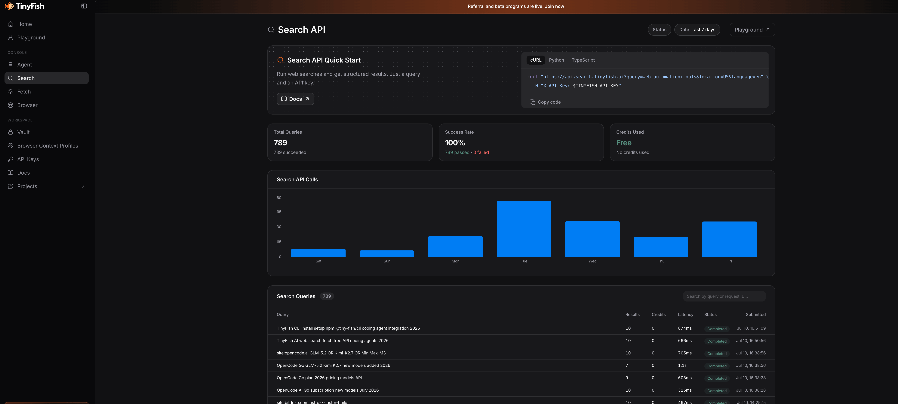
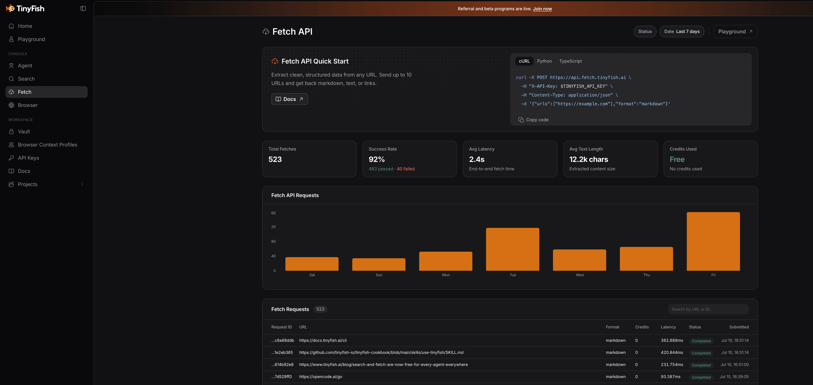

import Button from "@components/widgets/Button.astro";
import Notice from "@components/widgets/Notice.astro";
import ListCheck from "@components/widgets/ListCheck.astro";
import Accordion from "@components/widgets/Accordion.astro";
import Tabs from "@components/widgets/Tabs.astro";
import Tab from "@components/widgets/Tab.astro";

*Disclosure: this guide contains referral links. If you buy through them, I may earn a commission at no extra cost to you.*

[TinyFish](https://go.bitdoze.com/tinyfish) gives your coding agent free web search (12,000 requests/day) and free page fetch (1,000 URLs/day) through MCP, CLI or REST. Your agent knows Python, JavaScript, Docker, Kubernetes, and plenty more. But ask it about a library update that shipped last week, or a breaking change in a new release, and it either hallucinates or tells you to check the docs yourself.

The fix is live web access: real search and page fetching in real time.

TinyFish made Search and Fetch free. No credit card, no trial period. There are allowances (the daily ones are covered below), but they are large enough for a coding agent.

<Button text="Get Your Free TinyFish API Key" link="https://go.bitdoze.com/tinyfish" variant="solid" color="blue" size="md" icon="arrow-right" />

## What TinyFish gives you for free

Two endpoints, both free:

**TinySearch** takes a query and returns structured JSON results. Not blue links designed for human eyes, but clean, rank-stable data that your agent can parse directly. Typical latency is 1 to 3 seconds. You can pass location and language hints for geo-targeted results.

**TinyFetch** takes one or more URLs and returns clean content. The page renders in a real Chromium browser (JavaScript, SPAs, the works), then navigation bars, cookie banners, ads, and scripts get stripped. You get markdown, HTML, or JSON back. Your model stops paying tokens for junk HTML.

<YouTubeEmbed
  url="https://www.youtube.com/embed/Hu_OGbBEW3M"
  label="FREE TinyFish Makes AI Agents Actually Useful"
/>

### Free tier limits

Products now carry a Tiny prefix: TinySearch and TinyFetch (formerly Search and Fetch), TinyAgent (formerly Agent), TinyBrowser (formerly Browser).

| Product | Limit | Cost |
|---------|-------|------|
| **TinySearch** | 30 requests/min, 500/hour, 12,000/day | Free |
| **TinyFetch** | 150 URLs/min, 1,000 URLs/day, max 10 URLs per request | Free |
| **TinyAgent** | 2 concurrent runs | $0.016/step |
| **TinyBrowser** | 5 concurrent sessions | $0.002/min |
| **TinyMonitor** | 50 monitors/account | $0.005/check + the underlying Search or Fetch call |
| **TinyResearch** | Up to 5 concurrent runs | $2 per `deep` run, $3 per `max` run |
| **TinySet** | 1 to 250 rows per dataset | $0.10/row |

The 500/hour figure comes from the pricing page and the 12,000/day figure from the docs, so treat the hourly number as the tighter one if you burst.

For coding agent use, Search and Fetch cover most of what you need. TinyAgent and TinyBrowser bill from a prepaid Wallet (no plans, no minimums). New accounts start with $8 in Wallet funds and no card is needed, but most coding workflows never touch them. TinyMonitor's underlying Search/Fetch calls count toward the free daily allowance, so a handful of scheduled checks costs you the $0.005 check fee and nothing more.

<Notice type="warning" title="Fetch has a daily cap: 1,000 URLs">
TinyFetch is free up to 1,000 successfully fetched URLs per day (TinySearch: 12,000 requests per day). Both reset at 00:00 UTC. Failed URLs are not counted. Within the allowance, Search and Fetch never draw from your Wallet and keep working at a $0 balance. Past it, with wallet spending enabled, you need a positive Wallet balance or you get HTTP 402 `INSUFFICIENT_CREDITS`. With wallet spending disabled you get HTTP 429 `RATE_LIMIT_EXCEEDED` with `details.reason = "free_allowance_exhausted"`. The docs I read do not publish a per-URL rate beyond the allowance, so check the dashboard or ask sales before building on it.
</Notice>

### Real usage stats

These are actual TinyFish dashboard stats showing how coding agents are using the free tier:

**Search API**: 40.6K total requests with 360ms average response time:



**Fetch API**: 65.6K total requests. Notice how Codex CLI, OpenCode, Claude Code, and other agents are all using it:



<Notice type="success" title="Failed fetches are free">
If a URL returns an error or times out, it does not count against your allowance. Only successfully fetched URLs are counted.
</Notice>

## Why your coding agent needs web access

Most coding agents rely on the model's training data for anything outside your codebase. That works for stable patterns and well-documented APIs. It breaks down for recent releases, version-specific quirks, community solutions on GitHub, and current documentation.

Giving your agent a search+fetch pipeline changes the answer from "I think this is how it works" to "here is the current documentation."

### Token savings

TinyFish Fetch strips navigation, scripts, and boilerplate from pages before returning content. Your model processes the actual article content, not three kilobytes of cookie consent banners and footer links. This cuts token usage per fetch compared to raw HTML fetching.

## Setting up TinyFish with your coding agent

There are four ways to wire TinyFish into your agent: MCP, CLI + Skill, REST, and SDKs. Pick the one that matches your setup.

<Button text="Get a Free TinyFish API Key" link="https://go.bitdoze.com/tinyfish" variant="solid" color="blue" size="md" icon="arrow-right" />

### Option 1: MCP server (recommended)

If your agent supports MCP (Model Context Protocol), this is the cleanest integration. The hosted server is `https://agent.tinyfish.ai/mcp` (the old `https://mcp.tinyfish.ai` URL is stale). It signs you in with OAuth against your TinyFish account on first use, so there is no key to paste.

<Tabs>
<Tab name="Claude Code">
```bash
claude mcp add --transport http tinyfish https://agent.tinyfish.ai/mcp
```
Or: `npx -y install-mcp@latest https://agent.tinyfish.ai/mcp --client claude-code`
</Tab>
<Tab name="Codex">
```bash
codex mcp add tinyfish --url https://agent.tinyfish.ai/mcp
```
</Tab>
<Tab name="OpenCode">
```bash
opencode mcp add tinyfish --url https://agent.tinyfish.ai/mcp
opencode mcp auth tinyfish
```
OpenCode needs a model that supports tool use.
</Tab>
<Tab name="Cursor">
```bash
npx -y install-mcp@latest https://agent.tinyfish.ai/mcp --client cursor
```
</Tab>
<Tab name="Windsurf">
```bash
npx -y install-mcp@latest https://agent.tinyfish.ai/mcp --client windsurf
```
Windsurf stores the URL under the `serverUrl` key in its JSON config.
</Tab>
<Tab name="Grok">
```bash
grok plugin install tinyfish --trust
# or
grok mcp add --transport http tinyfish https://agent.tinyfish.ai/mcp
```
The Grok plugin ships five skills: tinyfish-web, tinyfish-research, tinyfish-automation, tinyfish-authenticated, tinyfish-browser.
</Tab>
<Tab name="ChatGPT / Claude">
ChatGPT has an official TinyFish plugin (one tap), or add a custom MCP connector with the URL `https://agent.tinyfish.ai/mcp/chatgpt`. Claude has an official connector in the [Claude directory](https://claude.ai/directory/tinyfish) (one tap, OAuth).
</Tab>
</Tabs>

Clients that cannot do OAuth can send `Authorization: Bearer <API key>` instead. Command Code works this way: `npx -y @tiny-fish/cli@latest connect command-code`.

The agent then sees Search, Fetch, and the rest as native tools: `search`, `fetch_content`, `run_web_automation`, monitors, deep research, datasets, browser sessions, and `get_wallet`.

### Option 2: CLI + Skill

The CLI is the most portable option. It works with any agent that can run shell commands, and the skill teaches your agent when to reach for search vs fetch.

**Install the CLI:**

```bash
npm install -g @tiny-fish/cli@latest
```

**Authenticate:**

```bash
tinyfish auth login
```

This opens the API keys page in your browser. Paste your key when prompted. The key saves to `~/.tinyfish/config.json`.

For CI/CD or non-interactive setups:

```bash
echo $TINYFISH_API_KEY | tinyfish auth set
```

**Verify it works:**

```bash
tinyfish --version
tinyfish auth status --pretty
```

**Install the skill** (teaches your agent the tool hierarchy):

```bash
npx skills add github.com/tinyfish-io/tinyfish-cookbook --skill use-tinyfish
```

The skill covers the escalation ladder: search for finding URLs, fetch for reading pages, agent for interactive browser tasks, and browser for raw CDP control. The same `SKILL.md` format powers design-quality skills, see my [best AI skills for web design](/best-ai-skills-for-web-design/) comparison.

**Test it:**

```bash
# Search
tinyfish search query "best Docker monitoring tools 2026" --pretty

# Fetch
tinyfish fetch content get --format markdown "https://docs.docker.com"
```

The CLI reads `TINYFISH_API_KEY` from the environment. Set `TINYFISH_NO_TELEMETRY` to turn off analytics.

### Option 3: REST API

For custom integrations or agents that don't support MCP:

```bash
# Search
curl "https://api.search.tinyfish.ai?query=docker+compose+healthcheck" \
  -H "X-API-Key: $TINYFISH_API_KEY"

# Fetch
curl -X POST https://api.fetch.tinyfish.ai \
  -H "X-API-Key: $TINYFISH_API_KEY" \
  -H "Content-Type: application/json" \
  -d '{"urls": ["https://docs.docker.com/compose/how-tos/startup-order/"]}'
```

Both endpoints return JSON. Search gives you ranked results with titles, snippets, and URLs. Fetch gives you the cleaned page content plus metadata (title, language, author, published date).

### Option 4: SDKs

For programmatic use in your own tools:

<Tabs>
<Tab name="TypeScript">
```bash
npm install @tiny-fish/sdk
```
```typescript
import { TinyFish } from "@tiny-fish/sdk";

const client = new TinyFish(); // reads TINYFISH_API_KEY from env

// Search
const results = await client.search.query("best React state management 2026");

// Fetch
const content = await client.fetch.getContents({
  urls: ["https://tanstack.com/query/latest"],
  format: "markdown",
});
```
</Tab>
<Tab name="Python">
```bash
pip install tinyfish
```
```python
from tinyfish import TinyFish

client = TinyFish()  # reads TINYFISH_API_KEY from env

# Search
results = client.search.query("best React state management 2026")

# Fetch
content = client.fetch.get_contents(
    urls=["https://tanstack.com/query/latest"],
    format="markdown"
)
```
</Tab>
</Tabs>

## Agent-specific setup guides

### Pi coding agent

Pi has native TinyFish support through the [pi-tinyfish](https://github.com/x1any/pi-tinyfish) package:

<Tabs>
<Tab name="npm">
```bash
pi install npm:pi-tinyfish
```
</Tab>
<Tab name="git">
```bash
pi install git:github.com/x1any/pi-tinyfish
```
</Tab>
</Tabs>

Set your API key:

```bash
export TINYFISH_API_KEY="your_api_key_here"
```

Add that to your shell profile (`~/.bashrc`, `~/.zshrc`, or `~/.config/fish/config.fish`) so it persists across sessions.

That's it. Next time you start Pi, the agent can call `tinyfish_search` and `tinyfish_fetch` as tools. When it needs to look up something about a library, check docs, or verify a config format, it will search the web and fetch the relevant pages automatically.

See the [Pi setup guide](/pi-coding-agent-setup-guide/) for full Pi installation instructions.

### Hermes Agent

[Hermes Agent](/hermes-agent-setup-guide/) from Nous Research has a built-in web search tool, but TinyFish adds clean page fetching and rank-stable JSON results.

**MCP approach** (cleanest if your Hermes version supports it): add a server named `tinyfish` with the URL `https://agent.tinyfish.ai/mcp` in your Hermes MCP config and complete the OAuth sign-in. Check your Hermes version's MCP config format, I have not listed one here.

**CLI approach** (works everywhere):

```bash
npm install -g @tiny-fish/cli@latest
tinyfish auth login
```

Hermes can then call `tinyfish search query "..."` and `tinyfish fetch content get <urls>` through its terminal access.

### OpenClaw

[OpenClaw](/clawdbot-setup-guide/) supports MCP servers. Add the TinyFish MCP server with the URL `https://agent.tinyfish.ai/mcp` to your OpenClaw config, using whatever format your OpenClaw version expects, and finish the OAuth sign-in (or send a Bearer API key if your client cannot do OAuth).

Or install the skill:

```bash
npx skills add github.com/tinyfish-io/tinyfish-cookbook --skill use-tinyfish
```

### Claude Code

```bash
claude mcp add --transport http tinyfish https://agent.tinyfish.ai/mcp
```

Claude Code asks you to sign in with your TinyFish account on first use. Older guides mention a `tinyfish config-claude` helper. It is not in the current CLI docs I checked, so use the command above.

### OpenCode

[OpenCode](/opencode-setup-guide/) supports MCP servers:

```bash
opencode mcp add tinyfish --url https://agent.tinyfish.ai/mcp
opencode mcp auth tinyfish
```

### Cursor and Codex

```bash
# Cursor
npx -y install-mcp@latest https://agent.tinyfish.ai/mcp --client cursor

# Codex
codex mcp add tinyfish --url https://agent.tinyfish.ai/mcp
```

For agents without MCP support, use the CLI or REST API options.

## Practical examples

Free web access gives your agent these jobs:

### Look up current documentation

```bash
tinyfish fetch content get --format markdown "https://docs.docker.com/compose/how-tos/startup-order/"
```

Your agent reads the actual docs instead of guessing from training data.

### Search for solutions to errors

```bash
tinyfish search query "TypeError: Cannot read property of undefined React 19" --pretty
```

Find GitHub issues, Stack Overflow answers, and blog posts about the exact error.

### Check library versions and changelogs

```bash
tinyfish search query "Next.js 15 breaking changes" --pretty
tinyfish fetch content get --format markdown "https://nextjs.org/blog/next-15"
```

Verify what changed before your agent suggests code that works with the old API.

### Research best practices

```bash
tinyfish search query "Docker healthcheck best practices 2026" --pretty
```

Get current recommendations instead of outdated patterns from 2023.

### Fetch one section of a page (REST only)

The CLI has no selector flag, so use curl when you want only part of a page:

```bash
curl -X POST https://api.fetch.tinyfish.ai \
  -H "X-API-Key: $TINYFISH_API_KEY" \
  -H "Content-Type: application/json" \
  -d '{
    "urls": ["https://docs.docker.com/compose/how-tos/startup-order/"],
    "format": "markdown",
    "include_selectors": ["main"],
    "exclude_selectors": ["nav", "footer"]
  }'
```

Smaller output means fewer tokens in your model and the same one URL against your daily allowance.

## How do I stay under the free fetch cap?

Search first, fetch only the best 2 or 3 URLs, and batch them. 1,000 URLs per day goes quickly if an agent fetches every search result. Habits that keep it low:

- **Search first, fetch the best 2 or 3 URLs.** Search snippets often answer the question on their own.
- **Batch up to 10 URLs per request** instead of looping one call per URL. The count against the allowance is the same, but you save round trips and per-minute pressure.
- **Cut the page down** with `include_selectors` and `exclude_selectors` (1 to 20 CSS selectors each, exclude applies first).
- **Know the cache.** If you omit `ttl`, any cached entry is accepted. `ttl: 0` forces a live fetch, and `ttl: 3600` accepts a cache entry younger than an hour. Use `ttl: 0` only when freshness matters.
- **Conditional fetch** for a single URL: send `if_none_match` with the etag from a previous response (set `include_etag_and_last_modified`), or `if_modified_since`.
- **Set `per_url_timeout_ms`** (1 to 110000) so slow pages fail fast. Failed URLs are not counted. Keep your client-side timeout at 150 seconds or more so you do not cut off a request that is still running.
- **Check your usage:**

```bash
tinyfish fetch usage --status completed --start-after 2026-11-27T00:00:00Z --limit 1000 --pretty
tinyfish search usage
```

The REST equivalent is `GET https://api.fetch.tinyfish.ai/usage`.

### Search filters worth knowing

TinySearch accepts `recency_minutes` (1 to 5256000), `domain_type` (`web`, `news`, or `research_paper`), `include_domains` and `exclude_domains` (a comma-separated string, not an array), and `purpose` (why you are searching, up to 2000 characters, improves results). `recency_minutes` cannot be combined with `after_date`/`before_date`. The `site:` operator still works but is deprecated for domain filtering.

```bash
curl "https://api.search.tinyfish.ai?query=next.js+breaking+changes&recency_minutes=10080&domain_type=news&include_domains=nextjs.org,vercel.com&purpose=check+what+changed+this+week" \
  -H "X-API-Key: $TINYFISH_API_KEY"
```

### Fetch options

Besides `format`, `links`, and `image_links`, TinyFetch has a `highlights` option (`query`, `max_passages` 1 to 20, `include_full_page_text`) that returns ranked verbatim passages answering a question. It is beta, markdown only, and enabled per account: without access you get HTTP 403 `FORBIDDEN`.

## The tool escalation ladder

The TinyFish skill teaches your agent to pick the right tool for the job:

| Tool | When to use | Speed | Cost |
|------|-------------|-------|------|
| **TinySearch** | Find URLs, current facts, docs, pricing | Fastest | Free (12,000/day) |
| **TinyFetch** | Read known URLs, get clean content | Fast | Free (1,000 URLs/day) |
| **TinyResearch** | Cited reports synthesized across multiple sources | Minutes | $2 per run (`deep`), $3 (`max`) |
| **TinyMonitor** | Re-check a page or topic on a schedule | Scheduled | $0.005/check |
| **TinyAgent** | Interact with pages, click, fill forms | Slower | $0.016/step |
| **TinyBrowser** | Raw CDP control for complex automation | Slowest | $0.002/min |

Start with the lightest tool that can answer the question. Only escalate when needed.

### TinyMonitor: scheduled page and topic checks

TinyMonitor sits on top of Search and Fetch. Point it at a URL (a Page monitor, fetched with `ttl: 0`) and it re-fetches on your schedule, diffs the content, and flags what changed. Point it at a search query (a Topic monitor) and it watches for new results. You can describe the change that matters, such as "price drops below $500", and TinyFish assesses it.

- Cost: $0.005 per completed check plus the underlying Search or Fetch call, which counts toward the free daily allowance. Failed checks are free. A daily monitor is about $0.15/month, an hourly one about $3.65/month.
- Limits: 50 monitors per account. Topic monitors run at most every 30 minutes and return 1 to 10 results per run.
- Delivery: dashboard, webhook (every scheduled run, retried 3 times), or email (only on change unless you enable "Email every run").

### TinyResearch: cited reports on demand

TinyResearch returns a source-backed report with citations, not a list of links. `POST` a question to `https://agent.tinyfish.ai/v1/automation/run-research` and it streams progress over SSE. There is also `run-research-async`, and `GET /v1/research-run/{id}` to poll.

- Cost: $2.00 per run in `deep` mode, $3.00 in `max` mode, charged on completion. Failed, cancelled, and timed-out runs are free.
- Time: `deep` usually takes 5 to 20 minutes, `max` 5 to 45 minutes (45 minute hard budget). Up to 5 concurrent runs.
- Follow-ups use `prior_run_id` or `session_id`, and each follow-up is a new paid run.
- It must be enabled for your account, otherwise you get HTTP 403.
- CLI: `tinyfish research run`. Python: `client.research.run(query=..., mode="deep")`.

It answers the kind of question that would otherwise take your agent a dozen search+fetch round trips. I have more detail in my [TinyFish review](/tinyfish-ai-agents-web-search/).

### TinySet and TinyAnswer

**TinySet** builds a dataset of web-sourced rows: `tinyfish dataset create "Specialty coffee shops in Oakland with their website and rating" --rows 25 --pretty`. It costs $0.10 per row, takes 1 to 250 rows, and a run takes about 5 to 20 minutes. Use it when you know the columns and want many rows, and TinyResearch when you want a cited report.

**TinyAnswer** returns a single answer with citations from `POST https://api.answer.tinyfish.ai/` with `{"question": "..."}`. It must be enabled per account and works with a personal API key only.

## Comparison with alternatives

| Feature | TinyFish Fetch | Firecrawl | Native LLM fetch | Hand-rolled Playwright |
|---------|---------------|-----------|-------------------|----------------------|
| **JavaScript rendering** | Yes (real Chromium) | Yes | No (static HTML only) | Yes |
| **Clean content extraction** | Yes | Yes | Raw HTML | Manual |
| **Stealth/anti-bot** | Built-in | Varies | No | Manual setup |
| **Free tier** | Yes (Search + Fetch) | Limited free | Depends on provider | You pay for compute |
| **Token optimization** | Strips boilerplate | Strips boilerplate | Full HTML | Manual |
| **Multi-URL batching** | Up to 10 URLs/call | Varies | No | Manual |

The main advantage of TinyFish over hand-rolling Playwright is that you don't manage browser instances, proxy rotation, or anti-bot detection. The main advantage over native LLM fetch is JavaScript rendering. Most modern docs sites are SPAs that return empty shells without it.

<Accordion label="How does TinyFish compare to Brave Search API?" group="alternatives">
Brave Search API offers a free tier (2,000 queries/month) but returns traditional search results without page fetching. You get titles, URLs, and snippets, but not the full page content. TinyFish gives you both search and clean page fetching for free. Its 30 searches/min is a rate, not a monthly quota: the real ceiling is the 12,000/day search allowance (and 1,000 fetched URLs/day), which is about 360,000 searches over a 30-day month if you used all of it.
</Accordion>

<Accordion label="Can I use TinyFish with my own API key from OpenCode Go?" group="alternatives">
TinyFish is a separate service from OpenCode Go. You need a TinyFish API key from [agent.tinyfish.ai](https://go.bitdoze.com/tinyfish). The good news is it's free, so you can use both OpenCode Go for your LLM models and TinyFish for web access without any conflicts.
</Accordion>

<Accordion label="What happens if I hit the rate limits?" group="alternatives">
Per-minute limits (Search 30 requests, Fetch 150 URLs) return HTTP 429 until the window resets. The daily allowances (Search 12,000 requests, Fetch 1,000 successfully fetched URLs) reset at 00:00 UTC. Past a daily allowance you get HTTP 402 `INSUFFICIENT_CREDITS` if wallet spending is enabled and your Wallet is empty, or HTTP 429 `RATE_LIMIT_EXCEEDED` (`details.reason = "free_allowance_exhausted"`) if wallet spending is disabled. Higher limits are an Enterprise add-on, and TinyFish for Startups gets 4x the default rate limits. Details at [tinyfish.ai/pricing](https://tinyfish.ai/pricing).
</Accordion>

<Accordion label="Is TinyFish still free?" group="alternatives">
Yes, within the allowances: Search is free up to 30 requests/min, 500/hour and 12,000/day, and Fetch is free up to 150 URLs/min and 1,000 successfully fetched URLs/day. Both keep working at a $0 Wallet balance. TinyAgent, TinyBrowser, TinyMonitor, TinyResearch, and TinySet are paid from the Wallet, and new accounts start with $8.
</Accordion>

## What I like and what I don't

I've been using TinyFish through Pi and Mastra for weeks now.

**What works well:** The search results are clean and fast. Fetch renders SPAs properly, which matters for React-based docs sites. The free tier covers daily coding agent use, as long as your agent does not fetch more than 1,000 URLs a day. Clean content means fewer tokens per fetch than raw HTML.

**What could be better:** The daily fetch cap is real, and an agent that fetches every search result can hit it. Fetch can be slow on heavy pages (5-10 seconds for JavaScript-heavy sites). Search occasionally returns stale results for very recent events. And TinyAgent and TinyBrowser add up if you need interactive automation.

**Bottom line:** For giving your coding agent web access, the free Search + Fetch tier works well. I have it wired into Pi through pi-tinyfish and into Mastra through the SDK. It's become a standard part of my agent setup.

<Button text="Get Started with TinyFish (Free)" link="https://go.bitdoze.com/tinyfish" variant="solid" color="blue" size="md" icon="arrow-right" />

## Related articles

- [TinyFish: Free Web Search and Fetch API for Your AI Coding Agents](/tinyfish-ai-agents-web-search/): detailed TinyFish overview
- [Extend Muse AI With Custom MCPs](/muse-tinyfish-search-fetch/): TinyFish, Composio and skills inside Meta's agent
- [Build Your Own AI Agent with Mastra](/build-ai-agent-mastra/): full guide using TinyFish with Mastra
- [Pi coding agent setup guide](/pi-coding-agent-setup-guide/): install and configure Pi
- [Hermes Agent setup guide](/hermes-agent-setup-guide/): install and configure Hermes
- [OpenCode Go: 31 AI Coding Models for $10/Month](/opencode-go-plan/): cheap models for your agent
