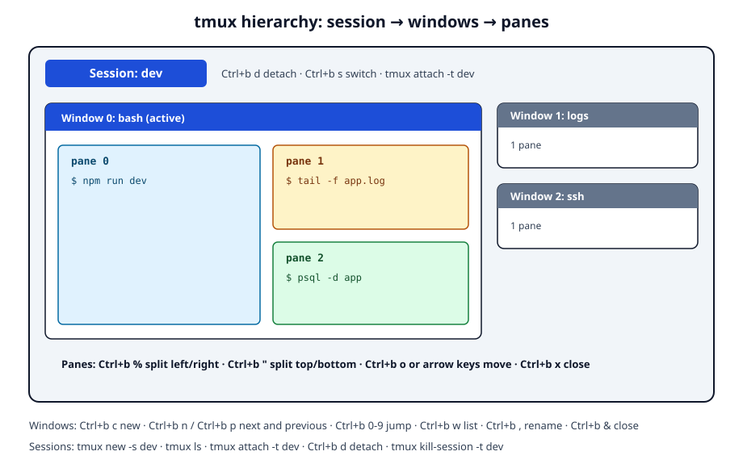

import { Picture } from "astro:assets";
import Button from "@components/widgets/Button.astro";
import Notice from "@components/widgets/Notice.astro";
import ListCheck from "@components/widgets/ListCheck.astro";
import Accordion from "@components/widgets/Accordion.astro";
import Tabs from "@components/widgets/Tabs.astro";
import Tab from "@components/widgets/Tab.astro";
import YouTubeEmbed from "@components/widgets/YouTubeEmbed.astro";
import imag1 from "../../assets/images/24/09/tmux_split_view.png";

Want to install tmux on MacOS and learn the basic commands? tmux (terminal multiplexer) keeps multiple terminal sessions alive inside a single window. You can detach, walk away, and reattach later, even from a different SSH connection, without losing what was running. tmux 3.8 shipped in September 2026 with floating panes and built-in light/dark themes. The core workflow has not changed, and every command in this guide works the same on 3.8.

This guide goes from `brew install tmux` through sessions, windows, panes, plugins, and the SSH workflow worth using on a real server. It also corrects the two pieces of advice older guides keep getting wrong: the Apple Silicon PATH fix and the "run tmux with sudo" trap.

Before you start, here is what you need:

<ListCheck>
<ul>
<li>A Mac with macOS and a terminal app (Terminal.app works, iTerm2, Wezterm, or Ghostty are nicer).</li>
<li>Homebrew, or internet access to install it (one command below).</li>
<li>About 10 minutes for the install and the first session.</li>
</ul>
</ListCheck>

For a nicer terminal to run tmux in, see the [Wezterm Mac setup with tmux and zoxide](https://www.bitdoze.com/install-wezterm-mac/) guide.

## What is tmux?

[tmux](https://github.com/tmux/tmux/wiki) is a terminal multiplexer. It runs inside one terminal window and gives you three layers to organize work:

1. Sessions are named workspaces that survive disconnects. Detach from one and everything inside keeps running.
2. Windows are tabs inside a session. The status bar shows them as `0:bash 1:logs 2:ssh`.
3. Panes are splits inside a window. One window can show several shells side by side.

<YouTubeEmbed
  url="https://www.youtube.com/embed/vtB1J_zCv8I"
  label="Tmux in 100 Seconds by Fireship"
/>

What makes tmux worth learning:

1. Detach from a session and reattach later, even from another computer. Long-running processes keep going while your laptop sleeps.
2. Split a window into panes, horizontally or vertically, and drive several shells from one screen.
3. If an SSH connection drops, the tmux session on the server does not care. Reattach and your work is exactly where you left it.
4. Key bindings, status bar, colors, and behavior are all configurable from one file.
5. Two people can attach to the same session, which is genuinely useful for pair programming or walking someone through a fix.

Beginners usually feel clumsy for a day or two, then the prefix key (`Ctrl+b`) becomes muscle memory. tmux earns its keep for anyone who runs builds, tails logs, works on remote servers, or juggles more than one task in a terminal.

## What's new in tmux 3.7 and 3.8

Two releases landed since this guide was first published. Nothing below is required to follow the rest of the article, but it is worth knowing what changed.

- Floating panes (3.7, completed in 3.8). `Ctrl+b *` opens a floating pane that overlays the current window instead of splitting it. Move and resize bindings live under `Ctrl+b g` (press `Ctrl+b ?` to see the binding group). tmux plans for floating panes to replace popups in 3.9.
- Fuzzy switcher (3.8). `Ctrl+b Tab` opens a fuzzy finder over sessions and windows. Faster than scrolling through `Ctrl+b w` when you have a pile of windows.
- Built-in themes (3.8). tmux now ships light and dark themes and a `theme` option. It detects your terminal theme by default, and the default colors look different from older tmux. If you want the classic look back, one line in your config does it (covered in the customization section).
- Mode help (3.7). Press `Ctrl+h` inside copy mode or any other mode to get help for that mode, not the full key table.
- Smaller wins. Copy-mode line numbers (`set -g copy-mode-line-numbers`), `focus-follows-mouse`, and a cleaner customize mode.

<Notice type="info" title="Updating from an older tmux?">
If you are upgrading an existing install, do not skip the restart step. tmux changed its internal protocol in 3.6, and an old server left running will refuse new clients. The fix is in <a href="#open-terminal-failed-not-a-terminal-after-upgrading">the troubleshooting section</a>.
</Notice>

If you want to see where terminals are heading beyond tmux, [Superlogical Rex: Ghostty's creator rethinks the terminal multiplexer](https://www.bitdoze.com/superlogical-rex/) is worth a read. Zellij is the modern alternative with built-in UI hints (~35.7k GitHub stars versus tmux's ~49k). I still default to tmux because it is preinstalled or one `apt install tmux` away on every Linux server I touch, and that is the environment where this tool matters most. If you are still deciding, our [best terminal multiplexers comparison](/best-terminal-multiplexers/) tests tmux, Zellij, Herdr, TuiOS, Rex, and Tern side by side.

## Getting started with tmux

Install it, verify the binary, then start a session. Nothing here needs a config file yet.

### Install tmux on macOS

The default path is Homebrew. If you do not have Homebrew yet:

1. Install Homebrew:

   ```sh
   /bin/bash -c "$(curl -fsSL https://raw.githubusercontent.com/Homebrew/install/HEAD/install.sh)"
   ```

   Follow the on-screen instructions. On Apple Silicon the installer puts Homebrew in `/opt/homebrew` and prints the `shellenv` line you should add to `~/.zprofile`. Do that step, it prevents the PATH problems described in troubleshooting later.

2. Install tmux:

   ```sh
   brew install tmux
   ```

   Homebrew pulls in the dependencies. On macOS that has included jemalloc since 3.7c (a workaround for a macOS `calloc` bug); you do not have to do anything, the formula handles it.

3. Verify the installation:

   ```sh
   tmux -V
   ```

   On a fresh install today that prints `tmux 3.8`. Anything from 3.6 up will follow this guide fine.

Table: tmux installation commands

| Action | Command |
|--------|---------|
| Install Homebrew | `/bin/bash -c "$(curl -fsSL https://raw.githubusercontent.com/Homebrew/install/HEAD/install.sh)"` |
| Install tmux | `brew install tmux` |
| Verify installation | `tmux -V` |

If `brew install tmux` fails, run `brew update` first and check that `brew doctor` is not complaining about permissions on `/opt/homebrew`.

<Notice type="info" title="Installing tmux on a Linux server">
Skip Homebrew entirely on Linux. tmux is preinstalled on many server images, and if it is not: `sudo apt install tmux` on Debian/Ubuntu or `sudo dnf install tmux` on RHEL/Alma/Rocky. The rest of this guide works the same there.
</Notice>

Want to pair tmux with a modern Mac terminal? The [Ghostty terminal setup guide for Mac](https://www.bitdoze.com/ghostty-terminal/) covers a fast GPU-accelerated option.

<Button text="Read the Ghostty setup guide" link="/ghostty-terminal/" variant="outline" color="blue" size="md" />

### Start your first tmux session

Start a new session:

```sh
tmux
```

Your terminal gets a status bar at the bottom and a fresh shell. That is a session with one window and one pane.

Better: name the session from the start so you can find it later:

```sh
tmux new -s dev
```

Even better, use attach-or-create. This is the one command I recommend putting in an alias:

```sh
tmux new -A -s dev
```

It attaches to `dev` if the session exists and creates it if it does not, which avoids the `can't find session` error.

To let another user attach to your session (pair programming or live troubleshooting):

1. Start a session as usual.
2. The other user attaches with `tmux attach -t session_name`.

Both of you see and type into the same session.

To reattach to an existing session:

```sh
tmux attach -t session_name
```

Without a name it attaches to the most recently used session. `tmux ls` lists everything currently running:

```sh
tmux ls
# dev: 1 windows (created Sun Oct 12 10:00:00 2026)
```

To detach without closing anything: press `Ctrl+b`, then `d`. The session keeps running in the background.

To close a session for good, type `exit` in its last window, or kill it explicitly:

```sh
tmux kill-session -t session_name
```

<Notice type="warning" title="Ctrl+b & kills the window">
`Ctrl+b` then `&` closes the current window and every pane in it. It is not a shortcut for "leave". Use `Ctrl+b d` to detach, `exit` to close cleanly, and save `Ctrl+b &` for when you really mean it.
</Notice>

Table: basic tmux session commands

| Action | Command |
|--------|---------|
| Start new session | `tmux` |
| Start named session | `tmux new -s session_name` |
| Attach or create (recommended) | `tmux new -A -s session_name` |
| Attach to session | `tmux attach -t session_name` |
| List sessions | `tmux ls` |
| Detach from session | `Ctrl+b` then `d` |
| Rename session | `tmux rename-session -t old_name new_name` |
| Kill session | `tmux kill-session -t session_name` |
| Kill current window | `Ctrl+b` then `&` |

The prefix key `Ctrl+b` is how tmux distinguishes commands from typing. Press it, release both keys, then press the command key. Every binding in this guide follows that pattern.

### tmux windows basics

Windows are the middle layer most beginner guides skip, and it shows the moment you look at the status bar and see `0:bash 1:bash-*`. A window is a tab. Panes live inside windows, windows live inside a session.



The bindings that matter first:

- New window: `Ctrl+b c`
- Next / previous window: `Ctrl+b n` / `Ctrl+b p`
- Jump to window by number: `Ctrl+b 0` through `Ctrl+b 9`
- List all windows and pick one: `Ctrl+b w`
- Rename the current window: `Ctrl+b ,`
- Close the current window: `Ctrl+b &` (then confirm with `y`)

Rename windows as soon as you create them. `2:ssh` beats `2:bash-` when you are switching at speed.

Table: tmux window commands

| Action | Command |
|--------|---------|
| Create window | `Ctrl+b c` |
| Next / previous window | `Ctrl+b n` / `Ctrl+b p` |
| Select window by number | `Ctrl+b 0` ... `Ctrl+b 9` |
| Choose from list | `Ctrl+b w` |
| Rename current window | `Ctrl+b ,` |
| Close current window | `Ctrl+b` then `&` |

### tmux panes

Panes split a single window into multiple sections, each running its own shell.

#### Splitting panes

<Picture formats={["webp"]} fallbackFormat="webp"
  src={imag1}
  alt="macOS terminal showing a tmux window split into three panes with the tmux status bar at the bottom"
/>

Use the prefix (`Ctrl+b`) plus a split key:

- Split vertically (left and right):
  ```
  Ctrl+b %
  ```
- Split horizontally (top and bottom):
  ```
  Ctrl+b "
  ```

Keep splitting panes to build whatever layout the task needs.

#### Navigating panes

- Next pane:
  ```
  Ctrl+b o
  ```
- Move by direction:
  ```
  Ctrl+b <arrow key>
  ```

With mouse support enabled (see customization below) you can also click a pane to focus it.

#### Closing panes

- Type `exit` in the pane, or
- `Ctrl+b x`, then confirm with `y`.

#### tmux resize pane

Interactive resize is the one you will use daily:

```
Ctrl+b Ctrl+<arrow key>
```

Hold Ctrl and tap an arrow key to grow the pane in that direction.

For precise control, use the command mode:

```
Ctrl+b :
resize-pane -U 5
```

`-U` up, `-D` down, `-L` left, `-R` right, with a cell count after the flag.

Table: tmux pane commands

| Action | Command |
|--------|---------|
| Split vertically | `Ctrl+b %` |
| Split horizontally | `Ctrl+b "` |
| Navigate to next pane | `Ctrl+b o` |
| Navigate by direction | `Ctrl+b <arrow key>` |
| Close current pane | `Ctrl+b x` or `exit` |
| Resize mode | `Ctrl+b :` then `resize-pane -[U/D/L/R] <number>` |
| Interactive resize | `Ctrl+b Ctrl+<arrow key>` |

When you forget a binding, `Ctrl+b ?` opens the full key table, and `Ctrl+h` shows help for whatever mode you are in.

## Changing the look of tmux

All of this lives in one config file. tmux reads `~/.tmux.conf` or `~/.config/tmux/tmux.conf` (the XDG path, supported since tmux 3.1). Pick one, do not maintain both. I use `~/.config/tmux/tmux.conf` on new setups because it keeps the home directory tidy.

After every edit, reload:

```sh
tmux source ~/.tmux.conf
```

Make that one keystroke by adding this to the config:

```sh
bind r source-file ~/.tmux.conf \; display-message "config reloaded"
```

Then `Ctrl+b r` reloads and confirms on the status bar. This is the verify step for every change below: edit, reload, look at the status bar. If nothing changed, `tmux source` will have printed a syntax error.

<Notice type="warning" title="tmux 3.8 changed default colors">
tmux 3.8 ships built-in light and dark themes and picks one by detecting your terminal. If your status bar suddenly looks different after upgrading, that is why. Restore the pre-3.8 ANSI colors with:

```sh
set -s theme terminal
```

The option accepts `detect`, `terminal`, `light`, or `dark`. Styles also accept theme-aware color names like `themewhite` and `themegreen`.
</Notice>

### 1. Customize the status bar

```sh
set -g status-style bg=black,fg=white
set -g status-position top
set -g status-left "[Session: #S] "
set -g status-right "%H:%M %d-%b-%y"
```

### 2. Window and pane styling

```sh
set -g window-status-current-style bg=yellow,fg=black
set -g window-status-style bg=green,fg=black
set -g pane-border-style fg=green
set -g pane-active-border-style fg=yellow
```

### 3. Enable mouse support

Worth it on a Mac. Click to focus panes, drag borders to resize, and drag to select text in copy mode:

```sh
set -g mouse on
```

### 4. Change the prefix key

If `Ctrl+b` fights with your editor or shell, rebind it. `Ctrl+a` is the common choice (it is what GNU screen uses):

```sh
unbind C-b
set-option -g prefix C-a
bind-key C-a send-prefix
```

### 5. Use a theme

On tmux 3.8 the built-in `theme` option covers most needs: force `dark`, force `light`, or follow the terminal. Only reach for a packaged theme if you want something more opinionated.

The classic route is TPM plus a theme plugin such as `jimeh/tmux-themepack`. It still works, though the pack has not been updated since 2024:

```sh
set -g @plugin 'tmux-plugins/tpm'
set -g @plugin 'jimeh/tmux-themepack'
set -g @themepack 'powerline/default/cyan'

run '~/.tmux/plugins/tpm/tpm'
```

Reload the config and press `prefix` + `I` to fetch it. If the theme renders oddly under 3.8's new theme system, fall back to `set -s theme dark` and move on.

Remember: the shell inside tmux is whatever your login shell is. macOS defaults to zsh, and if you want a friendlier shell altogether, [Fish Shell on macOS](https://www.bitdoze.com/fish-shell-macos-setup/) is a solid option.

Table: common tmux customization commands

| Customization | Command in tmux.conf |
|---------------|----------------------|
| Config reload binding | `bind r source-file ~/.tmux.conf \; display-message "config reloaded"` |
| Force a 3.8 theme | `set -s theme terminal` (or `dark` / `light` / `detect`) |
| Status bar color | `set -g status-style bg=color,fg=color` |
| Status bar position | `set -g status-position [top/bottom]` |
| Window color (active) | `set -g window-status-current-style bg=color,fg=color` |
| Pane border color | `set -g pane-border-style fg=color` |
| Enable mouse | `set -g mouse on` |
| Change prefix key | `set-option -g prefix C-[key]` |

## tmux plugins

Plugins extend tmux with things the core deliberately leaves out: session restore, clipboard integration, status widgets. The Tmux Plugin Manager (TPM) installs and updates them.

### Installing Tmux Plugin Manager (TPM)

TPM needs tmux 1.9 or newer, git, and bash. All present on a normal macOS or Linux box.

1. Clone the TPM repository:

   ```sh
   git clone https://github.com/tmux-plugins/tpm ~/.tmux/plugins/tpm
   ```

2. Add this to the bottom of your tmux.conf:

   ```sh
   # List of plugins
   set -g @plugin 'tmux-plugins/tpm'
   set -g @plugin 'tmux-plugins/tmux-sensible'

   # Initialize TMUX plugin manager (keep this line at the very bottom of tmux.conf)
   run '~/.tmux/plugins/tpm/tpm'
   ```

3. Reload the config (`tmux source ~/.tmux.conf`) and press `prefix` + `I` to fetch the plugins.

### Popular tmux plugins

<ListCheck>
<ul>
<li><strong>tmux-resurrect</strong> saves and restores sessions across a reboot. This is the one that pays for itself.</li>
<li><strong>tmux-continuum</strong> automates resurrect, including auto-restore on tmux start when you set <code>@continuum-restore 'on'</code>.</li>
<li><strong>tmux-yank</strong> copies to the system clipboard via <code>pbcopy</code> on macOS. The reliable clipboard fix on Terminal.app.</li>
<li><strong>tmux-battery</strong> puts battery percentage in the status bar, useful on a laptop.</li>
<li><strong>tmux-cpu</strong> puts CPU usage in the status bar, useful when a build is eating the machine.</li>
</ul>
</ListCheck>

```sh
set -g @plugin 'tmux-plugins/tmux-resurrect'
set -g @plugin 'tmux-plugins/tmux-continuum'
set -g @plugin 'tmux-plugins/tmux-yank'
set -g @plugin 'tmux-plugins/tmux-battery'
set -g @plugin 'tmux-plugins/tmux-cpu'
```

One honest caveat: resurrect, continuum, and yank are quiet projects (no meaningful commits since 2024). They are stable and still work with tmux 3.8, and TPM installs them fine.

### Why resurrect and continuum exist

tmux protects you against disconnects, not reboots. A Mac reboot or a VPS restart kills every session and every process inside them. That is the failure mode resurrect solves: `prefix` + `Ctrl+s` saves the current state, `prefix` + `Ctrl+r` restores it. Continuum does the saving for you on a timer and restores on startup. If you run anything in tmux that takes longer than a coffee break to recreate, install both.

### Installing and using plugins

1. Add the `set -g @plugin '...'` line to your tmux.conf.
2. Press `prefix` + `I` (capital i) to fetch and install.
3. Reload with `tmux source ~/.tmux.conf` if the plugin does not activate immediately.

### Managing plugins

- Install plugins: `prefix` + `I`
- Update plugins: `prefix` + `U`
- Remove plugins not in your config: `prefix` + `alt` + `u`

Table: basic TPM commands

| Action | Command |
|--------|---------|
| Install plugins | `prefix` + `I` |
| Update plugins | `prefix` + `U` |
| Remove unused plugins | `prefix` + `alt` + `u` |

### Example configuration with plugins

```sh
# List of plugins
set -g @plugin 'tmux-plugins/tpm'
set -g @plugin 'tmux-plugins/tmux-sensible'
set -g @plugin 'tmux-plugins/tmux-resurrect'
set -g @plugin 'tmux-plugins/tmux-continuum'
set -g @plugin 'tmux-plugins/tmux-yank'

# Plugin configurations
set -g @continuum-restore 'on'

# Initialize TMUX plugin manager (keep this line at the very bottom of tmux.conf)
run '~/.tmux/plugins/tpm/tpm'
```

Try a few plugins, keep the ones that earn their place in your config.

## Using tmux with SSH

This is where tmux stops being a toy. If you work on remote servers, tmux inside SSH is the difference between a dropped connection being a non-event and losing twenty minutes of setup.

<Notice type="info" title="One command to remember">
On the server, run <code>tmux new -A -s dev</code>. It attaches to your working session if it exists and creates it if it does not. Put it in a shell alias, or wire it into <code>~/.ssh/config</code> as a <code>RemoteCommand</code> so every login lands inside tmux.
</Notice>

The workflow:

1. SSH into the server:

   ```bash
   ssh your_username@server_address
   ```

2. Start (or join) your session:

   ```bash
   tmux new -A -s dev
   ```

3. Do your work. Long-running jobs (builds, `docker compose up`, log tails, [SSH port forwarding (tunneling)](https://www.bitdoze.com/ssh-tunneling-linux/)) go in their own window so a reconnect does not take them down.

4. Detach when you leave: `Ctrl+b`, then `d`. Close the laptop, switch networks, whatever. Reattach with the same `tmux new -A -s dev` later.

While you are in there: `tmux ls` lists sessions, `tmux kill-session -t session_name` kills one, and `tmux rename-session -t old_name new_name` renames it.

What you gain: work survives SSH drops and network changes, you can run several tasks in one connection (windows and panes), and named sessions keep projects separated on a shared box. What tmux does not save you from: a server reboot still kills the session and everything in it (see resurrect/continuum above).

Two things to sort out before tmux even matters on the server: know [how to secure an SSH server](https://www.bitdoze.com/secure-ssh-server-linux/) (keys, no root login, fail2ban or equivalent), and if your logins are already failing, [fixing SSH authentication failures](https://www.bitdoze.com/fix-ssh-too-many-authentication-failures/) comes first.

If you do not have a server to practice on yet, an inexpensive [Hetzner Cloud VPS](https://go.bitdoze.com/hetzner) is enough for this workflow. A small CX box runs tmux, your builds, and a handful of Docker containers comfortably.

## Troubleshooting common issues

Even with a clean install, a few things bite people on macOS. Each item below is symptom, cause, fix.

### tmux command not found

If the shell says `command not found: tmux`, either Homebrew did not install it or your PATH does not include Homebrew.

1. Check the install:

   ```sh
   brew list | grep tmux
   ```

   Empty output means tmux is not installed. Run `brew install tmux`.

2. Fix the PATH. Apple has shipped Apple Silicon Macs since late 2020, and most Macs in use today put Homebrew in `/opt/homebrew`, not `/usr/local`. The Homebrew installer normally adds the right line for you. If it did not, add it yourself and restart the terminal:

<Tabs>
<Tab name="Apple Silicon">

```sh
# add to ~/.zprofile
eval "$(/opt/homebrew/bin/brew shellenv)"
```

</Tab>
<Tab name="Intel Mac">

```sh
# add to ~/.zprofile
eval "$(/usr/local/bin/brew shellenv)"
```

</Tab>
</Tabs>

macOS runs zsh by default, so `~/.zshrc` and `~/.zprofile` are the files you want, not `~/.bash_profile`. Old guides that tell you to `export PATH="/usr/local/bin:$PATH"` are writing for Intel hardware. While you are in zsh config anyway, the [best Oh My ZSH plugins](https://www.bitdoze.com/best-oh-my-zsh-plugins/) are worth a look.

### `open terminal failed: not a terminal` after upgrading

This one is documented in the tmux 3.6 release notes and repeated for every release since: it is very important to restart tmux entirely after upgrading. tmux changed its internal protocol in 3.6. If you run `brew upgrade tmux` while an old server keeps running, `tmux attach` fails with exactly:

```
open terminal failed: not a terminal
```

The fix:

```sh
brew update && brew upgrade tmux
tmux kill-server
tmux
```

<Notice type="warning" title="Always restart tmux after upgrading">
`tmux kill-server` kills every session and the jobs running inside them. Save your work first. If you cannot afford to lose session state, that is exactly what tmux-resurrect and tmux-continuum are for (see the <a href="#tmux-plugins">plugins section</a>): save with `prefix` + `Ctrl+s` before the upgrade.
</Notice>

### Permissions issues

<Notice type="error" title="Never run tmux with sudo">
`sudo tmux` starts a root-owned tmux server and mangles the socket in `/tmp/tmux-501` (the `501` is your user ID). Afterwards your normal user cannot attach to its own sessions. If things are already broken: exit every client, run `tmux kill-server`, check `ls -ld /tmp/tmux-*` for root-owned leftovers, remove only what you own, and start tmux again as your normal user. There is no tmux task that requires root on your own machine.
</Notice>

### `no server running` after a reboot

Run `tmux ls` after a Mac reboot or VPS restart and you will see:

```
no server running on /tmp/tmux-501/default
```

That is normal, not an error. tmux protects against disconnects, not power loss. When the machine reboots, the tmux server dies and takes its sessions with it.

- If you installed resurrect, restore with `prefix` + `Ctrl+r` (or `prefix` + `Ctrl+s` beforehand to save).
- If you did not, start fresh with `tmux new -A -s dev` and rebuild.

To lose less next time, go back to the plugins section and install resurrect plus continuum.

### Lost tmux sessions

Before assuming a session is gone:

1. List sessions with `tmux ls`.
2. Attach with `tmux attach -t session-name` (or `tmux attach` for the most recent one).
3. Still nothing? The server is not running. Either it was killed, or the machine rebooted. Check the previous section.

### Copy-paste on macOS

Copy and paste inside tmux uses its own buffer, which is why `Cmd+C` does not do what you expect.

The basic loop:

1. Enter copy mode: `Ctrl+b [`
2. Move around, select text (with `set -g mouse on`, a drag selects and copies into the tmux buffer).
3. Paste from the buffer: `Ctrl+b ]`

To get text out to the macOS clipboard there are two realistic routes:

- tmux-yank works everywhere. The plugin from the plugins section above wires copies to `pbcopy`. On Terminal.app this is the reliable option.
- OSC 52 needs terminal support. `set -g set-clipboard external` makes tmux ask the terminal to set the system clipboard directly. iTerm2, Wezterm, and kitty support the underlying escape sequence; Terminal.app does not.

If clipboard integration misbehaves, check `Ctrl+b ?` and `man tmux` for the current bindings and the `set-clipboard` option (`on`, `external`, `off`) rather than trusting older blog posts. This is one area where tmux's defaults have shifted across releases.

### tmux not starting properly

- Test the config with `tmux source-file ~/.tmux.conf`. A syntax error prints the line number. Fix it and reload.
- Upgrade with `brew update && brew upgrade tmux`, then restart the server as described above.
- As a last resort, `tmux kill-server` and start clean. Every session dies with it, so detach anything you care about first.

### Keybindings not working

- Reload after every config edit (`tmux source-file ~/.tmux.conf` or your `Ctrl+b r` binding). Config is not re-read automatically.
- Check the binding in `Ctrl+b ?`. If your key is taken by a mode (copy mode, for example), bind it for the root table instead.
- A changed prefix key is the usual suspect after copying someone else's config. If `Ctrl+b` stops working, look for `set-option -g prefix` in the file.

### Display issues and freezing

- Terminal app. tmux runs in anything reasonable, but iTerm2, Wezterm, and Ghostty handle resize and color more cleanly than Terminal.app.
- Broken layout after resize. `Ctrl+b :` then `resize-pane -D` (or `-U`), or `tmux refresh-client -S` to force a redraw.
- Frozen pane. The process inside may just be busy or waiting for input. Try the pane's own `Ctrl+C`. If the whole client is wedged, `tmux kill-server` is the blunt instrument; check memory pressure first if it keeps happening (`Activity Monitor`, or `top` in another pane).

## FAQ

<Accordion label="Does tmux survive a reboot?" group="faq" expanded="true">
No. tmux sessions survive SSH disconnects and closed terminal windows, not reboots. When the machine restarts, the tmux server dies with it. tmux-resurrect saves session state to disk and tmux-continuum restores it automatically, which is the closest you get to reboot survival.
</Accordion>

<Accordion label="tmux vs screen vs Zellij: which one?" group="faq">
GNU screen is the old default and still shows up on ancient servers; use it only when tmux is not installable. Zellij is the modern alternative with built-in UI hints and less config, but tmux is the pragmatic default: preinstalled or one `apt install tmux` away on nearly every Linux server, with an ecosystem of plugins that has been stable for years. If you want the long view, [Superlogical Rex: Ghostty's creator rethinks the terminal multiplexer](https://www.bitdoze.com/superlogical-rex/) is a good read.
</Accordion>

<Accordion label="How do I exit tmux completely?" group="faq">
Type `exit` in each pane until the session closes, or press `Ctrl+b` then `&` to kill the current window (and its panes), or kill a named session with `tmux kill-session -t name`. To stop the tmux server entirely, `tmux kill-server`. Detaching (`Ctrl+b d`) does not exit anything; it just disconnects your view.
</Accordion>

<Accordion label="What is the tmux prefix key?" group="faq">
`Ctrl+b` by default. Press and release it, then press the command key (for example `Ctrl+b` then `d` to detach). It tells tmux that the next keypress is a command and not text. Many people rebind it to `Ctrl+a`; if your bindings suddenly do nothing, someone's config probably changed the prefix.
</Accordion>

<Accordion label="Where is the tmux config file?" group="faq">
Either `~/.tmux.conf` or `~/.config/tmux/tmux.conf`. tmux has read the XDG path since 3.1. Pick one location; if both exist, `~/.tmux.conf` wins. Reload after edits with `tmux source ~/.tmux.conf` or the `Ctrl+b r` binding from the customization section.
</Accordion>

## Conclusion

You now have tmux installed on macOS, verified with `tmux -V`, and the basic commands under your fingers: sessions to keep work alive, windows to organize it, panes to see it side by side. The customization and plugin sections are there when the defaults start to annoy you, and the SSH section is where this tool pays rent on remote servers.

Next steps I would take, in order:

1. Get the SSH habit working: `tmux new -A -s dev` on login, detach instead of closing the terminal.
2. Install resurrect and continuum so a reboot is a shrug instead of a rebuild.
3. Once tmux feels natural, level up with these [essential Linux commands](https://www.bitdoze.com/linux-commands/).
4. When the terminal itself starts feeling limiting, [Starship + Ghostty: Turbocharge Your Mac Terminal Setup](https://www.bitdoze.com/starship-ghostty-terminal/) is the next layer.

Practice the bindings for a week and they stop being a list of keys.

<Button text="Set up Wezterm with tmux and zoxide" link="/install-wezterm-mac/" variant="solid" color="blue" size="md" />
