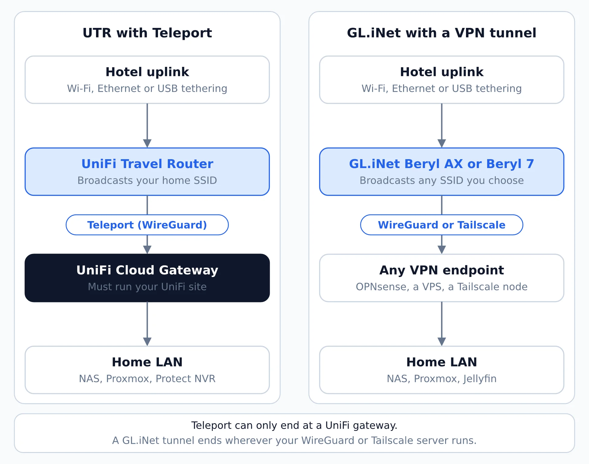
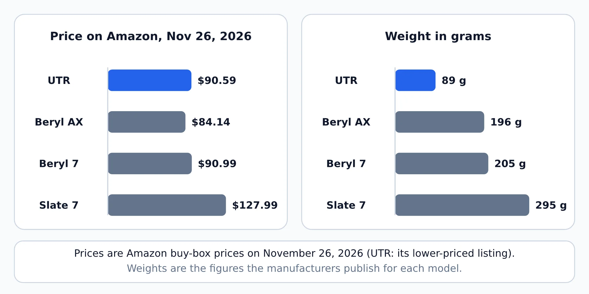
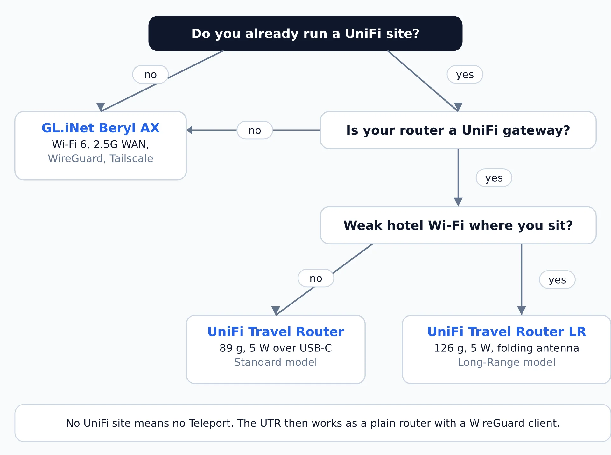

import Notice from "@components/widgets/Notice.astro";
import Accordion from "@components/widgets/Accordion.astro";
import Button from "@components/widgets/Button.astro";
import AmazonProduct from "@components/widgets/AmazonProduct.astro";

**The [UniFi Travel Router (UTR)](#unifi-travel-router-utr-the-pick-for-unifi-sites) is worth it only if a UniFi gateway runs your home network.** Bound to that site, it carries your Wi-Fi name and password into any hotel and tunnels every device home over Teleport. Everyone else gets more from the [GL.iNet Beryl AX](#glinet-beryl-ax-the-pick-for-everyone-else): Wi-Fi 6, a 2.5G WAN port, WireGuard and Tailscale.

Nobody on this site traveled with the UTR, so this UniFi Travel Router review draws on Ubiquiti's documentation, the Amazon listings and owner reports checked on November 26, 2026. Each owner report is linked where it is quoted.

<Notice type="warning" title="Affiliate disclosure">
Some links below are Amazon affiliate links, including `/go/` redirects that land on Amazon. Buying through them pays me a small commission at no extra cost to you. Prices were checked on November 26, 2026 and move constantly, so always confirm on the product page.
</Notice>

## Quick picks

| Router | Price (Nov 26, 2026) | Wi-Fi | Buy it if |
| --- | --- | --- | --- |
| [UniFi Travel Router (UTR)](/go/unifi-travel-router-utr/) | $90.59 | Wi-Fi 5 | A UniFi gateway runs your home site. |
| [UniFi Travel Router Long-Range (UTR-LR)](https://ui.com/integrations/accessory-tech/travel-router) | $99 at the Ubiquiti store | Wi-Fi 5 | The hotel access point sits far from your desk. |
| [GL.iNet Beryl AX](/go/glinet-beryl-ax/) | $84.14 | Wi-Fi 6 | You have no UniFi gateway, or you run Tailscale. |
| [GL.iNet Beryl 7](/go/glinet-beryl-7/) | $90.99 | Wi-Fi 7 | You want Wi-Fi 7 and two 2.5G ports. |
| [GL.iNet Slate 7](/go/glinet-slate-7/) | $127.99 | Wi-Fi 7 | You want a touchscreen on the router. |

The UTR-LR has no Amazon listing on November 26, 2026, so its price is the one at [Ubiquiti's store](https://store.ui.com/us/en/products/utr-lr). The UTR price is the lower of its two Amazon listings.

## What do you need before the UTR is useful?

A UniFi site whose gateway can run Teleport, and the UniFi app on an iOS or Android phone. The UTR also works with no UniFi account as a plain router, but only the bound version does the job you are paying for.

Ubiquiti's [store page](https://store.ui.com/us/en/products/utr) says it in two lines: "No UniFi Account required. Works in stand-alone device mode." and "WireGuard VPN supported." In that mode you name a Wi-Fi network, pick an uplink in a wizard and configure a VPN client yourself. That is a capable Wi-Fi 5 router, and cheaper boxes do it with newer radios.

Binding is the other mode. In the app you choose your home site, the UTR copies that network's Wi-Fi settings and brings up a Teleport tunnel on its own. Ubiquiti's [Teleport documentation](https://help.ui.com/hc/en-us/articles/5246403561495-UniFi-Gateway-Teleport-VPN) limits the feature to "users with a Next-Gen gateway or UniFi Cloud Gateway running UniFi OS". Teleport has to be switched on at that gateway first. An owner in Ubiquiti's [launch thread](https://community.ui.com/questions/Introducing-UniFi-Travel-Router/98637ee6-36b2-49f8-83a4-6bd125fd0074) reports the UTR would not offer the site to bind to until he enabled it.

| What runs at home | What the UTR can do |
| --- | --- |
| No UniFi hardware | Stand-alone router with a WireGuard or OpenVPN client. A GL.iNet does this with newer radios. |
| UniFi access points and switches behind OPNsense, pfSense or another router | No Teleport and no binding. The WireGuard client can still reach a server you run. |
| A UniFi gateway, such as a Cloud Gateway, Dream Router or Dream Machine | Bind to the site, copy the Wi-Fi settings, tunnel over Teleport. |

Check the middle row before you order. A [mini PC running OPNsense](/best-mini-pc-opnsense/) with UniFi access points behind it has no UniFi gateway, so the UTR stays in stand-alone mode. A commenter in r/Ubiquiti runs it that way, with the WireGuard client pointed at a Firewalla Gold at "400-500" Mbps ([thread](https://www.reddit.com/r/Ubiquiti/comments/1qkxns9/unifi_travel_router_real_world_review/)). A Beryl AX does the same with Wi-Fi 6 and Tailscale.

The [tech specs](https://techspecs.ui.com/unifi/wifi/utr) list Bluetooth as the only management method, so the phone is not optional: every change goes through the UniFi app. Owners in the threads linked here also report a case that runs hot ([r/UNIFI](https://www.reddit.com/r/UNIFI/comments/1wtjpcr/latest_thoughts_on_unifi_travel_router/)).

## How does Teleport differ from a WireGuard client?

Teleport is Ubiquiti's WireGuard tunnel with the configuration taken out: you enable it on the gateway, choose the site on the UTR and the tunnel comes up. A WireGuard client is the generic route. You add a config by hand and the far end can be any server you run.

*Left: Teleport ends at a UniFi gateway. Right: a GL.iNet tunnel ends wherever your WireGuard or Tailscale server already runs.*

Ubiquiti's [introduction to VPNs](https://help.ui.com/hc/en-us/articles/7951513517079-UniFi-Gateway-Introduction-to-VPNs) says Teleport "is powered by WireGuard technology", so the encryption is the same on both paths. What differs is who can terminate the tunnel and what follows you to the hotel.

| | Teleport | WireGuard client on the UTR |
| --- | --- | --- |
| Far end | A UniFi gateway running UniFi OS | Any WireGuard server: OPNsense, a VPS, a commercial provider |
| Home gateway behind NAT | Works, per Ubiquiti's FAQ | A UniFi WireGuard server needs UDP 51820 forwarded; other servers need their own port forward |
| What arrives at the hotel | Your home Wi-Fi name and password, plus the LAN devices behind the gateway | The subnets your server routes, under a Wi-Fi name you set by hand |

The NAT row comes from two Ubiquiti documents. The [Teleport FAQ](https://help.ui.com/hc/en-us/articles/5246403561495-UniFi-Gateway-Teleport-VPN) says "Teleport can be used when both the UniFi gateway and client are behind NAT". The [WireGuard server guide](https://help.ui.com/hc/en-us/articles/115005445768-UniFi-Gateway-WireGuard-VPN-Server) says a gateway behind NAT needs UDP 51820, its default WireGuard port, forwarded by the upstream router.

The owner-reported speeds come from one thread, not a benchmark. In [that r/Ubiquiti review](https://www.reddit.com/r/Ubiquiti/comments/1qkxns9/unifi_travel_router_real_world_review/) the original poster saw about 200 Mbps through Teleport on Ethernet, and a commenter reported 400 to 500 Mbps with the WireGuard client.

A bound UTR tunnels everything. Two owners describe the devices behind the UTR joining the home network, with internet traffic leaving through the home connection ([cwl.cc](https://cwl.cc/2026/review-unifi-travel-router-long-range/), [r/Ubiquiti](https://www.reddit.com/r/Ubiquiti/comments/1w3f6t7/unifi_travel_router_absolute_garbage/)). Your home upload link is therefore the ceiling for every call you take from the hotel.

Tailscale is the third path, and the UTR lacks it: the tech specs list OpenVPN and WireGuard as its VPN clients and nothing else. A GL.iNet router runs Tailscale in its interface, so it joins a tailnet you may already have. The [Tailscale setup guide](/tailscale-setup-guide/) covers the hosted version. The [self-hosted Headscale setup](/headscale-self-hosted-tailscale-setup/) puts the control server on your own hardware, and [NetBird vs Headscale vs Tailscale](/netbird-vs-headscale-vs-tailscale/) compares the three.

## UniFi Travel Router (UTR): the pick for UniFi sites

The UTR is the smallest way to carry a UniFi network, and it cost $90.59 on November 26, 2026. It turns a hotel check-in into two steps: join the hotel Wi-Fi once, then let every device reconnect to the Wi-Fi name it already knows.

**Best for:** homes where a UniFi gateway already runs the site and the traveler wants nothing to configure per trip.

**Strengths:** binding to the site takes a few taps in the UniFi app, where a GL.iNet needs a WireGuard config built first. An owner who carries both wrote that "the UniFi Travel Router won, hands down" on setup ([r/Ubiquiti](https://www.reddit.com/r/Ubiquiti/comments/1r58bws/unifi_travel_router_vs_glinet_beryl_ax_range/)). It measures 95.95 x 65 x 12.5 mm and weighs 89 g, less than half a Beryl AX's 196 g, and draws 5 W at most. The 1.14-inch display shows the uplink, its signal strength and the number of connected clients without the app.

**Trade-offs:** Wi-Fi 5 at 2x2, two Gigabit ports and low radio power. In that thread the UTR showed two bars out of three on a balcony 15 to 20 feet behind a glass door, where the Beryl AX showed full signal.

<AmazonProduct
  productName="Ubiquiti UniFi Travel Router (UTR)"
  productDescription="An 89 g Wi-Fi 5 travel router that binds to a UniFi site and tunnels back over Teleport, powered by 5 W over USB-C."
  productFeatures={["Wi-Fi 5, 2x2 radios, 866.7 Mbps top rate on 5 GHz", "Two Gigabit RJ45 ports, one WAN and one LAN", "USB-C power at 5 V/2 A and a second USB-C for phone tethering", "Teleport, WireGuard and OpenVPN clients, 1.14-inch status display"]}
  productLink="/go/unifi-travel-router-utr/"
  productImage="https://m.media-amazon.com/images/I/41hgb60WXAL._AC_SL1278_.jpg"
  productRating={4.4}
  recommendedBadge="Best for UniFi Sites"
  importantConsiderations={["Teleport needs a UniFi gateway running UniFi OS at home", "No power adapter in the box, by Ubiquiti's design", "Management only through the UniFi phone app"]}
  pros={["Binds to a UniFi site in a few taps and copies your Wi-Fi settings", "89 g and 12.5 mm thin, the smallest router in this group", "Runs on 5 W, so a phone charger or power bank is enough"]}
  cons={["Wi-Fi 5 radios with short range, two Gigabit ports only", "No Tailscale and no web interface"]}
/>

### Ports and display

The two ports have fixed roles, one WAN and one LAN, both Gigabit, so anyone with two wired devices packs a small switch. The display earns its place once the hotel portal asks for a new login. It shows the drop before any device fails, where a Beryl AX only blinks its light later, by the same owner's account. At 12.5 mm the body is thinner than an RJ45 plug ([Dong Knows](https://dongknows.com/ubiquiti-utr-unifi-travel-router-review/)), so the port block stands proud of it.

## Is Wi-Fi 5 a problem in a hotel?

Rarely. The 5 GHz radio links at up to 866.7 Mbps, and hotel uplinks sit far below that, so the line into the building is the bottleneck. Wi-Fi 5 costs the UTR range and the speed of local transfers.

The [tech specs](https://techspecs.ui.com/unifi/wifi/utr) list 802.11ac at 6.5 to 866.7 Mbps on 5 GHz and 802.11n at up to 300 Mbps on 2.4 GHz, both 2x2. An owner in the comparison thread skipped speed tests because his hotel "seems to cap up and down at 25 Mbps".

Two things get worse. Range comes first. Ubiquiti rates the radios at 13 dBm on 2.4 GHz and 15 dBm on 5 GHz, about two-thirds of the UTR-LR's figures. Local transfers come second. A laptop copying to a NAS on the same desk rides a link rated at 866.7 Mbps, against 2402 Mbps on a Beryl AX.

## How do you power the UTR and tether a phone?

From any USB-C source that supplies 5 V at 2 A: a phone charger or a power bank. The second USB-C port takes a tethered iPhone or Android phone, so a phone uplink needs its own cable.

Ubiquiti's specs put maximum consumption at 5 W and the power supply at "USB-C, 5V/2A (Adapter not included)". The adapter is absent: [Lester Chan's unboxing](https://lesterchan.net/blog/2026/11/10/unifi-travel-router-utr/) lists the router and a 50 cm braided USB-C cable as the box contents. GL.iNet rates the Beryl AX at under 8 W and the Slate 7 at under 18 W ([spec table](https://www.gl-inet.com/en-ca/pages/travel-routers)). On a weak port, the UTR is the one I would trust.

Owners notice the 5 W ceiling. One who travels with both brands keeps the UTR "on the plane or if I am needing it outside the hotel" because it "is great with a rechargeable battery" ([r/UNIFI](https://www.reddit.com/r/UNIFI/comments/1wtjpcr/latest_thoughts_on_unifi_travel_router/)). Use a 2 A charger: a commenter in the r/Ubiquiti review blamed the original poster's random reboots on a 1 A one. I would still skip the USB port on a hotel TV until I had read its output rating.

The specs list "USB Tethering (iOS/Android)" as an uplink. The tethering port is separate from the power port, so a tethered phone means two cables into the router ([Dong Knows](https://dongknows.com/ubiquiti-utr-unifi-travel-router-review/)). A commenter in the r/Ubiquiti review says tethering became reliable with firmware 6.5.250. Dong Knows reports the app keeps Ethernet, Wi-Fi and USB configured at once, with one active and the rest as backups.

## Which of the two Amazon listings should you buy?

The cheaper one, as long as it is in stock. Both listings sell the same Ubiquiti travel router, the UTR. Ubiquiti puts no power adapter in the box, and only one of the two titles says so.

| Listing on November 26, 2026 | Price | Sold by | Ships from | Stock |
| --- | --- | --- | --- | --- |
| [UTR Travel Router, power supply not included](/go/unifi-travel-router-utr/) | $90.59 | Brickz HI, a third-party seller | Amazon | In stock |
| [UniFi UTR, white, dual-band](/go/unifi-travel-router-utr-greybar/) | $97.97 | GreyBar, a third-party seller | Amazon | In stock |

Amazon showed 400+ bought in the past month for the GreyBar listing and 300+ for the Brickz HI listing on November 26, 2026. Neither listing comes from Ubiquiti or from Amazon itself, and Amazon ships both. The GreyBar listing carried Amazon's Choice and a list price of $107.70 on the same day, and it still outsold the cheaper one.

Both cost more than the $79 listed at [Ubiquiti's own store](https://store.ui.com/us/en/products/utr) on the same day, so check the store first.

<Button text="Check the GreyBar UTR listing" link="/go/unifi-travel-router-utr-greybar/" variant="outline" color="blue" size="md" icon="arrow-right" />

## UTR-LR: same hardware, folding antenna, higher price

The UTR-LR is a UTR with a folding antenna hinged on top, and it costs $20 more at Ubiquiti's store (Nov 26, 2026). The spec sheet matches the UTR on everything else: 2x2 Wi-Fi 5 radios, two Gigabit ports, 5 W over USB-C and the 1.14-inch display.

**Best for:** UniFi travelers who work far from the hotel access point, in suites, rentals or rooms with a balcony.

**Strengths:** the same bind and Teleport setup as the UTR, with transmit power of 20 dBm on 2.4 GHz and 23 dBm on 5 GHz.

**Trade-offs:** 37 g heavier, 7 mm thicker, and the same 866.7 Mbps Wi-Fi 5 ceiling.

| Spec | UTR | UTR-LR |
| --- | --- | --- |
| Antenna | Two internal | One external, folds flat and tilts up to 180 degrees |
| Max transmit power | 13 dBm on 2.4 GHz, 15 dBm on 5 GHz | 20 dBm on 2.4 GHz, 23 dBm on 5 GHz |
| Size | 95.95 x 65 x 12.5 mm | 96 x 65 x 19.5 mm |
| Weight | 89 g | 126 g |
| Price (Nov 26, 2026) | $90.59 on Amazon | $99 at the Ubiquiti store |

Specs are from Ubiquiti's [product page](https://ui.com/integrations/accessory-tech/travel-router) and its [tech specs](https://techspecs.ui.com/unifi/wifi/utr-lr).

The antenna adds reach. The 5 GHz rate stays at 866.7 Mbps. [Dong Knows](https://dongknows.com/ubiquiti-utr-lr-unifi-travel-router-long-range-review/) dates the release to August 28, 2026 and expects the antenna to help most in WISP mode, where the router listens to a distant hotel access point. An owner in the [r/UNIFI thread](https://www.reddit.com/r/UNIFI/comments/1vxv7d6/unifi_travel_router_longrange_utrlr/) covered a whole short-term rental with one unit, placed high and central.

Two quirks come with the hinge. The display sits under the antenna, so closing it hides the screen ([cwl.cc](https://cwl.cc/2026/review-unifi-travel-router-long-range/)). The same owner needed a key to get the flap open.

A search for "unifi uTR-LR" on Amazon returned only the two UTR listings on November 26, 2026, so the UTR-LR comes from [Ubiquiti's store](https://store.ui.com/us/en/products/utr-lr).

## UTR vs GL.iNet: where the specs split

This is the UniFi Travel Router vs GL.iNet on paper: the GL.iNet boxes win every radio and port spec, and the UTR wins on weight and power. Price does not separate them: on November 26, 2026 the UTR, Beryl AX and Beryl 7 sat within $7 of one another.

*Amazon prices on November 26, 2026, with the UTR at its lower-priced listing, and the manufacturers' published weights.*

| Spec | UTR | Beryl AX | Beryl 7 | Slate 7 |
| --- | --- | --- | --- | --- |
| Wi-Fi | 5 | 6 | 7 | 7 |
| Top rate on 5 GHz | 866.7 Mbps | 2402 Mbps | 2882 Mbps | 2882 Mbps |
| Ethernet ports | 1x 1G WAN, 1x 1G LAN | 1x 2.5G WAN, 1x 1G LAN | 2x 2.5G | 2x 2.5G |
| VPN | Teleport, WireGuard, OpenVPN | WireGuard, OpenVPN, Tailscale | WireGuard, OpenVPN, Tailscale | WireGuard, OpenVPN, Tailscale |
| Power | USB-C 5 V/2 A, 5 W max | USB-C 5 V/3 A, under 8 W | USB-C 5 to 12 V, under 12 W | USB-C 5 to 12 V, under 18 W |
| Size and weight | 95.95 x 65 x 12.5 mm, 89 g | 120 x 83 x 34 mm, 196 g | 120 x 83 x 34 mm, 205 g | 130 x 91 x 34 mm, 295 g |
| Price (Nov 26, 2026) | $90.59 | $84.14 | $90.99 | $127.99 |

Wi-Fi rates are the manufacturers' lab figures, as are the WireGuard speeds quoted below. Sources: [Ubiquiti's tech specs](https://techspecs.ui.com/unifi/wifi/utr) and [GL.iNet's spec table](https://www.gl-inet.com/en-ca/pages/travel-routers).

The 2.5G ports matter if you carry a NAS or a mini PC. A Beryl 7 links to either at 2.5G. The small switches in the [2.5 and 10GbE switch guide](/best-2-5-10gbe-switch-homelab/) match that port.

## GL.iNet Beryl AX: the pick for everyone else

Without a UniFi gateway at home, the Beryl AX is the better travel router. It cost $84.14 on November 26, 2026, less than the UTR, and it does more on every radio spec.

**Best for:** homes that end in OPNsense, pfSense, a Firewalla or a stock ISP router, and anyone who wants Tailscale on the router itself.

**Strengths:** OpenWrt with WireGuard, OpenVPN and Tailscale in the interface, so the far end can be any server ([GL.iNet docs](https://docs.gl-inet.com/router/en/4/user_guide/gl-mt3000/)). Wi-Fi 6, a 2.5G WAN port and a USB 3.0 port for a tethered phone or a storage drive. In the r/Ubiquiti comparison it held full signal through the balcony door that dropped the UTR to two bars out of three. The [travel router guide](/best-travel-router-wireguard-tailscale/) covers its captive portal and repeater settings.

**Trade-offs:** 196 g against 89 g, and 34 mm thick against 12.5 mm. The first trip asks you to build a WireGuard config or join a tailnet before you leave, which the same owner called "a bit more involved" than the UTR's bind.

<AmazonProduct
  productName="GL.iNet Beryl AX (GL-MT3000)"
  productDescription="A Wi-Fi 6 OpenWrt travel router with a 2.5G WAN port and WireGuard and Tailscale built in. The pick for homes without a UniFi gateway."
  productFeatures={["Wi-Fi 6, 574 Mbps on 2.4 GHz and 2402 Mbps on 5 GHz", "1x 2.5G WAN port and 1x 1G LAN port, plus USB 3.0", "WireGuard at 300 Mbps and OpenVPN at 150 Mbps, vendor lab figures", "OpenWrt with Tailscale and AdGuard Home in the interface"]}
  productLink="/go/glinet-beryl-ax/"
  productImage="https://m.media-amazon.com/images/I/41IiLQJghoL._AC_SL1000_.jpg"
  productRating={4.5}
  recommendedBadge="Best Overall"
  importantConsiderations={["The first trip needs a WireGuard config or a Tailscale login before you leave", "Needs a 5 V/3 A USB-C supply"]}
  pros={["Holds a link where the UTR drops, in one owner's side-by-side test", "Far end can be any WireGuard server or a tailnet", "Cheaper than the UTR at November 2026 prices"]}
  cons={["196 g and 34 mm thick", "No Wi-Fi 7 and one LAN port"]}
/>

## GL.iNet Beryl 7 and Slate 7: the Wi-Fi 7 step-ups

### GL.iNet Beryl 7

The Beryl 7 keeps the Beryl AX's body and adds Wi-Fi 7, a second 2.5G port and USB-C PD power for about $7 more, at $90.99 on November 26, 2026.

**Best for:** travelers who want the fastest Wi-Fi and two 2.5G ports without a touchscreen.

**Strengths:** two 2.5G ports, one of them configurable as WAN or LAN ([GL.iNet](https://www.gl-inet.com/products/gl-mt3600be)). The USB port is built to power mobile hotspots. A reader in the r/UNIFI thread who owns both wrote "if you want it to be powered via PD go with 7".

**Trade-offs:** 205 g, and GL.iNet's 1100 Mbps WireGuard figure needs a wired uplink faster than any hotel line.

<AmazonProduct
  productName="GL.iNet Beryl 7 (GL-MT3600BE)"
  productDescription="A Wi-Fi 7 travel router with two 2.5G ports and USB-C PD power. The step up from the Beryl AX for about the price of a UTR."
  productFeatures={["Wi-Fi 7, 688 Mbps on 2.4 GHz and 2882 Mbps on 5 GHz", "Two 2.5G Ethernet ports, one configurable as WAN or LAN", "WireGuard at up to 1100 Mbps, vendor lab figure", "USB-C PD power and a USB 3.0 port for tethering"]}
  productLink="/go/glinet-beryl-7/"
  productImage="https://m.media-amazon.com/images/I/41FK8yaMfFL._AC_SL1500_.jpg"
  productRating={4.2}
  recommendedBadge="Best for Wi-Fi 7"
  importantConsiderations={["Vendor speeds need a wired uplink no hotel provides", "205 g, more than twice the UTR's weight"]}
  pros={["Wi-Fi 7 and two 2.5G ports in the Beryl AX's body", "Runs from a PD charger shared with a laptop", "Tailscale and WireGuard in the OpenWrt interface"]}
  cons={["No touchscreen", "Heavier than the UTR"]}
/>

### GL.iNet Slate 7

The Slate 7 is the Beryl 7 with a touchscreen, more memory and a larger case.

**Best for:** anyone who wants to read the uplink status or toggle the VPN on the router instead of on a phone.

**Strengths:** a touchscreen that shows color-coded status for each uplink, 1 GB of memory and the same two 2.5G ports ([GL.iNet](https://www.gl-inet.com/products/gl-be3600)).

**Trade-offs:** 295 g, the heaviest here, and a WireGuard lab rate of 490 Mbps, under half the Beryl 7's. It cost $127.99 on November 26, 2026, $37 more than the Beryl 7.

<AmazonProduct
  productName="GL.iNet Slate 7 (GL-BE3600)"
  productDescription="A Wi-Fi 7 travel router with a touchscreen, two 2.5G ports and 1 GB of memory, for anyone who wants to control the router on the router."
  productFeatures={["Wi-Fi 7, 688 Mbps on 2.4 GHz and 2882 Mbps on 5 GHz", "Touchscreen for status and router controls", "Two 2.5G Ethernet ports and a USB 3.0 port", "WireGuard at 490 Mbps and OpenVPN DCO at 385 Mbps, vendor lab figures"]}
  productLink="/go/glinet-slate-7/"
  productImage="https://m.media-amazon.com/images/I/51ECXid1nLL._AC_SL1500_.jpg"
  productRating={4.4}
  recommendedBadge="Best for Touchscreen"
  importantConsiderations={["295 g, the heaviest router in this group", "WireGuard lab rate is under half the Beryl 7's"]}
  pros={["Screen shows the uplink and toggles the VPN without a phone", "Same two 2.5G ports as the Beryl 7"]}
  cons={["Highest price of the four picks on November 26, 2026", "Larger case at 130 x 91 x 34 mm"]}
/>

The Opal (Wi-Fi 5) and the TP-Link Roam 6 (Wi-Fi 6) cost less. The [travel router guide](/best-travel-router-wireguard-tailscale/) compares them with the rest of the GL.iNet line.

## Which travel router should you buy?

Start with the gateway at home before you compare routers. If a UniFi gateway runs your site, buy the UTR. If not, buy the Beryl AX. Two exceptions change that answer.

*Follow the first question to its end before comparing prices.*

The first exception is range. If the hotel access point sits far from your desk, or you work in suites rather than single rooms, the UTR-LR's antenna earns its $20 premium (Nov 26, 2026). The second is headroom. The Beryl 7 gives Wi-Fi 7 and two 2.5G ports for about the same price as a UTR.

## What I'd buy

- UniFi at home: the [UniFi Travel Router](/go/unifi-travel-router-utr/) at $90.59, or the UTR-LR from Ubiquiti's store when the hotel signal is weak.
- No UniFi gateway: the [GL.iNet Beryl AX](/go/glinet-beryl-ax/) at $84.14, with WireGuard to your own server or Tailscale.
- Wi-Fi 7 and two 2.5G ports: the [GL.iNet Beryl 7](/go/glinet-beryl-7/) at $90.99.

Prices are from November 26, 2026. For a home network that ends in OPNsense rather than a UniFi gateway, I'd buy the Beryl AX and skip the UTR. The bind is the only thing the UTR does that a GL.iNet cannot.

The UniFi Travel Router setup that matters happens at home before you pack it: switch on Teleport at the gateway and update the UniFi app. Then bind the UTR once on your own Wi-Fi. Dong Knows notes the router downloads its first firmware update as soon as it has internet, which can take up to ten minutes. That wait belongs at home, not in a hotel lobby.

## FAQ

<Accordion label="Is the UniFi Travel Router worth it?" group="faq" expanded="true">
Only with a UniFi gateway at home. Bound to your site, the UTR copies your Wi-Fi settings and tunnels over Teleport in a few taps, and it weighs 89 g on 5 W of USB-C power. Without a UniFi gateway it is a stand-alone Wi-Fi 5 router, and the GL.iNet Beryl AX does that job with Wi-Fi 6 and Tailscale for less.
</Accordion>

<Accordion label="Does the UniFi Travel Router work without a UniFi account?" group="faq">
Yes. Ubiquiti's store page says "No UniFi Account required. Works in stand-alone device mode", and that mode supports WireGuard and OpenVPN clients. Teleport and site binding are the parts that need a UniFi gateway running UniFi OS at home.
</Accordion>

<Accordion label="Can I use the UTR with WireGuard instead of Teleport?" group="faq">
Yes. You add the server's config in the UniFi app, and the far end can be any WireGuard server you run. If that server is a UniFi gateway behind NAT, UDP port 51820 has to be forwarded to it, while Teleport works behind NAT with no port forward. One owner reported 400 to 500 Mbps this way.
</Accordion>

<Accordion label="Does the UniFi Travel Router support Tailscale?" group="faq">
No. Ubiquiti's tech specs list OpenVPN and WireGuard as the UTR's VPN clients. Tailscale runs on OpenWrt routers such as the GL.iNet Beryl AX and Beryl 7, which [GL.iNet's docs](https://docs.gl-inet.com/router/en/4/interface_guide/tailscale) list as supported models.
</Accordion>

<Accordion label="How much power does the UniFi Travel Router need?" group="faq">
5 W at most, from a USB-C source at 5 V and 2 A, and no adapter ships in the box. A phone charger or a power bank runs it. In one owner thread a commenter traced random reboots to a 1 A charger, under that 2 A rating.
</Accordion>

<Accordion label="What is the difference between the UTR and the UTR-LR?" group="faq">
The UTR-LR adds a folding antenna and raises transmit power from 13 and 15 dBm to 20 and 23 dBm. It weighs 126 g against 89 g and is 7 mm thicker. The radios, ports, power and display match, and it cost $99 at Ubiquiti's store on November 26, 2026, with no Amazon listing.
</Accordion>

<Accordion label="Is Wi-Fi 5 fast enough for a travel router?" group="faq">
For hotel Wi-Fi, yes. The UTR's 5 GHz radio links at up to 866.7 Mbps, far above the 25 Mbps cap one owner measured on his hotel line. Wi-Fi 5 costs the UTR range and the speed of transfers between your own devices.
</Accordion>
