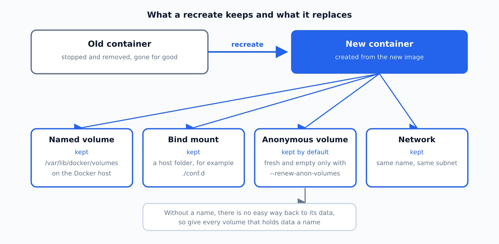
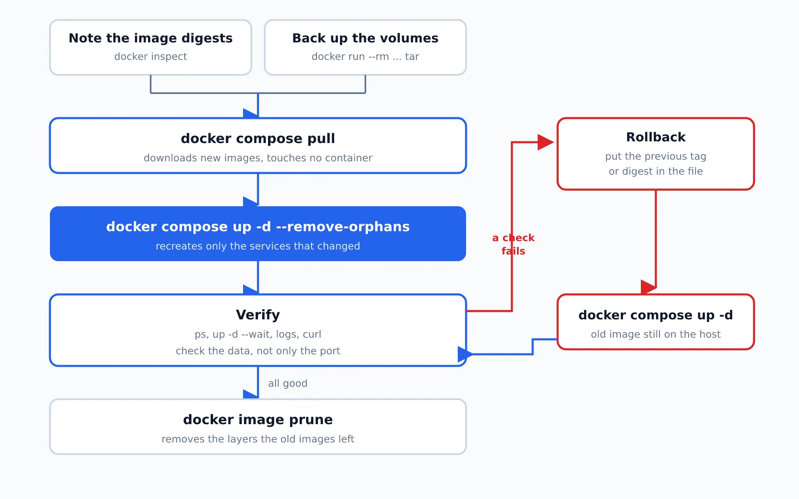

import Accordion from "@components/widgets/Accordion.astro";
import Notice from "@components/widgets/Notice.astro";

Updating a Docker Compose container comes down to two commands: `docker compose pull` downloads the new image and `docker compose up -d` swaps the container over. The part that bites people is the second one, because it also decides what happens to your data and what to do when the new version is broken.

This guide walks through the whole update on a small nginx stack. It covers what each command changes, how to back up the volumes first, how to verify the result and how to roll back. Every output block below is real, from Docker 29.2.1 and Compose v5.0.2, with the test project shown as `demo`.

The older version of this article used `docker-compose` v1 on a Plausible stack. That v1 binary is retired, so read [the Docker commands reference](/docker-commands/) if you still meet it in old tutorials. For Plausible itself use the [Plausible install guide](/install-plausible-analytics/).

## What do `docker compose pull` and `up -d` do?

`docker compose pull` downloads new images and touches no container. `docker compose up -d` recreates every container whose image or configuration changed and leaves the rest running.

`pull` fetches the image behind every `image:` line in the Compose file and stops there. It never stops, restarts or recreates a container, so you can run it at any time.

`docker compose up -d` is the command that applies the change. For each service it compares the running container with the image and configuration it has now. If either changed, Compose stops the old container, removes it and starts a new one from the new image. If nothing changed, the container is left alone, which is why a stack with five services shows one `Recreated` line and four `Running` lines after an update.

A recreate replaces the container, not everything around it:



*A recreate swaps the container. Named volumes, bind mounts, the network and, by default, anonymous volumes carry over.*

| Piece | After a recreate | Where the data lives |
|---|---|---|
| Named volume (`db-data:/var/lib/postgresql/data`) | Kept | `/var/lib/docker/volumes/<project>_db-data/_data` on the host |
| Bind mount (`./conf.d:/etc/nginx/conf.d`) | Kept | The host folder you named |
| Anonymous volume (no name before the colon) | Kept by default, fresh and empty with `--renew-anon-volumes` | `/var/lib/docker/volumes/<random id>/_data` |
| Network | Kept | n/a |
| Anything written inside the container outside a volume | Lost | It was in the container's writable layer |

The anonymous volume row is the one to read twice. Compose copies anonymous volumes from the old container to the new one unless you pass `-V`. That default saves you once and then hides the data under a random name, so give a name to every volume that holds anything you care about.

### Flags you will use with `up`

| Flag | What it does | When to use it |
|---|---|---|
| `--pull always` | Pulls the image before starting, even if a local copy exists | When you skip a separate `pull` step |
| `--build` | Builds images for services with a `build:` section before starting | Stacks that ship a Dockerfile |
| `--wait` | Waits until every service is running or healthy, then exits | The health check after an update |
| `--wait-timeout 60` | Sets the maximum seconds `--wait` blocks | Services with a slow start, so the command fails instead of hanging |
| `--remove-orphans` | Removes containers of services you deleted from the file | Always, on a stack you edit by hand |
| `--force-recreate` | Recreates containers even when nothing changed | When you patched a container by hand with `docker exec` and want a clean one |
| `--no-deps` | Starts only the named service, not the ones in `depends_on` | Updating one service in a stack with a shared database |
| `--renew-anon-volumes` (`-V`) | Gives the new container fresh anonymous volumes | Only when the image must start from its own empty volume |

## Tags: `latest`, a pinned tag or a digest

Three ways to write the `image:` line, three different update paths.

| Style | Example | What `pull` does | Rollback |
|---|---|---|---|
| Floating tag | `nginx:latest` | Fetches whatever the tag points to now | Hard, because the tag moved. Note the image ID or digest before you update |
| Pinned tag | `nginx:1.29-alpine` | Fetches new builds inside that minor line | Put the previous tag back |
| Digest | `nginx@sha256:5616...` | Nothing, until you change the digest | Put the previous digest back |

Pinned tags are the default I use. You choose when to move, and the old tag still exists when you need to go back. A digest is stricter. A tag can be re-pushed with different content, a digest cannot. To see the digest behind an image you already run:

```bash
docker inspect --format '{{index .RepoDigests 0}}' nginx:1.29-alpine
```

```text
nginx@sha256:5616878291a2eed594aee8db4dade5878cf7edcb475e59193904b198d9b830de
```

Paste that value into the Compose file and the stack is locked to that exact build.

<Notice type="warning" title="Never jump a database major version by editing the tag">
Changing `postgres:16` to `postgres:17` and running `up -d` gives you a container that refuses to start on the old data directory. A Postgres minor update keeps the data directory as is; a major upgrade needs a dump and restore or `pg_upgrade`, because the on-disk format changes. Read the release notes of any database before you touch its major tag, and take the volume backup first.
</Notice>

Postgres 18 images also moved the data path to `/var/lib/postgresql`, which the [multiple Postgres databases guide](/multiple-postgres-databases-docker/) covers. The upgrade methods are in the [PostgreSQL documentation](https://www.postgresql.org/docs/current/upgrading.html).

The same care goes for the `.env` file next to the Compose file. It holds passwords more often than not, and an update is a good moment to move them to [Docker Compose secrets](/docker-compose-secrets/).

## Before the update: backups and digests

Three things, two minutes.

1. Keep the Compose file in git, or copy it: `cp compose.yaml compose.yaml.bak`. You will want the exact old tags when something breaks.
2. Note the image ID Compose reports and the digest behind the tag:

   ```bash
   docker compose images
   ```

   ```text
   CONTAINER                    REPOSITORY          TAG                 PLATFORM            IMAGE ID            SIZE                CREATED
   demo-web-1                   nginx               1.28-alpine         linux/amd64         a8b39bd9cf0f        26MB                8 months ago
   ```

   ```bash
   docker inspect --format '{{index .RepoDigests 0}}' nginx:1.28-alpine
   ```

   ```text
   nginx@sha256:a8b39bd9cf0f83869a2162827a0caf6137ddf759d50a171451b335cecc87d236
   ```

3. Back up every named volume into one tarball with a throwaway container. The example volume is `demo_html`:

   ```bash
   mkdir -p bak
   docker run --rm -v demo_html:/data:ro -v "$PWD/bak:/backup" alpine tar czf /backup/html-vol.tgz -C /data .
   ls -l bak
   ```

   ```text
   -rw-r--r-- 1 root root 495 Nov 23 21:22 html-vol.tgz
   ```

The volume name starts with the project name. `docker volume ls` lists the real ones on your host. For a database, run the dump the database offers (`pg_dump`, `mysqldump`) before the tar, since a file copy of live data files is not a clean backup. To schedule copies of `/var/lib/docker/volumes` off the server, see [Pluton, a self-hosted Restic backup UI](/pluton-self-hosted-backup/).

## Update the stack

Here is the example stack: nginx with a named volume for the HTML root, a bind mount for the config and a health check. The port binds to `127.0.0.1` because Docker otherwise [publishes it past your firewall](/docker-bypasses-firewall/).

```yaml
services:
  web:
    image: nginx:1.28-alpine
    ports:
      - "127.0.0.1:8088:80"
    volumes:
      - html:/usr/share/nginx/html:ro
      - ./conf.d:/etc/nginx/conf.d:ro
    healthcheck:
      test: ["CMD", "wget", "-q", "-O", "/dev/null", "http://127.0.0.1/healthz"]
      interval: 5s
      timeout: 3s
      retries: 3

volumes:
  html:
```

The update bumps the tag to `nginx:1.29-alpine` and follows the flow below.



*The update flow, with the rollback branch on the right.*

### Pull the new images

```bash
docker compose pull
```

```text
 Image nginx:1.29-alpine Pulling
 aee4e54b3865 Pulling fs layer
 4a8b0b2a5b19 Pulling fs layer
 aee4e54b3865 Download complete
 612c0c1df4c5 Downloading [==========>                                        ]  4.194MB/20.25MB
 ...
 Image nginx:1.29-alpine Pulled
```

Layers that changed download again, the rest are skipped, which is why an update of a 26MB image takes seconds. After this the stack still runs the old image; `pull` changed the local tag, nothing else.

### Recreate the changed containers

```bash
docker compose up -d --remove-orphans
```

```text
 Container demo-sidecar-1 Stopping
 Container demo-sidecar-1 Stopped
 Container demo-sidecar-1 Removing
 Container demo-sidecar-1 Removed
 Container demo-web-1 Recreate
 Container demo-web-1 Recreated
 Container demo-web-1 Starting
 Container demo-web-1 Started
```

The first four lines are an orphan: a `sidecar` service that was removed from the file in the same edit. Without `--remove-orphans` it keeps running, with its old image, and nothing in the file mentions it any more.

### Check the state

```bash
docker compose ps
```

```text
NAME                         IMAGE               COMMAND                  SERVICE   CREATED                  STATUS                                     PORTS
demo-web-1                   nginx:1.29-alpine   "/docker-entrypoint.…"   web       Less than a second ago   Up Less than a second (health: starting)   127.0.0.1:8088->80/tcp
```

The image column shows the new tag, and the status says `health: starting`, which is the moment where `ps` alone is not enough. Run the health check and let Compose wait:

```bash
docker compose up -d --wait
```

```text
 Container demo-web-1 Running
 Container demo-web-1 Waiting
 Container demo-web-1 Healthy
```

`--wait` exits with code 1 when a service is unhealthy or exits before the timeout. With a health check that never passes and `--wait-timeout 8`, Compose prints `application not healthy after 8s` and exits with code 1. That makes the command a gate in a script. Here it finds nothing to recreate (`Running`), it only waits.

Then look at the logs and hit the service from outside:

```bash
docker compose logs --tail 5 web
curl -s -o /dev/null -w '%{http_code}\n' http://127.0.0.1:8088/healthz
curl -s http://127.0.0.1:8088/
```

```text
web-1  | 2026/11/23 19:22:25 [notice] 1#1: start worker process 25
web-1  | 2026/11/23 19:22:25 [notice] 1#1: start worker process 26
web-1  | 2026/11/23 19:22:25 [notice] 1#1: start worker process 27
web-1  | 2026/11/23 19:22:25 [notice] 1#1: start worker process 28
web-1  | 127.0.0.1 - - [23/Nov/2026:19:22:30 +0000] "GET /healthz HTTP/1.1" 200 3 "-" "Wget" "-"
200
<h1>v1</h1>
```

The last line is the test: the page comes from the named volume, which the new container did not touch. Log in to the app and open one record you wrote before the update. A port that answers says the process is up, not that your data made it.

### Clean up the old layers

```bash
docker image prune -f
```

```text
Total reclaimed space: 0B
```

Zero here, and that is expected. Plain `prune` removes dangling images only, the ones with no tag at all. The old `nginx:1.28-alpine` still has its tag, so it stays, which is also what makes the rollback below instant. When you are sure you will not go back, `docker image prune -a -f` removes every image that no container uses. That includes the images of stacks you took down with `docker compose down`, so check `docker image ls` first. For volumes, networks and build cache, see [how to clean all Docker images, volumes and networks](/cleanup-all-docker-things/). A disk that keeps filling is a job for the [overlay2 cleanup guide](/clean-docker-overlay2-dir/).

## How do I roll back a failed update?

Put the previous tag or digest back in the Compose file and run `docker compose up -d`. That restores the image. The data needs the backup only if the new version changed it.

If the health check fails, or the app starts and shows an empty dashboard, roll back the image first and the data second.

1. Edit the Compose file back to the previous tag or digest: `image: nginx:1.28-alpine`.
2. Recreate:

   ```bash
   docker compose up -d
   ```

   ```text
   Container demo-web-1 Recreate
   Container demo-web-1 Recreated
   Container demo-web-1 Starting
   Container demo-web-1 Started
   ```

3. Confirm with `docker compose ps`, which now reports `1.28-alpine`, then the same `curl` check.

If the old image is gone from the host, `up -d` pulls it again by tag or digest, so the rollback still works while the registry has it. Keeping the image local makes the rollback instant, which is why `docker image prune -a` belongs at the end of the update, after the checks pass.

Rolling back the image does not roll back the data. When the new version ran a database migration on start, the old version now sits on a newer schema and may fail with errors that look unrelated. That is the moment for the tarball from the backup step. Stop the service, empty the volume, restore, start:

```bash
docker compose stop web
docker run --rm -v demo_html:/data alpine find /data -mindepth 1 -delete
docker run --rm -v demo_html:/data -v "$PWD/bak:/backup:ro" alpine tar xzf /backup/html-vol.tgz -C /data
docker compose up -d --wait
```

On the test stack this brings the `v1` page back. With nginx serving static files the order does not matter. With a database, restore from the dump instead of the tar, and never into a running container.

## Images you build locally

A service with `build: .` has no tag to pull. Compose builds it when you ask:

```bash
docker compose up -d --build
```

Compose reuses the layer cache, so a changed line at the end of the Dockerfile rebuilds that layer and the ones after it. A `COPY` step reruns on its own when the copied files changed, so most edits need nothing more.

Two cases need a build with no cache: a `RUN apt-get update` layer that stays cached after the package mirrors moved on, and a base image whose tag was re-pushed. `docker compose build` accepts `--pull` and `--no-cache`:

```bash
docker compose build --pull --no-cache
docker compose up -d
```

`--pull` fetches a newer base image before building. `--no-cache` reruns every build step, so the build takes minutes instead of seconds. Run it once for a build that misbehaves, then go back to `up -d --build`.

## `docker compose restart` is not an update

`docker compose restart` stops and starts the same container. It keeps the image, the environment, the command and everything else the container was created with. The docs say it plainly: changes to the Compose file are not reflected after a restart.

```bash
docker compose restart
```

```text
 Container demo-web-1 Restarting
 Container demo-web-1 Started
```

Note what is missing: there is no `Recreate` line, only a restart. Use `restart` for a stuck process, `up -d` for anything you changed.

## Why not run `docker compose down` first?

`docker compose down` stops and removes the containers and the default network, so the service stays offline until the next `up`. `up -d` recreates only the containers that changed. A plain `down` keeps named volumes, but [`docker compose down -v`](https://docs.docker.com/reference/cli/docker/compose/down/) also removes the named volumes declared in the Compose file and the anonymous volumes of the containers. Keep `-v` for a stack you want to delete, never for an update.

## Stacks a panel manages for you

If the stack runs under [Dokploy](/dokploy-update-docker-compose/), the Compose file lives in the project's UI and the Rebuild action runs the pull and recreate for you. The catch is the same as on the command line. A `latest` tag needs the "Pull latest images on deploy" toggle on, or the rebuild restarts the old image and calls it a deploy.

If you would rather not run updates by hand, [auto-update tools such as Tugtainer](/tugtainer-docker-autoupdate/) compare the digest each container runs with the registry and recreate it on a schedule. They work on the image only. Make the volume backup from this guide before you switch them on.

## FAQ

<Accordion label="Does docker compose pull restart containers?" group="faq">
No. `docker compose pull` downloads the images named in the Compose file and stops there. The running containers keep the old image until `docker compose up -d` recreates the ones whose image or configuration changed.
</Accordion>

<Accordion label="Will docker compose restart pick up a new image?" group="faq">
No. `restart` stops and starts the same container with the image it was created from, and Compose ignores changes to the Compose file. Run `docker compose up -d` after `pull` to swap in the new image.
</Accordion>

<Accordion label="Are my volumes kept when a container is recreated?" group="faq">
Yes. Named volumes, bind mounts and, by default, anonymous volumes carry over to the new container. Only data written inside the container outside a volume is lost, and anonymous volumes start empty only when you add `--renew-anon-volumes`.
</Accordion>

<Accordion label="How do I update one service only?" group="faq">
Name the service and skip its dependencies: `docker compose pull web && docker compose up -d --no-deps web`. Without `--no-deps`, Compose also starts the services listed under `depends_on` and recreates them when their image or configuration changed, which is not what you want next to a database.
</Accordion>

<Accordion label="How do I roll back a Compose update?" group="faq">
Put the previous tag or digest back in the Compose file and run `docker compose up -d`. Compose pulls the old image again if it is missing, but a local copy makes the rollback instant, so run `docker image prune -a` only after the checks pass. If the new version migrated the data, restore the volume from the backup tar as well.
</Accordion>

<Accordion label="Should I run docker compose down before an update?" group="faq">
No. `up -d` recreates only the containers that changed, with less downtime. `down` removes every container, and `down -v` also deletes the named volumes declared in the Compose file, so it can wipe your data.
</Accordion>

<Accordion label="How do I update an image built from a Dockerfile?" group="faq">
Run `docker compose up -d --build`. Compose rebuilds with the layer cache, so only the changed layers take time. For a stale cache run `docker compose build --pull --no-cache` once, then `up -d`.
</Accordion>

<Accordion label="Why does the container still run the old image after pull?" group="faq">
Because `pull` only updates the local image. The container was created from the old one and stays on it until `docker compose up -d` recreates it. `docker compose ps` shows the tag each container runs, so compare that column with the file.
</Accordion>

<Accordion label="How do I upgrade Postgres to a new major version in Compose?" group="faq">
Not by editing the tag. A major release changes the on-disk format, and the new container refuses the old data directory. Dump with `pg_dump` from the old container, start the new major on a fresh volume, restore the dump, then repoint the app.
</Accordion>
