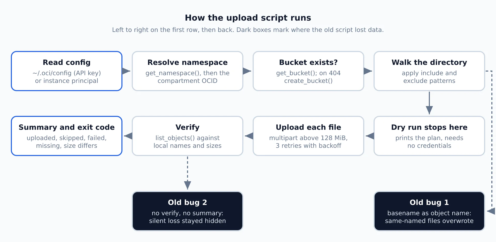
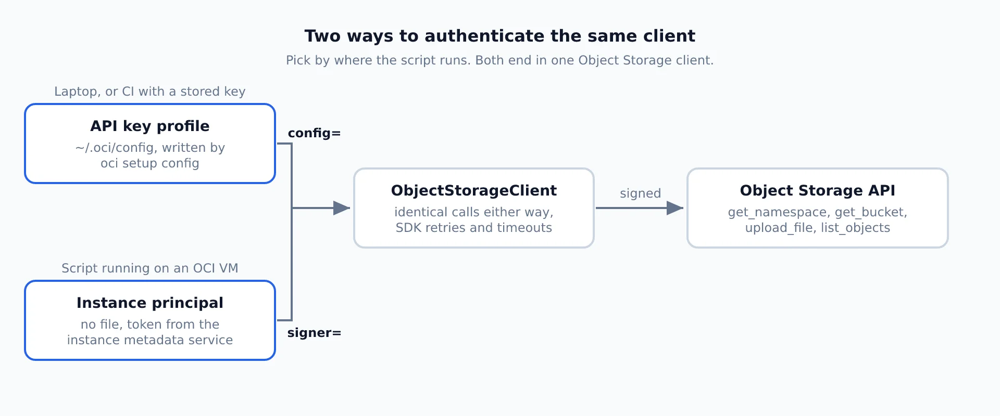

import Accordion from "@components/widgets/Accordion.astro";
import ListCheck from "@components/widgets/ListCheck.astro";
import Notice from "@components/widgets/Notice.astro";

Run `python upload_dir.py --dir ./backups --bucket my-bucket` to upload a directory tree to Oracle Cloud Infrastructure (OCI) Object Storage with the Python SDK. Object names keep the folder path, files already in the bucket are skipped, and `--dry-run` prints the plan first. Add `--compartment-id` when the bucket does not exist yet.

The 2023 version of this article had a bug that lost data. It passed the file name alone as the object name, so `data/2023/report.csv` and `data/2024/report.csv` both landed as `report.csv`, and the second upload replaced the first. This version is one file, `upload_dir.py`. It keeps the tree in the object names, skips files that are already there, retries failed uploads and verifies the result by listing the bucket.

<Notice type="warning" title="What was tested and what was not">
The script was compiled and run on Python 3.12.3 with `oci` 2.192.0 from PyPI: `--help`, `--dry-run` on a small tree, and the full upload path against an in-memory fake of the Object Storage API (bucket creation, skip policy, overwrite, failures, verify). No OCI credentials were available on the machine that produced this article. A real upload to a tenancy was not executed. Run `--dry-run` first and check the verify output of your first real run.
</Notice>

## Why did the old script lose data?

It used the file's base name as the object name, so two files called `report.csv` in different folders became one object and the second upload replaced the first. The old script had three problems in total, one of them silent:

- **Object names collapsed.** `upload_manager.upload_file(namespace, bucket_name, file, file_path)` used `file`, the base name. Every same-named file in a subfolder overwrote the previous one, and the result in the bucket was one flat list.
- **`max_parallel_uploads=10` did nothing.** `UploadManager` ignores unknown keyword arguments. The options it reads are `allow_multipart_uploads`, `allow_parallel_uploads` and `parallel_process_count` (default 3).
- **No verification, no summary, no failure handling.** An exception on the third file ended the run with a traceback. You had to guess what was in the bucket.



*The pipeline. Dry run needs no credentials and skips the first three boxes; the dark boxes are where the 2023 script lost data.*

## Prerequisites

<ListCheck>
<ul>
<li>Python 3.9 or newer. PyPI lists `oci` 2.192.0 for Python 3.6 to 3.13, and Oracle's support table lists 3.6 to 3.11 per OS. The SDK install and the dry run below ran on 3.12.3.</li>
<li>An OCI tenancy, a user that is allowed to write to a compartment, and the compartment OCID (starts with `ocid1.compartment.`).</li>
<li>An IAM policy for that user, see the [authentication section](#set-up-authentication).</li>
<li>Either the OCI CLI (used once to create the config file and the API key) or an API signing key you generate yourself.</li>
<li>No scratch space: the script reads files from disk, it does not copy or zip them first.</li>
</ul>
</ListCheck>

You do not need the OCI CLI to run the script. The `oci` Python package is a separate install and talks to the Object Storage REST API on its own. On a Mac, [install Python and create a venv with Homebrew](/install-upgrade-python-mac/) first, then the commands below are identical.

## Install the SDK in a virtual environment

```bash
python3 -m venv .venv
source .venv/bin/activate
pip install oci==2.192.0
python -c "import oci; print(oci.__version__)"
```

Expected last line: `2.192.0`. The pin matters. 2.192.0 was the newest release on PyPI on 2026-11-23, and the SDK ships a new version every one to two weeks ([release list](https://github.com/oracle/oci-python-sdk/releases)). Pinning keeps a re-run of `pip install -r requirements.txt` from pulling a different client next quarter.

If `pip install` fails on `cryptography`, upgrade pip first. The [cryptography docs](https://cryptography.io/en/latest/installation/) name an old pip as the most common cause of installation problems.

## Set up authentication

The SDK can sign requests in several ways. Two cover a directory upload:



*Both paths produce the same `ObjectStorageClient`. Choose by where the script runs, not by what it uploads.*

### API key profile (laptop, CI runner with a stored key)

The CLI writes the file and the key pair in one dialog ([CLI install and config](https://docs.oracle.com/en-us/iaas/Content/API/SDKDocs/cliinstall.htm)):

```bash
oci setup config
```

It asks for the user OCID, tenancy OCID and region, generates an RSA key pair and prints the fingerprint. Add the public key to your user under *API keys* in the Console, then the file at `~/.oci/config` looks like this:

```ini
[DEFAULT]
user=ocid1.user.oc1..aaaa...
fingerprint=aa:bb:cc:...
key_file=~/.oci/oci_api_key.pem
tenancy=ocid1.tenancy.oc1..aaaa...
region=eu-frankfurt-1
```

Check the result without uploading anything:

```bash
oci os ns get
```

It prints your Object Storage namespace when the key and fingerprint work. Oracle documents `GetNamespace` as a call that needs no policy and validates your credentials ([Object Storage policy details](https://docs.oracle.com/en-us/iaas/Content/Identity/policyreference/objectstoragepolicyreference.htm)), so this check does not test your bucket policy. `NotAuthenticated` means the public key was not uploaded or the fingerprint does not match. A missing config file shows up in the script as `ConfigFileNotFound`.

If `~/.oci/config` does not exist, the SDK reads the file path from the `OCI_CONFIG_FILE` environment variable. A profile without a `region` entry falls back to `OCI_REGION`.

### Instance principal (script on an OCI VM)

A VM inside OCI can authenticate as itself. There is no key file to copy, nothing to rotate, and nothing to leak in a backup of the home directory. Two one-time steps ([Calling Services from an Instance](https://docs.oracle.com/en-us/iaas/Content/Identity/Tasks/callingservicesfrominstances.htm)):

1. Create a dynamic group with a matching rule, for example `instance.id = 'ocid1.instance.oc1..aaaa...'` or `instance.compartment.id = 'ocid1.compartment.oc1..bbbb...'`.
2. Add a policy for that group (same syntax as below, with `dynamic-group` instead of `group`).

Then run the script with `--instance-principal`. It reads a short lived security token from the instance metadata service at `169.254.169.254`, so it only works on an OCI instance. On a laptop that call fails after a delay and the script exits with an authentication error.

### IAM policy for creating buckets and writing objects

Put this in a policy (Identity, Policies), replacing the group and compartment names:

```
allow group backup-uploaders to manage object-family in compartment backups
```

Creating a bucket needs `BUCKET_CREATE`, which comes with `manage buckets`, and the multipart upload calls need `manage objects` ([Object Storage policy details](https://docs.oracle.com/en-us/iaas/Content/Identity/policyreference/objectstoragepolicyreference.htm)). If the bucket already exists and you never want the script to create or delete one, pre-create the bucket and narrow the policy:

```
allow group backup-uploaders to read buckets in compartment backups
allow group backup-uploaders to manage objects in compartment backups
```

Reading objects for the verify step needs `OBJECT_INSPECT`, which both `read` and `manage` include.

## The script

Save this as `upload_dir.py`. It imports only the standard library and `oci`.

```python
#!/usr/bin/env python3
"""Upload a directory tree to an OCI Object Storage bucket.

Object names are the file paths relative to --dir (POSIX separators), so the
folder structure survives and two files called report.csv in different folders
no longer overwrite each other.
"""

import argparse
import fnmatch
import mimetypes
import os
import sys
import time

import oci
from oci.object_storage import ObjectStorageClient, UploadManager

DEFAULT_EXCLUDES = [".git", ".DS_Store", "__pycache__", "node_modules", ".venv", "*.pyc", "*.swp"]
PART_SIZE = 128 * 1024 * 1024  # files above this size go up as multipart uploads
ATTEMPTS = 3                   # script retries per file, on top of the SDK retries
BACKOFF_SECONDS = 2            # wait 2s, then 4s, then 8s between those retries


def parse_args():
    parser = argparse.ArgumentParser(description="Upload a directory tree to an OCI Object Storage bucket.")
    parser.add_argument("--dir", required=True, help="local directory to upload")
    parser.add_argument("--bucket", required=True, help="target bucket (created when missing)")
    parser.add_argument("--prefix", default="", help="optional object name prefix, for example backups/db1")
    parser.add_argument("--include", action="append", default=[], help="glob pattern to include, repeatable")
    parser.add_argument("--exclude", action="append", default=[], help="glob pattern to exclude, repeatable")
    parser.add_argument("--dry-run", action="store_true", help="print the plan, touch nothing, needs no credentials")
    parser.add_argument("--overwrite", action="store_true", help="upload every file, even when the size matches")
    parser.add_argument("--compartment-id", help="compartment OCID, only needed to create the bucket")
    parser.add_argument("--profile", default="DEFAULT", help="profile name inside ~/.oci/config")
    parser.add_argument("--instance-principal", action="store_true", help="auth as the OCI instance itself, no config file")
    return parser.parse_args()


def build_client(args):
    """Return an Object Storage client with the SDK retry strategy attached."""
    retry = oci.retry.DEFAULT_RETRY_STRATEGY
    try:
        if args.instance_principal:
            signer = oci.auth.signers.InstancePrincipalsSecurityTokenSigner()
            config = {"region": signer.region}
            return ObjectStorageClient(config, signer=signer, retry_strategy=retry, timeout=(10, 60))
        config = oci.config.from_file(profile_name=args.profile)
        oci.config.validate_config(config)
        return ObjectStorageClient(config, retry_strategy=retry, timeout=(10, 60))
    except Exception as e:
        sys.exit("Authentication failed (%s: %s). Fix ~/.oci/config or run on an OCI instance with --instance-principal." % (type(e).__name__, e))


def ensure_bucket(object_storage, namespace, args):
    """Return the bucket, creating it with NoPublicAccess when it is missing."""
    try:
        return object_storage.get_bucket(namespace, args.bucket).data
    except oci.exceptions.ServiceError as e:
        if e.status != 404:
            raise
    if not args.compartment_id:
        sys.exit("Bucket %s does not exist. Pass --compartment-id to create it." % args.bucket)
    print("Creating bucket %s" % args.bucket)
    details = oci.object_storage.models.CreateBucketDetails(
        name=args.bucket,
        compartment_id=args.compartment_id,
        public_access_type="NoPublicAccess",
        storage_tier="Standard",
    )
    return object_storage.create_bucket(namespace, details).data


def object_prefix(args):
    """The prefix as the SDK expects it: empty, or a path ending with a slash."""
    return args.prefix.strip("/") + "/" if args.prefix else ""


def walk_directory(args):
    """Return (file_path, relative_name, size) for every file that passes the filters."""
    plan = []
    excludes = DEFAULT_EXCLUDES + args.exclude
    for root, dirs, files in os.walk(args.dir):
        # Prune excluded directories in place so os.walk never descends into them.
        dirs[:] = sorted(d for d in dirs if not matches(d, excludes))
        for name in sorted(files):
            if matches(name, excludes):
                continue
            relative_root = os.path.relpath(root, args.dir).replace(os.sep, "/")
            relative = name if relative_root == "." else relative_root + "/" + name
            if args.include and not any(fnmatch.fnmatch(relative, p) or fnmatch.fnmatch(name, p) for p in args.include):
                continue
            file_path = os.path.join(root, name)
            plan.append((file_path, relative, os.path.getsize(file_path)))
    return plan


def matches(name, patterns):
    return any(fnmatch.fnmatch(name, p) for p in patterns)


def upload_file(upload_manager, namespace, args, file_path, name):
    """Upload one file; files above PART_SIZE become multipart uploads. Returns an error or None."""
    content_type = mimetypes.guess_type(file_path)[0] or "application/octet-stream"
    for attempt in range(1, ATTEMPTS + 1):
        try:
            upload_manager.upload_file(
                namespace, args.bucket, name, file_path,
                part_size=PART_SIZE, content_type=content_type,
            )
            return None
        except Exception as e:  # the SDK already retried timeouts, 429 and 5xx
            if attempt == ATTEMPTS:
                return "%s: %s" % (type(e).__name__, e)
            time.sleep(BACKOFF_SECONDS * 2 ** (attempt - 1))


def list_bucket(object_storage, namespace, args):
    """Return {object_name: size} for every object under the prefix, 1000 objects per call."""
    remote = {}
    start = None
    while True:
        response = object_storage.list_objects(
            namespace, args.bucket, prefix=object_prefix(args), fields="name,size", start=start
        )
        for obj in response.data.objects or []:
            remote[obj.name] = obj.size
        start = response.data.next_start_with
        if not start:
            return remote


def main():
    args = parse_args()
    args.dir = os.path.realpath(args.dir)
    if not os.path.isdir(args.dir):
        sys.exit("%s is not a directory" % args.dir)

    namespace = remote = upload_manager = None
    if not args.dry_run:
        object_storage = build_client(args)
        namespace = object_storage.get_namespace().data
        bucket = ensure_bucket(object_storage, namespace, args)
        print("Namespace %s, bucket %s, compartment %s" % (namespace, bucket.name, bucket.compartment_id))
        # The manager reconfigures its client for parallel parts, so it gets its own.
        upload_manager = UploadManager(
            build_client(args),
            allow_multipart_uploads=True,
            allow_parallel_uploads=True,
            parallel_process_count=3,
        )
        remote = list_bucket(object_storage, namespace, args)

    plan = walk_directory(args)
    pending, skipped = [], 0
    for file_path, relative, size in plan:
        name = object_prefix(args) + relative
        if not args.dry_run and not args.overwrite and remote.get(name) == size:
            skipped += 1
            print("skip   %s (%d bytes, identical)" % (name, size))
            continue
        pending.append((file_path, name, size))

    print("Plan: %d files, %d bytes to upload to %s" % (len(pending), sum(p[2] for p in pending), args.bucket))
    if args.dry_run:
        for _, name, size in pending:
            print("would upload %s (%d bytes)" % (name, size))
        return 0

    started = time.time()
    uploaded = failed = bytes_sent = 0
    failures = []
    for file_path, name, size in pending:
        error = upload_file(upload_manager, namespace, args, file_path, name)
        if error:
            failed += 1
            failures.append((name, error))
            print("FAIL   %s: %s" % (name, error))
        else:
            uploaded += 1
            bytes_sent += size
            print("ok     %s (%d bytes)" % (name, size))

    # Verify: list the bucket and compare object names and sizes with the local plan.
    remote = list_bucket(object_storage, namespace, args)
    expected = {object_prefix(args) + relative: size for _, relative, size in plan}
    missing = sorted(n for n in expected if n not in remote)
    mismatched = sorted(n for n, s in expected.items() if n in remote and remote[n] != s)

    print("-" * 60)
    print("uploaded %d files (%d bytes) in %.1fs, skipped %d, failed %d" % (
        uploaded, bytes_sent, time.time() - started, skipped, failed))
    print("verify: %d local files, %d objects in the bucket under the prefix" % (len(expected), len(remote)))
    for name in missing:
        print("  missing in bucket: %s" % name)
    for name in mismatched:
        print("  size differs: %s (local %d, bucket %d)" % (name, expected[name], remote[name]))
    for name, error in failures:
        print("  failed: %s: %s" % (name, error))
    return 1 if failed or missing or mismatched else 0


if __name__ == "__main__":
    sys.exit(main())
```

## What each flag and setting does

Flags on the command line:

| Flag | What it does | Default | When to change it |
|---|---|---|---|
| `--dir` | Local directory to upload. Required. | none | Always set it. `--dir ./backups` produces object names relative to that folder. |
| `--bucket` | Target bucket, created when missing. Required. | none | Bucket names must be unique in the tenancy namespace. |
| `--prefix` | Puts every object under a path, `backups/db1/data/2023/report.csv`. | empty | Use one prefix per machine or job so runs do not collide in a shared bucket. |
| `--include` | Glob a file must match, repeatable. | all files | `--include '*.sql' --include '*.dump'` for database dumps only. |
| `--exclude` | Glob to drop, repeatable. On top of the built-in list. | `.git`, `node_modules`, `.venv`, `__pycache__`, `.DS_Store`, `*.pyc`, `*.swp` | Add `.cache`, `*.tmp`, media folders. |
| `--dry-run` | Prints the plan, opens no connection, needs no credentials. | off | Run it before every first upload to a new bucket. |
| `--overwrite` | Uploads every file even when the size in the bucket matches. | off | Only when you know a file changed without changing size. |
| `--compartment-id` | Compartment for bucket creation. | none | Only needed the first time, when the bucket does not exist yet. |
| `--profile` | Section name inside `~/.oci/config`. | `DEFAULT` | A second tenancy or a dedicated CI profile. |
| `--instance-principal` | Authenticates as the VM instead of a file. | off | Any run on an OCI instance. |

Settings inside the script:

| Setting | What it does | Default | When to change it |
|---|---|---|---|
| `DEFAULT_EXCLUDES` | Directories and files the walk never descends into. | see the `--exclude` row | Edit the list at the top of the file. |
| `PART_SIZE` | Part size for `upload_file`. Files larger than this go up as multipart uploads, smaller ones in one PUT. | 128 MiB (the SDK default) | Raise to reduce request count on huge files; the service caps a part at 50 GiB and a multipart upload at 10,000 parts. |
| `allow_multipart_uploads` | Lets the manager use multipart at all. | `True` | Leave it on; without it a file over 50 GiB cannot be uploaded. |
| `allow_parallel_uploads` | Uploads the parts of one multipart upload in parallel. | `True` | Leave it on for large archives; it does nothing for single PUT files. |
| `parallel_process_count` | Parallel workers per multipart upload. | 3 in the SDK | Raise to 5 or 6 on a fast link; more parallel parts open more connections. |
| `ATTEMPTS`, `BACKOFF_SECONDS` | Script retries per file when the SDK gives up, waiting 2 s, then 4 s, then 8 s. | 3, 2 | Raise `ATTEMPTS` on a flaky link. |
| `oci.retry.DEFAULT_RETRY_STRATEGY` | SDK retries: 8 attempts within 600 s, exponential backoff with jitter, on timeouts, connection errors, 429 and 5xx except 501. | SDK default | Leave it. The client already retries, so the script only catches what survived that. |
| `timeout=(10, 60)` | Connect and read timeout in seconds for each request. | 10 s connect, 60 s read (SDK default) | Raise the read timeout on a slow uplink for large single PUTs. |
| Overwrite policy | Without `--overwrite`, a file whose object exists with the same size is skipped. | skip identical | Default is safe and cheap: re-runs cost nothing for unchanged files. |

Object names always use forward slashes and the path relative to `--dir`, on Linux, macOS and Windows alike. That is the fix for the 2023 bug.

## Run it

### Dry run first

```bash
python upload_dir.py --dir ./tree --bucket my-bucket --dry-run
```

Output from the test tree used for this article (two files named `report.csv` in different folders, a `notes.txt`, and a `node_modules` folder that must be skipped):

```text
Plan: 3 files, 13 bytes to upload to my-bucket
would upload notes.txt (1 bytes)
would upload data/2023/report.csv (6 bytes)
would upload data/2024/report.csv (6 bytes)
```

The two `report.csv` files get different object names. The old script would have printed `Uploading .../report.csv` twice and written one object.

With a prefix and an extra exclude:

```bash
python upload_dir.py --dir ./tree --bucket my-bucket --prefix backups/db1 --exclude '*.txt' --dry-run
```

```text
Plan: 2 files, 12 bytes to upload to my-bucket
would upload backups/db1/data/2023/report.csv (6 bytes)
would upload backups/db1/data/2024/report.csv (6 bytes)
```

### The real upload

```bash
python upload_dir.py \
  --dir /var/backups/db1 \
  --bucket company-backups \
  --prefix db1 \
  --compartment-id ocid1.compartment.oc1..aaaa...
```

Each file prints `ok`, `skip` or `FAIL`, and the run ends with the summary:

```text
------------------------------------------------------------
uploaded 142 files (5318272 bytes) in 38.4s, skipped 0, failed 0
verify: 142 local files, 142 objects in the bucket under the prefix
```

That summary block is the shape of the output, not a capture from a real tenancy. The exit code is 0 only when nothing failed, nothing is missing and no size differs, so the line drops into cron and CI as is:

```bash
python upload_dir.py --dir /var/backups/db1 --bucket company-backups --prefix db1 \
  || logger -t oci-upload "upload to company-backups failed"
```

## Verify the upload

The script already lists the bucket after uploading and compares every local file with an object of the same name and size. Two independent checks:

```bash
oci os object list --bucket-name company-backups --prefix db1/ --all --output table
```

You should see the tree under the prefix, and the count should match the `verify:` line. Without `--all` the CLI stops at 100 objects. A spot check of one object from the CLI:

```bash
oci os object get --bucket-name company-backups --name db1/data/2023/report.csv --file /tmp/report.csv
diff /tmp/report.csv /var/backups/db1/data/2023/report.csv
```

No output from `diff` means the object matches the local file byte for byte. A size comparison does not catch a same-size corruption. For files below `PART_SIZE`, compare the base64 `md5` field (request it with `fields="name,size,md5"` in `list_objects`) with a local checksum.

## Failure modes and fixes

| Error or symptom | Cause | Fix |
|---|---|---|
| `ConfigFileNotFound` | No `~/.oci/config` | Run `oci setup config` or write the file by hand. |
| `InvalidConfig`, then a list of `missing` keys | Profile lacks `user`, `fingerprint`, `key_file`, `tenancy` or `region` | Complete the profile. |
| `Authentication failed (...)` | `NotAuthenticated` or instance metadata unreachable | Upload the public key, or drop `--instance-principal` off the VM. |
| `Bucket ... does not exist. Pass --compartment-id` | The bucket is missing, is in another region, or your policy does not cover it. `get_bucket` returns 404 `BucketNotFound` in all three cases | Check the region in the profile and the policy above; add `--compartment-id` once if the bucket is new. |
| `NotAuthorizedOrNotFound` on `create_bucket` | No policy for the compartment, or a wrong compartment OCID | Add the policy above and check the OCID. |
| 409 `NotAuthorizedOrResourceAlreadyExists` on `create_bucket` | The name is taken in the namespace, or you lack permission to create it | Pick another name; bucket names are unique within the namespace. |
| `429 TooManyRequests` in a failed line | Service rate limit, normally from many tiny files | The SDK retries 429 already; lower `parallel_process_count` or stagger cron jobs. |
| `missing in bucket` in the verify block | A file changed or vanished between the walk and the upload, or a part failed | Re-run; the skip policy uploads only what differs. |
| `size differs` | File was written while uploading | Snapshot the source (stop the writer or upload a dump file) and re-run. |
| Very slow with thousands of small files | One PUT per file, each a signed HTTPS request | Many small files are a request problem, not a bandwidth one; tar them first. |

## Rollback

An upload overwrites objects with the same name. To make that reversible, enable versioning on the bucket before the first run:

```bash
oci os bucket update --bucket-name company-backups --versioning Enabled
```

After that an overwrite turns the old object into a previous version, and it stays until a lifecycle rule deletes it. You cannot disable versioning once it is on, only suspend it ([Object Storage versioning](https://docs.oracle.com/en-us/iaas/Content/Object/Tasks/usingversioning.htm)). Without versioning, rollback means restoring from your previous copy, so do not point this at a bucket whose current content you cannot reproduce.

The script never deletes an object that is absent locally, so an aborted run leaves the bucket in its previous state plus the files that already went up. Removing a bad run is a prefix delete:

```bash
oci os object bulk-delete --bucket-name company-backups --prefix db1/ --force
```

Read that prefix twice before pressing Enter.

## Cost and ops notes

Object Storage has three tiers: Standard, Infrequent Access and Archive ([storage tiers](https://docs.oracle.com/en-us/iaas/Content/Object/Concepts/understandingstoragetiers.htm)). You pick a bucket's default tier, Standard or Archive, at creation and cannot change it later. The script creates Standard buckets.

| Tier | Storage cost | Minimum stay | Retrieval | Use for |
|---|---|---|---|---|
| Standard | highest of the three | none | no retrieval fee, immediate | Backups you restore from this month |
| Infrequent Access | lower than Standard | 31 days | per-GB retrieval fee | Weekly or monthly dumps |
| Archive | lowest, about a tenth of Standard in Oracle's [price list](https://www.oracle.com/cloud/storage/archive-storage/faq/) | 90 days | no retrieval fee, but restore first (at most an hour to the first byte) | Compliance copies |

Rules that matter for a backup job:

- Oracle's price list shows the first 10 GB per month free for both Standard and Archive ([Archive FAQ](https://www.oracle.com/cloud/storage/archive-storage/faq/)), so a small backup set can stay inside the free allowance.
- Deleting or overwriting an Infrequent Access or Archive object before its minimum stay ends bills the rest of the period. Keep daily re-uploads of the same files in Standard, or in a versioned bucket, where an overwrite keeps the old copy as a previous version.
- Oracle bills requests per 10,000. A tree of 100,000 small files costs more in requests than one archive with the same bytes.
- Oracle bills failed or abandoned multipart uploads as storage until someone aborts them. The documented fix is a lifecycle rule that deletes uncommitted uploads after a set number of days; the docs example uses 5 ([Lifecycle management](https://docs.oracle.com/en-us/iaas/Content/Object/Tasks/usinglifecyclepolicies.htm)).
- Inbound data transfer is free. Outbound transfer has a monthly free allowance (10 TB for regions in North America, Europe and the UK) and costs per GB after that ([networking pricing](https://www.oracle.com/cloud/networking/pricing/)).

On the ops side, keep the key file at mode 600, never commit it, and prefer the instance principal for anything long lived inside OCI. If the script runs on an Oracle ARM VM, the [Hetzner vs Oracle ARM benchmarks](/hetzner-oracle-arm-performance/) have network and disk results for those shapes. The [ARM WordPress install with CloudPanel](/install-wordpress-on-ubuntu-arm/) covers an Oracle free tier setup. If the data comes from a CloudPanel server, [CloudPanel remote backups with Rclone](/cloudpanel-remote-backups/) is the route to OneDrive and Google Drive. This script is the direct route to OCI for any directory.

## Object Storage features a script user should know

| Feature | What it does | How it meets this script |
|---|---|---|
| [Object versions](https://docs.oracle.com/en-us/iaas/Content/Object/Tasks/usingversioning.htm) | Every overwrite or delete keeps the previous copy as a version | Enable it to make `--overwrite` reversible; versions consume storage until a lifecycle rule removes them |
| [Pre-authenticated requests](https://docs.oracle.com/en-us/iaas/Content/Object/Tasks/usingpreauthenticatedrequests.htm) | A URL that grants read, write or read/write to one object, a prefix or a bucket, with an expiry | Share one uploaded file without making the bucket public |
| [Retention rules](https://docs.oracle.com/en-us/iaas/Content/Object/Tasks/usingretentionrules.htm) | Bucket level rule that blocks deleting or overwriting objects for a set duration | Protects a backups bucket from a compromised machine; a locked rule cannot be shortened |
| [Lifecycle policies](https://docs.oracle.com/en-us/iaas/Content/Object/Tasks/usinglifecyclepolicies.htm) | Up to 1,000 rules per bucket that move, delete or expire objects, versions and failed multipart uploads | Delete old `db1/daily/` objects after 30 days, abort uncommitted uploads |
| Public access type | `NoPublicAccess` (the value the script sets), `ObjectRead`, `ObjectReadWithoutList` | Keep `NoPublicAccess` and share through pre-authenticated requests |
| S3 Compatibility API | The same buckets through the S3 protocol with customer secret keys | Lets rclone and other S3 tools write to the same bucket; see [Pluton backups with restic and rclone](/pluton-self-hosted-backup/) and [Zerobyte, a restic GUI](/zerobyte-restic-gui/) |

This script talks to the OCI API only. For S3 compatible storage such as [Cloudflare R2 with Dokploy](/dokploy-backups-cloudflare-r2/), use an S3 client such as `boto3` with the same object-name rule. [Bunny Storage vs S3 vs Backblaze](/bunny-storage-vs-s3-vs-backblaze/) compares tiers and prices across providers.

## FAQ

<Accordion label="What must the ~/.oci/config file contain?" group="faq">

A profile header such as `[DEFAULT]` and five entries: `user`, `fingerprint`, `key_file`, `tenancy` and `region`, plus an optional `pass_phrase` when the key is encrypted (Oracle marks that entry deprecated). `oci setup config` writes the entries and generates the key pair. The script loads the profile named by `--profile` and calls `validate_config`, so a missing entry stops the run before anything is uploaded.

</Accordion>

<Accordion label="Does the script need the OCI CLI installed?" group="faq">

No. It imports the `oci` Python package, which talks to the Object Storage REST API directly. The CLI is only a convenience for creating `~/.oci/config` once and for the `oci os object list` check. The script itself needs Python and `pip install oci==2.192.0`.

</Accordion>

<Accordion label="How do I upload only new or changed files?" group="faq">

Run without `--overwrite`. The script lists the bucket first, then skips any file whose object already exists with the same size, and prints it as `skip`. Add `--overwrite` to force every file, for example after a same-size edit.

</Accordion>

<Accordion label="How does the script keep the folder structure?" group="faq">

The object name is the file's path relative to `--dir` with forward slashes, plus `--prefix` when given. `--dir ./tree --prefix backups/db1` turns `./tree/data/2023/report.csv` into `backups/db1/data/2023/report.csv`. The old script used the base name only, so same-named files overwrote each other.

</Accordion>

<Accordion label="How large can a file be, and when does multipart start?" group="faq">

An object can be up to 10 TiB. A plain PUT stops at 50 GiB, so anything larger must be multipart, with parts of at most 50 GiB and at most 10,000 parts. `UploadManager` switches to multipart when a file is larger than `part_size`, which is 128 MiB by default and in this script.

</Accordion>

<Accordion label="What IAM policy does the script need?" group="faq">

`allow group backup-uploaders to manage object-family in compartment backups` covers everything, including bucket creation. For an existing bucket, `read buckets` plus `manage objects` is enough: `get_bucket` needs `BUCKET_READ`, the multipart calls need `manage objects`, and the verify step needs `OBJECT_INSPECT`. On a VM, create a dynamic group and write the same statement with `dynamic-group`.

</Accordion>

<Accordion label="How do I run it on an OCI VM without a key file?" group="faq">

Add the instance to a dynamic group, give that group the policy, and run with `--instance-principal`. The SDK then fetches a short lived token from `169.254.169.254`, so no file is stored and nothing needs rotating. It only works on an OCI instance. Elsewhere the call fails after a delay.

</Accordion>

<Accordion label="What does the upload cost?" group="faq">

Inbound data transfer is free. You pay for storage, for requests per 10,000, and for any retrieval from Infrequent Access. Standard is the most expensive tier and Archive costs about a tenth of it, and the first 10 GB per month of each are free in Oracle's price list. Watch the 31 and 90 day minimums on the cheaper tiers and the abandoned multipart uploads, which bill as storage until someone aborts them.

</Accordion>
