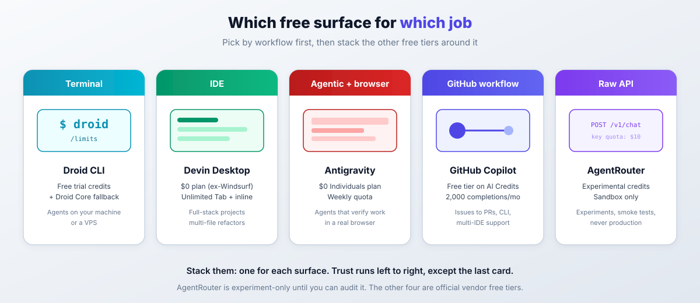
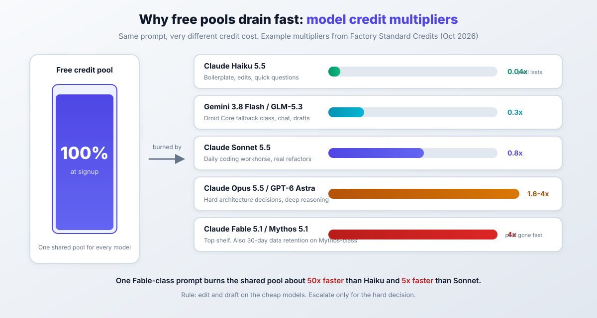

import Button from "@components/widgets/Button.astro";
import Notice from "@components/widgets/Notice.astro";
import ListCheck from "@components/widgets/ListCheck.astro";
import Accordion from "@components/widgets/Accordion.astro";
import Tabs from "@components/widgets/Tabs.astro";
import Tab from "@components/widgets/Tab.astro";
import YouTubeEmbed from "@components/widgets/YouTubeEmbed.astro";

Want to run Claude Sonnet 5.5, GPT-6, Gemini 3.1, or Opus 5.5 without paying? Here are five verified ways to use Claude Sonnet 5.5, GPT-6, and Gemini 3.1 for free, checked October 2026. This page is where I keep the current free-tier map.

<Notice type="success" title="What You'll Get">

- **Droid CLI free trial credits**, plus a free Droid Core open-weight fallback when rate limits hit
- **Devin Desktop $0 plan**, the editor that replaced Windsurf, with unlimited Tab completions and inline edits
- **Google Antigravity $0 Individuals plan** with Gemini 3.8 Flash, Claude Sonnet/Opus 4.6 thinking, and GPT-OSS-120b
- **GitHub Copilot Free tier** running on GitHub AI Credits, with a 2,000 completions per month cap
- **AgentRouter experimental credits** for sandbox API tests (treat as untrusted)

</Notice>

<Notice type="info" title="Last verified: October 2026">

Every plan, quota, and price below was checked against vendor docs on 2026-10-20. Free offers in this space rot in months, not years (see [Amp Code Free is paused: what to use instead](/amp-code-free-ai-coding-agent/) for a recent casualty). Sign up and confirm the numbers yourself before you build a workflow around them.

</Notice>

<YouTubeEmbed
  url="https://www.youtube.com/embed/JoeInjyhMo8"
  label="How to Use Claude Sonnet 5.5, GPT-6 and Gemini 3.1 for FREE"
/>

## Why use Claude Sonnet 5.5, GPT-6, and Gemini 3.1?

The models people want in 2026 are not the ones this article used to name. The current flagships:

<ListCheck>

- **Claude Sonnet 5.5**: Anthropic's coding workhorse, strong on SWE-bench-class tasks and long-running agentic work. $2 input / $10 output per million tokens.
- **Claude Opus 5.5**: the heavy reasoning tier. $4 / $20 per million tokens. Above that sits Fable 5.1 at $10 / $50 if you truly need it.
- **GPT-6.x family**: GPT-6.1 Sol, GPT-6 Astra, and the GPT-5.6 Sol / Terra / Luna line. GPT-5.5 and GPT-5.3-Codex are still served. OpenAI's pricing page hides clear per-token numbers behind a dynamic UI, so check the API pricing page before budgeting.
- **Gemini 3.1 Pro**: Google's current pro-tier model. API preview pricing is $2 / $10 per million tokens only through 2026-11-30, then it doubles to $4 / $20 on 2026-12-01.
- **Claude Haiku 5.5 / Gemini Flash class**: the cheap end of the same families, $0.10 / $0.50 per million for Haiku under 100k context. This is where most of your free quota should go.

</ListCheck>

Run those prices against a real workload and the bill shows up fast. A 50-prompt refactoring session on Sonnet 5.5 is easy to justify; the same session on Opus 5.5 or Fable 5.1 is a different conversation. The five methods below let you use Claude Sonnet 5.5, GPT-6, and Gemini 3.1 for free, or at least close enough for day-to-day work.

If you want a free-forever escape hatch that nobody can take away, look at the [best open-source LLMs to replace Claude Opus 5.5](/best-open-source-llms-claude-alternative/) and run them yourself. Everything on this page is someone else's free tier, which means someone else can change it.

## Method 1: Droid CLI by Factory - free credits + Droid Core fallback

**[Droid CLI by Factory](https://go.bitdoze.com/droid-cli)** is the terminal-first option, and the one I reach for when I want an agent running on a repo without opening an editor. New accounts get free trial credits. Factory does not publish the exact signup amount in its docs (older guides say 20 million tokens, some videos say 40 million), so check what onboarding shows you and treat that as the number.

### What is Droid CLI?

Droid CLI is a command-line coding agent with a multi-model catalog: Claude Sonnet 5.5 and Opus 5.5, GPT-6.1 Sol and GPT-6 Astra, Gemini 3.1 Pro, Grok 4.7, and more. The part that matters for free usage is **Droid Core**, a free open-weight pool (Inkling, GLM-5.3, Kimi K3, Qwen3.8 Max, DeepSeek V4.1 Flash, MiniMax M3, Mistral Large 4) that sessions can fall back to when paid credits hit a rate limit. Docs live at `docs.factory.com` now; old `docs.factory.ai` links redirect.

### Key features

<ListCheck>

- A multi-model picker to switch between Claude, GPT, Gemini, and open-weight models per session
- Reasoning effort levels: `off`, `low`, `medium`, `high`, `xhigh`, `max` on supported models
- Factory Standard Credits: one metered pool with rolling 5-hour, 7-day, and 30-day rate limits
- The `/limits` command for an interactive breakdown of what you have left, right in the session
- Droid Core fallback so sessions keep working on free open-weight models when credits are rate-limited
- IDE integration, same agent in your editor if the terminal is not your thing

</ListCheck>

### How to get started

Prerequisites: macOS, Linux, or Windows with shell access. On Linux, `xdg-utils` is needed for browser-based sign-in:

```bash
sudo apt-get install xdg-utils
```

Then install with whichever path fits your machine:

<Tabs>
<Tab name="macOS / Linux">

```bash
curl -fsSL https://app.factory.ai/cli | sh
```

</Tab>
<Tab name="Homebrew">

```bash
brew install --cask droid
```

</Tab>
<Tab name="npm">

```bash
npm install -g droid
```

</Tab>
<Tab name="Windows">

```powershell
irm https://app.factory.ai/cli/windows | iex
```

</Tab>
</Tabs>

Launch it and sign in:

```bash
droid
```

Pick your model from the selector (Sonnet 5.5 as the default coding model, Haiku 5.5 or Droid Core when you want to be cheap), set reasoning effort if the task warrants it, and work.

A real prompt looks like this:

```text
Create a Python web scraper that extracts product prices from
e-commerce sites, handles pagination, and exports data to CSV
with error handling
```

### Verify your free credits

Do not guess what you have left. Run `droid`, type `/limits`, and you get an interactive panel with 5-hour, 7-day, and 30-day credit buckets. Cross-check against Settings -> Usage in the Factory dashboard. Also confirm which fallback model is configured, so a rate-limited session drops to Droid Core instead of dying.

If `/limits` shows nothing or errors, you are on an old binary. Re-run the install command and check `docs.factory.com/droid-cli/quickstart` for the current flow.

### When you hit the limits (failure modes)

- **Rate limit exhausted**: rolling 5h/7d/30d windows, not a hard monthly wall. With fallback configured, sessions continue on Droid Core (free, weaker models). Without it, you wait.
- **Model deprecation churn**: Factory retires models on short notice. DeepSeek V4 Flash 0731, Kimi K2.5, GLM-5.1, and MiniMax M2.7 are already gone from the catalog. Free users get migrated automatically, so pin nothing critical to a specific model name.
- **Credits are shared**: the same pool pays for chat, agent runs, and background work. A runaway agent loop is the fastest way to zero.

### Paid ladder (so you know the exit ramp)

Pro is $20/month, Plus $100 (about 5x Pro), Max $200 (about 10x). Extra Usage is prepaid from $10 with no expiry. Multipliers in the catalog are the real cost model: Sonnet 5.5 at 0.8x, Opus 5.5 at 1.6x, Fable 5.1 at 4x, Haiku 5.5 at 0.04x, GLM-5.3 at 0.06x. If you escalate to Fable-class thinking on every prompt, you will burn a month's free credits in an afternoon.

### Best use cases for Droid CLI

- Backend APIs, database layers, and server configuration
- Automation scripts, data processing, and glue code
- Code review and cleanup on existing codebases
- Fast proof-of-concept work before you commit to an architecture
- Agents on a VPS: run the CLI on a box and let it work (see the [VPS setup for AI coding agents](/vps-ai-coding-setup/))

Terminal-first tooling is also easy to script. If you want an open-source alternative in the same lane, [OpenCode, an open-source Claude Code alternative, on your VPS](/opencode-setup-guide/) is worth a look.

<Button
  text="Get Free Credits with Droid CLI"
  url="https://go.bitdoze.com/droid-cli"
  size="lg"
  color="blue"
  variant="solid"
  icon="arrow-right"
  iconPosition="right"
/>

## Method 2: Devin Desktop (formerly Windsurf) - free IDE tier

<Notice type="warning" title="Windsurf is gone">

`windsurf.com` now redirects to `devin.ai/desktop`. Cognition absorbed Windsurf, the editor is **Devin Desktop**, and the old "25 free prompts per month" and Supernova credit table no longer exist. Old blog posts, including older versions of this one, still describe a product that is not there. If a guide talks about Supernova, it is stale.

</Notice>

### What happened to Windsurf?

Cognition (the people behind Devin) took over the Windsurf editor. Current surfaces are Devin Desktop (the IDE), Devin CLI, Devin Web, and Fusion. Anyone landing on old Windsurf pricing links is now looking at Devin's plans. The good news: there is still a $0 tier, and it is arguably better than what Windsurf offered because Tab completions and inline edits are unlimited.

### Free vs Pro

| Plan | Price | What you get |
| --- | --- | --- |
| **Free** | $0 | Light quota to code with agents, limited model availability, unlimited inline edits, unlimited Tab completions |
| **Pro** | $20/mo | Increased quotas, frontier models (OpenAI, Claude, Gemini, SpaceXAI plus open-source), free use of SWE-2, Devin Cloud agents, extra usage at API pricing |
| **Max** | $200/mo | Highest quotas |
| Teams | $80/mo + $40/seat | Team features |

**SWE-2** is Cognition's own coding model (released 2026-09-10): 50.0% on FrontierCode 1.1 Main, within a point of Fable 5.1 at 64% cheaper, post-trained from Kimi K3. It runs in Desktop, CLI, Web, and Fusion, and Pro users get it at no extra cost.

### Getting started

Prerequisites: a desktop OS (Windows, macOS, or Linux) and an account.

1. Download Devin Desktop from the Devin site.
2. Sign up on the Free plan. No card.
3. Use Tab completions and inline edits for daily coding. These do not touch your agent quota.
4. Reserve agent runs for real multi-step tasks, and keep an eye on the quota indicator in the Desktop UI.

Before promising yourself a specific model, open the model selector and compare it against what Free exposes. Frontier models on the list (the newest Claude and GPT tiers) are Pro-gated.

### Failure modes and free-tier gotchas

- **"Light quota" is vague on purpose.** Devin does not publish an exact number. Treat Free as a starter allowance and watch the display.
- **Limited model availability on Free.** If you need Claude Sonnet 5.5 or Opus 5.5 specifically, check the selector before you start, not after.
- **Unlimited Tab and inline edits are the real free value.** Do not burn agent quota on work a completion can do.

### Best use cases for Devin Desktop

- Full-stack project work in an AI-native editor
- Multi-file refactors where agent mode earns its keep
- Learning new frameworks with an agent that can run and verify code
- Daily speed on Free: Tab completions and inline edits all day, no quota math
- SWE-2 and cloud agents if you later move to Pro

<Button
  text="Try Devin Desktop Free"
  url="https://go.bitdoze.com/windsurf"
  size="lg"
  color="green"
  variant="solid"
  icon="arrow-right"
  iconPosition="right"
/>

## Method 3: AgentRouter - free API credits (use with caution)

**[AgentRouter](https://go.bitdoze.com/agentrouter)** is a unified API router that has advertised roughly $200 in free credits for access to premium models through an OpenAI-compatible endpoint. Keep the word "advertised" in mind.

### What is AgentRouter?

One base URL, one key, many models. You point an OpenAI-compatible client at `https://agentrouter.org/v1` and get Claude Code, OpenAI Codex, Gemini CLI-class models behind it. It plugs into Roo Code, Kilo Code, Cline, and similar tools.

On 2026-10-20 the site served a sliding CAPTCHA to non-browser clients and I could not re-verify the $200 offer, the model list, or even the base URL. That does not make it a scam. It does mean I cannot vouch for it, and neither should you until you have seen the terms yourself at signup.

### Setup (Roo Code / Kilo Code)

If you proceed, create the API key with a hard per-key quota first. This is the step most people skip and the one that limits the blast radius when a key leaks.

<ListCheck>

- Set a quota per key (for example $10), never a blank check
- Restrict the key to the models you plan to call
- Use one key per tool or environment, so revoking one does not break everything
- Never reuse a key in a client-side or public repo config

</ListCheck>

Then in Roo Code, create a profile:

```json
{
  "profile_name": "AgentRouter Free",
  "provider": "OpenAI Compatible",
  "base_url": "https://agentrouter.org/v1",
  "api_key": "your_api_key_here",
  "model": "gpt-5",
  "enable_streaming": true
}
```

In Kilo Code: settings -> "Use my own key" -> "OpenAI Compatible" provider -> base URL `https://agentrouter.org/v1` -> paste the key -> pick a model. Re-verify that endpoint at signup before relying on the snippet above.

### Important considerations

<Notice type="warning" title="Reliability notice">

AgentRouter is a hard-to-audit service. The site sits behind a CAPTCHA, its offers are not independently verifiable, and the terms of service determine what happens to your prompts.

- **Do not send proprietary or client code** through unverified routers. Full stop.
- Set per-key quotas and model restrictions every time.
- Fine for testing, learning, and open-source work. Never production.
- Free offers like this disappear without notice. Confirm the $200 claim at signup today, not in a blog post from last year.

</Notice>

If you would rather pay a few dollars for audited budget models than gamble on free routers, there is a better path: [DeepSeek V4 Flash, GPT 5.6 Luna, and Kimi K3 for cheap via OpenCode Go or ClinePass](/opencode-go-vs-clinepass-cheap-models/).

### Best use cases for AgentRouter

- API experiments: comparing models on the same prompt set
- Batch smoke tests on non-sensitive data, throwaway runs
- Cost comparison: measuring which model handles your workload before paying anyone
- Non-critical prototypes: things you would not mind losing

<Button
  text="Try AgentRouter for Experiments"
  url="https://go.bitdoze.com/agentrouter"
  size="lg"
  color="purple"
  variant="solid"
  icon="arrow-right"
  iconPosition="right"
/>

## Method 4: Google Antigravity - free Gemini 3.8 Flash + Claude Sonnet 4.6

**[Google Antigravity](https://antigravity.google/)** is Generally Available now, not a public preview. The Individuals plan is **$0/month**, and it is the best free deal here for agentic work that needs to verify itself in a browser.

### What is Google Antigravity?

An agent-first development platform. The product family spans the Antigravity App, IDE, CLI, SDK, and Extensions, with a Remote Control concept for handing off work. The core workflow has not changed:

- **Editor view** for synchronous work: tab completions, inline commands, an agent in the side panel
- **Manager view** for asynchronous fan-out: spawn multiple agents across workspaces, track them in an inbox

What makes it interesting is the artifact model. Instead of drowning you in tool calls or dumping a final diff, agents produce task lists, implementation plans, walkthroughs, screenshots, and browser recordings you can review. For UI work, that verification loop is the point.

### What the free plan includes

The Individuals plan gets you a variety of agent models, unlimited Tab completions, unlimited Command requests, and a basic **weekly** rate limit that refreshes on a weekly cycle. Limits correlate with work done, not raw prompt count.

Here is the part marketing pages blur: your plan gates which models appear in the selector.

| Model | Free (and AI Plus) | AI Pro | AI Ultra | Enterprise |
| --- | --- | --- | --- | --- |
| Gemini 4 Argon (newest) | No | Yes | Yes | Yes |
| Gemini 3.8 Flash | Yes | Yes | Yes | Yes |
| Gemini 3.7 / 3.6 Flash | No | No | No | Yes |
| Gemini 3.1 Pro | No | No | No | Yes |
| Claude Sonnet 5.5 (thinking) | No | Yes | Yes | Yes |
| Claude Opus 5.5 (thinking) | No | Yes | Yes | Yes |
| Claude Sonnet 4.6 (thinking) | Yes | Yes | No | No |
| Claude Opus 4.6 (thinking) | Yes | Yes | No | No |
| GPT-OSS-120b | Yes | Yes | Yes | No |

<Notice type="info" title="Free is not the newest">

Free gets you **Gemini 3.8 Flash, Claude Sonnet/Opus 4.6 thinking, and GPT-OSS-120b**. Not Gemini 4 Argon, not Sonnet/Opus 5.5. Older guides (and older versions of this article) promised free Gemini 3 Pro and Opus 4.7; that is not what the $0 plan exposes today. Open the model selector and treat that as the source of truth.

</Notice>

### Getting started

1. Sign up at [antigravity.google](https://antigravity.google/) with a Google account.
2. Download the IDE for macOS, Linux, or Windows.
3. Pick a model your plan exposes. On Free that means the table above.
4. Use Editor view for hands-on work, Manager view when a task deserves parallel agents.

The workflow worth stealing is browser-verified delivery:

```text
Task: "Build a new frontend feature and verify it works"

The agent will:
1. Write the feature code
2. Launch localhost from the terminal
3. Drive a browser to test the feature
4. Return screenshots and recordings as proof
```

### Verify and failure modes

**Verify**: open the model selector. If Sonnet 5.5 or Gemini 4 Argon appears, you are on a paid Google AI plan, not Free.

**Failure modes**:

- **Weekly quota refresh.** Free resets weekly. Pro refreshes every 5 hours until the weekly cap. When Free runs out, you wait; there is no overage path on the $0 plan.
- **Overage toggles** (Never / Always) and AI credits for spillover exist on Pro and Ultra only. Business access runs through Google Cloud or Gemini Enterprise from $30/seat/month.
- **BYOK** is supported if you want to bring your own key and stop counting.

### Best use cases for Antigravity

- Browser-verified UI work: the agent tests what it built and shows you
- Complex multi-file projects: plan, implement, and verify in one loop
- Parallel development: multiple agents on separate tasks
- Automated testing: screenshots and recordings instead of "looks good to me"
- Background research: spawn an agent and keep working

<Button
  text="Try Google Antigravity Free"
  url="https://antigravity.google/"
  size="lg"
  color="red"
  variant="solid"
  icon="arrow-right"
  iconPosition="right"
/>

## Method 5: GitHub Copilot free tier - GitHub AI Credits explained

**[GitHub Copilot](https://github.com/features/copilot/plans)** still has an ongoing $0 Free tier. The billing unit, though, is not what older guides describe. "Premium requests" are legacy. Everything now runs on **GitHub AI Credits**: chat, agent mode, code review, cloud agents, Copilot CLI, and Copilot Apps all draw from the same credit pool.

### Free vs Pro vs Pro+ - AI Credits

| Plan | Price | Base AI credits (+ flex) | Notes |
| --- | --- | --- | --- |
| **Free** | $0 | An allowance (limited chat/agent usage) | Auto model selection only; 2,000 completions/month cap |
| Student | $0 | Allowance | Excludes third-party agents |
| Pro | $10/mo | 1,000 (+$5 flex, roughly $15 value) | Selection of models |
| **Pro+** | $39/mo | 3,900 (+$31 flex, roughly $70 value) | Premium models |
| **Max** | $100/mo | 10,000 (+$100 flex, roughly $200 value) | Priority access to premium models |
| Business | $19/seat | 1,900/user | Team features |
| Enterprise | $39/seat | 3,900/user | Overage at $0.01/credit |

Two caveats worth knowing before you plan around these numbers. First, GitHub's own footnote says flex allotments "may change over time", so do not budget a workflow around them. Second, the Free plan does not let you pick models. If you specifically want Claude Sonnet 5.5 or Opus 5.5, Free will not give you a selector; you get auto model choice. The old 50-requests-plus-multipliers scheme this article used to publish is dead, along with its model table.

If $39 to $100 per month is more than you need, there are [cheaper alternatives to GitHub Copilot](/github-copilot-alternatives-2026/) worth reading before you upgrade.

### Getting started

Prerequisites: a GitHub account. Nothing else.

1. Enable Copilot Free from the [plans page](https://github.com/features/copilot/plans). Older guides, including older versions of this post, advertise a 30-day no-card Pro trial. I could not confirm that offer in current GitHub docs on 2026-10-20. The plans page lists Pro at $10/month and marks it "free for some users" (students, teachers, popular OSS maintainers). Check the page for whatever trial exists today instead of trusting a post from last year.
2. Install in your editor: VS Code, JetBrains, Zed, Vim, or the Copilot desktop app.
3. For the CLI: Copilot CLI is a standalone tool now. The old `gh extension install github/gh-copilot` flow is obsolete, so do not copy that snippet from stale posts. Get the current install command from the official Copilot CLI setup docs under docs.github.com/copilot.
4. Preview features and model controls live in your Copilot settings on github.com. On the Free plan most of that is grayed out, which is expected.

### Verify and failure modes

**Verify**: GitHub -> Settings -> Copilot -> monitor AI credits usage. That dashboard shows spend against your allowance. If you cannot find it, the docs page "Monitor AI usage for Copilot" has the current path.

**Failure modes**:

- **Credits exhausted.** Chat and agent features throttle until the refresh. On paid plans, completions keep flowing; on Free you also have the 2,000 completions/month cap to think about.
- **Flex allotments change.** GitHub said so. Expect movement.
- **Free cannot pick models.** The single most common complaint, and a hard gate.

### Copilot features overview

<Tabs>
<Tab name="Completion">

Ghost text suggestions as you type, tab to accept, context-aware across the project. The Free tier's strongest surface.

</Tab>
<Tab name="Chat">

Ask coding questions, generate code from descriptions, refactor existing code, debug with explanations.

</Tab>
<Tab name="CLI">

Create files and features, do Git operations in natural language, automate DevOps tasks, open PRs and issues from the terminal.

</Tab>
<Tab name="Agents">

Assign issues to `@copilot`, let it analyze and code, get a pull request back to review and merge.

</Tab>
</Tabs>

### Best use cases for GitHub Copilot

- Daily completions on Free, which is genuinely useful
- GitHub-native workflows: issues to `@copilot` to PR
- Terminal automation on paid tiers via the CLI
- Teams on Business and Enterprise with shared policies

<Notice type="info" title="For more details">

Check out the complete [GitHub Copilot Pro setup guide with Zed IDE and the Copilot CLI](/github-copilot-complete-guide/) for in-depth setup, tips, and advanced workflows. Heads up: that guide may still describe legacy premium-request billing, which is being updated separately.

</Notice>

<Button
  text="Start Free with GitHub Copilot"
  url="https://github.com/features/copilot/plans"
  size="lg"
  color="gray"
  variant="solid"
  icon="arrow-right"
  iconPosition="right"
/>

## Comparison: which free method is best?

Five ways in, one question left: which do you install tonight?



| Feature | Droid CLI | Devin Desktop | AgentRouter | Antigravity | GitHub Copilot |
| --- | --- | --- | --- | --- | --- |
| **Free allowance** | Trial credits (check onboarding) + Droid Core | Light agent quota, unlimited Tab/inline | Claims ~$200, unverified | Weekly quota, unlimited Tab/Commands | AI credit allowance, 2,000 completions/mo |
| **Models on free** | Catalog incl. Sonnet 5.5, GPT-6.x, Gemini 3.1 + Droid Core | Limited set (frontier is Pro) | Unverified | Gemini 3.8 Flash, Sonnet/Opus 4.6, GPT-OSS-120b | Auto selection only |
| **Best for** | Terminal and automation | IDE development | API experiments | Agentic, browser-verified work | GitHub-native development |
| **Trust** | High | High | Experiment only | High | Very high |
| **Learning curve** | Medium | Low | Medium | Medium | Low |
| **IDE integration** | Yes | Built-in | Multiple (Roo, Kilo, Cline) | Built-in | Multi-IDE |
| **Browser control** | No | No | No | Yes | No |
| **Renewal** | Trial, then rate limits | Ongoing, quota-based | One-time claim | Weekly refresh | Monthly allowance |

### My recommendations

**Choose Droid CLI if you:**

- Live in the terminal or want agents on a VPS
- Like having a free open-weight fallback (Droid Core) when credits throttle
- Want one picker across Claude, GPT, Gemini, and Grok

**Choose Devin Desktop if you:**

- Want a complete AI-native editor at $0
- Care more about unlimited Tab completions and inline edits than agent quota
- Are migrating from Windsurf and want the closest successor

**Choose AgentRouter if you:**

- Need raw API access for experiments and can accept the trust trade-off
- Want to smoke-test many models through one OpenAI-compatible endpoint
- Keep keys quota-capped and never send code you cannot afford to leak

**Choose Google Antigravity if you:**

- Want agents that verify their work in a real browser
- Need parallel agent fan-out with reviewable artifacts
- Are fine with Gemini 3.8 Flash and Claude 4.6 on Free

**Choose GitHub Copilot if you:**

- Want the most production-grade free tier with a vendor that is not going anywhere
- Work in GitHub issues and PRs all day
- Need completions more than frontier-model choice

<Notice type="success" title="Pro tip: stack all five free tiers">

Use all five, but assign each a role:

- **Droid CLI** for terminal work and automation, with Droid Core as the free floor
- **Devin Desktop** for editor work where Tab and inline edits cover 80% of the day
- **Antigravity** for agentic tasks that need browser verification
- **GitHub Copilot** for GitHub-native flows and completions
- **AgentRouter** for API experiments in a sandbox, nothing more

That is five surfaces covered without a single subscription.

</Notice>

If you are evaluating paid options too, see the [best AI coding tools and agents in 2026](/ai-coding-tools/).

## How "free" works now: quotas, credits, and multipliers

The era of "here are N free tokens" is mostly over. Every vendor now meters free access as a **quota or credit pool**, and prices models inside that pool by multiplier. Understanding this one idea is the difference between a free tier that lasts a month and one that lasts an afternoon.



Take Factory's catalog as a concrete example. The same prompt costs 0.04 credits on Claude Haiku 5.5, 0.8 on Sonnet 5.5, 1.6 on Opus 5.5, and 4 on Fable 5.1. GLM-5.3 in the free Droid Core pool runs 0.06. A "free prompt" on an Opus-class model burns your shared pool 5 to 50 times faster than a Flash or Haiku-class prompt, depending on where you started.

<Notice type="info" title="Watch the promo cliffs and the tokenizer trap">

Three dates worth putting in a calendar:

- **2026-11-22**: GPT-5.6 Sol goes from 1.6x to 2x in Factory's catalog
- **2026-12-01**: Gemini 3.1 Pro API pricing doubles from $2/$10 to $4/$20 per million tokens
- **2027-01-01**: Gemini 3.8/3.7 Flash promotional rates roll to their regular rates

And one footgun that is not a date: Claude 4.7 and newer models use a tokenizer that emits roughly 30% more tokens for the same text. The same prompt you ran last year costs more than you remember, even at unchanged per-token rates.

</Notice>

<ListCheck>

- Draft and edit on the cheap models (Haiku, Flash, Droid Core). Escalate only for the hard decision.
- Keep long context off frontier models when a smaller one can answer from a summary.
- Check `/limits` or the vendor dashboard weekly, not when something breaks.
- Pin your assumptions to a date. Promo rates expire.
- When free quotas run out, look at the [cheapest AI models under $1 per million tokens](/best-cheap-models-hermes-agent/) before reaching for a big-model API key.

</ListCheck>

Open-source coding agents like [OpenCode Go](https://go.bitdoze.com/opencode-go) can also route cheap open-weight models when you want a budget API path instead of babysitting free tiers.

## Security and privacy: what not to send through free tiers

<Notice type="warning" title="The one hard rule">

Never route proprietary, client, or unreleased code through a service you cannot audit. Unverified API routers (the AgentRouter category) are exactly this. If the code matters to someone other than you, it does not go through.

</Notice>

The rest, in rough order of severity:

1. **Retention terms vary.** Factory notes that Mythos-class Anthropic models carry a 30-day data-retention requirement. Different products, different rules. Read the data policy of the tier you are on, not the marketing page.
2. **Consumer vs business terms.** Antigravity Free runs on Google's consumer terms. If you need client-grade commitments, Gemini Enterprise starts at $30/seat/month on Google Cloud terms with spend controls. Pick the right one for the work in front of you.
3. **Assume free-tier inputs are logged.** Scrub secrets, `.env` contents, API keys, and PII before pasting anything into a prompt. This is basic hygiene on paid tiers too.
4. **Free offers rot without notice.** Amp Code Free paused. Windsurf became Devin. Copilot's billing unit changed. Build nothing irreplaceable on someone else's free tier.

<Accordion label="Will free AI tiers train on my code?" group="faq" expanded="true">

It depends on the product and plan. Most consumer coding tiers have data controls that let you opt out of training, and business/enterprise plans usually default to not training on your data. Check each vendor's data controls explicitly. "Free" and "we won't train on your code" are separate settings.

</Accordion>

<Accordion label="Is using these free tiers legitimate?" group="faq">

Yes. Everything here is an official free plan or trial from the vendor. The risks are offer churn and data handling, not legality. Where I flag unverified claims (AgentRouter's $200, Droid's exact signup credit), that is a verification warning, not a fraud accusation.

</Accordion>

<Accordion label="What should I never paste into a free tier?" group="faq">

Secrets of any kind, client or employer code, personal data, unreleased product plans, and anything covered by an NDA. If you would not commit it to a public repo, do not paste it into a prompt on an unverified tier.

</Accordion>

## Conclusion: stack all five free tiers

You can use Claude Sonnet 5.5, GPT-6, and Gemini 3.1 for free, as long as you treat "free" as quota management and not unlimited access. The current map:

<ListCheck>

- **Droid CLI**: free trial credits plus Droid Core, the honest terminal option
- **Devin Desktop**: the $0 editor that replaced Windsurf, with unlimited Tab and inline edits
- **Google Antigravity**: $0 Individuals plan with Gemini 3.8 Flash and Claude 4.6, weekly quota
- **GitHub Copilot Free**: AI Credits allowance and 2,000 completions per month, auto model selection
- **AgentRouter**: experimental credits for sandbox API work only

</ListCheck>

My advice: sign up for all five this week, not someday. Offers and quotas change, and the signup terms you see today are the ones I could not see behind a CAPTCHA or a login wall. Then consolidate on the one or two that match how you work.

Two extra moves if you want to keep going. A sixth free option with zero signup friction is [Freebuff, a free AI coding agent with no subscription](/freebuff-free-ai-coding-agent/). And if you are already paying for a Claude, Codex, or Gemini subscription, you can [use your existing Claude, Codex, or Gemini subscription with any AI coding tool](/vibeproxy-ai-subscriptions-guide/) instead of buying a second seat.

<Notice type="success" title="Ready to get started?">

Pick the surface you use most, install that one tonight, and add the others as needed. The buttons below go to the current free tiers.

</Notice>

<Button
  text="Get Free Credits with Droid CLI"
  url="https://go.bitdoze.com/droid-cli"
  size="lg"
  color="blue"
  variant="solid"
/>

<Button
  text="Try Devin Desktop Free"
  url="https://go.bitdoze.com/windsurf"
  size="lg"
  color="green"
  variant="solid"
/>

<Button
  text="Try AgentRouter for Experiments"
  url="https://go.bitdoze.com/agentrouter"
  size="lg"
  color="purple"
  variant="solid"
/>

<Button
  text="Try Google Antigravity Free"
  url="https://antigravity.google/"
  size="lg"
  color="red"
  variant="solid"
/>

<Button
  text="Start Free with GitHub Copilot"
  url="https://github.com/features/copilot/plans"
  size="lg"
  color="gray"
  variant="solid"
/>

<Button
  text="Try Freebuff - Free AI App Builder"
  url="https://go.bitdoze.com/freebuff"
  size="lg"
  color="green"
  variant="solid"
/>

Monitor what you use and escalate only when the task earns it.
