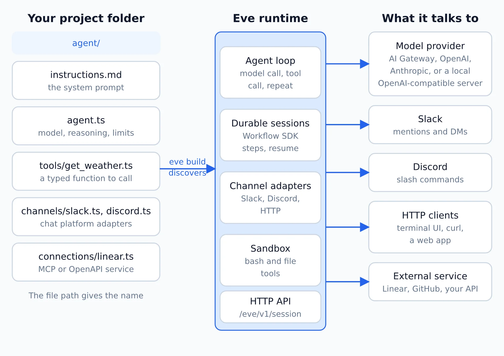
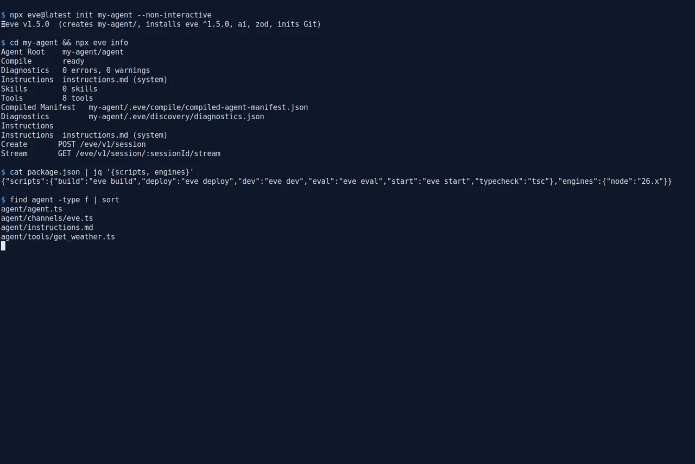
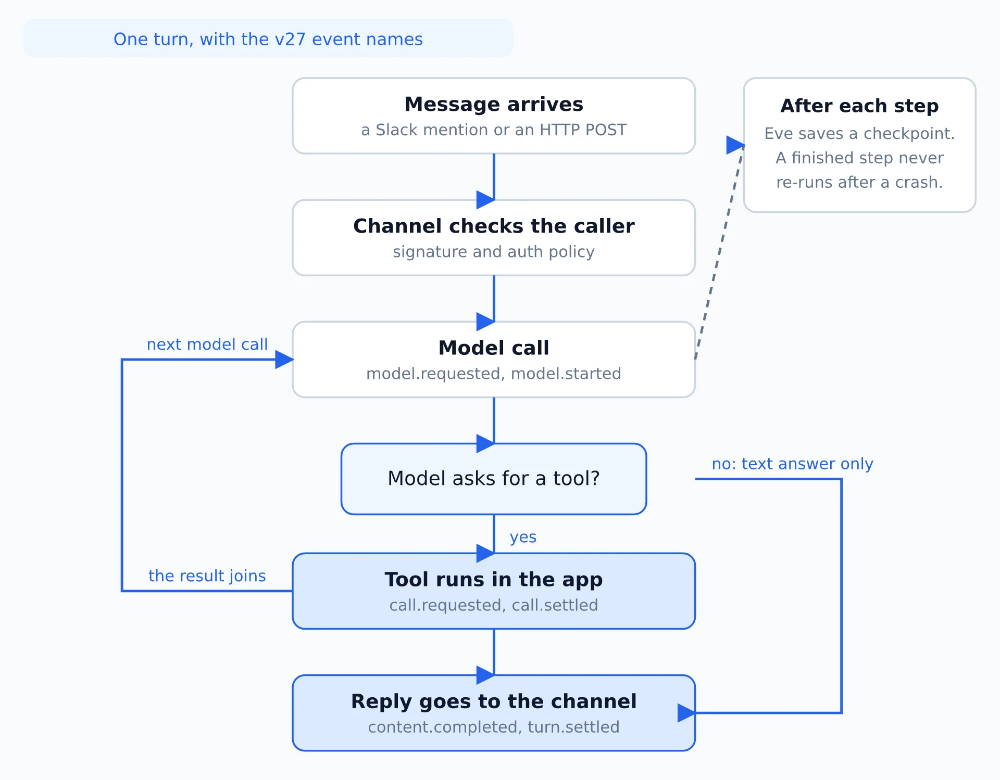
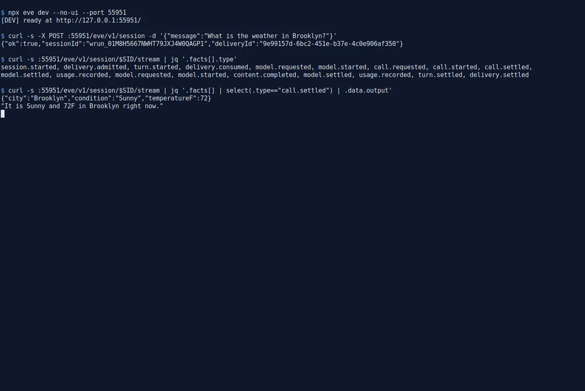
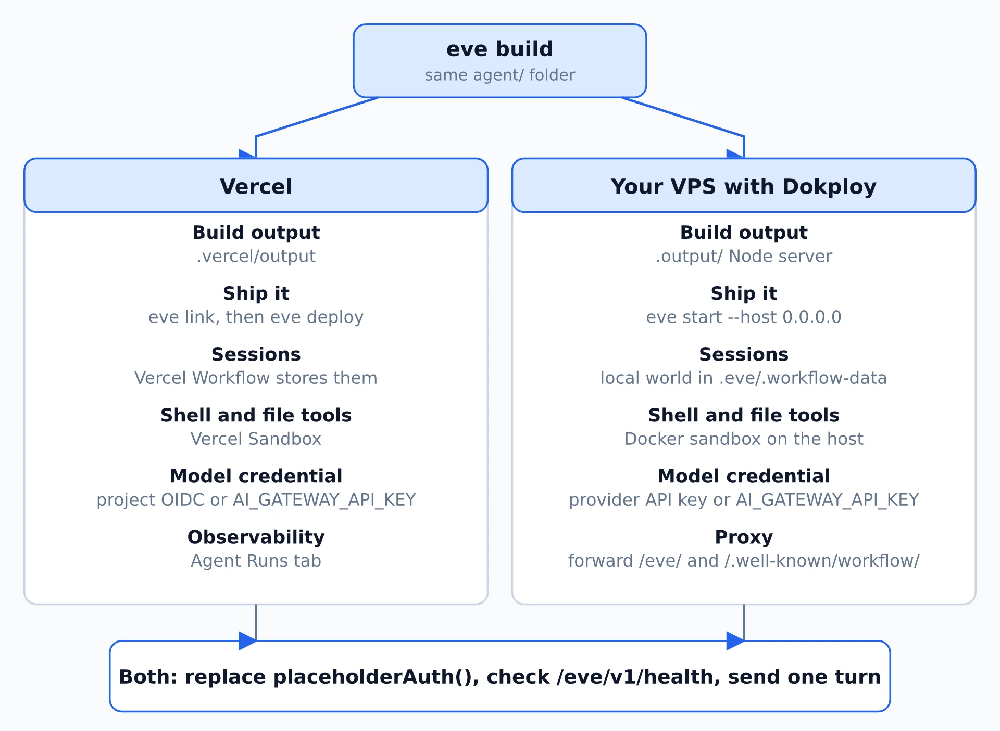
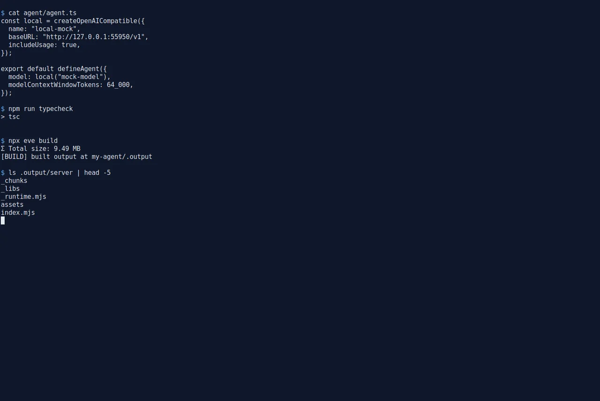

import Button from "@components/widgets/Button.astro";
import Notice from "@components/widgets/Notice.astro";
import ListCheck from "@components/widgets/ListCheck.astro";
import Accordion from "@components/widgets/Accordion.astro";
import Tabs from "@components/widgets/Tabs.astro";
import Tab from "@components/widgets/Tab.astro";

Eve is an open source framework (Apache-2.0) for durable AI agents, and each part of the agent is a file: instructions in `agent/instructions.md`, tools in `agent/tools/`, channels in `agent/channels/`. One command scaffolds a project and opens a terminal UI: `npx eve@latest init my-agent`. The [GitHub repository](https://github.com/vercel/eve) dates from June 2026.

The easiest way to describe it is "Next.js, but for agents." Eve reads that folder structure and turns it into a running agent that works locally, serves HTTP, and keeps a conversation alive across many turns.

I've built agents with a few different frameworks, and the thing that won me over here is how little ceremony there is. You can read a whole Eve project by looking at the directory tree. That's it. No registry to keep in sync, no wiring file that drifts out of date.

This guide scaffolds an agent from scratch, gives it a tool, connects it to Slack and Discord, and swaps the default model for an open source one. The last step deploys it, either on Vercel or on your own VPS with Dokploy. Commands were checked against eve 1.5.0 on November 28, 2026.

<Notice type="info" title="Pin your Eve version">
  This article follows eve 1.5.0, released on November 25, 2026. Eve 1.0 renamed most session events and several channel APIs, so pin the version in `package.json` and read the changelog in `node_modules/eve/CHANGELOG.md` before you upgrade. The full docs ship inside the package at `node_modules/eve/docs/` and match the installed version exactly; [eve.dev/docs](https://eve.dev/docs/introduction) is the online copy.
</Notice>

## What is Vercel Eve?

Eve is an open source framework for durable agents written as ordinary files in a TypeScript project. You scaffold it with one `npx` command and deploy the same folder to Vercel or a VPS.

"Durable" is the word that matters. An Eve session isn't one request and one response. It can stream progress while it works, call tools and subagents, pause to ask a human for approval, resume after the answer arrives, and keep state across turns. Under the hood it leans on the open source [Workflow SDK](https://workflow-sdk.dev/) to make sessions resumable and crash-safe, so your code can focus on the work instead of the plumbing.



*The agent folder on the left, the Eve runtime in the middle, and everything it talks to on the right.*

Here's what a small project looks like:

```text
my-agent/
├── package.json         # scripts: dev, build, start, typecheck, deploy
└── agent/
    ├── instructions.md   # who the agent is, how it behaves
    ├── agent.ts          # picks the model, runtime config
    ├── channels/
    │   ├── eve.ts        # the HTTP API and its auth policy (scaffolded)
    │   ├── slack.ts      # added with `eve add channel/slack`
    │   └── discord.ts    # added with `eve add channel/discord`
    ├── tools/            # typed functions the model can call
    │   └── get_weather.ts
    ├── skills/           # longer procedures, loaded on demand
    ├── connections/      # MCP servers and OpenAPI APIs
    ├── subagents/        # specialist child agents
    └── schedules/        # cron jobs
```

A file's location says what it does, and its path usually gives it a name. Drop `agent/tools/get_weather.ts` in place and Eve discovers a tool called `get_weather`. Rename the file and the tool name moves with it. That's the whole mental model.

<ListCheck>
- **`instructions.md`** tells the agent who it is and how to behave (the always-on system prompt)
- **`agent.ts`** chooses the model and sets runtime options
- **`tools/`** holds typed functions the model can call
- **`skills/`** holds longer procedures the model only loads when they're useful
- **`channels/`** hold the HTTP API (`eve.ts`) and the adapters for Slack, Discord, and other chat platforms
</ListCheck>

Start with `instructions.md` and `agent.ts`. The scaffold also writes `channels/eve.ts` with a placeholder auth policy. Add the other folders when you need them.

## Prerequisites

Before you scaffold anything, make sure you have:

<ListCheck>
- **Node 24 or newer**, which includes npm. The 1.5.0 scaffold writes `"node": "26.x"` under `engines`; on Node 24.17 npm prints an EBADENGINE warning, and the install, typecheck, build and dev server all ran
- **A model credential**: a ChatGPT subscription, a Vercel account, or an AI Gateway, OpenAI, or Anthropic API key. You do not need a Vercel project to start chatting
</ListCheck>

The scaffold sets `openai/gpt-6-luna-fast` with `reasoning: "high"`, routed through the Vercel AI Gateway. When no credential is present, the terminal UI opens `/login` to add one, and `/model` switches the model or the reasoning effort.

## Step 1: Scaffold your first agent

`npx` can run `eve init` without installing anything first:

```bash
npx eve@latest init my-agent
```

That command creates the project, installs dependencies, initializes Git, starts the dev server, and opens an interactive terminal UI. Type a message and you'll watch the model loop run in real time.



*A fresh scaffold on eve 1.5.0: `eve info` reports 0 errors and lists the discovered files.*

A couple of things worth knowing:

<ListCheck>
- Pass `-n` (`--non-interactive`) to scaffold without opening the terminal UI, `--model <provider/model-id>` to pick the model, or `--agents support,research` for a workspace with several agents
- `eve init` holds the terminal, so hit `Ctrl+C` to get your shell back before you start editing files
- To add Eve to a project you already have, run `eve init .` from a folder that has a `package.json` and no `agent/` files yet. It adds `eve`, `ai`, and `zod` without touching the rest
</ListCheck>

If you'd rather wire it in by hand, install the three dependencies and declare a Node engine. The 1.5.0 docs say to pin Node 26:

```bash
npm install eve@latest ai zod
```

```json
{
  "engines": {
    "node": "26.x"
  }
}
```

Then write the two files Eve needs. `agent/instructions.md`:

```md
You are a concise assistant. Use tools when they are available.
```

And `agent/agent.ts`:

```ts
import { defineAgent } from "eve";

export default defineAgent({
  model: "openai/gpt-6-luna-fast",
});
```

Even at this size the agent can already do real work, because the default harness ships with `bash`, `read_file`, `write_file`, `edit_file`, `web_fetch`, `web_search`, and an `agent` delegation tool. `npx eve info` lists what Eve discovered.

<Notice type="info" title="Letting a coding agent do the setup">
  If you're using Claude Code, Cursor, or a similar tool, hand it this prompt: "Set up an eve agent: read the eve docs (bundled at `node_modules/eve/docs` once eve is installed), scaffold with `npx eve@latest init <name>`, add a typed tool at `agent/tools/get_weather.ts`, run it with `npm run dev`, then create a session, stream it, and send a follow-up." Once `eve` is installed, the full docs live locally in `node_modules/eve/docs/`, so the model doesn't have to guess at an unfamiliar API.
</Notice>

## Step 2: Give the agent a tool

A tool is a typed action the agent can call: hit an API, run a query, write a file. The filename becomes the tool name the model sees, and it has to be snake_case. Create `agent/tools/get_weather.ts`:

```ts
import { defineTool } from "eve/tools";
import { z } from "zod";

// The model sees this tool as `get_weather`, from the filename.
export default defineTool({
  description: "Get the current weather for a city.",
  inputSchema: z.object({ city: z.string().min(1) }),
  async execute({ city }) {
    return { city, condition: "Sunny", temperatureF: 72 };
  },
});
```

The pieces of a tool:

<ListCheck>
- A **filename slug** under `agent/tools/`, which is the model-facing name
- A **`description`** written for the model, telling it what the tool does
- An **`inputSchema`**, a Zod schema (pass `z.object({})` for no input)
- An **`execute(input, ctx)`** function, sync or async, that does the work
</ListCheck>

Tools run in your app runtime with full access to `process.env`, not inside the sandbox, so they can import shared code from `lib/` and read your secrets directly. One thing to keep in mind: a step that gets interrupted mid-execution re-runs on resume, so make side effects like charges or emails idempotent, or gate them behind approval (more on that below).

## Step 3: Run it and send a message

A scaffolded app has a `dev` script, and `eve dev` reloads on every change:

```bash
npm run dev
```

The dev server listens on port 2000 by default. For a background server, `npx eve dev --no-ui --port 55951` skips the terminal UI and prints one line when it is up: `[DEV] ready at http://127.0.0.1:55951/`.



*One turn with the v27 event names: the tool result feeds the next model call, and Eve saves a checkpoint after each step.*

Every Eve app also exposes the same HTTP API. Start a durable session with `curl`:

```bash
curl -X POST http://127.0.0.1:2000/eve/v1/session \
  -H 'content-type: application/json' \
  -d '{"message":"What is the weather in Brooklyn?"}'
```

The response is `202` with the session id in the body and in the `x-eve-session-id` header:

```json
{"ok":true,"sessionId":"wrun_01M8H47YXAXRZ994AVN90Z3CHA","deliveryId":"b30a7939-ae75-46f3-a382-0f37eda59814"}
```

Attach to the stream with the session id:

```bash
curl "http://127.0.0.1:2000/eve/v1/session/<sessionId>/stream?follow=true"
```

The stream is NDJSON. For this turn you see `session.started`, `turn.started`, `model.requested`, `model.started`, `call.requested` (the tool call), `call.settled` (its result), `content.completed` (the reply), then `turn.settled` and `delivery.settled`. The names `actions.requested`, `action.result`, `message.completed` and `session.completed` belong to the v26 stream that Eve 1.0 replaced. To continue the conversation, post a follow-up to the same session id:

```bash
curl -X POST http://127.0.0.1:2000/eve/v1/session/<sessionId> \
  -H 'content-type: application/json' \
  -d '{"message":"Now do Queens."}'
```

The follow-up needs only `message`. The `continuationToken` field from older Eve versions is rejected with `Unknown field 'continuationToken'`.

On November 28, 2026, a lab run with eve 1.5.0 pointed the agent at a local OpenAI-compatible mock on port 55950. The first turn made two model calls, one `get_weather` call, and settled in about 0.2 seconds.



*One real turn: the session id comes back from the create call, and the stream shows the tool call and the reply.*

That's the hello-world. A weather bot isn't useful to anyone, so next the agent goes where people already work.

## Step 4: Connect the agent to Slack

A channel is the adapter between a platform and your agent. It normalizes incoming messages, owns the resume token for that surface, and decides how replies get delivered. The Slack channel answers `@mentions` and DMs, replies in threads, shows typing indicators, and turns human-in-the-loop prompts into Slack buttons.

The nice part: credentials can run through [Vercel Connect](https://vercel.com/kb/guide/vercel-connect), which handles both the outbound bot token and inbound webhook verification. No `SLACK_BOT_TOKEN` or `SLACK_SIGNING_SECRET` sits in your project. This step needs a Slack workspace you admin, so it follows the [Slack docs](https://eve.dev/docs/channels/slack) and was not run here.

Run the guided setup from the agent project, then deploy:

```bash
npx eve add channel/slack
npx eve deploy
```

Setup signs you in to Vercel, links a project, creates or reuses a Slack app through Connect, asks you to install it in a workspace, and writes the channel file:

```ts
import { connectSlackCredentials } from "@vercel/connect/eve";
import { slackChannel } from "eve/channels/slack";

export default slackChannel({
  credentials: connectSlackCredentials("slack/my-agent"),
});
```

`connectSlackCredentials` returns the bot token and webhook verifier, keeping token rotation and request verification inside Connect instead of your code. To manage the Slack app yourself, run `eve add channel/slack` and choose **Use portable credentials**. Eve then writes a bare `slackChannel()` that reads `SLACK_BOT_TOKEN` and `SLACK_SIGNING_SECRET`, and you add the `app_mentions:read`, `chat:write`, and `im:history` scopes in the Slack app settings. Point Event Subscriptions at `https://<your-host>/eve/v1/slack`.

`eve deploy` installs dependencies and runs `vercel deploy --prod --logs`. Older guides, the previous version of this one included, re-pointed the Connect trigger by hand with `vercel connect detach` and `vercel connect attach --trigger-path /eve/v1/slack`. The 1.5 reference tells you not to run `detach`, because it removes the project's token access.

### Pulling in thread context

By default the channel gives you the triggering mention, but not the earlier replies in the thread. To let the agent read what was said before it was called in, add one option:

```ts
import { connectSlackCredentials } from "@vercel/connect/eve";
import { slackChannel } from "eve/channels/slack";

export default slackChannel({
  credentials: connectSlackCredentials("slack/my-agent"),
  threadContext: { since: "last-agent-reply" },
});
```

`since: "last-agent-reply"` means repeated mentions in one thread only inject what's new, so you don't re-feed the whole history every turn. The option needs the matching Slack history scope, such as `channels:history`. For custom filtering, `loadThreadContextMessages` from the same module still returns the raw thread messages.

<Notice type="warning" title="Tell people they're talking to a bot">
  Eve doesn't add an "I'm an AI" disclosure for you. Depending on where your users are, you may be legally required to disclose that they're talking to an automated system. Bake it into your `instructions.md` or your channel responses.
</Notice>

## Step 5: Connect the agent to Discord

Discord works through HTTP Interactions: slash commands, message components, and modals. Discord enforces a three-second deadline to acknowledge a command, so the channel verifies the signature, acknowledges right away, and runs the actual work in the background. You don't have to think about any of that; it's handled.

Discord has the same two paths. `npx eve add channel/discord` goes through Connect, points the Interactions Endpoint URL at the Connect trigger, and registers `/ask` for you. The manual route starts with the minimal `agent/channels/discord.ts` and a bot you create in the Developer Portal; these steps come from the [Discord docs](https://eve.dev/docs/channels/discord) and were not run here:

```ts
import { discordChannel } from "eve/channels/discord";

export default discordChannel();
```

Discord needs three environment variables:

```bash
DISCORD_PUBLIC_KEY=...      # verifies the signature headers
DISCORD_APPLICATION_ID=...  # edits the deferred response, sends followups
DISCORD_BOT_TOKEN=...       # proactive messages, fallback, typing indicators
```

The route is `POST /eve/v1/discord` by default. Paste that public URL into your Discord application's Interactions Endpoint URL field in the Developer Portal.

Registering commands is on you, not the channel. A string option named `message` lines up with Eve's default prompt extraction:

```bash
curl -X PUT "https://discord.com/api/v10/applications/$DISCORD_APPLICATION_ID/commands" \
  -H "Authorization: Bot $DISCORD_BOT_TOKEN" -H "Content-Type: application/json" \
  -d '[{"name":"ask","description":"Ask the eve agent","type":1,
    "options":[{"name":"message","description":"What should the agent do?","type":3,"required":true}]}]'
```

Use guild commands during development; they propagate much faster than global ones. For file uploads, add an attachment option named `file` next to `message`. Here's a slightly fuller channel that decides auth per command and posts the reply back:

```ts
import { discordChannel } from "eve/channels/discord";

export default discordChannel({
  onCommand: (ctx, interaction) => ({
    auth: {
      principalId: interaction.user.id,
      principalType: "user",
      authenticator: "discord",
      attributes: { channel_id: interaction.channelId, guild_id: interaction.guildId ?? "" },
    },
  }),
  events: {
    "content.completed"(event, ctx) {
      if (event.data.phase !== "reply" || typeof event.data.value !== "string") return;
      return ctx.channel.discord.post(event.data.value);
    },
  },
});
```

File attachments work on both channels: Slack stages files attached to a mention, and Discord takes them through the command's `file` option. Replying to plain DMs, mentions, and thread replies on Discord takes more setup, because Discord sends those only over its Gateway WebSocket. Eve runs an experimental relay for that, and the docs cover running it inside and outside Vercel.

The thing I appreciate is that the same agent logic serves both platforms. Your `get_weather` tool doesn't know or care whether the question came from Slack, Discord, the terminal, or a browser. Write the behavior once, expose it everywhere.

## Step 6: How do you use open source models with Eve?

Change one line in `agent/agent.ts` and the agent runs on any model the Vercel AI Gateway serves, or on a provider you call directly. The scaffolded model is `openai/gpt-6-luna-fast`, but you're not married to it.

We learned the hard way over the past couple of years that a model you depend on can be deprecated or pulled out from under you, so being able to switch matters. Eve makes the model a single line of config.

You have two routing options.

<Tabs>
<Tab name="Gateway (string id)">

A string model id routes through the Vercel AI Gateway. Swap the value and you're using a different model, no other changes:

```ts
import { defineAgent } from "eve";

export default defineAgent({
  // any model the gateway exposes
  model: "moonshotai/kimi-k2.6",
});
```

This works on Vercel with project OIDC, or anywhere else with `AI_GATEWAY_API_KEY` set. The Gateway is the lowest-setup path: one key, many models, easy to A/B between a fast cheap model and a stronger one.

</Tab>
<Tab name="Direct provider">

To skip the Gateway entirely, pass a model instance from an AI SDK provider package and set that provider's key. Eve also ships `openai()` and `anthropic()` helpers under `eve/models/` that read `OPENAI_API_KEY` or `ANTHROPIC_API_KEY`. For a local or OpenAI-compatible endpoint, `@ai-sdk/openai-compatible` is the shortest path, and it is what the lab run in step 3 used:

```bash
npm install @ai-sdk/openai-compatible
```

```ts
import { createOpenAICompatible } from "@ai-sdk/openai-compatible";
import { defineAgent } from "eve";

const local = createOpenAICompatible({
  name: "local-mock",
  baseURL: "http://127.0.0.1:55950/v1",
  includeUsage: true,
});

export default defineAgent({
  model: local("mock-model"),
  modelContextWindowTokens: 64_000,
});
```

Point the `baseURL` at Ollama, LM Studio, OpenRouter, Together, Groq, or your own endpoint, and you're running an open model with the same agent code. Set `modelContextWindowTokens` to the context length the server allocates, because the Gateway holds no metadata for a model it does not serve. Pick a model with native tool calling, since Eve agents call tools on most turns. For a model or an agent CLI kept inside a container, see the [guide to running AI CLI tools safely in Docker or Podman](/docker-podman-ai-cli-tools-safe-environment/). For current model prices, the [cheap models guide for Hermes Agent](/best-cheap-models-hermes-agent/) has the numbers.

</Tab>
</Tabs>

Which open model should you reach for? Models like GLM-5.2, Kimi K2.6, and Qwen 3.6 hold up well for agentic tool-calling work at a fraction of the cost of frontier models. I went deep on the trade-offs in my guide to the [best open source LLMs to replace Claude](/best-open-source-llms-claude-alternative/), so check that if you're picking one for a real workload. The short version: route cheap, fast models to simple turns and save the expensive ones for the hard problems. Eve lets you do exactly that, even per subagent.

<Notice type="info" title="Per-task model routing">
  Because the model is just config, you can run subagents on different models. A research subagent might use a cheap long-context model while the root agent stays on something stronger. You build the skill once and route it wherever makes sense.
</Notice>

## Step 7: Add tools from external services with connections

Beyond the tools you write, Eve can pull in tools from external MCP servers and OpenAPI documents. These live in `agent/connections/`, and the model never sees the URL or credentials, it discovers the tools and calls them by name.

A connection to Linear's MCP server looks like this:

```ts
import { defineMcpClientConnection } from "eve/connections";

export default defineMcpClientConnection({
  url: "https://mcp.linear.app/mcp",
  description: "Linear workspace: issues, projects, cycles, and comments.",
  auth: {
    getToken: async () => ({ token: process.env.LINEAR_API_TOKEN! }),
  },
});
```

For anything that touches money, deletes data, or sends messages, gate it behind approval. The helpers live in `eve/tools/approval`: `never()` is the default, `once()` asks the first time in a session, and `always()` asks every time. With `auto()`, a decision model asks only about risky calls. The same pause-and-resume flow that powers human-in-the-loop tools handles it. Ready-made items live in a registry: `npx eve registry search linear` finds them and `npx eve add connection/linear` installs one.

## Step 8: Deploy it

You've got a working agent. Now it needs to live somewhere. Eve runs the same way locally, on Vercel, and on a plain Node host, so going to production is mostly mechanical. If you are still weighing it against another framework, the [Mastra vs Eve comparison](/mastra-vs-eve-typescript-ai-agents/) covers the differences.



*The same `eve build` output goes to Vercel or to a VPS; each path needs a different session store, sandbox, credential and proxy setup.*

### Option A: Deploy on Vercel

`eve build` compiles the agent and writes the host output. On Vercel that's the Build Output bundle under `.vercel/output`, plus the compiled artifacts under `.eve/`. Link the project once, then deploy from the project root:

```bash
npx eve link
npx eve deploy
```

`eve link` pulls the project environment, so an AI Gateway credential lands in `.env.local`. You can also push to a Git-connected project.



*The lab agent: `npm run typecheck` passes and `eve build` writes a 9.49 MB server to `.output/` in about 3 seconds (local build, no `VERCEL` variable).*

Before that first production request, work through the short checklist:

<ListCheck>
- Set a **model credential** and any **route-auth secrets** in the deployment environment, never in source
- Replace the scaffolded `placeholderAuth()` with a real auth policy (Basic, JWT, OIDC, or a custom verifier) from the [auth docs](https://eve.dev/docs/guides/auth-and-route-protection); an unconfigured app fails closed and rejects browser traffic, which is the safe default
- Confirm the **sandbox backend** matches the environment (Vercel Sandbox on Vercel, Docker or another provider elsewhere)
</ListCheck>

Once deployed, the platform auto-detects Eve and surfaces an Agent Runs tab under your project's Observability view, where you can browse sessions and read each conversation's trace.

Eve itself is Apache-2.0 and free. On Vercel you pay for what the agent uses: Workflow, Sandbox, and AI Gateway tokens. The Gateway's free tier includes a $5 monthly credit and sells tokens at provider list price with no markup ([AI Gateway pricing](https://vercel.com/docs/ai-gateway/pricing), checked November 28, 2026). The Workflow and Sandbox pricing pages render their numbers in the browser, so check [Workflows](https://vercel.com/workflows/pricing) and [Sandbox](https://vercel.com/sandbox/pricing) for the current rates.

### Option B: Self-host on your own VPS

If you'd rather not be tied to Vercel's platform, Eve runs as a normal Node service behind your own process manager or reverse proxy:

```bash
eve build
PORT=3000 eve start --host 0.0.0.0
```

Outside Vercel, Eve writes the standard Nitro output under `.output/`, and the Workflow SDK uses its local world, which stores state under `.eve/.workflow-data`. The sandbox runs in Docker when `eve build` can reach a Docker daemon. A few things to make explicit when self-hosting:

<ListCheck>
- Put `.eve/.workflow-data` on **persistent storage** so session state survives restarts, and back it up with the rest of your data
- Use a **direct provider model** with `OPENAI_API_KEY` or `ANTHROPIC_API_KEY`, or keep `AI_GATEWAY_API_KEY` if you still want Gateway routing
- Replace `vercelOidc()` with auth your host can verify
- Forward both **`/eve/`** and **`/.well-known/workflow/`** through the proxy without rewriting the path; with only `/eve/`, a session starts but the run stalls
- Keep the eve version in mind: a new build on the same release keeps sessions running, an eve upgrade strands them
- If your agent uses schedules, run them on one process only (`eve start --no-schedules` on the others), or trigger the same work from your own cron
</ListCheck>

The cleanest way I've found to run a Node service like this on a VPS is [Dokploy](/dokploy-install/), an open source, self-hostable alternative to Vercel and Heroku. It gives you Git-based deploys, automatic HTTPS via Traefik, environment variable management, and logs, all from a dashboard you control. My [Dokploy install guide](/dokploy-install/) covers getting it running on a fresh server.

The deploy flow for an Eve agent maps almost exactly onto a normal Node app, so if you've deployed anything with Dokploy before, this will feel familiar. My walkthrough on [deploying TanStack Start on a VPS with Dokploy](/tanstack-start-dokploy-deploy/) shows the full pattern (build command, start command, environment variables, domain). The same steps apply here: set the build command to `npm run build` (which runs `eve build`), the start command to `eve start --host 0.0.0.0`, expose the port, and add your model and auth secrets in the environment panel. One footgun: a Dockerfile `RUN npm run build` step has no Docker daemon, so the build records no sandbox. Select `DockerSandbox.environment()` in `agent/sandbox.ts` for that setup, per the [self-hosting docs](https://eve.dev/docs/guides/deployment/self-hosting). For a smaller first project on the same stack, the [TanStack Start todo app tutorial](/tanstack-start-bunny-database-drizzle/) uses Drizzle and Bunny Database.

<Notice type="success" title="Why self-host the agent">
  Running on your own VPS means your conversation data and credentials stay on infrastructure you control, costs are predictable, and you're not exposed to platform pricing changes. The trade-off is you handle backups, scaling, and the persistent `.workflow-data` storage yourself.
</Notice>

### Verify the deployment

Whichever path you took, smoke-test the live routes: health first, then a real turn. The health route is public; the session route follows your auth policy. A lab run of the production build on November 28, 2026 answered `{"ok":true,"status":"ready"}` on health and `401 unauthorized` on an unauthenticated session. That is the expected result while `placeholderAuth()` is still in place:

```bash
curl https://<your-app>/eve/v1/health

curl -X POST https://<your-app>/eve/v1/session \
  -H 'content-type: application/json' \
  -d '{"message":"Hello from production"}'
```

You can also drive the live deployment with the dev terminal, which is handy for a quick production check:

```bash
npx eve remote connect --url https://<your-app>
npx eve remote connect --url https://<your-app> --print "Hello from production"
```

The second form sends one message, prints the final reply, and exits non-zero if the turn fails.

## What to build next

The weather bot was just a way to see the loop run. The interesting part is what you put in `tools/` and `skills/`. A content-repurposing agent that drafts social posts and calls image generation tools. A lead-research agent that pulls from your CRM. A support triage bot living in your Slack. The scaffolding is the same every time, which is the whole point: you stop reinventing the harness and spend your time on the capability itself.

<ListCheck>
- Add a **skill** in `agent/skills/` for any multi-step procedure the model should load only when relevant
- Spin up **subagents** for parallel or specialist work, each on its own model
- Add **schedules** for recurring jobs like a daily digest
- Put a **Next.js front end** in front of the agent with the `useEveAgent` hook
</ListCheck>

## Wrapping up

Eve takes the part of agent-building that's usually a tangle (channels, durable state, model routing, deploys) and turns it into a folder you can read top to bottom. You scaffold with one command, add a tool as a single file, point a channel at Slack or Discord, and pick whatever model fits the job and your budget. Deploy it on Vercel for the zero-config path, or self-host it on a VPS with Dokploy when you want to own the whole stack.

If you're coming from another framework, the switch costs you almost nothing, since your tools and skills are plain TypeScript and Markdown you can carry elsewhere. Start with the weather hello-world, then replace it with something your team will really use.

<Button text="Read the Eve docs" link="https://eve.dev/docs/introduction" variant="solid" color="blue" size="md" icon="arrow-right" />

## FAQ

<Accordion label="Is Vercel Eve free and open source?" group="faq" expanded="true">
Yes. Eve is open source under Apache-2.0 and lives on [GitHub](https://github.com/vercel/eve). You can run it entirely on your own infrastructure with your own model keys. The optional conveniences (AI Gateway, hosted Sandbox, Vercel Connect, the Agent Runs dashboard) are Vercel platform features you can opt into, not requirements.
</Accordion>

<Accordion label="Do I need a Vercel account to use Eve?" group="faq">
No. You need a model credential, which can be a ChatGPT subscription or a direct provider key like `ANTHROPIC_API_KEY` or `OPENAI_API_KEY`. A Vercel account makes the AI Gateway, Slack credentials via Connect, and hosted sandboxes easier. You can also self-host the whole thing on a VPS with Dokploy and never link a Vercel project.
</Accordion>

<Accordion label="Which Node version and port does Eve need?" group="faq">
Eve requires Node 24 or newer, and the 1.5.0 scaffold pins `"node": "26.x"` under `engines`. `eve dev` listens on port 2000 and `eve start` on port 3000, and both accept `--port`. For a background server, pass `--no-ui`, which skips the terminal UI and prints one ready line.
</Accordion>

<Accordion label="Can one agent serve Slack and Discord at the same time?" group="faq">
Yes. Add both `agent/channels/slack.ts` and `agent/channels/discord.ts`, with `eve add channel/slack` and `eve add channel/discord`. The agent's instructions, tools, and skills are shared; each channel just adapts the platform's input and output. Your tools don't need to know which surface a message came from.
</Accordion>

<Accordion label="Can I use open source models instead of the default?" group="faq">
Yes. Change the `model` value in `agent/agent.ts`. Use a gateway string id like `moonshotai/kimi-k2.6`, or install an AI SDK provider and point its `baseURL` at OpenRouter, Together, Groq, or a self-hosted endpoint. For a local server, `@ai-sdk/openai-compatible` works with Ollama, LM Studio, llama.cpp, and vLLM. See my [open source LLM comparison](/best-open-source-llms-claude-alternative/) for picking one.
</Accordion>

<Accordion label="What does 'durable' mean for an Eve session?" group="faq">
A session can stream progress, call tools and subagents, pause for human approval, resume after the answer arrives, and keep state across many turns. It's built on the open source Workflow SDK, which makes runs resumable and crash-safe. A completed step never re-runs; an interrupted step does, so make side effects idempotent.
</Accordion>

<Accordion label="Why is my follow-up request rejected with an unknown field?" group="faq">
Eve 1.0 removed the `continuationToken` from the HTTP API and renamed the stream events from v26 to v27. A follow-up now posts `{"message":"..."}` to `/eve/v1/session/<sessionId>`, and the stream reports `call.requested`, `call.settled`, `content.completed`, and `turn.settled`. The server answers `Unknown field 'continuationToken'` on the old shape.
</Accordion>

<Accordion label="What does self-hosting need that Vercel handles for you?" group="faq">
Four things: persistent storage for `.eve/.workflow-data`, Docker on the host when the agent uses the shell and file tools, a route auth policy your host can verify instead of `vercelOidc()`, and a proxy that forwards `/eve/` and `/.well-known/workflow/`. On Vercel, Vercel Workflow and Vercel Sandbox provide the first two by default.
</Accordion>
