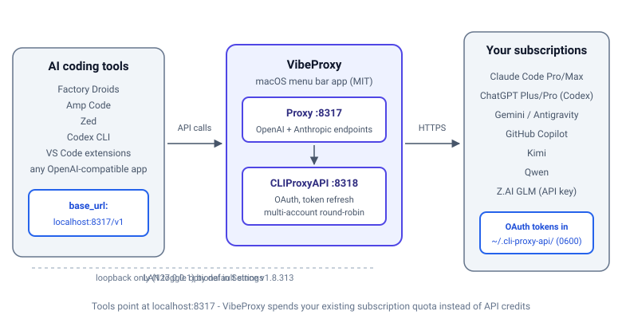

import YouTubeEmbed from "@components/widgets/YouTubeEmbed.astro";
import Button from "@components/widgets/Button.astro";
import Notice from "@components/widgets/Notice.astro";
import ListCheck from "@components/widgets/ListCheck.astro";
import Accordion from "@components/widgets/Accordion.astro";
import Tabs from "@components/widgets/Tabs.astro";
import Tab from "@components/widgets/Tab.astro";

You already pay for Claude Code, ChatGPT Plus, or another AI subscription. Why pay again for API access? VibeProxy is a macOS menu bar app that routes your existing subscriptions to coding tools like Factory AI Droids, Amp Code, Zed, Codex CLI, and any other OpenAI-compatible application. No API keys needed: OAuth in, model calls out.

Since the first version of this guide, the provider list has grown past Claude, Codex, and Gemini. VibeProxy now also connects GitHub Copilot, Kimi, and Z.AI GLM (Qwen was there before), and it can run several accounts per provider with automatic failover.

<Notice type="success" title="What you'll learn">

- **Stop paying twice** for AI by reusing the subscriptions you already fund
- **Install VibeProxy** on macOS with verified DMG/ZIP downloads (Intel builds included)
- **Connect Claude Code, Codex, Gemini, GitHub Copilot, Kimi, Qwen, and Z.AI GLM**
- **Configure Factory Droids, Amp Code, Zed, Codex CLI, and other tools** against the local proxy
- **Run multi-account round-robin** and pin providers with Priority toggles
- **Look up current model IDs** for every supported provider (2026 reference tables)

</Notice>

<Notice type="info" title="What's new in this guide (updated Oct 2026)">

VibeProxy ships near-daily (v1.8.341 as of 2026-10-21), and a lot changed since this article first went up:

- **Intel x86_64 builds** exist since v1.8.58 (officially untested)
- **New providers** joined: GitHub Copilot, Z.AI GLM (API key), Kimi (OAuth)
- **Multi-account round-robin** with rate-limit failover, plus **Provider Priority toggles**
- **DMG + ZIP releases per architecture**, each with a SHA-256 checksum file
- **Loopback-only binding enforced by default**, with an opt-in LAN toggle
- **Vercel AI Gateway route** for lower-risk Claude Max access
- **Refreshed model IDs** across the board: Claude Opus 4.7, GPT-5.5 / 5.3-codex, Gemini 3.1

</Notice>

If you're new to AI coding tools, start with [our AI Programming Beginners Guide](https://www.bitdoze.com/ai-programming-beginners-guide/). If you already know the space and want the comparison table, see [the best AI coding tools and agents in 2026](https://www.bitdoze.com/ai-coding-tools/).

## What is VibeProxy?

[VibeProxy](https://github.com/automazeio/vibeproxy) is a free, MIT-licensed macOS app from Automaze (about 3,393 GitHub stars as of 2026-10-21). It runs in the menu bar and creates a local proxy on port **8317**. Your coding tools talk to that proxy; the proxy talks to your existing subscriptions through the bundled [CLIProxyAPI](https://github.com/router-for-me/CLIProxyAPI), which handles OAuth, token refresh, and routing. (The bundled binary is still named `cli-proxy-api-plus`, a leftover from the retired CLIProxyAPIPlus fork. Ignore the name.)



Two local ports matter: **8317** is the proxy your tools point at, **8318** is the CLIProxyAPI backend behind it. Both bind to loopback. More on that in [Security Considerations](#security-considerations).

### Why use VibeProxy?

<ListCheck>

- Spend your existing flat-rate subscription quota instead of per-token API fees
- One proxy serves many models: Claude Opus 4.7, Sonnet 4.6, GPT-5.5, Gemini 3.1, Copilot-hosted models, GLM-5
- Browser OAuth per provider, so there are no API keys to manage; tokens stay local and refresh automatically
- Several logins per provider give you round-robin distribution and failover when one account hits a rate limit
- `-thinking-N` suffixes expose Claude reasoning budgets
- Sparkle checks daily and pulls both VibeProxy and the bundled CLIProxyAPI forward
- Anything that speaks the OpenAI or Anthropic API shape can point at it

</ListCheck>

**[COST]** VibeProxy itself is $0. The savings come from not double-paying: if you already fund a $20+/month Claude or ChatGPT plan, every API call through a third-party tool is money you do not spend twice.

## Supported AI subscriptions: Claude, Codex, Gemini, Copilot, Kimi & GLM

VibeProxy talks to these providers today (source: project README and setup docs, fetched 2026-10-21):

| Subscription | Models available (current IDs) | Auth | Requirements |
|-------------|-------------------------------|------|--------------|
| **Claude Code Pro/Max** | `claude-opus-4-7`, `claude-sonnet-4-6`, thinking variants | OAuth | Active subscription |
| **ChatGPT Plus/Pro (Codex)** | `gpt-5.5`, `gpt-5.4`, `gpt-5.3-codex`, `gpt-5.3-codex-spark` | OAuth | Active subscription |
| **Google Antigravity** | `gemini-3.1-pro-preview`, `gemini-3-pro-preview`, Claude-via-Antigravity | OAuth | Google account |
| **Gemini CLI** | `gemini-2.5-pro`, `gemini-2.5-flash`, `gemini-2.5-flash-lite` | OAuth | Google Cloud project |
| **GitHub Copilot** | `claude-opus-4.6`, `claude-sonnet-4.6`, `gpt-5.3-codex`, `gemini-3.1-pro-preview` | OAuth | Active Copilot plan |
| **Qwen** | `qwen3-coder-plus`, `qwen3-coder-flash` | OAuth | Qwen account |
| **Kimi** | see in-app provider list | OAuth | Kimi account |
| **Z.AI GLM** | `glm-5`, `glm-4.7`, `glm-4-plus`, `glm-4-air`, `glm-4-flash` | API key | GLM API key |

<Notice type="info" title="Already have these subscriptions?">

If you're using [Claude Sonnet and GPT models for free](https://www.bitdoze.com/use-claude-sonnet-4-5-gpt-5-free/) or hold any paid plan above, VibeProxy lets you spend that quota across every coding tool you own. GitHub Copilot subscribers get a second pool of Claude/GPT/Gemini usage through GitHub's own API; see [our GitHub Copilot Pro guide](https://www.bitdoze.com/github-copilot-complete-guide/) if you are still deciding on that plan.

</Notice>

**[COST]** Each provider draws its own quota. The Copilot route is a separate budget from your Claude Code or ChatGPT plan, which is exactly why it is useful: you can fail over between pools instead of burning one subscription dry.

<YouTubeEmbed
  url="https://www.youtube.com/embed/AeBIWsSOcJ0"
  label="Claude, ChatGPT, Gemini in ONE Place? Here's How VibeProxy Makes It Happen"
/>

*The video above was recorded before the 2026 provider and UI additions (GitHub Copilot, Kimi, Z.AI GLM, Priority toggles). The setup flow is the same; the settings screen has more rows now.*

## Installing VibeProxy on macOS (DMG + SHA-256, Intel note)

<Notice type="warning" title="System requirements">

- **macOS 13.0 (Ventura)** or later (`LSMinimumSystemVersion` in the app bundle)
- **Apple Silicon** (M1/M2/M3/M4/M5) or **Intel x86_64**. Intel builds ship since v1.8.58 (2026-01-15) but are officially marked **untested**. Use them, report issues upstream.
- An active subscription (or GLM API key) for at least one supported provider
- Nothing else listening on ports **8317** (proxy) or **8318** (backend)

</Notice>

### Prerequisites

<ListCheck>

- macOS 13.0+ on Apple Silicon or Intel
- At least one supported AI subscription
- Ports 8317 and 8318 free on the machine

</ListCheck>

Quick pre-check for port conflicts:

```bash
lsof -i :8317 -i :8318
# empty output = ports are free
```

### Download and verify the release

Releases ship per architecture as both DMG and ZIP, each with a `.sha256` file (latest DMG is roughly 34 MB as of v1.8.341, 2026-10-21):

| File | Use for |
|------|---------|
| `VibeProxy-arm64.dmg` / `.zip` | Apple Silicon Macs |
| `VibeProxy-x86_64.dmg` / `.zip` | Intel Macs (untested builds) |
| `*.sha256` | checksum file next to each archive |

<Tabs>
<Tab name="Install with DMG">
1. Download `VibeProxy-arm64.dmg` (or `VibeProxy-x86_64.dmg`) from the [releases page](https://github.com/automazeio/vibeproxy/releases)
2. Verify the checksum:

```bash
shasum -a 256 -c VibeProxy-arm64.dmg.sha256
# expect: VibeProxy-arm64.dmg: OK
```

3. Double-click the DMG and drag `VibeProxy.app` into `/Applications`
4. Eject the DMG and launch VibeProxy from Applications

DMGs are notarized **and stapled** since v1.8.312 (2026-09-26), so Gatekeeper should stay quiet.
</Tab>
<Tab name="Install with ZIP">
1. Download `VibeProxy-arm64.zip` (or `VibeProxy-x86_64.zip`)
2. Verify the checksum:

```bash
shasum -a 256 -c VibeProxy-arm64.zip.sha256
# expect: VibeProxy-arm64.zip: OK
```

3. Unzip and move the app:

```bash
unzip VibeProxy-arm64.zip
mv VibeProxy.app /Applications/
```

4. Launch VibeProxy from `/Applications`
</Tab>
</Tabs>

<Button text="Download VibeProxy" link="https://github.com/automazeio/vibeproxy/releases" variant="solid" color="purple" size="md" icon="arrow-right" />

**Verify:** `VibeProxy.app` sits in `/Applications` and opens without a Gatekeeper dialog. **If broken:** a "damaged" dialog can still appear on rare occasions. Clear quarantine and retry:

```bash
xattr -cr /Applications/VibeProxy.app
```

### First launch

1. Open VibeProxy from `/Applications`
2. A menu bar icon appears (green dot = server running)
3. Click the icon and select **Open Settings**
4. The proxy starts automatically on port **8317**

**Verify:** menu bar status is green, and a quick probe answers on the proxy port:

```bash
curl -s -o /dev/null -w "%{http_code}\n" http://localhost:8317
# any HTTP status means the listener is up (404/401 are fine for a bare probe)
```

**If broken:** no menu bar icon means an older build with a TCC/entitlements bug (fixed in v1.8.313). Update the app from the releases page.

## Connecting your AI subscriptions

With VibeProxy running, authenticate each provider you want to use. The flow is the same everywhere: click **Connect** in Settings, finish OAuth in the browser, and VibeProxy detects completion automatically.

### Connecting Claude Code

1. Click the VibeProxy menu bar icon and select **Open Settings**
2. Click **Connect** next to Claude Code
3. Log in when the browser opens
4. VibeProxy detects completion and stores the tokens

**If broken:** token expired or provider shows disconnected, use **Disconnect** then **Connect** again (see [Troubleshooting](#troubleshooting)).

### Connecting OpenAI Codex

1. Click **Connect** next to Codex in Settings
2. Complete the browser authentication with your ChatGPT account
3. Wait for VibeProxy to confirm the connection

### Connecting Antigravity (Gemini 3 & Claude-via-Antigravity)

<Notice type="info" title="Antigravity vs Gemini CLI">

- **Antigravity** gives you **Gemini 3.x** (`gemini-3.1-pro-preview`, `gemini-3-pro-preview`) **and** Claude-via-Antigravity models with a generous shared quota
- **Gemini CLI** gives you the **2.x** family (`gemini-2.5-pro`, `gemini-2.5-flash`)
- Connect both if you want the full range

</Notice>

1. Click **Connect** next to Antigravity
2. Sign in with your Google account and grant model access
3. Restart VibeProxy to activate the Gemini 3.x model list

### Connecting Gemini CLI

1. Click **Connect** next to Gemini
2. Sign in with your Google account
3. Select a Google Cloud project (or accept the default)
4. VibeProxy saves the credentials in `~/.cli-proxy-api/`

### Connecting GitHub Copilot

1. Click **Connect** next to GitHub Copilot in Settings
2. Enter the device code at GitHub (the code is copied with its hyphen, so a paste just works)
3. Authorize VibeProxy against your GitHub account

You need an active Copilot subscription. The payoff is worth it: you get **Claude, GPT, and Gemini models through GitHub's API on a separate quota**. If you are choosing or rethinking that plan, read [our GitHub Copilot Pro guide](https://www.bitdoze.com/github-copilot-complete-guide/) first.

<Notice type="warning" title="Copilot premium-request multipliers">

Copilot bills premium models at different rates. As of late 2026: `claude-opus-4.6` counts as **3x**, `claude-sonnet-4.6` as **1x**, `claude-haiku-4.5` as **0.33x**. Opus through Copilot is the fastest way to burn a plan. If your usage just went metered, [GitHub Copilot usage-based pricing changes and cheaper alternatives](https://www.bitdoze.com/github-copilot-alternatives-2026/) walks through the numbers and the exits.

</Notice>

### Connecting Kimi, Qwen, and Z.AI GLM

- **Kimi** and **Qwen**: same Connect-and-OAuth flow. Kimi's model IDs are not enumerated in the official docs; use the provider list inside the app.
- **Z.AI GLM** is the odd one out. It takes an API key instead of OAuth: grab one from your Z.AI account (API key management page), then **Add Account** in VibeProxy Settings and paste it. The key is stored in `~/.cli-proxy-api/` like the OAuth tokens.

**Verify (all providers):** every provider you intend to use shows **Connected** in Settings. Then run a test prompt from any configured tool and confirm you get a completion back. An error like `auth_unavailable: no auth available` means that model's provider is not authenticated yet.

## Setting up Factory AI Droids

[Factory Droid CLI](https://go.bitdoze.com/droid-cli) is an AI coding agent that takes custom model definitions. Point those definitions at VibeProxy and your subscriptions run the whole session.

### Install Factory CLI

```bash
curl -fsSL https://app.factory.ai/cli | sh
```

### Configure custom models

Create or edit `~/.factory/config.json`. The pattern: Anthropic-shaped Claude models use `base_url: http://localhost:8317` with `provider: "anthropic"`; everything else goes through `http://localhost:8317/v1` with `provider: "openai"`. The `api_key` is a placeholder; VibeProxy ignores it.

```json
{
  "custom_models": [
    {
      "model_display_name": "CC: Opus 4.7 (High)",
      "model": "claude-opus-4-7-thinking-32000",
      "base_url": "http://localhost:8317",
      "api_key": "dummy-not-used",
      "provider": "anthropic"
    },
    {
      "model_display_name": "CC: Sonnet 4.6",
      "model": "claude-sonnet-4-6",
      "base_url": "http://localhost:8317",
      "api_key": "dummy-not-used",
      "provider": "anthropic"
    },
    {
      "model_display_name": "GPT-5.3 Codex",
      "model": "gpt-5.3-codex",
      "base_url": "http://localhost:8317/v1",
      "api_key": "dummy-not-used",
      "provider": "openai"
    },
    {
      "model_display_name": "Gemini 3.1 Pro",
      "model": "gemini-3.1-pro-preview",
      "base_url": "http://localhost:8317/v1",
      "api_key": "dummy-not-used",
      "provider": "openai"
    }
  ]
}
```

### Use Factory with VibeProxy

1. Launch Factory CLI:

```bash
droid
```

2. Select a model with `/model` and pick one of your custom entries
3. Code. All requests route through VibeProxy automatically.

**Verify:** `/model` lists your custom models and a test prompt returns a completion. **If broken:** 404s from Factory usually mean VibeProxy is not running or the `base_url` is wrong. Check the menu bar status and the `base_url` values above.

<Accordion label="Full Factory configuration with all models" group="config">

A fuller set covering thinking budgets, Copilot entries, and GLM:

```json
{
  "custom_models": [
    {
      "model_display_name": "CC: Opus 4.7 (High)",
      "model": "claude-opus-4-7-thinking-32000",
      "base_url": "http://localhost:8317",
      "api_key": "dummy-not-used",
      "provider": "anthropic"
    },
    {
      "model_display_name": "CC: Opus 4.7 (Medium)",
      "model": "claude-opus-4-7-thinking-10000",
      "base_url": "http://localhost:8317",
      "api_key": "dummy-not-used",
      "provider": "anthropic"
    },
    {
      "model_display_name": "CC: Opus 4.7 (Low)",
      "model": "claude-opus-4-7-thinking-4000",
      "base_url": "http://localhost:8317",
      "api_key": "dummy-not-used",
      "provider": "anthropic"
    },
    {
      "model_display_name": "CC: Opus 4.7",
      "model": "claude-opus-4-7",
      "base_url": "http://localhost:8317",
      "api_key": "dummy-not-used",
      "provider": "anthropic"
    },
    {
      "model_display_name": "CC: Sonnet 4.6 (High)",
      "model": "claude-sonnet-4-6-thinking-32000",
      "base_url": "http://localhost:8317",
      "api_key": "dummy-not-used",
      "provider": "anthropic"
    },
    {
      "model_display_name": "CC: Sonnet 4.6",
      "model": "claude-sonnet-4-6",
      "base_url": "http://localhost:8317",
      "api_key": "dummy-not-used",
      "provider": "anthropic"
    },
    {
      "model_display_name": "GPT-5.5 (High)",
      "model": "gpt-5.5(high)",
      "base_url": "http://localhost:8317/v1",
      "api_key": "dummy-not-used",
      "provider": "openai"
    },
    {
      "model_display_name": "GPT-5.5",
      "model": "gpt-5.5",
      "base_url": "http://localhost:8317/v1",
      "api_key": "dummy-not-used",
      "provider": "openai"
    },
    {
      "model_display_name": "GPT-5.5 (Low)",
      "model": "gpt-5.5(low)",
      "base_url": "http://localhost:8317/v1",
      "api_key": "dummy-not-used",
      "provider": "openai"
    },
    {
      "model_display_name": "GPT-5.3 Codex (High)",
      "model": "gpt-5.3-codex(high)",
      "base_url": "http://localhost:8317/v1",
      "api_key": "dummy-not-used",
      "provider": "openai"
    },
    {
      "model_display_name": "GPT-5.3 Codex",
      "model": "gpt-5.3-codex",
      "base_url": "http://localhost:8317/v1",
      "api_key": "dummy-not-used",
      "provider": "openai"
    },
    {
      "model_display_name": "Gemini 3.1 Pro",
      "model": "gemini-3.1-pro-preview",
      "base_url": "http://localhost:8317/v1",
      "api_key": "dummy-not-used",
      "provider": "openai"
    },
    {
      "model_display_name": "Gemini 3 Pro",
      "model": "gemini-3-pro-preview",
      "base_url": "http://localhost:8317/v1",
      "api_key": "dummy-not-used",
      "provider": "openai"
    },
    {
      "model_display_name": "GH: Opus 4.6 (via Copilot)",
      "model": "claude-opus-4.6",
      "base_url": "http://localhost:8317/v1",
      "api_key": "dummy-not-used",
      "provider": "openai"
    },
    {
      "model_display_name": "GH: Sonnet 4.6 (via Copilot)",
      "model": "claude-sonnet-4.6",
      "base_url": "http://localhost:8317/v1",
      "api_key": "dummy-not-used",
      "provider": "openai"
    },
    {
      "model_display_name": "GLM-5",
      "model": "glm-5",
      "base_url": "http://localhost:8317/v1",
      "api_key": "dummy-not-used",
      "provider": "openai"
    },
    {
      "model_display_name": "GLM-4.7",
      "model": "glm-4.7",
      "base_url": "http://localhost:8317/v1",
      "api_key": "dummy-not-used",
      "provider": "openai"
    },
    {
      "model_display_name": "Qwen3 Coder Plus",
      "model": "qwen3-coder-plus",
      "base_url": "http://localhost:8317/v1",
      "api_key": "dummy-not-used",
      "provider": "openai"
    }
  ]
}
```

</Accordion>

## Setting up Amp Code

[Amp Code](https://www.bitdoze.com/amp-code-free-ai-coding-agent/) by Sourcegraph works with VibeProxy, but the rules changed. The old secrets.json hack is gone, and there is **no fallback to Amp credits** for models you have not authenticated. That matches [why Amp Code's free tier was paused](https://www.bitdoze.com/amp-code-free-ai-coding-agent/): when the provider toggles are all off, Amp falls back to its own rate-limited free tier. For anything else, you authenticate the provider or you get nothing.

<Notice type="warning" title="No fallback anymore">

If Amp requests a model whose provider is not connected, you get `auth_unavailable: no auth available`. Amp does **not** silently spend its own credits. Authenticate the provider (or pick a model from a provider you did authenticate).

</Notice>

### Point Amp at VibeProxy

```bash
mkdir -p ~/.config/amp
echo '{"amp.url": "http://localhost:8317"}' > ~/.config/amp/settings.json
```

### Authenticate the providers you want

Use the bundled backend binary inside the app bundle (the `cli-proxy-api-plus` filename is a legacy name):

```bash
VP=/Applications/VibeProxy.app/Contents/Resources
$VP/cli-proxy-api-plus -config $VP/config.yaml -claude-login   # Claude Code
$VP/cli-proxy-api-plus -config $VP/config.yaml -codex-login    # ChatGPT / Codex
$VP/cli-proxy-api-plus -config $VP/config.yaml -login          # Gemini
```

You can also run `amp login` now: it redirects directly to ampcode.com (the old "403 Invalid state parameter" failure was fixed in v1.8.51). Restart VibeProxy after the logins.

**How Amp traffic splits:** management calls (`/auth/cli-login`, `/api/*`) forward to ampcode.com; model calls (`/provider/*`) go to the CLIProxyAPI backend on **8318**. Nothing to configure for that split.

### Use Amp with VibeProxy

```bash
# Interactive mode
amp

# Direct prompt
amp "Say hello"
```

**Verify:** `amp "Say hello"` returns a greeting. **If broken:** `auth_unavailable` means the model's provider has no login. Re-run the matching login command above and restart VibeProxy.

## Use VibeProxy with any AI coding tool (no API keys needed)

Any tool that accepts a custom OpenAI-compatible (or Anthropic-compatible) endpoint can use VibeProxy. The generic recipe:

| Setting | Value |
|---------|-------|
| **Base URL** | `http://localhost:8317/v1` (or `http://localhost:8317` for Anthropic-shaped APIs) |
| **API Key** | `dummy` or any placeholder string |
| **Model** | a current model ID from the [reference below](#vibeproxy-supported-models-reference-2026) |

If you enabled the LAN toggle (see Security), substitute the machine's LAN IP for `127.0.0.1`/`localhost` in these URLs. Editors like [Windsurf](https://go.bitdoze.com/windsurf) that accept custom OpenAI-compatible endpoints follow the same table.

**Verify:** one test prompt per configured tool. Any completion proves the path works.

### Zed editor

[Zed](https://zed.dev) is a fast code editor with AI features. In its AI settings (open Settings with `Cmd+,`), set the API endpoint to `http://localhost:8317/v1` and use `dummy` as the API key. If the settings UI has moved fields around since Oct 2026, look for the custom provider / custom endpoint section.

### OpenCode

For [OpenCode](https://www.bitdoze.com/opencode-setup-guide/) and similar CLI tools, the environment-variable pattern usually works:

```bash
export OPENAI_API_BASE="http://localhost:8317/v1"
export OPENAI_API_KEY="dummy"
```

OpenCode's config surface keeps moving; if that fails, check [our OpenCode setup guide](https://www.bitdoze.com/opencode-setup-guide/) for the current config file shape. If you would rather buy cheap model access than proxy subscriptions, OpenCode has an [OpenCode Go plan](https://go.bitdoze.com/opencode-go) with a pool of low-cost models.

### VS Code extensions (Roo Code, Continue, etc.)

Many VS Code extensions support custom endpoints:

```json
{
  "provider": "OpenAI Compatible",
  "base_url": "http://localhost:8317/v1",
  "api_key": "dummy-not-used",
  "model": "claude-sonnet-4-6"
}
```

### Any other tool

Same three settings from the table above. The Anthropic-native path (Claude-shaped SDKs) uses `http://localhost:8317` as the base with no `/v1`; the OpenAI-shaped path uses `/v1`. If you are sandboxing third-party CLIs, [run AI CLI tools in Docker or Podman safely](https://www.bitdoze.com/docker-podman-ai-cli-tools-safe-environment/) and point them at the host's loopback address.

## Use VibeProxy with Codex CLI itself

You can even point Codex CLI at VibeProxy instead of at ChatGPT directly. Edit `~/.codex/config.toml`:

<Tabs>
<Tab name="Option 1: Simple base_url override (recommended)">
```toml
base_url = "http://127.0.0.1:8317/v1"
```

This is the option to use. It keeps Codex's native ChatGPT surfaces (Quick Chat, "More details", Computer history) working.
</Tab>
<Tab name="Option 2: Explicit provider block">
```toml
model_provider = "cliproxyapi"

[model_providers.cliproxyapi]
name = "cliproxyapi"
base_url = "http://127.0.0.1:8317/v1"
wire_api = "responses"
```

Upstream CLIProxyAPI docs recommend this shape, but there is a catch: see the warning below.
</Tab>
</Tabs>

<Notice type="warning" title="Quick Chat breaks with the explicit provider block (issue #544)">

With the explicit `model_provider` block, Codex's built-in ChatGPT surfaces (Quick Chat, "More details", Computer history) consistently fail. Tracked as issue #544 in the VibeProxy repo. The simple `base_url` override keeps them working, which is why I recommend it for most setups.

</Notice>

**Verify:** run `codex` and confirm it picks up the proxy's model list. For the related Codex desktop app, see how to [use the Codex app with any model](https://www.bitdoze.com/codex-app-any-model/).

## Multi-account & provider priority

Two features in the same Settings panel do the heavy lifting for day-to-day use.

### Multi-account (v1.7.0+)

Add several accounts per provider. VibeProxy distributes requests across them round-robin and fails over automatically when one account hits a rate limit. Account lists are collapsible; accounts can be removed individually.

**[COST]** This is the practical rate-limit mitigation for Max/Pro users. Two Claude accounts means one can cool off in the 5-hour window while the other serves. It does not double your per-window quota; it spreads and backstops it.

### Provider priority toggles (v1.8.51+)

Enable or disable providers in Settings. Disabled providers have their models excluded from the served list (`oauth-excluded-models` under the hood), and the change hot-reloads without restarting the app.

When to use the toggles:

<ListCheck>

- **Pin a single provider** when you want predictable routing
- **Skip a rate-limited provider** without logging it out
- **Resolve model-name collisions** between providers (the dot-vs-dash problem in the models reference)

</ListCheck>

**Verify:** disable a provider in Settings and confirm its models disappear from your connected tool's model list without a restart.

<Accordion label="Does adding a second account double my quota?" group="faq">

No. Providers meter per account (and often per organization). A second account gives you a second independent window and failover capacity, not a merged super-quota. If both accounts are on the same team plan, they may share team-level limits.

</Accordion>

## VibeProxy supported models reference (2026)

Model IDs below are current as of 2026-10-21 (v1.8.341, from the bundled FACTORY_SETUP docs). VibeProxy ships near-daily and model IDs follow the providers, so if a listed ID returns not-found, check Settings, run `copilot --help` for Copilot names, or read the bundled setup docs.

<Notice type="warning" title="Dot vs Dash: Two Different Backends">

This is the most common footgun. **Copilot** models use dot notation (`claude-opus-4.6`, `claude-sonnet-4.6`) and route through `provider: "openai"` with the `/v1` base URL. **Claude Code subscription** models use dash notation (`claude-opus-4-7`, `claude-sonnet-4-6`) and route through `provider: "anthropic"` with the bare base URL. Mixing the two fails with model-not-found errors.

</Notice>

### Claude models (via Claude Code subscription)

| Model ID | Notes |
|----------|-------|
| `claude-opus-4-7` | Strongest current Opus |
| `claude-sonnet-4-6` | Default coding model |
| `claude-opus-4-7-thinking-32000` | Opus with extended thinking (32K budget) |
| `claude-opus-4-7-thinking-10000` | Opus, medium thinking |
| `claude-opus-4-7-thinking-4000` | Opus, low thinking |
| `claude-sonnet-4-6-thinking-32000` | Sonnet with extended thinking |

Date suffixes are gone. `claude-opus-4-5-20251101` and friends no longer appear; use the clean IDs above.

### OpenAI GPT models (via ChatGPT subscription)

All through `base_url: http://localhost:8317/v1`:

| Model ID | Notes |
|----------|-------|
| `gpt-5.5` | Current flagship |
| `gpt-5.5(high)` | Higher effort variant |
| `gpt-5.5(low)` | Cheaper/faster variant |
| `gpt-5.4` | Previous flagship |
| `gpt-5.4(high)` | Higher effort |
| `gpt-5.4-mini` | Small model |
| `gpt-5.3-codex` | Coding-tuned |
| `gpt-5.3-codex(high)` | Coding, high effort |
| `gpt-5.3-codex-spark` | Lightweight coding |

### Gemini models (via Antigravity & Gemini CLI)

| Model ID | Notes | Auth |
|----------|-------|------|
| `gemini-3.1-pro-preview` | Current Gemini 3.1 | Antigravity |
| `gemini-3.1-flash-image-preview` | Image generation | Antigravity |
| `gemini-3-pro-preview` | Gemini 3 Pro | Antigravity |
| `gemini-3-pro-image-preview` | Gemini 3 Pro with vision | Antigravity |
| `gemini-claude-opus-4-6-thinking` | Claude Opus via Antigravity (generous quota) | Antigravity |
| `gemini-claude-sonnet-4-6-thinking` | Claude Sonnet thinking via Antigravity | Antigravity |
| `gemini-claude-sonnet-4-6` | Claude Sonnet via Antigravity | Antigravity |
| `gemini-2.5-pro` | Gemini 2.5 Pro | Gemini CLI |
| `gemini-2.5-flash` | Gemini 2.5 Flash | Gemini CLI |
| `gemini-2.5-flash-lite` | Gemini 2.5 Flash Lite | Gemini CLI |

The Claude-via-Antigravity IDs are worth knowing: they run Claude models on a quota shared with Sonnet and GPT-OSS rather than your Claude subscription.

### GitHub Copilot models (dot notation: `claude-opus-4.6`)

| Model ID | Premium rate |
|----------|--------------|
| `claude-opus-4.6` | 3x |
| `claude-sonnet-4.6` | 1x (Copilot default) |
| `claude-haiku-4.5` | 0.33x |
| `gpt-5.3-codex` | 1x |
| `gemini-3.1-pro-preview` | 1x |

All Copilot entries go through `provider: "openai"` + `/v1`. Official tip: run `copilot --help` to discover the current Copilot model names when something 404s.

### Qwen, Kimi & Z.AI GLM models

| Provider | Model IDs | Notes |
|----------|-----------|-------|
| **Qwen** | `qwen3-coder-plus`, `qwen3-coder-flash` | OAuth; see also [Qwen 3.6 models for AI coding agents](https://www.bitdoze.com/qwen36-ai-coding-agents/) |
| **Z.AI GLM** | `glm-5`, `glm-4.7`, `glm-4-plus`, `glm-4-air`, `glm-4-flash` | API key; cheap coding models, featured in the [cheapest AI models for coding agents](https://www.bitdoze.com/best-cheap-models-hermes-agent/) roundup |
| **Kimi** | see in-app provider list | OAuth; official docs do not enumerate model IDs yet |

**[COST]** GLM is the budget lane here: an API key from [Z.AI GLM](https://go.bitdoze.com/glm) plus `glm-4.7` or `glm-5` handles grunt work without touching your Claude quota. Keep your Opus/Claude budget for the hard problems.

## Extended thinking mode

VibeProxy exposes Claude's Extended Thinking by encoding the budget in the model name. Append a suffix to any Claude model ID:

```
{model-name}-thinking-{NUMBER}
```

**Presets** (same labels the Claude ecosystem uses):

- `-thinking-4000`: "think" (~4K tokens)
- `-thinking-10000`: "think harder" (~10K tokens)
- `-thinking-32000`: "ultra think" (~32K tokens)

Works on Claude 3.7+, Opus 4/4.7, and Sonnet 4/4.6. Example:

```json
{
  "model": "claude-opus-4-7-thinking-10000"
}
```

What happens: VibeProxy strips the `-thinking-10000` suffix, sets the thinking budget parameter to 10,000 tokens, and forwards the request. The response includes the reasoning steps.

## Advanced `config.yaml` overrides

Power users get a persistent override file at `~/.cli-proxy-api/config.yaml`. VibeProxy merges it with the bundled defaults into `~/.cli-proxy-api/merged-config.yaml` and hot-reloads without an app restart.

<Notice type="info" title="Never edit merged-config.yaml">

`merged-config.yaml` is regenerated on every merge. It is a read-only diagnostic: useful for confirming what the effective config is. Put your edits in `~/.cli-proxy-api/config.yaml`.

</Notice>

The example from the README worth knowing: force low verbosity on all GPT requests.

```yaml
payload:
  default:
    - models:
        - name: "gpt-*"
      protocol: "codex"
      params:
        "text.verbosity": "low"
```

Two semantics to choose from:

| Key | Behavior |
|-----|----------|
| `default` | Fills the parameter only when the client sends nothing (won't override a tool that sets its own value) |
| `override` | Always enforces the value, regardless of what the client sent |

Verbosity values: `low`, `medium`, `high`.

**Verify:** change the file and send the next request. The change should apply without restarting VibeProxy. **If broken:** a YAML typo means your rule silently does not apply; check the app/proxy log, then diff against `merged-config.yaml` to see whether your rule made it into the effective config.

## Troubleshooting

<Accordion label="VibeProxy menu bar status" group="troubleshoot">

- A green dot means the server is running, a red dot means it stopped
- Click the status to toggle the server on and off

No icon at all? That was a TCC/entitlements bug in older builds, fixed in v1.8.313 (2026-09-27). Update the app.

</Accordion>

<Accordion label="Connection issues" group="troubleshoot">

| Problem | Solution |
|---------|----------|
| Can't connect to Claude/Codex | Re-click **Connect** in VibeProxy settings |
| Factory shows 404 errors | VibeProxy is not running or `base_url` is wrong (check menu bar) |
| Authentication expired | Disconnect and reconnect the provider |
| Port 8317 or 8318 already in use | Quit other VibeProxy or CLIProxyAPI instances. Orphaned processes sometimes survive app quits: `lsof -i :8317 -i :8318`, then `kill` the PID |
| `auth_unavailable: no auth available` | That model's provider has no login. Authenticate it (see the Amp login commands above) and restart VibeProxy |
| Login buttons fail with "flag provided but not defined" | App/backend version drift, fixed in v1.8.313. Update VibeProxy |
| Gemini returns 401 | Verify the Google Cloud project has the Gemini API enabled |
| Model not found | Check dot-vs-dash notation (Copilot vs Claude Code). For Copilot names, run `copilot --help` |

</Accordion>

<Accordion label="Usage drains faster than expected" group="troubleshoot">

Community-reported (issues #313 and #292, both closed): the same prompt can burn subscription usage **2-3x faster** through third-party CLIs like Droids than through native Claude Code or Codex. That figure comes from user reports, not a controlled benchmark.

What I would do about it:

- Watch the usage dashboards on the provider side, not just the tool's token counter
- Expect faster drain of the 5-hour window during heavy agentic sessions
- Use smaller or thinking-off models for grunt work; save Opus/thinking for the hard tasks
- Spread load across providers and accounts (see Multi-Account & Provider Priority)

</Accordion>

<Accordion label="Enterprise / Team Claude accounts" group="troubleshoot">

If your dashboard shows `plan: free` or `5-hour-limit 0%` on a paid enterprise account: the claude.ai account endpoint returns a Cloudflare challenge instead of JSON for organization accounts, so the proxy cannot read your plan or usage and fails to track or fail over. Tracked as issue #382, open since 2026-05-27. If you rely on usage tracking or auto-failover, test this on your org account before depending on it.

</Accordion>

<Accordion label="'App is damaged' error" group="troubleshoot">

Remove quarantine attributes and reopen:

```bash
xattr -cr /Applications/VibeProxy.app
```

Rare since notarized and stapled DMGs shipped in v1.8.312, but the fix is still the right one.

</Accordion>

<Accordion label="Verification checklist" group="troubleshoot">

<ListCheck>

- VibeProxy is running (menu bar icon shows green)
- Every provider you need shows **Connected** in Settings
- Your tool's base URL points at `localhost:8317` (with `/v1` for OpenAI-shaped APIs)
- API key in the tool is set (any placeholder works)
- A test prompt ("what day is it?") returns a completion

</ListCheck>

</Accordion>

<Accordion label="Uninstall / rollback" group="troubleshoot">

1. Quit VibeProxy (menu bar icon, or `pkill -f VibeProxy`)
2. Delete `/Applications/VibeProxy.app`
3. Optionally remove `~/.cli-proxy-api/`. This deletes the OAuth tokens and is the real "disconnect all providers" step
4. Revert each tool's config: `~/.factory/config.json`, `~/.config/amp/settings.json`, `~/.codex/config.toml`, editor endpoint settings
5. Check for orphaned listeners: `lsof -i :8317 -i :8318` and kill any leftovers

**Warning:** removing `~/.cli-proxy-api/` logs you out of every proxied account. You will need to re-run the OAuth flows after a reinstall.

</Accordion>

## Security considerations

<Notice type="warning" title="Important security information">

- OAuth tokens are stored locally in `~/.cli-proxy-api/` with 0600 permissions
- Since v1.8.313 (2026-09-27) port 8317 binds to 127.0.0.1 only. Earlier builds bound all interfaces; the current behavior is enforced
- The "Allow LAN connections (port 8317)" toggle in Settings exposes the proxy to your network, with a warning in the UI and bind-mode diagnostics in the proxy log. If you enable it, any machine on the LAN can spend your subscription quota. Use the machine's LAN IP in tool configs and treat the toggle as temporary
- Traffic to AI providers is TLS end to end
- Tokens refresh before expiry, so you are not storing raw passwords

</Notice>

<Notice type="error" title="Terms of service risk">

Using subscription OAuth tokens through a third-party proxy may violate provider terms of service. The project's own docs warn about account suspension and permanent bans. VibeProxy adds an official escape hatch: you can route Claude requests through **Vercel's AI Gateway** for sanctioned access to a Claude Max subscription instead of calling Anthropic with OAuth tokens directly. Vercel's AI Gateway is a paid, credit-based service; see [Vercel's AI Gateway docs](https://vercel.com/docs/ai-gateway) for current pricing and setup. Use at your own risk.

</Notice>

## Use cases and benefits

### For professional developers

<ListCheck>

- Your existing flat-rate subscription covers tools that would otherwise bill per token
- Switch between Claude, GPT, Gemini, Copilot-hosted models, and GLM without juggling separate API keys
- Run Factory, Amp, and Zed against the same proxy, and add a second account for failover
- Extended thinking gives you reasoning budgets for architecture decisions and hard debugging
- When one terminal is not enough, [run AI coding agents on macOS with cmux](https://www.bitdoze.com/cmux-terminal/)

</ListCheck>

### For hobbyists and learners

<ListCheck>

- A single subscription goes further when every tool can spend its quota
- Try different coding tools without opening a new API bill
- Watching traffic hit a local proxy teaches you how AI APIs work
- Side projects can run on premium models within your plan's quota

</ListCheck>

**[COST]** The win to remember: avoid per-token API bills for work your flat-rate subscription already covers. When a project genuinely needs metered scale, switch to API keys deliberately instead of leaking usage through a proxy.

For more AI programming guidance:

- [AI Programming Beginners Guide](https://www.bitdoze.com/ai-programming-beginners-guide/)
- [Best Open-Source LLMs as Claude Alternatives](https://www.bitdoze.com/best-open-source-llms-claude-alternative/)
- [MCP Introduction for Beginners](https://www.bitdoze.com/mcp-introduction-beginners/)

## Related tools and resources

- [GitHub Copilot Complete Guide](https://www.bitdoze.com/github-copilot-complete-guide/) - the $10 Copilot plan with Zed and CLI
- [Amp Code Free AI Coding Agent](https://www.bitdoze.com/amp-code-free-ai-coding-agent/) - Amp's paused free tier and what to use instead
- [Docker & Podman for AI CLI Tools](https://www.bitdoze.com/docker-podman-ai-cli-tools-safe-environment/) - sandbox third-party CLIs
- [LiteLLM Docker Compose Install](https://www.bitdoze.com/litellm-docker-install/) - self-host a team-wide LLM gateway when one Mac is not the whole story
- [BrightData MCP Guide](https://www.bitdoze.com/brightdata-mcp-guide/) - web data tools for agents
- [Agent Router](https://go.bitdoze.com/agentrouter) - managed alternative: unified access to Claude Code, OpenAI Codex, and Gemini CLI without running your own local proxy (VibeProxy is the free self-hosted path)

## Frequently asked questions

<Accordion label="Is VibeProxy free?" group="faq" expanded="true">

Yes. MIT-licensed, $0, download it from GitHub and run it as long as you like. You still need at least one paid AI subscription (or a GLM API key) for the proxy to have anything to route.

</Accordion>

<Accordion label="Does it work on Intel Macs?" group="faq">

Yes, with caveats. x86_64 builds ship since v1.8.58 (2026-01-15), but the project marks them **untested**. If you run one, report results upstream so that changes.

</Accordion>

<Accordion label="Will this get my account banned?" group="faq">

There is real risk. Using subscription OAuth tokens through a proxy can violate provider TOS, and the project's own docs warn about suspension and permanent bans. If you want lower-risk Claude Max access, use the Vercel AI Gateway route described in [Security Considerations](#security-considerations).

</Accordion>

<Accordion label="Can I use it with Linux or Windows?" group="faq">

The VibeProxy app is macOS-only. The underlying CLIProxyAPI runs on other platforms if you start it manually. See the [CLIProxyAPI repository](https://github.com/router-for-me/CLIProxyAPI).

</Accordion>

<Accordion label="How do I update VibeProxy?" group="faq">

Since v1.6, VibeProxy checks for updates daily and installs them via Sparkle. Releases are near-daily and often track upstream CLIProxyAPI bumps, so let auto-update do its job. Manual downloads from the releases page work too.

</Accordion>

<Accordion label="What if a model isn't working?" group="faq">

1. Confirm the model's provider is authenticated in Settings
2. Check the model ID against the reference tables above (watch dot-vs-dash notation)
3. For Copilot model names, run `copilot --help`
4. Restart VibeProxy after config changes (except Priority toggles, which hot-reload)
5. Check Console.app logs, search for "VibeProxy"

</Accordion>

<Accordion label="Why does my subscription usage drain faster through VibeProxy?" group="faq">

Community-reported (issues #313/#292): third-party agentic CLIs can burn the 5-hour window 2-3x faster than native Claude Code or Codex for the same nominal work. That number is from user reports, not a measurement. Watch the provider's own usage dashboard and use cheaper models for routine edits. Details in [Troubleshooting](#troubleshooting).

</Accordion>

<Accordion label="Do I need API keys?" group="faq">

No. That is the point. Providers are authenticated with OAuth in the browser. The only real API key in the flow is Z.AI GLM's. Tool-side "API key" fields take a dummy placeholder like `dummy-not-used`.

</Accordion>

## Conclusion

VibeProxy lets you use the AI subscriptions you already pay for across every coding tool you own, instead of buying API access a second time. Claude Code, ChatGPT Plus, Gemini, GitHub Copilot, Kimi, Qwen, and Z.AI GLM all route through one local proxy. The tool side is covered too: Factory Droids, Amp Code, Zed, Codex CLI, VS Code extensions, anything OpenAI-compatible. Model IDs stay current with the bundled docs (Opus 4.7, Sonnet 4.6, GPT-5.5, Gemini 3.1, Copilot-hosted models, GLM-5), and the day-to-day controls are there when you need them: multi-account round-robin, Priority toggles, `config.yaml` overrides, extended thinking. It is a native macOS app, loopback-only by default, with auto-updates and SHA-256 verified releases.

Whether you use [GitHub Copilot](https://www.bitdoze.com/github-copilot-complete-guide/), [Amp Code](https://www.bitdoze.com/amp-code-free-ai-coding-agent/), Factory Droids, or something else, VibeProxy is the boring local proxy that makes one subscription work everywhere.

<Button
  text="Download VibeProxy"
  link="https://github.com/automazeio/vibeproxy/releases"
  size="lg"
  color="purple"
  variant="solid"
  icon="arrow-right"
  iconPosition="right"
/>

<Notice type="info" title="Continue learning">

- [How to Use Claude Sonnet and GPT Models for Free](https://www.bitdoze.com/use-claude-sonnet-4-5-gpt-5-free/)
- [AI Programming Beginners Guide](https://www.bitdoze.com/ai-programming-beginners-guide/)
- [Best Open-Source LLMs as Claude Alternatives](https://www.bitdoze.com/best-open-source-llms-claude-alternative/)
- [GitHub Copilot Complete Guide](https://www.bitdoze.com/github-copilot-complete-guide/)
- [Amp Code Free AI Coding Agent](https://www.bitdoze.com/amp-code-free-ai-coding-agent/)

</Notice>

Start with the DMG install and the SHA-256 verify step, connect one provider, and run a test prompt before wiring up the rest of your tools.
