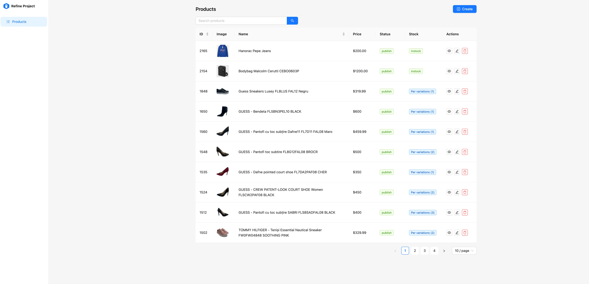

import Accordion from "../../components/widgets/Accordion.astro";
import Notice from "../../components/widgets/Notice.astro";
import ListCheck from "../../components/widgets/ListCheck.astro";
import Button from "../../components/widgets/Button.astro";
import Tabs from "../../components/widgets/Tabs.astro";
import Tab from "../../components/widgets/Tab.astro";

*Disclosure: this guide contains referral links. If you buy through them, I may earn a commission at no extra cost to you.*

A client of mine runs [bigsales.ro](https://bigsales.ro/), a WooCommerce store with a large product catalog. They kept telling me the same thing: managing products in the default WooCommerce admin is painful. Slow page loads, too many clicks to change a price, no proper mobile view, and the bulk editor barely qualifies as "bulk." So I built a modern WooCommerce admin dashboard for products, and it is now open source.

There is a timing angle here too. WooCommerce spent years shipping a block-based product editor as the "modern" replacement for the classic metabox screen, then deprecated and removed it in v11.0 (August 2026). Store owners are back to the classic editor, and third-party product management tools are newly relevant.

<Button text="Woo Admin on GitHub" link="https://github.com/bitdoze/woo-admin" variant="solid" color="purple" size="md" icon="arrow-right" />

## The problem with WooCommerce product management

If you have managed more than a handful of products in WooCommerce, you already know. The WordPress admin was designed for blog posts, and WooCommerce bolted product management on top of that. It works, but it does not work well.

To make things more interesting, WooCommerce's own attempt to fix the product editor did not stick. The block-based product editor shipped as an experimental feature, went through several iterations, and was then removed entirely in WooCommerce 11.0.0 (2026-08-04) along with its extension APIs and tooling. The classic metabox-based product editor is again the only WooCommerce product editor in wp-admin. Fixes like "product description editor alignment in the classic product editor" continue to land in the 11.x changelog, which tells you where the current investment is going. If you were waiting for WooCommerce to solve product editing for you, the window closed.

Specific pain points my client kept running into:

- Editing a single product means loading the full WordPress editor, waiting for all those metaboxes, saving, and waiting again. On the shared hosting plan they were on back in early 2026, that was 5-10 seconds per page load. (WooCommerce has shipped admin performance fixes since then, but the fundamental architecture has not changed.) If the underlying store itself is slow, [speeding up WordPress with CloudPanel Varnish cache](https://www.bitdoze.com/cloudpanel-varnish-cache/) or moving to managed WordPress hosting like [Cloudways](https://go.bitdoze.com/cloudways) helps, but it does not fix the editor UX.
- The bulk edit feature lets you change a few fields at once, but it is buried in a dropdown, the UI is cramped, and it chokes on large selections.
- No usable mobile web interface. If you need to update stock from your phone while at a warehouse, the wp-admin on a small screen is rough. The official WooCommerce mobile app has improved a lot here (more on that below), but the web admin itself is still not phone-friendly.
- Searching and filtering products is basic. You cannot sort by stock status or quickly find products missing images.
- Every plugin you add to improve the admin adds more load to an already heavy page.

## What exists out there already

Before building something custom, I went through the existing options. There are a few categories:

### WordPress plugins for bulk editing

Plugins like Smart Manager by StoreApps (9.0.0 as of Nov 2026), PBULKiT by iThemeland (Bulk Edit Products for WooCommerce, 4.1.3 as of Nov 2026), and YITH WooCommerce Bulk Product Editing add spreadsheet-style WooCommerce bulk product editing inside the WordPress admin. They work, and for simple price or stock updates they can be enough.

The downsides: they still run inside WordPress, so you inherit all the bloat. They add more PHP processing to already heavy admin pages. Some are free for basic features but lock useful stuff (like scheduled edits or variation management) behind paid tiers. And they still do not give you a fast, standalone interface.

### Hosted platforms

Shopify, BigCommerce, and similar platforms have better admin dashboards out of the box. But if you are already on WooCommerce, switching your entire e-commerce platform is not a quick fix. You picked WooCommerce for a reason (flexibility, no monthly fees, WordPress ecosystem), and those reasons probably still apply.

### Custom admin panels

A few developers have built custom React or Vue frontends that talk to the WooCommerce REST API. Most of them are abandoned or half-finished, and the ones that work are proprietary. I could not find a maintained open-source option that did the basics well.

That is what pushed me to build [Woo Admin](https://github.com/bitdoze/woo-admin).

### The official WooCommerce mobile app

The free WooCommerce mobile app (iOS, watchOS, Android, Wear OS) has come a long way. It handles product creation and editing, order management, Tap to Pay, and has WooCommerce POS built right into the app with barcode scanning, coupons, and receipts.

For quick stock tweaks from a phone, it is a real option. I would not tell anyone to ignore it.

Where it falls short for my client's workflow: desktop bulk operations on a large catalog. The app is designed for quick single-item edits and order processing, not for sitting down and working through 200 products in a sortable table with inline price editing. That is the gap Woo Admin fills. If your main pain is "update prices in bulk from my laptop," a dedicated web dashboard still wins. If your main pain is "check stock from the warehouse floor," the official app might be all you need.

## What Woo Admin does

Woo Admin is a standalone React WooCommerce admin dashboard that connects to your store through the REST API. It runs in its own Docker container, completely separate from WordPress, so your store does not get any heavier.

The current feature set covers the product editing workflows that wp-admin handles worst, especially WooCommerce bulk product editing on large catalogs:

<ListCheck>
<ul>
<li>Browse products with server-side pagination and search</li>
<li>Desktop table view with sorting, plus a card layout on mobile</li>
<li>Create, edit, and delete products</li>
<li>Manage pricing (regular and sale prices) with flexible decimal input</li>
<li>Stock management: toggle tracking, set quantity, update status</li>
<li>Product type support: simple, variable, and external products</li>
<li>Image upload to WordPress and URL-based image management</li>
<li>Category assignment with hierarchical display</li>
<li>Global attribute management and term creation</li>
<li>Full variation CRUD for variable products</li>
<li>Product status control (published, draft, pending, private)</li>
<li>Mobile-friendly interface that works on a phone</li>
</ul>
</ListCheck>

One limitation to set expectations: bulk operations are per-product REST calls (there is no batch endpoint usage in the current code). On a 10k+ SKU catalog, editing 50 products means 50 API calls. That is fine for day-to-day work but worth knowing before you try to mass-update your entire catalog in one sitting.

## The tech stack

The frontend is React 18 with TypeScript and Vite. I went with Ant Design for the UI components because it has solid table, form, and layout components that I did not want to build myself. On top of that, I used Refine (`@refinedev/core` + `@refinedev/antd`), which is a framework specifically for admin panels. It gives you data provider patterns and CRUD hooks, so I spent my time on WooCommerce-specific logic instead of wiring up pagination and form state for the hundredth time.

For HTTP requests I used Axios. In production, the app compiles down to static files served by Nginx, which also handles the reverse proxy to the WooCommerce API. The whole thing ships as a Docker image with a multi-stage build: Node compiles the TypeScript, then the output gets copied into a small Nginx Alpine image.

The app runs on React 18 today, and that is fine. The ecosystem has moved on since I built it though. Here is where things stood as of November 2026:

| Package | Repo pins | Latest (Nov 2026) |
|---|---|---|
| react / react-dom | ^18.2.0 | 19.3.1 |
| antd | ^5.0.0 | 6.7.0 |
| @refinedev/core | ^4.0.0 | 5.0.12 |
| vite | ^5.0.0 | 8.3.8 |
| react-router-dom | ^6.20.0 | 7.18.5 |

If you are thinking about upgrading: Refine 5 now requires `@tanstack/react-query` (it did not before), and `@refinedev/antd` still peers on antd 5.x. So antd 6 is not a drop-in upgrade alongside Refine's antd integration today. Do not assume a `npm update` will get you there cleanly.

<Notice type="warning" title="Node 20 in the Dockerfile is EOL">
  The Dockerfile build stage uses `node:20-alpine`. Node 20 reached end-of-life (last release v20.20.2, March 2026). If you build the image yourself, bump it to `node:24-alpine` (current LTS) or `node:22-alpine` (maintenance LTS). This is a one-line change in the Dockerfile and worth doing for security updates.
</Notice>

## How it connects to WooCommerce

The app talks to the WooCommerce REST API (v3) and the WordPress REST API (for media uploads). The wc/v3 integration is still the current REST API version per the official docs as of Nov 2026. There are two connection modes:

```
Proxy mode (recommended)              Direct API mode
─────────────────────────             ─────────────────────────
Browser                               Browser
  │                                     │
  ├─ /api/wc/* ──► Nginx container ──►  ├─ /api/wc/* ──► your-store.com
  ├─ /api/wp/* ──► (injects auth)  ──►  ├─ /api/wp/* ──► (direct, CORS
  │                                     │                  required)
  ▼                                     ▼
Credentials stay on the server        Credentials in browser requests
```

### Proxy mode (recommended)

In proxy mode, the frontend makes requests to relative paths like `/api/wc` and `/api/wp`. The Nginx container sitting in front of the app proxies those to your WooCommerce site and injects authentication headers.

This is the setup I recommend because:

- Your WooCommerce API credentials never appear in browser requests
- You do not need to configure CORS on your WordPress site
- It works behind any reverse proxy (Traefik, Caddy, another Nginx)

The proxy routes look like this:

```
/api/wc/*  →  https://your-store.com/wp-json/wc/v3/*
/api/wp/*  →  https://your-store.com/wp-json/wp/v2/*
```

### Direct API mode

If you do not want to use the built-in proxy, the frontend can call the WooCommerce API directly. Set `VITE_WC_API_BASE` to your store's full API URL and provide the consumer key and secret. This requires CORS to be properly configured on your WordPress installation.

One note on WooCommerce 11.2 and 11.3 (Oct-Nov 2026): the WooCommerce team hardened REST API key authentication. Keys are now scoped to REST API requests only, and there were several fixes around key nonce handling and route handling. If your store runs the experimental Settings UI, the key management screen may look different from the classic `WooCommerce → Settings → Advanced → REST API` path. Nothing in Woo Admin breaks from this (it uses standard consumer key/secret auth through the proxy), but it is worth knowing if you are troubleshooting auth issues.

## Project structure

The codebase is small and focused:

```
src/
├── components/
│   ├── ProductAttributesInput.tsx    # Global attribute selector
│   ├── ProductCategoriesInput.tsx    # Hierarchical category picker
│   ├── ProductImagesInput.tsx        # Upload + URL image manager
│   ├── ProductVariationsManager.tsx  # Variation CRUD
│   └── ProductVariationsTable.tsx    # Variation display
├── pages/products/
│   ├── list.tsx     # Product listing with table/card views
│   ├── create.tsx   # New product form
│   ├── edit.tsx     # Edit form with variation support
│   └── show.tsx     # Product detail view
├── providers/
│   └── wooDataProvider.ts   # Custom Refine data provider
├── App.tsx          # Routing and Refine config
└── main.tsx         # React entry point
```

The custom data provider (`wooDataProvider.ts`) is where the WooCommerce-specific logic lives: normalizing payloads, formatting prices, cleaning up image objects, and mapping between how Refine expects data and how the WooCommerce API works.

### Price normalization

One thing that tripped me up early: WooCommerce is picky about price formats in the API, and users type prices in all kinds of ways. The data provider normalizes prices before sending them:

- Accepts both `.` and `,` as decimal separators
- Strips currency symbols and whitespace
- Rounds to two decimal places
- If someone fills in only the sale price, it gets promoted to the regular price (a common mistake)

## How to deploy it

### Prerequisites

<ListCheck>
<ul>
<li>A WooCommerce store (3.5+) on WordPress 4.4+ with pretty permalinks enabled. Plain permalinks will not work with the REST API. Go to <code>Settings → Permalinks</code> and pick anything other than "Plain".</li>
<li>WooCommerce API keys with read/write permission (go to <code>WooCommerce → Settings → Advanced → REST API</code>)</li>
<li>Docker and Docker Compose on your server. If you have not already, [install Docker and Docker Compose on your server](https://www.bitdoze.com/install-docker-ubuntu-arm/)</li>
<li>Optionally, a WordPress application password for media uploads</li>
<li>Node 20+ if you want to run the dev server locally (Node 24 is the current LTS)</li>
</ul>
</ListCheck>

The dashboard is a tiny static Nginx container with no database and no PHP. It runs fine on a 1-2 vCPU VPS alongside your store. A [Hetzner Cloud](https://go.bitdoze.com/hetzner) CX22-class box (or anything similar in the $5-10/mo range) is plenty.

The app targets the wc/v3 REST API, which is the current WooCommerce REST integration as of Nov 2026. I have not done a formal compatibility matrix against every WooCommerce 11.x point release.

### Step 1: Clone the repo

```bash
git clone https://github.com/bitdoze/woo-admin.git
cd woo-admin
```

### Step 2: Create your .env file

<Tabs>
<Tab name="Proxy mode (recommended)">

```env
VITE_WC_API_BASE=/api/wc
VITE_WC_URL=https://your-store.com
VITE_WC_CONSUMER_KEY=ck_your_key_here
VITE_WC_CONSUMER_SECRET=cs_your_secret_here
VITE_WP_USERNAME=your_wp_user
VITE_WP_APP_PASSWORD=your_app_password
ACCESS_PASS=pick_a_strong_password
```

`VITE_WC_API_BASE=/api/wc` tells the frontend to use relative paths. The Nginx container proxies those to `VITE_WC_URL` and injects the auth headers. Credentials never reach the browser.

</Tab>
<Tab name="Direct mode">

```env
VITE_WC_API_BASE=https://your-store.com/wp-json/wc/v3
VITE_WC_CONSUMER_KEY=ck_your_key_here
VITE_WC_CONSUMER_SECRET=cs_your_secret_here
VITE_WP_USERNAME=your_wp_user
VITE_WP_APP_PASSWORD=your_app_password
ACCESS_PASS=pick_a_strong_password
```

`VITE_WC_API_BASE` is the full API URL. No `VITE_WC_URL` needed (there is no proxy). Requires CORS configured on WordPress. See [Troubleshooting](#troubleshooting) if you hit CORS errors.

</Tab>
</Tabs>

<Notice type="warning" title="Protect your dashboard">
  Always set `ACCESS_PASS`. Without it, anyone who finds the URL can manage your products. The dashboard uses HTTP Basic Auth with username `admin` and whatever password you set here. If you run Traefik in front of it, make sure the `Authorization` header is forwarded. See the [Traefik basic authentication guide](https://www.bitdoze.com/traefik-basic-authentication/).
</Notice>

### Step 3: Create the Docker network and start the container

```bash
docker network create web
docker compose up -d --build
```

That builds the frontend, packages it into an Nginx container, and starts serving. The entrypoint script generates the runtime configuration and Nginx proxy config automatically from your environment variables.

Quick sanity check: `docker compose logs woo-admin | tail -20` should show the entrypoint writing `env.js` and the Nginx config. If those lines are missing, something is wrong with your environment variables.

### Step 4: Set up a reverse proxy

The container exposes port 80 internally. Put it behind your existing reverse proxy (Traefik, Caddy, Nginx) with SSL termination. If you are setting up Traefik from scratch, see my [Traefik reverse proxy in Docker setup guide](https://www.bitdoze.com/traefik-proxy-docker/). If you are running Docker apps with a panel, you can check my guide on [deploying Docker Compose apps with Dokploy](https://www.bitdoze.com/dokploy-docker-compose-app/).

If you have WordPress running in Docker too, check out my [WordPress Docker installation guide](https://www.bitdoze.com/install-wordpress-docker/) for the full setup.

### Step 5: Verify it works

Do not skip this. Three quick checks before you call it done:

```bash
# 1. Container logs show env.js + nginx config rendered
docker compose logs woo-admin | tail -20

# 2. Proxy path works through Basic Auth (should return JSON product list)
curl -u admin:'your_access_pass' https://dash.example.com/api/wc/products?per_page=1

# 3. WordPress media proxy reachable (needs VITE_WP_* creds)
curl -u admin:'your_access_pass' https://dash.example.com/api/wp/media?per_page=1
```

<Notice type="success" title="Expected result">
  All three checks pass: logs show config written, the products curl returns a JSON array, and the media curl returns a JSON array (or empty array). Open the dashboard URL in a browser, log in with `admin` / your `ACCESS_PASS`, and confirm the product table loads.
</Notice>

If `/api/wc` returns 503, the proxy inputs (`VITE_WC_URL` + consumer key/secret) were missing when the container started. The entrypoint fell back to the no-proxy Nginx config. Fix your `.env` and run `docker compose up -d` again (the config is regenerated at every start). More failure modes below.

## Troubleshooting

If `/api/wc` or `/api/wp` returns 503, proxy environment variables are missing at container start. The entrypoint detects no `VITE_WC_URL` and renders the fallback `nginx.no-proxy.conf`, which has no upstream to proxy to. Fix: set `VITE_WC_URL` and the consumer key/secret in `.env`, then `docker compose up -d` again. The config is regenerated every time the container starts, so you do not need to rebuild.

A 401/403 from upstream (the WooCommerce API) means the consumer key or secret is wrong, or the key was created without read/write permission. Go to `WooCommerce → Settings → Advanced → REST API` and recreate the keys with both read and write permissions. On WooCommerce 11.2+, key auth was hardened and scoped to REST API requests, so make sure you are using the standard key/secret pair and not some legacy auth method.

A 404 from the REST API, or an API that is unreachable at all, means pretty permalinks are not enabled. This is the classic gotcha. The WooCommerce REST API requires pretty permalinks. Go to `Settings → Permalinks`, pick anything other than "Plain", and save.

CORS errors in direct API mode are expected. Direct mode calls your store's API from the browser, so WordPress must send CORS headers. Either configure CORS on WordPress or switch to proxy mode (which avoids CORS entirely).

If the Basic Auth prompt loops or the dashboard itself returns 401, `ACCESS_PASS` is set but your reverse proxy is stripping the `Authorization` header before it reaches the Nginx container. Some proxies do this by default. Fix: configure the proxy to forward the `Authorization` header. If you use Traefik, see the [Traefik basic authentication guide](https://www.bitdoze.com/traefik-basic-authentication/). Remember the dashboard username is always `admin`.

If image upload fails, `VITE_WP_USERNAME` or `VITE_WP_APP_PASSWORD` is missing, or the application password does not have media upload capability. The container falls back to the WooCommerce key/secret for the `/api/wp` routes in this case, and the WC keys may not have permission to upload media. Create a WordPress application password for a user who can upload files.

## Running it in production

The dashboard has zero state. It is a static Nginx Alpine container with no database, no PHP, and nothing to back up. The store behind it still needs backups though. Check my roundup of [free WordPress backup plugins](https://www.bitdoze.com/best-free-wordpress-backup-plugins/) if you have not set those up yet.

Updates are straightforward: `git pull && docker compose up -d --build`. If you are managing Docker stacks with Dokploy, see [how to update Docker Compose stacks](https://www.bitdoze.com/dokploy-update-docker-compose/). And if you bumped the Node base image per the tech stack note above, keep that change handy since `git pull` will revert the Dockerfile.

For secrets, `.env` holds the consumer key/secret and `ACCESS_PASS`. It is loaded into the container via `env_file`, so treat it like a secret. Do not commit it to a public repo. If `ACCESS_PASS` leaks, rotate it. For more on this, see [secure Docker Compose secrets handling](https://www.bitdoze.com/docker-compose-secrets/).

On hardening, keep it behind HTTPS at your reverse proxy (always). Optionally IP-restrict the dashboard at the proxy level since it is pure admin surface. The host firewall matters too. See [how I secured my Docker server](https://www.bitdoze.com/bsi-security-report-docker-ufw/) for a practical walkthrough.

To remove it entirely, run `docker compose down` and drop the `web` network if nothing else uses it. Nothing on your WooCommerce store changes when you do.

<ListCheck>
<ul>
<li>HTTPS at the reverse proxy (non-negotiable)</li>
<li>Strong <code>ACCESS_PASS</code> set and rotated periodically</li>
<li>IP restriction at the proxy if your team has static IPs</li>
<li>WooCommerce API keys scoped to the dashboard user only</li>
<li>Container image kept updated (<code>git pull && docker compose up -d --build</code>)</li>
</ul>
</ListCheck>

## Local development

If you want to contribute or customize it for your store:

```bash
npm ci
npm run dev
```

The dev server starts on port 3000. Create a `.env` file with your store credentials and the app connects directly to your WooCommerce API. Make sure your store has CORS headers configured for `localhost:3000`, or use proxy mode. Node 20+ works; Node 24 is the current LTS as of Nov 2026.

```bash
npm run build      # Production build
npm run preview    # Preview the production build locally
```

## What the dashboard looks like in practice





My client's main complaint was "I just want to see my products and change a price without waiting 10 seconds." So the product list is the first thing you see. On desktop it is a sortable table with image thumbnails, stock badges, and action buttons. On a phone it switches to cards, which is the part my client uses most since they check stock from their warehouse.

The edit form groups related fields together instead of scattering them across metaboxes like WooCommerce does. Pricing is near the top, then stock, then categories and attributes, then images, then variations. Each section fetches data on demand, so the form does not choke even with thousands of products in the catalog.

One detail I am happy with: category assignment shows the full path (like "Electronics > Phones > Smartphones") so you immediately know where a product sits. In the default WooCommerce editor, nested categories are just indented checkboxes that get confusing past two levels.

## Frequently asked questions

<Accordion label="Does this work with WooCommerce 11.x?" group="faq" expanded="true">
  Yes. Woo Admin targets the wc/v3 REST API, which remains the current WooCommerce REST integration as of Nov 2026. WooCommerce 11.0 removed the block product editor from wp-admin, but that is an admin UI change only. The REST API is unaffected and has expanded, if anything. The 11.2+ REST key-auth hardening (keys scoped to REST API requests) is transparent to Woo Admin since it uses standard consumer key/secret authentication through the proxy.
</Accordion>

<Accordion label="Does this replace the WordPress admin entirely?" group="faq">
  No. Woo Admin focuses on product management only. You still need the WordPress admin for orders, customers, settings, shipping, taxes, and everything else WooCommerce does. Think of it as a dedicated tool for the one task that the default admin handles poorly.
</Accordion>

<Accordion label="Can multiple people use the dashboard at the same time?" group="faq">
  Yes. Each user session talks to the WooCommerce API independently. There is no server-side session state. Just be aware that if two people edit the same product simultaneously, the last save wins.
</Accordion>

<Accordion label="Will this slow down my WooCommerce store?" group="faq">
  No. The dashboard runs in its own container and only talks to the WooCommerce REST API. It does not add any PHP code, plugins, or database queries to your store. The REST API calls are the same ones any external integration would make.
</Accordion>

<Accordion label="How does it handle really large catalogs (10k+ products)?" group="faq">
  The product list uses server-side pagination and search, so browsing stays fast regardless of catalog size. Individual edits are single REST calls, which is fine. Bulk operations are per-product calls though (no batch endpoint in the current code), so mass-updating 50 products on a 10k SKU catalog means 50 requests. Fine for daily work; set expectations for big batch jobs.
</Accordion>

<Accordion label="Can I run this without Docker?" group="faq">
  You can build the static files with `npm run build` and serve the `dist/` folder from any web server. You will need to configure the proxy yourself (or use direct API mode). Docker just makes the deployment and proxy setup turnkey.
</Accordion>

<Accordion label="Is it secure?" group="faq">
  In proxy mode, WooCommerce API credentials stay on the server. They never reach the browser. The optional `ACCESS_PASS` adds HTTP Basic Auth to the dashboard itself, so random people cannot stumble into it. For production, always run it behind HTTPS. If you run Traefik, see the [Traefik basic authentication guide](https://www.bitdoze.com/traefik-basic-authentication/) for forwarding the Authorization header.
</Accordion>

<Accordion label="What about orders and customers?" group="faq">
  Not yet. The current version is product-focused. Orders and customer management are on the radar but not in active development right now. If you want to contribute, the repo is open.
</Accordion>

## What is next

The repo is at [github.com/bitdoze/woo-admin](https://github.com/bitdoze/woo-admin) under the MIT license. It has been stable since launch and I am running it in production for [bigsales.ro](https://bigsales.ro/). My client stopped complaining about product management, which I consider a success.

The repo has not needed changes since the initial release. If you find a bug or want to add a feature, issues and pull requests are welcome.

If your WooCommerce admin dashboard is as frustrating as mine was, clone the repo and try it. A single `docker compose up` and you are in.

<Button text="Get Woo Admin on GitHub" link="https://github.com/bitdoze/woo-admin" variant="solid" color="purple" size="md" icon="arrow-right" />
