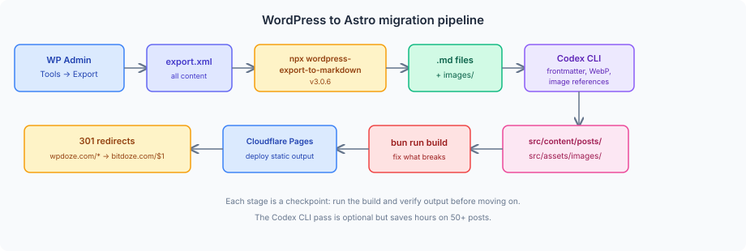
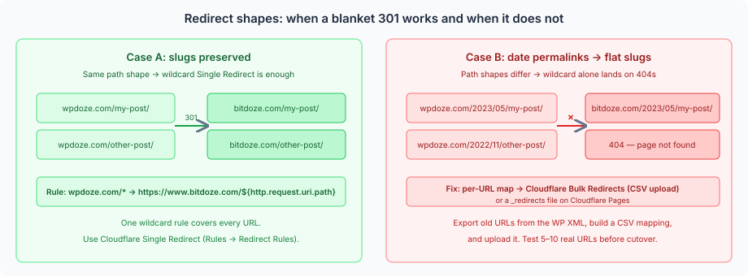

import Accordion from "../../components/widgets/Accordion.astro";
import Notice from "../../components/widgets/Notice.astro";
import ListCheck from "../../components/widgets/ListCheck.astro";
import Tabs from "../../components/widgets/Tabs.astro";
import Tab from "../../components/widgets/Tab.astro";

I had been putting off migrating my WordPress site to Astro and MDX for months. I had a WordPress blog at [wpdoze.com](https://www.wpdoze.com) with a bunch of old articles that I wanted to move over to [bitdoze.com](https://www.bitdoze.com), which runs on Astro with MDX. I figured it would be painful. Turns out it was not that bad, and I want to share what I did so you can skip the trial-and-error part.

<Notice type="info" title="What changed since I first wrote this (updated Nov 2026)">
  <ul>
    <li>Astro content collections now use loaders defined in <code>src/content.config.ts</code> (Astro 5+ Content Layer, current in Astro 7). The old <code>src/content/config.ts</code> schema-only pattern is legacy.</li>
    <li>Cloudflare Page Rules are deprecated. Use Redirect Rules (Single Redirects and Bulk Redirects) instead. They take precedence over any remaining Page Rules.</li>
    <li>Astro can now encode images (AVIF/WebP) at build time from <code>src/assets/</code>, so pre-converting with <code>cwebp</code> is optional. I still do it to keep Git repos small, but you do not have to.</li>
  </ul>
</Notice>

## Why I left WordPress

WordPress works. Millions of sites run on it for good reason. But my site was just static articles, and I was still paying for hosting, babysitting plugin updates, and watching page load times get worse. Astro generates plain HTML files, so pages load instantly with no database or PHP involved. Hosting on Cloudflare Pages costs zero dollars. And I get to write in MDX files in a Git repo instead of fighting the block editor. That was enough for me.

If you are new to Astro, I have a guide on [how to build a free blog with Astro and Cloudflare](https://www.bitdoze.com/build-astro-blog-free/), and there is also my list of [the best Astro.js online courses](https://www.bitdoze.com/best-astrojs-online-courses/) if you prefer video. If you are still on the fence, my [Astro vs WordPress cost and ops breakdown](https://www.bitdoze.com/astro-vs-wordpress/) goes deeper into the monthly bill and maintenance trade-offs.

## What the migration looked like

Here is the WordPress to Astro migration pipeline end to end:



The short version:

1. Exported everything from WordPress (posts, pages, images)
2. Converted the XML export to Markdown files
3. Used Codex CLI from OpenAI to automate the boring parts: image conversion, frontmatter formatting, fixing image references
4. Built the Astro project and fixed what broke
5. Redirected the old domain to the new one

I will walk through each step.

### What you need first

<ListCheck>
<ul>
<li>WordPress admin access (Tools → Export) and the site still live; the converter downloads images from your live site</li>
<li>Node.js and npx on your machine (<code>wordpress-export-to-markdown</code> v3.0.6 at time of writing)</li>
<li>An Astro project with MDX, or build one after. See my <a href="https://www.bitdoze.com/build-astro-blog-free/">free Astro blog guide</a></li>
<li>A full backup of the WordPress site before you touch anything</li>
<li>Access to DNS/CDN settings for the old domain (for 301 redirects later)</li>
</ul>
</ListCheck>

## Step 1: Export your WordPress content

WordPress has a built-in export tool. Go to **Tools → Export** in your admin panel and export **All content**. You get an XML file with all your posts, pages, categories, tags, and image references.

A few things worth knowing:

- The export has image URLs but not the actual files. The converter in the next step downloads them for you.
- Custom post types or ACF fields might need extra handling. For a regular blog, the default export is enough.
- Back up your site first. There are plenty of [free WordPress backup plugins](https://www.bitdoze.com/best-free-wordpress-backup-plugins/) if you do not have one. You probably will not need the backup, but you will sleep better.

<Notice type="info" title="Before you start">
  Make sure your WordPress site is still accessible during the migration. The markdown converter needs to download images from your live site.
</Notice>

**Verify**: open the XML file and confirm it contains `<item>` entries before moving on. If the file is empty or truncated, the export did not work.

**Failure mode**: exports of very large sites can time out in the WordPress admin. If the download dies halfway, export by content type or date range instead of everything at once.

## Step 2: Convert WordPress XML to Markdown

To convert WordPress to Markdown, [wordpress-export-to-markdown](https://github.com/lonekorean/wordpress-export-to-markdown) is the tool to use. It is a Node.js CLI that reads your XML export and spits out Markdown files with frontmatter. It also downloads all the images.

### Install and run

```bash
npx wordpress-export-to-markdown
```

The tool walks you through an interactive setup: where the XML file is, where to put the output, how to handle images. I saved images, skipped year/month folders (wanted a flat structure to reorganize later), and excluded drafts.

Latest release at time of writing is v3.0.6 (July 2026). Pin it if you want reproducibility across runs:

```bash
npx wordpress-export-to-markdown@3.0.6 \
  --frontmatter-fields=title,date,slug,categories,tags,coverImage,excerpt \
  --post-folders=false --date-folders=none
```

The `--frontmatter-fields` flag lets the converter emit slug, cover image, excerpt, categories, and tags directly into the frontmatter. That cuts down the AI cleanup pass in Step 3 considerably. The wizard honors the same options if you prefer the interactive route. Flags are there for scripting and repeatability.

When it finishes, you have a folder of `.md` files and a directory with all the images.

**Verify**: `ls output/` (or wherever you pointed it) shows `.md` files and a populated `images/` directory. Spot-check one file's frontmatter to confirm the fields you asked for are there.

### What the output looks like

Each post becomes a Markdown file with frontmatter. If you ran the converter with default settings, you get title and date. With `--frontmatter-fields`, you get much more:

```markdown
---
title: "Your Post Title"
date: "2023-05-15"
slug: "your-post-slug"
categories: ["tutorials"]
tags: ["wordpress", "astro"]
coverImage: "images/your-image.png"
excerpt: "First paragraph of the post..."
---

Your post content here with images referenced like:

```

What still needs the AI pass: description text (the meta description, not the excerpt), canonical URLs pointing to the new domain, and category normalization if your WordPress categories were a mess. That is where Codex CLI came in.

## Step 3: Let AI handle the grunt work

This step saved me hours. I used [Codex CLI from OpenAI](https://github.com/openai/codex) to handle the repetitive file-by-file changes that I was not going to do by hand for 50+ articles. The pattern is what matters: let a coding agent do the bulk edits, then review the diff. Codex CLI, Claude Code, or any similar tool works. I used Codex because it was what I had open.

<Notice type="info" title="Affiliate disclosure">
  Some links below are affiliate links. I only recommend tools I use or that fit the workflow described here.
</Notice>

If you run multiple coding agents, [Agent Router](https://go.bitdoze.com/agentrouter) gives you one access layer for Codex, Claude Code, and Gemini CLI. Not required, but useful if you switch between them.

### Convert images to WebP

The WordPress export had a mix of PNG and JPEG files, many of them oversized. There are two ways to handle this.

<Tabs>
<Tab name="Path A: pre-convert with cwebp (what I did)">
Batch-convert everything to WebP before it enters the Astro project. This keeps source assets small in Git, which matters if you are pushing hundreds of images to a repo:

```bash
# Converting all PNG/JPEG images to WebP format
for img in images/*.{png,jpg,jpeg}; do
  cwebp -q 80 "$img" -o "${img%.*}.webp"
done
```

WebP files run about 25-35% smaller than equivalent JPEGs at similar quality. Across a whole blog, that is a lot of bandwidth saved. AVIF is typically smaller still, but WebP has broader tooling support and I did not want to fight edge cases during a migration.

After this step, you also need to update image references in the Markdown files (see the next subsection).
</Tab>
<Tab name="Path B: let Astro encode at build">
Skip the manual conversion entirely. Drop the original PNG/JPEG files into `src/assets/`, use the `image()` frontmatter helper or the `<Image />` component, and Astro's default Sharp image service will encode them to optimized AVIF/WebP at build time.

This is the documented Astro behavior with the default image service. It also means you can skip the "update image references" step below. You keep the original filenames and Astro handles the format conversion in the output.

<Notice type="warning" title="Honest note">
  I have not run Path B end-to-end on this site. It is the documented Astro image pipeline behavior, not a personal test. If your project sets custom <code>image.service</code> options, check those first.
</Notice>
</Tab>
</Tabs>

### Update image references

Only needed for Path A. After converting images, all the Markdown files still pointed to `.png` and `.jpg` filenames. Codex CLI went through every file and swapped the extensions:

```markdown
<!-- Before -->


<!-- After -->

```

If you took Path B and let Astro encode at build, skip this entirely.

### Format frontmatter for Astro

My Astro site uses a Zod-validated frontmatter schema. If you ran the converter with `--frontmatter-fields` back in Step 2, half of this is already done. What remains is the description text, canonical URL, and any category cleanup:

```yaml
---
date: 2023-05-15T00:00:00Z
title: "Your Post Title"
description: "A brief description pulled from the first paragraph"
image: "../../assets/images/your-post/featured.webp"
categories: ["cms"]
authors: ["Dragos"]
tags: ["wordpress", "tutorials"]
canonical: "https://www.bitdoze.com/your-post-slug/"
---
```

### Move images to the right place

Astro optimizes images best when they live in `src/assets/` rather than `public/`. Codex CLI moved each post's images into the right directory structure:

```
src/assets/images/
  └── post-slug/
      ├── featured.webp
      └── screenshot-1.webp
```

<Notice type="success" title="Codex CLI was the real time-saver">
  Without it, I would have spent a full day just on image conversion, reference updates, and frontmatter formatting. Codex handled all of it in minutes. I just reviewed the output and fixed the occasional mistake. The whole AI pass is minutes of tool time. No paid API beyond whatever coding-agent subscription you already have.
</Notice>

## Step 4: Set up your Astro content collection

If you do not have an Astro site yet, go set one up first. My [free Astro blog guide](https://www.bitdoze.com/build-astro-blog-free/) covers that.

Astro content collections define what fields your posts need and validate them at build time. Since Astro 5 (the Content Layer), collections live in **`src/content.config.ts`** and require a loader. Pre-Astro-5 projects used `src/content/config.ts` without loaders. If you see both patterns in tutorials, that is why. The config below is written against Astro 7.x-era content collections (this site runs Astro 7.4).

```typescript
// src/content.config.ts
import { defineCollection } from "astro:content";
import { glob } from "astro/loaders";
import { z } from "astro/zod";

const posts = defineCollection({
  loader: glob({ pattern: "**/*.{md,mdx}", base: "./src/content/posts" }),
  schema: ({ image }) =>
    z.object({
      date: z.coerce.date(),
      title: z.string(),
      description: z.string().optional(),
      image: image().optional(),
      categories: z.array(z.string()).optional(),
      authors: z.array(z.string()).optional(),
      tags: z.array(z.string()).optional(),
      canonical: z.string().optional(),
    }),
});

export const collections = { posts };
```

The `({ image })` schema context gives you the `image()` helper for optimized image references in frontmatter. `z.coerce.date()` handles the fact that frontmatter dates arrive as strings through the glob loader.

Put your converted MDX files in `src/content/posts/` and images in `src/assets/images/`.

## Step 5: Build and fix what breaks

Run your Astro build to see what is broken:

```bash
bun run build
```

Things that tripped me up:

- Broken image paths where the reference in the MDX file did not match the actual file location
- Invalid frontmatter that Astro's Zod validation rejected (it tells you exactly which field in which file, which is nice)
- HTML from WordPress that MDX did not like, mostly unclosed tags and unescaped special characters
- Missing component imports at the top of MDX files

One more: stale `node_modules` after switching Node or Bun versions causes phantom build errors. Reinstall dependencies before you start debugging the build itself.

I ran the build after each batch of changes, so when something broke I knew what I had just touched. Codex CLI also helped here by reading the build error output and fixing the problems automatically.

## Step 6: Deploy and redirect

Once the build passes, deploy. I use Cloudflare Pages and wrote a [guide on deploying Astro to Cloudflare](https://www.bitdoze.com/deploy-astrojs-cloudflare/) if that is your setup too. You can also [deploy Astro on a VPS](https://www.bitdoze.com/deploy-astro-on-vps/) with a budget VPS like [Hetzner](https://go.bitdoze.com/hetzner) if you prefer managing your own server, or [deploying Astro to Bunny.net](https://www.bitdoze.com/deploy-astro-bunny-net/) with [Bunny.net](https://go.bitdoze.com/bunny) if you want an edge CDN in front of the static files.

### Set up domain redirects

The last piece: redirect your old domain. I pointed `wpdoze.com` at `bitdoze.com`. Cloudflare Page Rules are deprecated at this point. Use **Redirect Rules** instead. Modern Rules take precedence over any old Page Rules you might have lying around.

Here is what a Single Redirect looks like in the Cloudflare dashboard (Rules → Redirect Rules → Create rule → "Redirect from domain to domain" template):

```
Single Redirect (wildcard pattern)
  When: Hostname equals wpdoze.com
  Then: Dynamic redirect to https://www.bitdoze.com/${http.request.uri.path}, 301
```

That wildcard works when your URL shapes match between old and new site. If your WordPress site used date permalinks (`/2023/05/slug/`) and your Astro site uses flat slugs (`/slug/`), the blanket rule will land old deep links on 404s. You need a per-URL map in that case.



For per-URL redirects: [export your WordPress post URLs and titles](https://www.bitdoze.com/export-wordpress-post-urls-titles/) from the XML or a crawl, build a CSV mapping old paths to new ones, and upload it to **Cloudflare Bulk Redirects** (CSV upload). If you are on Cloudflare Pages, a `_redirects` file in your deploy output works too.

<Notice type="warning" title="Don't skip the redirects">
  301 redirects tell search engines that your content has permanently moved. Without them, you lose whatever SEO value your old domain had built up, and visitors hitting old bookmarks or search results get a dead page. Test the wildcard against 5-10 real old URLs before you decommission anything.
</Notice>

### Verify the move

Do not assume the redirects work. Check them:

```bash
# 1. Redirects answer 301 (not 302, not 200)
curl -sI https://wpdoze.com/some-old-slug/ | grep -iE '^(HTTP|location)'

# 2. Sitemap present on the new site
curl -s https://www.bitdoze.com/sitemap-index.xml | head

# 3. Spot-check migrated posts render with images
curl -s https://www.bitdoze.com/your-post-slug/ | grep -c '
<ul>
<li>Run the build after every major change, not just at the end. It is much easier to find the problem when you know what you just changed.</li>
<li>Use WebP (or AVIF) for all images. The size savings are real and Astro handles them well.</li>
<li>Do not try to manually edit hundreds of files. Use AI tooling like Codex CLI or scripts to handle bulk changes.</li>
<li>Keep your old WordPress site running until you have verified everything works on the new site. Do not rush to take it down.</li>
<li>Check your analytics after the migration. See the "Verify the move" section above for the concrete checks. File a Change of Address in Google Search Console for domain moves.</li>
<li>Decide on wildcard vs per-URL redirects before cutover. If your URL shapes changed, a blanket 301 will 404 on old deep links. See Step 6.</li>
<li>Redirect or intentionally 404 <code>/feed/</code> URLs, attachment pages, and archive pagination (<code>/page/2/</code>). They are commonly deep-linked and die silently in migrations.</li>
<li>Lower the DNS TTL on the old domain a day before the switch so rollback is fast if something goes wrong.</li>
</ul>
</ListCheck>

The WordPress site is your rollback. Nothing is destroyed by the migration. If the new site breaks, you point DNS back. Do not decommission WordPress until the link crawler comes back clean. Also worth knowing: zero hosting on Cloudflare Pages free tier means zero *hosting*, not zero everything. Domain renewals and any third-party services still cost money (more on that in the Wrapping up section).

## After the migration

Once your content is over, a few things are worth doing:

- I wrote a guide on [Astro SSG build optimization](https://www.bitdoze.com/astro-ssg-build-optimization/) because large sites can get slow to build. Worth reading if you have more than a handful of posts. There are also [Astro 7 build speed benchmarks](https://www.bitdoze.com/astro-7-faster-builds/) if you want to see what the latest major version buys you.
- If you are on Node.js, [switching to Bun](https://www.bitdoze.com/migrate-astro-bun/) cut my build times down noticeably.
- You will probably want a [contact form](https://www.bitdoze.com/add-contact-form-astro/) at some point.
- For analytics, I use Plausible proxied through Cloudflare Workers. I wrote up [how to set that up](https://www.bitdoze.com/astro-plausible-cloudflare-workers/).
- If raw MDX is not your thing and you want a CMS UI, here are the [headless CMS options for Astro](https://www.bitdoze.com/best-headless-cms-for-astro/) worth considering.

## Frequently asked questions

<Accordion label="How long does the whole migration take?" group="faq" expanded="true">
  Depends on how many posts you have. My site had around 50 articles and the whole thing took about a day. Most of that time went to reviewing what Codex CLI produced and fixing edge cases. The actual export and conversion was maybe an hour.
</Accordion>

<Accordion label="Do I need to know TypeScript to use Astro?" group="faq">
  No. Plain JavaScript works fine in Astro components. TypeScript is optional, though I recommend it for content collection schemas because it catches frontmatter mistakes at build time. The Zod schema definitions are readable even if TypeScript is new to you.
</Accordion>

<Accordion label="What about WordPress comments?" group="faq">
  Astro is a static site generator, so there is no built-in comment system. You can bolt on Giscus (uses GitHub Discussions), Disqus, or Hyvor Talk. Personally, I dropped comments entirely. Most of mine were spam.
</Accordion>

<Accordion label="Will I lose my SEO rankings?" group="faq">
  With proper 301 redirects, rankings should carry over. I saw a small dip for about two weeks while Google reprocessed things, then it recovered. The faster page loads from Astro helped my rankings afterward. For domain-level moves, file a Change of Address in Google Search Console and submit your new sitemap. I use [SEO Gets to track Search Console and GA4 data](https://www.bitdoze.com/seo-gets-tool/) so I can watch the recovery in one place.
</Accordion>

<Accordion label="Can I use this process for a WooCommerce site?" group="faq">
  For the content parts (blog posts, pages), yes. But if you have a WooCommerce store with products, cart, and checkout, Astro alone will not replace that. You would need a headless commerce layer like Snipcart or Shopify's Storefront API alongside Astro.
</Accordion>

<Accordion label="What if my posts use WordPress shortcodes?" group="faq">
  Shortcodes do not convert. The markdown exporter dumps them as plain text. You will need to replace them with MDX components or just remove them. I used Codex CLI to find all shortcodes across my files and convert the common ones into MDX equivalents. YouTube embeds are the most common leftover. Here is [how to embed YouTube videos in Astro](https://www.bitdoze.com/add-youtube-videos-astro-blog/).
</Accordion>

<Accordion label="My URLs changed shape (date permalinks to flat slugs). What do I do?" group="faq">
  A blanket domain 301 only works when path shapes match. If WordPress used date permalinks like <code>/2023/05/slug/</code> and your Astro site uses flat slugs like <code>/slug/</code>, old deep links will 404. Build a per-URL redirect map: [export your WordPress post URLs and titles](https://www.bitdoze.com/export-wordpress-post-urls-titles/), create a CSV with old path to new path, and upload it to Cloudflare Bulk Redirects (or use a <code>_redirects</code> file on Cloudflare Pages). Test 5-10 real old URLs before going live.
</Accordion>

<Accordion label="What about WordPress feeds and attachment URLs?" group="faq">
  WordPress feeds (<code>/feed/</code>), attachment pages, and archive pagination (<code>/page/2/</code>) are commonly deep-linked and die silently in migrations. Redirect <code>/feed/</code> to your new Astro RSS feed (<code>@astrojs/rss</code> generates one). Redirect attachment URLs to their parent post, or let them 404 deliberately. Just make the choice consciously instead of discovering it in your 404 logs three months later.
</Accordion>

## What should you know about wrapping up?

Moving from WordPress to Astro took a day of focused work, and I am glad I did it. My site loads faster, hosting costs went from a paid WordPress hosting bill to zero on Cloudflare Pages free tier, and writing in MDX files beats the WordPress editor for my workflow. To be clear on costs: "zero" means zero hosting. You still pay for domain renewal and any third-party services. In my case Plausible proxied through Cloudflare Workers ([how I set that up](https://www.bitdoze.com/astro-plausible-cloudflare-workers/)).

The tools that made it practical: [wordpress-export-to-markdown](https://github.com/lonekorean/wordpress-export-to-markdown) for the initial conversion, and Codex CLI for all the file-by-file reformatting I was not going to do by hand. Astro's content collections tied it all together with type-safe validation that caught mistakes at build time.

If you have been putting off migrating your WordPress site to Astro, just start with a handful of posts and see how it goes. The process is more mechanical than creative, and the tooling handles most of it.
