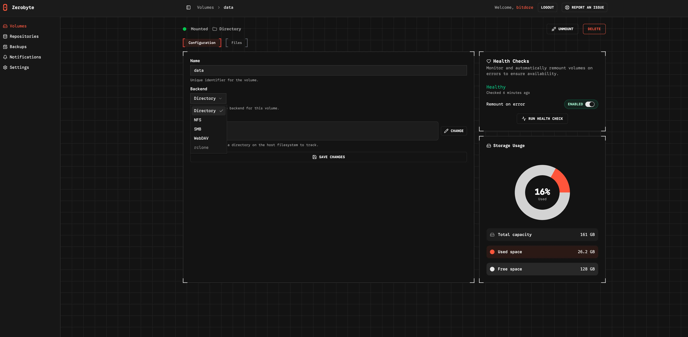
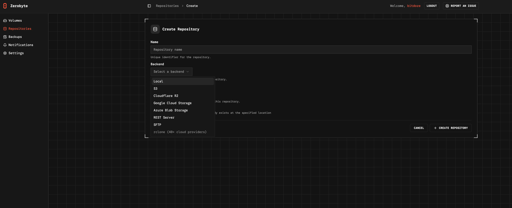
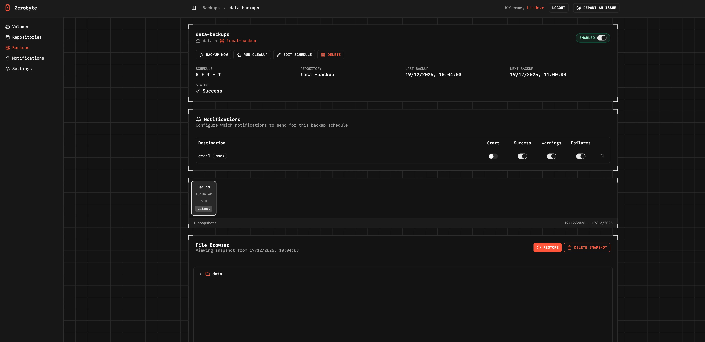
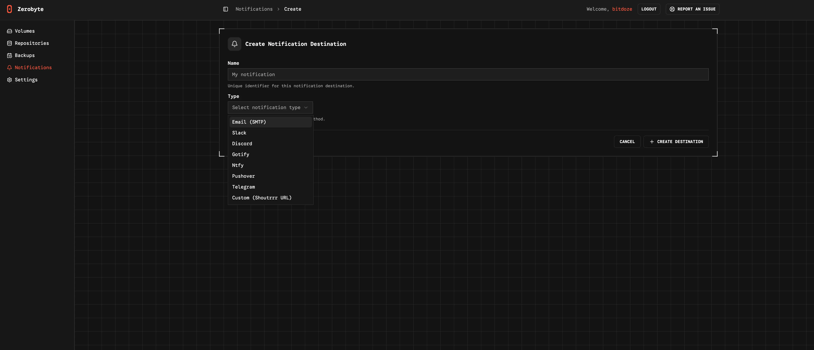

import Button from "@components/widgets/Button.astro";
import Notice from "@components/widgets/Notice.astro";
import ListCheck from "@components/widgets/ListCheck.astro";
import Accordion from "@components/widgets/Accordion.astro";
import Tabs from "@components/widgets/Tabs.astro";
import Tab from "@components/widgets/Tab.astro";
import YouTubeEmbed from "@components/widgets/YouTubeEmbed.astro";

If you run a VPS, homelab, or any Linux server, backups are the only insurance that matters. Disks fail, updates break, and mistakes happen. Zerobyte is a Restic GUI that puts a clean web dashboard on top of [Restic](https://restic.net/), so you get self-hosted backup automation without living in the terminal.

The project has moved fast. When this guide first went live the image was `v0.19`; the current stable line is `v0.43.2` with 7,000+ GitHub stars, a docs site at [zerobyte.app](https://zerobyte.app/docs), and 20+ stable releases in between. The core workflow is unchanged: volumes, repositories, scheduled jobs, retention, restores. The operational details around keys, env vars, and exposure changed a lot. This update covers the current release end to end, including the parts that will bite you if you only bump the image tag on an old stack.

## What is Zerobyte?

[Zerobyte](https://github.com/nicotsx/zerobyte) is an open-source (AGPL-3.0) backup automation platform that wraps the Restic engine with a modern dashboard. It handles repository creation, scheduling, retention, and restore workflows from a browser instead of a pile of cron jobs and shell aliases.

Think of it as a restic web UI with a scheduler attached. The heavy lifting, encryption, deduplication, repository format, still belongs to Restic. Zerobyte is the control plane on top.

### Why Restic plus Zerobyte works

| Layer | Responsibility | What you get |
| --- | --- | --- |
| Restic | Encryption, deduplication, compression, repo format | Secure and efficient backups |
| Zerobyte | Web UI, scheduling, retention, mirrors, logs | A usable control plane |

Together they give you fast, encrypted backups with a workflow you can revisit months later and still understand. If Zerobyte disappeared tomorrow, your repositories remain plain Restic repos you can read with the stock CLI and the recovery key.

### Key features

<ListCheck>

- Automated backups with retention policies powered by Restic
- End-to-end encryption by default, keys handled through a recovery-key flow
- Flexible schedules, plus on-demand "Backup now" runs without touching cron
- Automatic retries with configurable count and delay; interrupted jobs re-queued after a restart
- Multi-backend repositories: local, S3-compatible, GCS, Azure, rclone remotes
- Source volumes from local directories, NFS, SMB, WebDAV, and SFTP
- Mirror repositories for 3-2-1 setups, with backfill and sync progress in the UI
- Compression modes `off` / `auto` / `max`, with per-job override and custom Restic flags
- Browser snapshot downloads, cancellable restores, restore to a custom location
- Multi-user organizations, 2FA, passkeys, OIDC SSO, API keys with expiry
- Job logs, an Activity page for background operations, and notification health status

</ListCheck>

<Notice type="warning" title="Still 0.x, very actively developed">
Zerobyte is still in the 0.x series. A lot of releases landed in 2026 and several were breaking: new required env vars, a webhook allowlist, removed secret-reference syntax. Pin your image tag, read release notes before you upgrade, and expect the UI to move around between minor versions.
</Notice>

<YouTubeEmbed
  url="https://www.youtube.com/embed/menR-JtmgLI"
  label="ZeroByte: The Most Powerful Open-Source Backup UI"
/>

## What's changed since our first guide

If you deployed from the 2025 version of this article, here is what matters before you touch anything.

<Notice type="warning" title="Bumping only the image tag will not boot">
If you deployed from our 2025 guide: moving the image from `v0.19` to `v0.43` alone will NOT start the container. `APP_SECRET` has been required since v0.23.0 and `BASE_URL` since v0.24.0. Add both, then upgrade. See [Recovery key and APP_SECRET](#recovery-key-and-app_secret-your-actual-keys) and [How to upgrade Zerobyte safely](#how-to-upgrade-zerobyte-safely).
</Notice>

Short version of the delta:

- **Image is now `ghcr.io/nicotsx/zerobyte:v0.43`** (stable `v0.43.2` as of 2026-10-03). The old `v0.19` pin is roughly 24 stable releases behind.
- **Two required environment variables.** `APP_SECRET` (since v0.23.0) encrypts secrets stored in the database. `BASE_URL` (since v0.24.0) must be the real URL you use to open the UI; an `https://` prefix turns on Secure cookies.
- **Recovery-key model for repository passwords.** Repos created in the UI are initialized by Zerobyte with an organization-level Restic password you download once as `restic.pass`. You no longer invent that password yourself.
- **Mirror repositories.** Zerobyte now syncs a second repository for 3-2-1 setups natively. You do not need an external replication tool for the basic case.
- **`WEBHOOK_ALLOWED_ORIGINS` allowlist (v0.36.0).** Self-hosted ntfy, Gotify, generic webhooks, and custom Shoutrrr URLs need an explicit origin allowlist. Slack, Discord, Pushover, Telegram, and public ntfy.sh do not.
- **Auth stack grew up.** 2FA (v0.22), OIDC SSO with organizations (v0.30), passkeys (v0.38), API keys with expiry (v0.40), and the option to disable password login for SSO-only deployments (v0.40).
- **The image got smaller and the app got faster.** 597 MB down to 245 MB as of v0.27.0, which is also when the app moved to TanStack Start.
- **Remote agents exist, but only in alpha.** `zerobyte-agent` binaries shipped in v0.44.0-alpha.x (2026-10). Alpha, not officially supported, not for production. Same story for the desktop apps.

A note on the screenshots below: they come from the December 2025 UI. The v0.43 interface added a new sidebar and an Activity page. The workflows are the same; the chrome around them is not.

## Prerequisites

<ListCheck>

- Linux VPS or homelab box with Docker and Docker Compose installed
- **Rootful Docker.** Rootless Docker cannot perform the kernel mounts Zerobyte uses for NFS/SMB/WebDAV volumes
- 2 GB RAM is comfortable; the official performance-tuning guide shows it also runs on low-power boxes with `GOMAXPROCS` tweaks
- Local disk for `/var/lib/zerobyte` (SQLite database + keys). Avoid network shares here
- Optional: rclone on the host if you want rclone-backed repositories (the rclone binary ships inside the image; the host install is only for creating the config)
- A domain and reverse proxy if you want HTTPS, which you do
- On TrueNAS: `/var/lib` is ephemeral. Point `/var/lib/zerobyte` at a dedicated dataset or upgrades will eat your database

</ListCheck>

Verify Docker is sane before anything else:

```bash
docker info >/dev/null && echo "rootful docker OK"
```

If that fails without `sudo`, your daemon is not running or your user is not in the `docker` group. Fix that first.

<Button text="Try Hetzner Cloud Now" link="https://go.bitdoze.com/hetzner" variant="solid" color="blue" size="lg" external={true} icon="rocket-launch" />
<Button text="Try Hostinger VPS" link="https://go.bitdoze.com/hostinger-vps" variant="solid" color="green" size="lg" external={true} icon="rocket-launch" />

_VPS prices jumped across the board in 2026. If you're rethinking a rented box, see [what changed and when a mini PC wins](/vps-price-increases/). If a mini PC wins for your homelab, the [ASUS DC510 mini PC](https://go.bitdoze.com/asus-dc510) is the class of box I'd pick as a quiet local backup target._

Cost picture: Zerobyte itself is free (AGPL-3.0). You pay for the box (roughly $5 to $10/month VPS class, or one mini PC purchase) and for whatever storage backend you point repositories at. The repository section covers how to keep the storage bill predictable.

## Install Zerobyte with Dokploy

Dokploy is my default for Docker apps that need a domain and TLS without hand-writing Traefik labels. If you don't have it yet, follow [how to install Dokploy](/dokploy-install/) first.

### Step 1: Create the service

1. Open your Dokploy project
2. Click Add Service and choose Compose
3. Name it `zerobyte`

If Compose services are new to you, see [how to deploy a Docker Compose app in Dokploy](/dokploy-docker-compose-app/) for the full walkthrough of that screen.

### Step 2: Paste the compose file

Generate the app secret first and keep the output somewhere safe outside this server:

```bash
openssl rand -hex 32
```

Then paste this into the service:

```yaml
services:
  zerobyte:
    image: ghcr.io/nicotsx/zerobyte:v0.43
    networks:
      - dokploy-network
    restart: unless-stopped
    cap_add:
      - SYS_ADMIN
    devices:
      - /dev/fuse:/dev/fuse
    environment:
      - TZ=UTC
      # required since v0.24; must match the URL you open in the browser. https:// enables Secure cookies
      - BASE_URL=https://zerobyte.example.com
      # required since v0.23; encrypts secrets stored in the DB. Use the openssl output from above
      - APP_SECRET=<openssl rand -hex 32>
      # v0.32.1+; makes rate limiting key off X-Forwarded-For behind your proxy
      - TRUST_PROXY=true
    volumes:
      - /etc/localtime:/etc/localtime:ro
      # keep this bind mount on local disk so you can back it up as a plain directory
      - /var/lib/zerobyte:/var/lib/zerobyte
      # sample local repository path, change to your storage
      - /srv/backups:/backups
      # sample source data to back up, read-only
      - /srv/data:/data:ro
      # optional, delete if you do not use rclone remotes
      - /etc/rclone:/root/.config/rclone:ro

networks:
  dokploy-network:
    external: true
```

A few notes about this compose file:

- There is no `ports:` block on purpose. The container stays on `dokploy-network` and Traefik reaches it. Do not publish `4096` to the host in the Dokploy path.
- `/srv/backups` is a sample local repository path. Change it to your storage location.
- `/srv/data` is the source data to back up. Mount sources read-only when possible.
- `/etc/rclone` is optional. Remove it if you don't use rclone remotes.
- The UI listens on port `4096` inside the container.

### Step 3: Domain and port

Create a domain in Dokploy and map it to port `4096`. After deploy, open `https://zerobyte.example.com` (whatever you set in `BASE_URL`) to reach the UI.

<Notice type="info" title="BASE_URL and cookies">
Secure cookies only turn on when `BASE_URL` starts with `https://`. If you serve the UI on more than one hostname, list the extras in `TRUSTED_ORIGINS`. If the URL you type in the browser does not match `BASE_URL`, expect login and callback weirdness.
</Notice>

<Notice type="info" title="Storage warning">
Keep `/var/lib/zerobyte` on local disk. Pointing it to a network share often causes permission issues and poor performance.
</Notice>

**Verify**

```bash
curl -sI https://zerobyte.example.com | head -5
```

You want `HTTP/2 200` or `302` plus TLS headers. In the browser you should land on first-run onboarding, and the app should push you to download the recovery key before it lets you do anything else. That behavior is correct. Read the [Recovery key section](#recovery-key-and-app_secret-your-actual-keys) before clicking past it.

**Failure modes**

- Container restart-loops: missing `APP_SECRET` or `BASE_URL`. Check `docker logs zerobyte`.
- 502 from Traefik: domain not attached to the service, or mapped to a port other than `4096`.
- Cookie/login loop after putting the app behind a proxy: `BASE_URL` does not match the public URL, or the proxy is not passing `X-Forwarded-Proto`.

## Install Zerobyte with Docker Compose

Standalone path, no PaaS. Use this if you run plain Docker on a VPS or a NAS. The README still draws the same trade-off as before: one compose file with privileges for in-container network mounts, one without.

Both variants below pin `ghcr.io/nicotsx/zerobyte:v0.43` and set `BASE_URL` + `APP_SECRET`. Generate the secret first (`openssl rand -hex 32`).

<Tabs>
<Tab name="Full setup (remote mounts)">

Use this if you want Zerobyte to mount NFS, SMB, WebDAV, or SFTP shares inside the container. `cap_add: SYS_ADMIN` does the heavy lifting; `/dev/fuse` is needed for FUSE-based mounts (rclone mount, sshfs). It is not needed for CIFS.

```yaml
services:
  zerobyte:
    image: ghcr.io/nicotsx/zerobyte:v0.43
    container_name: zerobyte
    restart: unless-stopped
    cap_add:
      - SYS_ADMIN
    devices:
      - /dev/fuse:/dev/fuse
    ports:
      # loopback bind by default; see the note below
      - "127.0.0.1:4096:4096"
    environment:
      - TZ=UTC
      # required since v0.24. Change when you put a real domain on it
      - BASE_URL=http://127.0.0.1:4096
      # required since v0.23
      - APP_SECRET=<openssl rand -hex 32>
      # set true only behind a reverse proxy you control
      - TRUST_PROXY=false
    volumes:
      - /etc/localtime:/etc/localtime:ro
      - /var/lib/zerobyte:/var/lib/zerobyte
      - /srv/backups:/backups
      - /srv/data:/data:ro
      - /etc/rclone:/root/.config/rclone:ro
```

</Tab>
<Tab name="Simplified setup (local folders)">

If you only back up local directories, drop the capability and the FUSE device. All repository types still work in this variant. The only thing you lose is mounting NFS/SMB/WebDAV/SFTP from inside the container.

```yaml
services:
  zerobyte:
    image: ghcr.io/nicotsx/zerobyte:v0.43
    container_name: zerobyte
    restart: unless-stopped
    ports:
      - "127.0.0.1:4096:4096"
    environment:
      - TZ=UTC
      - BASE_URL=http://127.0.0.1:4096
      - APP_SECRET=<openssl rand -hex 32>
    volumes:
      - /etc/localtime:/etc/localtime:ro
      - /var/lib/zerobyte:/var/lib/zerobyte
      - /srv/data:/data:ro
```

**Trade-offs**

- Smaller blast radius, fewer privileges
- Perfectly fine for local directories and every repository backend
- No in-container NFS, SMB, WebDAV, or SFTP mounts (mount on the host instead and bind the path in)

</Tab>
</Tabs>

Start it:

```bash
docker compose up -d
docker logs -f zerobyte
```

**Verify**

Logs show a clean startup, and `curl -sI http://127.0.0.1:4096` returns `200`. Because we bound to loopback, reach the UI with an SSH tunnel from your workstation:

```bash
ssh -L 4096:localhost:4096 user@your-server
# then open http://127.0.0.1:4096
```

Binding `127.0.0.1:4096:4096` instead of `4096:4096` is deliberate. Published container ports bypass UFW rules on the Docker host. If you truly want LAN access on `4096:4096`, read up on [why Docker published ports skip your firewall rules](/docker-bypasses-firewall/) first.

**Failure modes**

- Port 4096 already in use: `ss -tlnp | grep 4096` and move the host side (`"4097:4096"`).
- Orphan containers after a rename: `docker compose ls` shows the project name. Old experiments under a different project name can hold the port or the bind path.
- Restart loop: same missing-env problem as the Dokploy path. `docker logs zerobyte` says which var.

## Add your first volume

Zerobyte backs up data from volumes, the source locations you mount into the container. To back up a local directory, bind it in the compose file, then pick it from the UI.

Example host path:

```diff
services:
  zerobyte:
    volumes:
      - /var/lib/zerobyte:/var/lib/zerobyte
+     - /srv/projects:/projects:ro
```

Then go to Volumes in Zerobyte and create a new "Directory" volume that points to `/projects`.



Supported volume types now include local directories, NFS, SMB, WebDAV, and **SFTP** (added in v0.21). Remote volume types need the full compose variant with `SYS_ADMIN`. FUSE-style volumes default to Restic's `--ignore-inode` behavior (since v0.36.0), which is what you want on network filesystems where inode numbers lie.

Volumes get health checks and auto-remount. If a share drops overnight, Zerobyte retries instead of failing the job once and going quiet.

**Verify:** the volume shows healthy in the UI and the file picker lists real files from it. If the picker is empty, the bind path inside the container is wrong.

## Create a repository

Repositories are where your encrypted snapshots live. This is where the mental model changed most since 2025.

<Notice type="info" title="You do not run restic init anymore">
Repositories created in the UI are initialized by Zerobyte with an organization-level Restic password. You download that password once as the recovery key (`restic.pass`). Custom repository passwords only exist for imported or external repos. Details in the [Recovery key section](#recovery-key-and-app_secret-your-actual-keys).
</Notice>

| Repository type | Examples |
| --- | --- |
| Local directory | `/var/lib/zerobyte/repositories/myrepo`, or a bind-mounted path like `/backups` |
| S3 compatible | AWS S3, MinIO, Wasabi, Backblaze B2, Cloudflare R2 |
| Google Cloud Storage | GCS buckets |
| Azure Blob Storage | Azure containers |
| rclone remotes | Google Drive, Dropbox, OneDrive, and friends |



If you are picking a backend purely on cost for a backup repository, compare [the cheapest S3-compatible storage for backup repositories](/bunny-storage-vs-s3-vs-backblaze/) before you commit. Storage is cheap; egress on restore is where the bill shows up.

Per-repository options worth knowing:

- **Bandwidth limits** (v0.23) so a first backup does not saturate a cheap VPS uplink
- **Compression mode** `off` / `auto` / `max`, overridable per job since v0.42
- **Editable repositories** (v0.28.1) instead of delete-and-recreate
- **Insecure TLS / custom CA** per repository (v0.21) for MinIO with internal certs
- **Disable per-repo auto health checks** (v0.43) if a backend is slow and noisy

**Verify:** the repository shows as initialized and an empty-but-valid snapshot list opens without errors. A repo that is not initialized will reject the first backup with a password or backend error.

**Cost note:** storage plus egress is the real cost, not the software. Bandwidth limits keep a first sync from eating a metered link. Plan the restore path before the backup path.

### Using rclone for cloud storage

1. Install rclone on your host: `curl https://rclone.org/install.sh | sudo bash`
2. Configure a remote: `rclone config`
3. Mount the config into the container:

```diff
services:
  zerobyte:
    volumes:
      - /var/lib/zerobyte:/var/lib/zerobyte
+     - ~/.config/rclone:/root/.config/rclone:ro
```

If you run the container as a non-root user, set `RCLONE_CONFIG_DIR` to wherever you mounted it. "No remotes available" in the UI almost always means the config landed at the wrong path.

After restarting the container, choose rclone as the repository type and select your remote.

**Verify before you trust it:** run `rclone listremotes`, `rclone ls remote:`, and a test `rclone mount` **on the host**. If the remote misbehaves outside Zerobyte, it will misbehave inside it too. Debugging on the host is always faster than debugging through the UI.

## Recovery key and APP_SECRET: your actual keys

This is the section that decides whether your backups are recoverable six months from now. Two different secrets, two different jobs.

**`APP_SECRET`** encrypts credentials and secrets stored in the Zerobyte database (repository passwords, notification tokens). Generate it yourself (`openssl rand -hex 32`) and pass it via the `APP_SECRET` env var, or `APP_SECRET_FILE` (v0.34.0) if you use Docker secrets. Since v0.37.3, values encrypted under a different `APP_SECRET` are rejected outright, so this value is load-bearing for upgrades and migrations. Lose it and stored credentials become unreadable.

**The recovery key, `restic.pass`**, is the Restic repository password. For repos created in the UI it is the organization-level default. First-run onboarding forces a redirect to `/download-recovery-key` until an owner or admin downloads it, with password re-entry. That annoying flow is the point. It is the only copy of the password that unlocks every repo Zerobyte initialized.

<svg viewBox="0 0 620 310" xmlns="http://www.w3.org/2000/svg" role="img" aria-label="Key relationship diagram: APP_SECRET encrypts database credentials, restic.pass encrypts Restic repositories, losing both means unrecoverable backups">
  <rect x="20" y="20" width="260" height="90" rx="8" fill="#1e3a5f" stroke="#3b82f6" stroke-width="2"/>
  <text x="150" y="55" text-anchor="middle" fill="#e2e8f0" font-family="sans-serif" font-size="16" font-weight="bold">APP_SECRET</text>
  <text x="150" y="82" text-anchor="middle" fill="#94a3b8" font-family="sans-serif" font-size="12">env var you generate</text>
  <rect x="340" y="20" width="260" height="90" rx="8" fill="#1e3a5f" stroke="#3b82f6" stroke-width="2"/>
  <text x="470" y="55" text-anchor="middle" fill="#e2e8f0" font-family="sans-serif" font-size="16" font-weight="bold">restic.pass</text>
  <text x="470" y="82" text-anchor="middle" fill="#94a3b8" font-family="sans-serif" font-size="12">recovery key from the UI</text>
  <path d="M150 110 L150 150 L200 150" fill="none" stroke="#3b82f6" stroke-width="2"/>
  <path d="M470 110 L470 150 L420 150" fill="none" stroke="#3b82f6" stroke-width="2"/>
  <rect x="120" y="150" width="380" height="55" rx="8" fill="#0f2744" stroke="#64748b" stroke-width="1"/>
  <text x="310" y="175" text-anchor="middle" fill="#e2e8f0" font-family="sans-serif" font-size="13">APP_SECRET decrypts DB credentials</text>
  <text x="310" y="195" text-anchor="middle" fill="#e2e8f0" font-family="sans-serif" font-size="13">restic.pass decrypts Restic repositories</text>
  <rect x="20" y="235" width="580" height="55" rx="8" fill="#3f1d1d" stroke="#ef4444" stroke-width="2"/>
  <text x="310" y="260" text-anchor="middle" fill="#fecaca" font-family="sans-serif" font-size="13" font-weight="bold">Store both OFF the server (password manager + offline copy)</text>
  <text x="310" y="280" text-anchor="middle" fill="#fecaca" font-family="sans-serif" font-size="12">Lose keys + server = backups are encrypted noise</text>
</svg>

<Notice type="error" title="Losing restic.pass + APP_SECRET = data loss">
Store both outside the server before you schedule anything. A password manager plus a printed or offline copy is enough. If the server burns and both keys were only on the server, the backups are encrypted noise. The docs are blunt about this for a reason.
</Notice>

<Notice type="info" title="Encrypted config export">
v0.43.0 added encrypted config export/import as a passphrase-protected `.zbex` file for migrating instances, and the UI reminds you to re-export the recovery key if it is more than a year old. Use it when you move between boxes, and keep the export with the same care as the key itself.
</Notice>

Key custody checklist:

<ListCheck>

- Download `restic.pass` during onboarding (owner/admin only, password re-entry required)
- Store `restic.pass` off the server: password manager plus one offline copy
- Record `APP_SECRET` in the same manager the moment you generate it
- Run one CLI unlock test (snippet below) so you know the key works
- Re-export the recovery key if the UI warns you it is stale

</ListCheck>

**Lock yourself back in.** If an admin is locked out, the bundled CLI resets credentials from the container:

```bash
docker exec -it zerobyte bun run cli reset-password --username admin
# also available: disable-2fa, change-username, change-email, rekey-2fa, assign-organization
# passwords must be 8-128 characters
```

**Verify:** with `restic.pass` saved at `/secure/restic.pass`, run the CLI snippet in the [Restic CLI section](#restic-cli-against-zerobyte-repositories). `restic snapshots` should list what the UI shows. That proves the key you downloaded is the real one.

**Failure modes**

- Stuck on the download screen: by design. Download the key and the redirect ends.
- CLI says "wrong password": you are using a password you invented instead of `restic.pass`. For UI-created repos there is only one correct password, and it is the recovery key.

## Create your first backup job

The happy path, once volumes and repositories exist:

<ListCheck>

1. Pick a source volume and a repository
2. Set a schedule (daily, weekly, or custom cron)
3. Add include and exclude paths
4. Configure retention (keep daily, weekly, monthly, yearly)
5. Run the job once manually to verify credentials and performance before the schedule fires

</ListCheck>



Things the UI can do now that it could not in 2025:

- **Backup now** on demand without creating a fake cron entry (v0.33)
- **Automatic retries** with configurable count and delay (v0.34)
- **Interrupted scheduled backups re-queue** after a restart instead of silently skipping (v0.41)
- **Custom Restic flags per job**: `--read-concurrency`, `--exclude-larger-than`, `--no-scan`, `--pack-size`
- **Compression override per job** (v0.42), so one repo can serve both cold archives and hot data

**Verify:** run the job manually, confirm a snapshot appears in the list, and read the job log end to end. A green badge with an empty log is fine. A green badge with retries at the top of the log is worth understanding before you trust the schedule.

**Ops note:** schedule the first run in a low-traffic window. The first backup is I/O and bandwidth heavy; incremental ones are not.

## Mirror repositories for 3-2-1 backups

A mirror is a second Restic repository that Zerobyte keeps in sync with your primary. This closes the "but my backups live on the same NAS as the data" hole.

<svg viewBox="0 0 620 300" xmlns="http://www.w3.org/2000/svg" role="img" aria-label="3-2-1 backup diagram: source data backs up to a primary repository, mirrors to a second provider, and keeps one offline copy">
  <rect x="20" y="110" width="130" height="70" rx="8" fill="#1e3a5f" stroke="#3b82f6" stroke-width="2"/>
  <text x="85" y="140" text-anchor="middle" fill="#e2e8f0" font-family="sans-serif" font-size="14" font-weight="bold">Source data</text>
  <text x="85" y="162" text-anchor="middle" fill="#94a3b8" font-family="sans-serif" font-size="11">your server</text>
  <path d="M150 130 L230 80" fill="none" stroke="#22c55e" stroke-width="2" marker-end="none"/>
  <text x="185" y="95" fill="#22c55e" font-family="sans-serif" font-size="11">backup</text>
  <path d="M150 160 L230 210" fill="none" stroke="#22c55e" stroke-width="2"/>
  <text x="180" y="205" fill="#22c55e" font-family="sans-serif" font-size="11">backup</text>
  <rect x="235" y="45" width="160" height="70" rx="8" fill="#14332a" stroke="#22c55e" stroke-width="2"/>
  <text x="315" y="75" text-anchor="middle" fill="#e2e8f0" font-family="sans-serif" font-size="13" font-weight="bold">Primary repo</text>
  <text x="315" y="96" text-anchor="middle" fill="#94a3b8" font-family="sans-serif" font-size="11">local or S3</text>
  <rect x="235" y="185" width="160" height="70" rx="8" fill="#14332a" stroke="#22c55e" stroke-width="2"/>
  <text x="315" y="215" text-anchor="middle" fill="#e2e8f0" font-family="sans-serif" font-size="13" font-weight="bold">Offline copy</text>
  <text x="315" y="236" text-anchor="middle" fill="#94a3b8" font-family="sans-serif" font-size="11">external disk, rotated</text>
  <path d="M395 80 L475 130" fill="none" stroke="#f59e0b" stroke-width="2"/>
  <text x="405" y="95" fill="#f59e0b" font-family="sans-serif" font-size="11">mirror sync</text>
  <rect x="480" y="105" width="120" height="70" rx="8" fill="#3b2f14" stroke="#f59e0b" stroke-width="2"/>
  <text x="540" y="135" text-anchor="middle" fill="#e2e8f0" font-family="sans-serif" font-size="13" font-weight="bold">Mirror repo</text>
  <text x="540" y="156" text-anchor="middle" fill="#94a3b8" font-family="sans-serif" font-size="11">different provider</text>
  <text x="310" y="285" text-anchor="middle" fill="#94a3b8" font-family="sans-serif" font-size="12">3 copies, 2 media types, 1 offsite</text>
</svg>

Workflow in the UI:

1. Create a second repository at a different provider or site (this is the mirror target).
2. Attach it to the primary as a mirror.
3. Backfill existing snapshots. The backfill UI has been there since v0.35.0; since v0.43.0 you can pick per-mirror missing snapshots and sync exactly those.
4. Watch progress and cancel if needed (live progress since v0.42.0). Mirror sync failures send notifications as of v0.43.2, which is what you want.

Official write-up of the pattern: [3-2-1 backup strategy](https://zerobyte.app/docs/guides/3-2-1-backup-strategy).

<Notice type="info" title="What mirrors do not fix">
Mirrors protect against losing a repository backend. They do not protect against a compromised host that holds both keys. That is what off-server `restic.pass` storage and the offline copy are for.
</Notice>

And do not forget the instance itself. The Zerobyte database is small but load-bearing. [Back up your Dokploy metadata to Cloudflare R2](/dokploy-backups-cloudflare-r2/) if Dokploy runs the app, and treat `/var/lib/zerobyte` the same way. R2 (or any cheap S3 target) doubles fine as the mirror destination.

**Cost note:** a mirror roughly doubles storage spend. Pick a deliberately boring second backend, not a second copy in the same account and region.

## Restore data

Open Backups, select a snapshot, and restore files back to their original paths. For partial restores, pick only the files you need and Zerobyte pulls them from Restic.

New since the first guide:

- **Browser snapshot downloads** (v0.29): a full snapshot streams out as a `.tar`, a single file streams raw. Handy when you just need one config back and do not want to run a restore job.
- **Cancellable restores** (v0.41): stop a runaway restore instead of waiting it out.
- **Restore to a custom location**, including a scratch directory for verification.
- Restores from read-only volumes cannot target the original location (v0.42). Restore somewhere writable instead.

**Verify:** restore a small file set to a scratch directory and diff it against the source before you trust the pipeline.

```bash
diff -r /srv/data/sample /tmp/restore-test/sample && echo "restore verified"
```

<Notice type="info" title="A backup you cannot restore is not a backup">
Do this once at deploy time and once every few months. It is the only test that matters.
</Notice>

## Notifications

Silent backup failures are the default failure mode of every backup tool. Do not live with them.



Destinations include Slack, Discord, Pushover, Telegram, Gotify, ntfy (access-token auth since v0.21), generic webhooks (v0.21), and custom Shoutrrr URLs. Since v0.36.0 there are also pre-backup and post-backup webhooks if you want to quiesce an app or kick a job on another box.

Each notification channel shows **health status and the last delivery error** (v0.36.0). Use it. A channel that failed three days ago is exactly the one that will not tell you about tomorrow's failed backup.

<Notice type="warning" title="WEBHOOK_ALLOWED_ORIGINS">
Since v0.36.0, outbound webhooks, Gotify, self-hosted ntfy, and custom Shoutrrr URLs require `WEBHOOK_ALLOWED_ORIGINS`, an exact origin match of scheme + host + port (paths are ignored). If your self-hosted ntfy silently stopped delivering after upgrading past v0.36, this is why. Public ntfy.sh and the fixed providers (Slack, Discord, Pushover, Telegram) do not need it. Backup webhooks do not follow redirects.
</Notice>

**Verify:** send a test notification and confirm the health status shows a fresh last-delivery timestamp. For real coverage of the box itself, pair this with [server monitoring with Beszel and Uptime Kuma](/beszel-uptime-kuma/) so the machine going dark is also an event, not a mystery.

## Keep Zerobyte off the open internet

The README is direct: running Zerobyte internet-exposed is "highly discouraged". I agree. This app holds the keys to every backup you own.

<Notice type="warning" title="There was an auth bypass">
v0.19.0 (2025-12-17) fixed an authentication bypass that affected every prior version: API endpoints were reachable without a session. Pin a current version and update promptly. Running old tags of a backup control plane is how you turn a disk failure into a security incident.
</Notice>

Exposure ladder, best first:

<ListCheck>

1. Private network only. Put Zerobyte on Tailscale or WireGuard and never publish port 4096. Zerobyte ships an official [Tailscale guide](https://zerobyte.app/docs/guides/tailscale); if you would rather self-host the control plane, see [self-hosting a Tailscale control server with Headscale](/headscale-self-hosted-tailscale-setup/)
2. Reverse proxy with TLS, plus app-level auth. The proxy must pass `X-Forwarded-Proto`; use `TRUSTED_ORIGINS` for extra hostnames. v0.43.1 fixed SSO sign-in behind HTTPS-to-HTTP proxies, so keep the image current if you run that shape. Guide: [reverse proxy](https://zerobyte.app/docs/guides/reverse-proxy)
3. If you publish a port at all, bind loopback: `127.0.0.1:4096:4096`, then tunnel or proxy in. Never `0.0.0.0:4096`. Remember that published container ports skip UFW, see [why Docker bypasses your firewall (and the fix)](/docker-bypasses-firewall/)
4. Harden the box around it anyway: [how I secured my Docker server](/bsi-security-report-docker-ufw/)

</ListCheck>

Auth stack worth turning on:

- **2FA** (v0.22) for every human account
- **Passkeys** (v0.38). They require HTTPS or localhost, same as every other WebAuthn implementation
- **OIDC SSO** with organizations and invites (v0.30). Password login can be disabled entirely for SSO-only deployments (v0.40)
- **API keys with expiry** (v0.40) instead of long-lived tokens

Honest limitation: there is no fine-grained RBAC. Organization members are trusted operators. Invite accordingly.

**Ops note:** set `TRUST_PROXY=true` only behind a proxy you control. It makes rate limiting trust `X-Forwarded-For`, which is only safe when you own the header path.

## How to upgrade Zerobyte safely

Upgrades in the 0.x line have all required action at least once. Treat them like database upgrades, not like `docker compose pull` and hope.

1. **Pin the minor tag.** `ghcr.io/nicotsx/zerobyte:v0.43` is a moving minor tag and follows the latest `v0.43.x` patch. `v0.43.2` is the exact patch. Pinning the minor is the default I use; pin the patch if you need byte-for-byte repeatability.
2. **Read the release notes first.** The breaking-change register so far: v0.23 (`APP_SECRET` required), v0.24 (`BASE_URL` required), v0.32 (removed `env://` and `file://` dynamic secret references, replaced by `PROVISIONING_PATH`), v0.36 (`WEBHOOK_ALLOWED_ORIGINS` for self-hosted notification endpoints).
3. **Back up `/var/lib/zerobyte` before you bump.** It is the SQLite database plus key material. A plain `tar` of the directory is enough:

```bash
tar -C /var/lib -czf /srv/backups/zerobyte-$(date +%F).tar.gz zerobyte
```

4. **Confirm `APP_SECRET` and `restic.pass` are stored off the server.** You will need them if the box dies mid-upgrade.
5. Pull and recreate:

```bash
docker compose pull zerobyte
docker compose up -d
docker logs -f zerobyte
```

If you run Zerobyte as a Dokploy Compose stack, the workflow is [updating Docker Compose stacks in Dokploy](/dokploy-update-docker-compose/). And if you do not already keep [offsite copies of instance data](/dokploy-backups-cloudflare-r2/), the upgrade section is a good time to start.

**Rollback:** restoring the old image tag together with the pre-upgrade `/var/lib/zerobyte` backup is the undo path. Test restores beat optimistic upgrades; take the tarball.

**Verify after upgrading:** `docker logs zerobyte` is clean, the UI loads, and one job runs green end to end.

## Zerobyte troubleshooting

<Accordion label="NFS/SMB/WebDAV mount fails inside the container" group="troubleshoot" expanded="true">
Escalate in this order, least privilege first:

1. Best option: mount the share on the host (systemd unit or autofs) and bind the mountpoint into the container as a plain directory. No extra caps needed.
2. `cap_add: SYS_ADMIN`. Add `/dev/fuse` only for FUSE-based mounts (rclone mount, sshfs). CIFS does not need it.
3. AppArmor hosts (Ubuntu/Debian): run `docker inspect --format '{{.AppArmorProfile}}' zerobyte`. If it prints `docker-default`, add `security_opt: ["apparmor:unconfined"]`.
4. Seccomp-restricted environments: `security_opt: ["seccomp:unconfined"]`. Last resort, it widens attack surface.
5. SELinux hosts (CentOS/Fedora): `security_opt: ["label:disable"]`.
</Accordion>

<Accordion label="rclone repositories: 'No remotes available'" group="troubleshoot">
Test the remote on the host first: `rclone listremotes`, `rclone ls remote:`, `rclone mount`. If it fails there, Zerobyte is not the problem.

"No remotes available" in the UI means the config file is mounted at the wrong path. The image expects `/root/.config/rclone`. If you run as non-root, set `RCLONE_CONFIG_DIR` to the path you mounted.
</Accordion>

<Accordion label="Container restart-loops on boot" group="troubleshoot">
Almost always a missing `APP_SECRET` or `BASE_URL` on v0.23+. `docker logs zerobyte` names the variable. Add it, `docker compose up -d` again.
</Accordion>

<Accordion label="Repository is locked" group="troubleshoot">
Since v0.38.0 stale locks are auto-removed and the job retries. There has been a manual Unlock button in the UI since v0.27.0. Use the UI first; reach for `restic unlock` via the CLI only if the UI cannot clear it.
</Accordion>

<Accordion label="Webhook or self-hosted ntfy notifications stopped delivering" group="troubleshoot">
Check `WEBHOOK_ALLOWED_ORIGINS` first (see the Notifications section). Then read the channel health status for the last delivery error. Backup webhooks do not follow redirects, so a 302 from your endpoint is a silent failure.
</Accordion>

## Restic CLI against Zerobyte repositories

You can still use stock `restic` against anything Zerobyte manages. The mental model changed though: Zerobyte initializes UI-created repos itself, so you do not invent a password and run `restic init` anymore.

To read a Zerobyte repository from the CLI, use the downloaded recovery key:

```bash
export RESTIC_REPOSITORY=/srv/backups/restic-repo
export RESTIC_PASSWORD_FILE=/secure/restic.pass   # downloaded from the Zerobyte UI
restic snapshots
restic check
```

<Notice type="info" title="The password is not a password you picked">
For UI-created repos, the only correct `RESTIC_PASSWORD` is the one inside `restic.pass`. Custom repository passwords exist only for imported or external repos. If the CLI says "wrong password", you are using the wrong key source, not a typo.
</Notice>

For reference, this is what the retention policy in the UI executes under the hood. Do not run it against Zerobyte-managed repos unless you know you want to prune outside the app:

```bash
restic -r $RESTIC_REPOSITORY forget --prune \
  --keep-daily 7 --keep-weekly 4 --keep-monthly 12 --keep-yearly 3
```

**Verify:** `restic snapshots` lists the same snapshots the UI shows. Any drift means you are pointed at the wrong repo path or the wrong key.

## FAQ

<Accordion label="Do I need SYS_ADMIN and /dev/fuse?" group="faq" expanded="true">
Only if you want Zerobyte to mount NFS, SMB, WebDAV, or SFTP shares inside the container. For local folders, use the simplified compose variant without the capability and device. Every repository backend still works either way.
</Accordion>

<Accordion label="Where does Zerobyte store repositories?" group="faq">
Local repositories live under `/var/lib/zerobyte/repositories` by default, unless you bind a different path like `/backups` and use that. Cloud repositories are stored in the backend you configure. The `/var/lib/zerobyte` directory also holds the SQLite database and key material, which is why it stays on local disk and gets backed up before upgrades.
</Accordion>

<Accordion label="Where is my Restic password?" group="faq">
In the `restic.pass` file you downloaded during onboarding. That is the recovery key, and it is the repository password for every repo Zerobyte initialized. `APP_SECRET` is a different secret entirely: it encrypts credentials stored in the Zerobyte database. Both belong off the server. See [Recovery key and APP_SECRET](#recovery-key-and-app_secret-your-actual-keys).
</Accordion>

<Accordion label="Can Zerobyte back up other machines?" group="faq">
Not as a first-class feature today. Remote agents (`zerobyte-agent`) are shipping in the v0.44 alpha line (linux x64/arm64 binaries and a `Dockerfile.agent`), with enrollment and a systemd service in the repo. Alpha, not officially supported, not for production. The practical workarounds right now: mount shares from other machines into the one instance, or pull over SFTP volumes.
</Accordion>

<Accordion label="How much RAM does it need?" group="faq">
There is no official minimum. 2 GB is comfortable for the UI plus jobs. The performance-tuning guide at zerobyte.app documents `GOMAXPROCS` and `RESTIC_PROGRESS_FPS` knobs for low-power boxes, so a small VPS or a mini PC is realistic. The heavy resource use is Restic's first backup pass, not the dashboard.
</Accordion>

<Accordion label="Is Zerobyte free?" group="faq">
Yes. AGPL-3.0, no paid tier announced as of October 2026. Your real costs are the box, the storage backend, egress on restores, and the mirror destination if you run 3-2-1. Bandwidth limits per repository keep first syncs from eating a metered uplink.
</Accordion>

## Final thoughts

Restic gives you trustworthy encrypted backups. Zerobyte gives that engine a control plane you can still understand at 2 a.m.: schedules, retention, mirrors, logs, and a restore path that does not start with `man restic`. The 2026 releases closed most of the gaps I noted in the first version of this guide, especially native mirror repositories and a real docs site.

If you want a comparison worth reading alongside it, [Pluton: self-hosted backups with Restic and Rclone](/pluton-self-hosted-backup/) wraps the same Restic engine and still wins on breadth of rclone destinations (80+). The old framing, "Pluton has replication and Zerobyte does not", no longer holds: Zerobyte covers 3-2-1 with mirror repositories today, and remote agents are landing in alpha. Pick based on the UI you prefer and the destinations you use.

Operator sign-off before you trust this stack:

<ListCheck>

- Recovery key (`restic.pass`) downloaded and stored off the server
- `APP_SECRET` recorded in your password manager
- One manual backup completed green
- A small restore validated with `diff` against the source
- Notification test landed and the channel health status is fresh
- Scheduled job set for a quiet window
- Image pinned to `v0.43`
- `/var/lib/zerobyte` backed up somewhere that is not this disk

</ListCheck>

<Button text="View Zerobyte on GitHub" link="https://github.com/nicotsx/zerobyte" variant="solid" color="blue" size="md" icon="arrow-right" />
