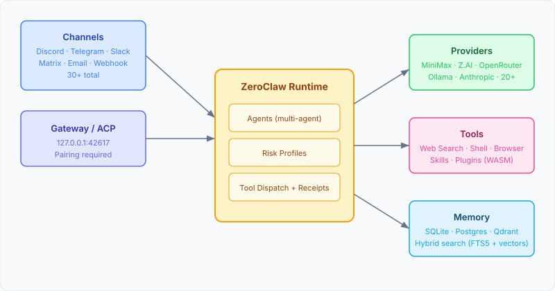
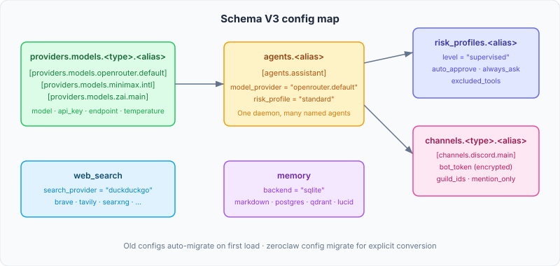

import YouTubeEmbed from "@components/widgets/YouTubeEmbed.astro";
import Button from "@components/widgets/Button.astro";
import Notice from "@components/widgets/Notice.astro";
import ListCheck from "@components/widgets/ListCheck.astro";
import Accordion from "@components/widgets/Accordion.astro";
import Tabs from "@components/widgets/Tabs.astro";
import Tab from "@components/widgets/Tab.astro";

A proper ZeroClaw setup on a VPS gives you a self-hosted AI assistant written in Rust that boots in milliseconds and uses less memory than a browser tab. ZeroClaw is now at v0.8.7 (October 2026) and the project has moved fast since I first covered it in February - the install flow, config schema, and recommended models have all changed. This guide walks through the current setup with MiniMax M3 and GLM-5.3 as your models and Discord as the chat channel.

**Updated October 2026** - rewritten for ZeroClaw v0.8.x. If you followed the February 2026 version of this guide, the `onboard` command is gone, the config format changed to Schema V3, and the models are two generations newer. The "What's new" section below covers what broke.

If you're comparing self-hosted bot options, our [OpenClaw alternatives roundup](/openclaw-alternatives/) includes ZeroClaw alongside nanobot, NanoClaw, memU, and PicoClaw. For a heavier 24/7 assistant, see the [OpenClaw setup guide for a heavier 24/7 assistant](/clawdbot-setup-guide/). If you want something in Python with faster initial setup, the [NanoBot setup guide (also updated for GLM-5.3 and MiniMax M3.1)](/nanobot-setup-guide/) covers that path.

<Button text="ZeroClaw GitHub" link="https://github.com/zeroclaw-labs/zeroclaw" variant="solid" color="blue" size="md" icon="github" />

<Notice type="info" title="What this guide covers">
<ListCheck>
<ul>
<li>Installing ZeroClaw via the prebuilt install script or Docker</li>
<li>Configuring MiniMax M3 and GLM-5.3 (Schema V3)</li>
<li>Web search setup (DuckDuckGo default, Brave upgrade)</li>
<li>Discord channel integration with correct intents</li>
<li>Security: risk profiles, gateway pairing, OS sandboxing</li>
<li>Ops and troubleshooting: verify steps, failure modes, CLI cheat sheet</li>
</ul>
</ListCheck>
</Notice>

<Notice type="warning" title="Video predates v0.8">
The video below was recorded against the pre-v0.8 flow. The `onboard` command and old config format shown are deprecated. Use the written steps in this guide instead.
</Notice>

<YouTubeEmbed
  url="https://www.youtube.com/embed/8zuIJWGp2ko"
  label="ZeroClaw setup video (pre-v0.8: commands deprecated)"
/>

## What's new in ZeroClaw v0.8 (October 2026)

If you set up ZeroClaw before June 2026, several things you relied on have changed:

<Notice type="warning" title="Breaking changes if you followed the February 2026 version">
Four hard breaks to know about: `zeroclaw onboard` is deprecated (use `zeroclaw quickstart`), the config schema moved to V3 (old configs auto-migrate on first load), Docker env vars changed completely (legacy `API_KEY`/`PROVIDER`/`ZEROCLAW_MODEL` are gone), and the gateway port is now 42617 instead of 8080.
</Notice>

<ListCheck>
<ul>
<li><strong>`onboard` replaced by `quickstart`</strong> - the guided setup now walks through provider, risk profile, memory, channels, and agent in one flow</li>
<li><strong>Schema V3 config</strong> - providers, agents, risk profiles, and channels are separate typed sections; old configs auto-migrate, or run <code>zeroclaw config migrate</code> explicitly</li>
<li><strong>Prebuilt install script</strong> - no Rust toolchain needed; the installer downloads a release binary and falls back to source if needed</li>
<li><strong>Gateway port 42617</strong> - was 8080; the Docker compose maps <code>127.0.0.1:42617</code></li>
<li><strong>Official Docker images</strong> - <code>ghcr.io/zeroclaw-labs/zeroclaw</code> with distroless and Debian variants; new env-var grammar</li>
<li><strong>Model generation bump</strong> - MiniMax M3/M3.1-Flash and GLM-5.3/5.3-Flash replace M2.5 and GLM-5</li>
<li><strong>Multi-agent runtime</strong> - one daemon runs many named agents, each with its own workspace, memory, and provider</li>
<li><strong>Dashboard, SOP engine, WASM plugins</strong> - web UI for config editing and chat, standard-operating-procedure workflows with approval gates, and a plugin host</li>
</ul>
</ListCheck>

Old configs are migrated automatically when ZeroClaw loads them. If you want to see what changed before committing, run `zeroclaw config migrate` and inspect with `zeroclaw config list`.

## What ZeroClaw actually is

ZeroClaw is a self-hosted AI assistant from zeroclaw-labs, built entirely in Rust. The official site claims under 20ms cold start (~12ms measured on Apple Silicon) and memory usage lower than a browser tab. Everything runs from a single config file and the architecture is trait-based: swap your LLM provider, channel, memory backend, or tools by editing TOML. The project is dual-licensed MIT / Apache-2.0 and has 33,000+ stars on GitHub as of October 2026.

The architecture looks like this:



Messages come in from your chat app, hit the gateway (which binds to `127.0.0.1:42617` by default and requires pairing), and the runtime routes them to whatever LLM you configured. The model can use built-in tools (shell, file access, web search, memory) to get work done. Each agent has a risk profile controlling what it can do autonomously.

If you want something even lighter that runs on $10 hardware, [PicoClaw, a Go-based assistant that runs on $10 hardware](/picoclaw-setup-guide/) is worth a look.

### How it compares

| | ZeroClaw | NanoBot | OpenClaw |
|---|---|---|---|
| **Language** | Rust | Python | TypeScript |
| **Resource footprint** | Milliseconds cold start, browser-tab-scale memory | ~100MB RAM | > 1GB RAM |
| **Config format** | TOML (Schema V3) | JSON | Custom |
| **Channels** | 30+ | 9 | 4 |
| **Providers** | 20+ families | 13+ | Several |
| **Multi-agent** | Yes (v0.8) | No | No |
| **Memory** | SQLite/Postgres/Qdrant hybrid search | File-based | File + semantic |
| **Security** | Risk profiles + OS sandbox + pairing + tool receipts | Allowlists | Allowlists |
| **Setup** | Install script + quickstart | pip install | Custom script |

I stopped printing binary sizes and RAM numbers in this table because they change every release and I can't re-measure all three tools against their current versions each month. The qualitative story holds: ZeroClaw is the leanest, nanobot is the fastest to set up, and OpenClaw has the most polished OAuth onboarding for existing Claude/ChatGPT subscriptions.

For the nanobot path, see our [NanoBot setup guide (also updated for GLM-5.3 and MiniMax M3.1)](/nanobot-setup-guide/). For OpenClaw, see the [OpenClaw setup guide for a heavier 24/7 assistant](/clawdbot-setup-guide/).

## Why MiniMax M3 and GLM-5.3

When I first covered ZeroClaw in February 2026, the budget picks were MiniMax M2.5 and GLM-5. Both are now two generations behind. The current sweet spot for an always-on VPS bot is MiniMax M3.1-Flash or GLM-5.3-Flash - both give you 1M token context windows at prices that make a personal bot affordable.

Pricing as of 2026-10-29 (via OpenRouter; check the model pages before committing):

| Model | Context | Input | Output | Notes |
|---|---|---|---|---|
| MiniMax M3.1-Flash | 1M | $0.15/M | $0.60/M | Flagship-flash, released 2026-10-19 |
| MiniMax M3 | 1M | $0.30/M | $1.20/M | Multimodal (text/image/video-in) |
| GLM-5.3-Flash | 1M | $0.15/M | $0.50/M | Budget pick for agents |
| GLM-5.3 | 1M | check model page | check model page | Reasoning model for SWE/long-horizon tasks |
| GLM-5.3-Prime | 1M | $2.80/M | $8.80/M | High-speed variant, 1.5-2x throughput |

If you want to dig deeper into budget model picks across providers, our [cheapest AI models under $1/M tokens](/best-cheap-models-hermes-agent/) guide covers the full list. And if you want to eliminate API costs entirely, you can [run local models with Ollama](/openclaw-ollama-local-models/) and point ZeroClaw at your local instance.

### MiniMax M3.1-Flash

MiniMax M3.1-Flash is the default I'd pick for a Discord bot that handles quick questions and lookups. It has a 1M token context window (so long conversations don't hit limits), it's fast, and at $0.15/M input / $0.60/M output it costs less per interaction than most alternatives.

ZeroClaw's own provider catalog example defaults to `MiniMax-M3` with `MiniMax-M2.7` and `MiniMax-M2.7-highspeed` as alternatives. M3.1-Flash is the newer flash-tier option. MiniMax also has a multi-region endpoint field (`endpoint = "intl"` or `"cn"`) so you can route through the global or mainland China API without hand-building URLs.

### GLM-5.3 (Z.AI)

GLM-5.3 from Zhipu AI (Z.AI) is a reasoning model aimed at software engineering and long-horizon agent tasks, released 2026-08-18 with a 1M token context window. It's a strong pick when your bot does code analysis or multi-step research.

The budget variant GLM-5.3-Flash runs at $0.15/M input / $0.50/M output on OpenRouter. The high-speed GLM-5.3-Prime variant (released 2026-09-23) is $2.80/M input / $8.80/M output with 1.5-2x throughput - overkill for a personal Discord bot but useful if you need low-latency responses under load.

Both models are available through their native APIs and through OpenRouter.

## Installation

ZeroClaw now ships a prebuilt install script that handles the binary download - no Rust toolchain required.

### Prerequisites

<ListCheck>
<ul>
<li>A Linux VPS (Ubuntu 24.04 works well) or local machine</li>
<li>A model API key: MiniMax, Z.AI, or OpenRouter</li>
<li>A Discord account and server (for the Discord integration)</li>
<li>Port 42617 available (gateway binds to localhost by default)</li>
<li>No Rust toolchain needed for the binary install path</li>
</ul>
</ListCheck>

<Tabs>
<Tab name="Install script (recommended)">

```bash
curl -fsSL https://raw.githubusercontent.com/zeroclaw-labs/zeroclaw/master/install.sh | sh
```

The installer downloads a prebuilt release binary (no compile step). If no matching binary exists for your platform, it falls back to building from source and can bootstrap Rust for you.

Then run the guided setup:

```bash
zeroclaw quickstart
```

`quickstart` walks you through provider selection, risk profile, memory backend, channels, and agent creation in one flow. It writes secrets encrypted (API keys go into `config.toml` with the encryption key in a `.secret_key` file beside it).

</Tab>
<Tab name="From source">

If you want to build from source or need specific channel features:

```bash
git clone https://github.com/zeroclaw-labs/zeroclaw.git
cd zeroclaw
./install.sh --source
```

The source build is guided (app/feature picker). For the manual path:

```bash
cargo install --locked --path .
```

Channel feature flags: the default build ships a lean bundle: ACP, webhook, email, Telegram, Discord, and filesystem. Release artifacts add Git, Matrix, Lark, and WhatsApp Web. Slack, Mattermost, LINE, Signal, and voice features need `--preset full` or individual `channel-*` features. If you add Slack after upgrading and it's missing, you're running a lean build.

</Tab>
</Tabs>

### Verify the install

```bash
zeroclaw --version
zeroclaw doctor
```

`zeroclaw --version` prints the version (Docker images built without the build-arg show "0.8.5 (unknown)" - that's cosmetic). `zeroclaw doctor` runs diagnostics and prints warnings about config issues, workspace problems, and channel health.

For a quick smoke test once you have a provider configured:

```bash
zeroclaw agent -a assistant -m "hello"
```

If you get a response back, the provider wiring works.

## Configuring MiniMax M3

ZeroClaw uses TOML for configuration. The config lives at `~/.zeroclaw/config.toml`. Schema V3 organizes providers under typed slots with your own alias.

### Get an API key

1. Go to [platform.minimax.io](https://platform.minimax.io) (global) or [minimaxi.com](https://www.minimaxi.com) (mainland China)
2. Create an account and generate an API key

<Notice type="success" title="MiniMax coding plan: 10% off">
MiniMax offers coding plans priced for developer workloads. [Get 10% off with our referral link](https://go.bitdoze.com/minimax). For details on how GLM and MiniMax compare for always-on bots, see our [best open source models for OpenClaw](/best-opensource-models-for-openclaw/) breakdown.
</Notice>

### Add to config

Three ways to connect, depending on what you have:

<Tabs>
<Tab name="OpenRouter">

The simplest path if you already have an OpenRouter key - one gateway for any model:

```toml
[providers.models.openrouter.default]
model   = "minimax/minimax-m3.1-flash"
api_key = "sk-or-your-openrouter-key"
```

Swap `minimax/minimax-m3.1-flash` for `minimax/minimax-m3` if you want the full multimodal model.

</Tab>
<Tab name="MiniMax direct">

Use MiniMax's native typed slot with the multi-region endpoint:

```toml
[providers.models.minimax.intl]
model    = "MiniMax-M3"          # or MiniMax-M2.7 / MiniMax-M2.7-highspeed
api_key  = "your-minimax-api-key"
endpoint = "intl"                # variants: cn, intl
```

Set `endpoint = "cn"` for the mainland China API.

</Tab>
<Tab name="Anthropic-compatible (coding plan)">

If you're on MiniMax's coding plan, use the Anthropic-compatible endpoint:

```toml
[providers.models.anthropic.minimax]
model  = "MiniMax-M3"
api_key = "your-minimax-api-key"
uri    = "https://api.minimax.io/anthropic"    # global
# uri = "https://api.minimaxi.com/anthropic"   # mainland China
```

</Tab>
</Tabs>

### Test it

```bash
zeroclaw agent -m "What's 42 * 17?"
```

If you get a response, MiniMax is working.

## Configuring GLM-5.3 (Z.AI)

GLM-5.3 works through OpenRouter, Z.AI's native API, or their Anthropic-compatible endpoint.

### Get an API key

1. Go to [z.ai](https://z.ai/manage-apikey/apikey-list)
2. Register and create an API key

<Notice type="success" title="Z.AI GLM coding plan: 10% off">
Z.AI offers [GLM coding plans (10% off with our link)](https://go.bitdoze.com/glm) designed for continuous developer workloads.
</Notice>

### Add to config

<Tabs>
<Tab name="OpenRouter">

```toml
[providers.models.openrouter.glm]
model   = "z-ai/glm-5.3-flash"    # or z-ai/glm-5.3 for the full model
api_key = "sk-or-your-openrouter-key"
```

</Tab>
<Tab name="Z.AI direct">

```toml
[providers.models.zai.main]
model   = "glm-5.3"               # check current model IDs in the Z.AI dashboard
api_key = "your-zai-api-key"
```

</Tab>
<Tab name="Anthropic-compatible (coding plan)">

Recommended for coding-plan subscribers:

```toml
[providers.models.anthropic.zai]
model  = "glm-5.3"
api_key = "your-zai-api-key"
uri    = "https://api.z.ai/api/anthropic"
```

</Tab>
</Tabs>

### Switching between models

Each model lives under its own alias, so switching is editing one line in the `[agents.<alias>]` section - point `model_provider` at whichever provider alias you want. No restart needed for the CLI. For the daemon, restart with `zeroclaw daemon` or `zeroclaw service restart`.

## Web search setup

Without web search, your bot is limited to the model's training data and whatever files are on your server. The good news: web search now works out of the box with no API key.

<Notice type="info" title="No API key needed">
DuckDuckGo is the default search provider. It works immediately with zero configuration. Brave, Tavily, SearXNG, and others are optional upgrades.
</Notice>

<Tabs>
<Tab name="DuckDuckGo (default)">

Search works immediately with no config. If you want to be explicit:

```toml
[web_search]
search_provider = "duckduckgo"
```

</Tab>
<Tab name="Brave (upgrade)">

Brave Search gives you more control and better results for technical queries. The free tier now gives up to $20 in free calls every month (prepaid credits, no subscription - this changed from the old "1,000 free searches/month" model).

1. Go to [brave.com/search/api](https://brave.com/search/api/)
2. Sign up and generate an API key

```toml
[web_search]
search_provider = "brave"
brave_api_key   = "your-brave-search-api-key"
```

</Tab>
</Tabs>

### Browser tool settings

The `[browser]` section controls two different things now:

```toml
[browser]
enabled = true                      # gates browser_open (default true)
automation_enabled = false          # gates full browser automation (default false)
allowed_domains = ["docs.rs", "github.com", "stackoverflow.com"]
```

`browser.enabled` controls the `browser_open` tool (hands a URL to the system browser). `automation_enabled` is a separate opt-in for full browser automation - it goes through the approval flow when triggered. The `allowed_domains` list is shared by both. The default is `["*"]`; lock it down once you know what domains your bot needs.

## Discord setup

Discord is one of ZeroClaw's 30+ channels. The integration uses Discord's WebSocket gateway directly - no webhook URL or public endpoint needed.

### Create a Discord bot and enable intents

1. Go to [discord.com/developers/applications](https://discord.com/developers/applications)
2. Click **New Application**, give it a name
3. Go to **Bot** in the left sidebar, click **Add Bot**
4. Copy the bot token

<Notice type="warning" title="Both intents are required">
In the Bot settings page, scroll to **Privileged Gateway Intents** and enable BOTH **MESSAGE CONTENT INTENT** and **SERVER MEMBERS INTENT**. Skipping these is the single most common reason a bot sits online but never replies. The old advice that Server Members Intent was optional is wrong - both are required now.
</Notice>

### Get your user ID

1. Open Discord Settings → **Advanced** → enable **Developer Mode**
2. Right-click your avatar anywhere in Discord
3. Click **Copy User ID**

### Configure ZeroClaw

Add the Discord channel to your config using the Schema V3 shape:

```toml
[channels.discord.main]
bot_token    = "YOUR_DISCORD_BOT_TOKEN"
allowed_users = ["YOUR_USER_ID"]
# guild_ids    = ["YOUR_SERVER_ID"]     # scope to specific servers
# channel_ids  = ["CHANNEL_ID"]          # scope to specific channels
# mention_only = true                    # only respond when @mentioned
# archive      = true                    # sidecar discord.db + discord_search tool
```

The `bot_token` field replaces the old `token` field. Set it through the encrypted secrets surface (quickstart writes secrets encrypted by default) rather than pasting plaintext into the config file.

<Notice type="warning" title="Allowlist behavior">
An empty allowlist means **deny all inbound messages** by default - the opposite of most other bots. Add your user ID or use `["*"]` for open access. If you're not sure what your sender identity looks like, start the bot, send it a message, and check the warning log for the exact value.
</Notice>

Useful fields worth knowing: `guild_ids` and `channel_ids` scope where the bot listens, `mention_only = true` makes it respond only when @mentioned (helpful in busy servers), and `archive = true` stores messages in a local `discord.db` sidecar with a `discord_search` tool.

v0.8.1 added slash commands generated from installed skills, and v0.8.2 added approval buttons (interaction components) so you can approve tool actions from Discord. If you're using the experimental WASM Discord plugin, never give it the same bot token as the built-in channel - you'll get double replies.

### Invite the bot to your server

1. In the Discord developer portal, go to **OAuth2** → **URL Generator**
2. Under **Scopes**, check `bot`
3. Under **Bot Permissions**, check `Send Messages`, `Read Message History`, and `View Channels`
4. Copy the generated URL and open it in your browser
5. Select the server to add the bot to

### Start the daemon and verify

```bash
zeroclaw daemon
```

This starts the full autonomous runtime including all configured channels. Send a message in Discord - the bot should respond.

If nothing happens, run `zeroclaw channel doctor` for targeted channel health checks. The failure modes table in the Ops section covers the common culprits (intents off, missing permissions, `mention_only`, invalid token).

## Full config example (Schema V3)

If you're migrating from the old flat config format, ZeroClaw auto-migrates on first load. For an explicit conversion:

```bash
zeroclaw config migrate      # V2 → V3
zeroclaw config list         # print resolved values
zeroclaw config schema       # expected shape
zeroclaw config set <key> <value>   # set a single key
```

Here's what a complete `~/.zeroclaw/config.toml` looks like in Schema V3 with OpenRouter, MiniMax M3.1-Flash, Discord, web search, and SQLite memory:



```toml
# ── Providers ──────────────────────────────────────────────
[providers.models.openrouter.default]
model   = "minimax/minimax-m3.1-flash"
api_key = "sk-or-your-openrouter-key"
temperature = 0.7

# ── Risk profiles ──────────────────────────────────────────
[risk_profiles.standard]
level          = "supervised"          # readonly | supervised | full
auto_approve   = []
always_ask     = []
excluded_tools = []
# forbidden_paths = ["/etc", "/root", "/proc", "/sys", "~/.ssh", "~/.aws"]

# ── Agents ─────────────────────────────────────────────────
[agents.assistant]
model_provider = "openrouter.default"  # dotted type.alias reference
risk_profile   = "standard"

# ── Channels ───────────────────────────────────────────────
[channels.discord.main]
bot_token     = "YOUR_DISCORD_BOT_TOKEN"   # use encrypted secrets
allowed_users = ["YOUR_USER_ID"]

# ── Web search ─────────────────────────────────────────────
[web_search]
search_provider = "duckduckgo"

# ── Browser ────────────────────────────────────────────────
[browser]
enabled           = true
automation_enabled = false
allowed_domains   = ["docs.rs", "github.com", "stackoverflow.com"]

# ── Memory ─────────────────────────────────────────────────
[memory]
backend = "sqlite"
```

The full config reference is generated from the live schema at [docs.zeroclaw.com](https://docs.zeroclaw.com/master/en/reference/config.html).

### Provider slots and fallback chains

ZeroClaw has typed provider slots: `openrouter`, `minimax`, `zai`, `anthropic`, `ollama`, `custom` (with `uri`), and about 20 provider families total. Each slot accepts your alias, so you can run multiple configs for the same provider type.

Since v0.8, you can add fallback chains for resilience:

```toml
[providers.models.openrouter.default]
model          = "minimax/minimax-m3.1-flash"
api_key        = "sk-or-..."
fallback_models = ["z-ai/glm-5.3-flash", "minimax/minimax-m3"]
fallback       = "zai.main"            # fall back to another provider alias
```

Worth enabling for an always-on VPS bot: if one provider rate-limits, the request chains to the next.

### Memory backends

Memory backends are now `sqlite`, `markdown`, `postgres`, `qdrant`, `lucid`, or `none`. SQLite hybrid search (FTS5 + vectors) remains the default and needs no external services. v0.8.4 added retrieval caching, reranking, and typed-fact extraction.

Set `embedding_provider = "noop"` if you don't want to pay for embeddings - you lose vector search but keyword search (FTS5) still works on its own.

### Workspace and identity files

ZeroClaw uses workspace files to shape the bot's personality:

| File | Purpose |
|------|---------|
| `IDENTITY.md` | Who the agent is |
| `SOUL.md` | Core personality and values |
| `USER.md` | Your personal info and preferences |
| `AGENTS.md` | Behavior guidelines |
| `TOOLS.md` | Tool usage instructions |
| `BOOTSTRAP.md` | Startup instructions |
| `MEMORY.md` | Long-term memory notes |

Edit these in `~/.zeroclaw/workspace/`.

Bootstrap truncation: with `compact_context` on (the default), each workspace file is cut at 6,000 characters before reaching the model. Run `zeroclaw doctor` - it prints `[workspace]` warnings with retained/discarded counts if your files are getting truncated. Keep personality files concise.

## Docker deployment

ZeroClaw now ships official prebuilt images on GitHub Container Registry. The "build it yourself" approach is no longer the primary path.

### Official images

| Tag | What it is |
|-----|-----------|
| `ghcr.io/zeroclaw-labs/zeroclaw:latest` | Distroless (no shell) |
| `ghcr.io/zeroclaw-labs/zeroclaw:debian` | Debian base with shell, git, curl |
| `ghcr.io/zeroclaw-labs/zeroclaw:v0.8.7` | Pinned version (use for prod) |

Multi-arch: amd64 and arm64.

### Docker run

```bash
docker run -d --name zeroclaw \
  -e ZEROCLAW_providers__models__openrouter__default__api_key="$OPENROUTER_API_KEY" \
  -e ZEROCLAW_gateway__host=0.0.0.0 \
  -e ZEROCLAW_gateway__allow_public_bind=true \
  -p 127.0.0.1:42617:42617 \
  -v zeroclaw-data:/zeroclaw-data \
  ghcr.io/zeroclaw-labs/zeroclaw:latest
```

<Notice type="info" title="Legacy env vars are gone">
The old `API_KEY`, `PROVIDER`, and `ZEROCLAW_MODEL` env vars were removed in v0.8.0. The only env-var surface is the schema-mirror grammar: `ZEROCLAW_<dotted_path_with_double_underscores>=<value>`. For example, `ZEROCLAW_providers__models__openrouter__default__api_key` maps to `[providers.models.openrouter.default] api_key`.
</Notice>

### Docker Compose

```yaml
version: "3.8"
services:
  zeroclaw:
    image: ghcr.io/zeroclaw-labs/zeroclaw:latest
    container_name: zeroclaw
    restart: unless-stopped
    ports:
      - "127.0.0.1:42617:42617"
    volumes:
      - zeroclaw-data:/zeroclaw-data
    environment:
      - ZEROCLAW_providers__models__openrouter__default__api_key=${OPENROUTER_API_KEY}
      - ZEROCLAW_gateway__host=0.0.0.0
      - ZEROCLAW_gateway__allow_public_bind=true
    deploy:
      resources:
        limits:
          cpus: "2"
          memory: 512M
    healthcheck:
      test: ["CMD", "zeroclaw", "status", "--format=exit-code"]
      interval: 60s
      timeout: 10s
      retries: 3
      start_period: 10s

volumes:
  zeroclaw-data:
```

Download the official compose file (note the branch is `master`, not `main`):

```bash
curl -O https://raw.githubusercontent.com/zeroclaw-labs/zeroclaw/master/docker-compose.yml
```

ARM64 gotcha: the distroless image may exit immediately on ARM64 (Raspberry Pi, Graviton). Use `ghcr.io/zeroclaw-labs/zeroclaw:debian` instead - it has the shell and libraries needed on ARM.

### Hardening notes

- The container runs as non-root (UID 65534) by default.
- Keep the `127.0.0.1:` prefix on the port mapping unless you specifically want LAN access. The image sets `ZEROCLAW_gateway__host=0.0.0.0` internally - exposure is bounded by your `ports:` mapping and firewall.
- Pin tags for production (`:v0.8.7`) rather than using `:latest`.
- The compose example ships with 2 CPU / 512M resource limits - reasonable for a personal bot.

## Security settings

ZeroClaw's security defaults are stricter than most alternatives.

### Gateway pairing

When the gateway starts, it generates a pairing code. You exchange this for a bearer token before any webhook requests are accepted:

```bash
# Start gateway (shows pairing code in logs)
zeroclaw gateway

# Exchange code for token
curl -X POST http://127.0.0.1:42617/pair \
  -H "X-Pairing-Code: 123456"
```

All subsequent requests need the `Authorization: Bearer <token>` header. v0.8.5 made pairing codes stronger by default and reading or minting them now requires an owner-only admin token. Auth providers include `native` (pairing), `peercred` (Unix socket peer uid), and `oidc.<alias>` (SSO). A config with `require_pairing = false` and no other auth is rejected by validation.

<Notice type="info" title="Pairing token revocation">
To revoke a paired token, use the pairing controls. Editing `gateway.paired_tokens` in the config does NOT disconnect live connections - already-paired clients stay connected until they're explicitly revoked.
</Notice>

### Risk profiles

Risk profiles replace the old `[autonomy]` section. Each agent references one:

```toml
[risk_profiles.standard]
level          = "supervised"    # readonly | supervised | full
auto_approve   = []              # tools that never prompt
always_ask     = []              # tools that always prompt
excluded_tools = []              # tools that are disabled
```

- `readonly` - no writes, no shell execution.
- `supervised` (default) - medium-risk tools prompt through the initiating channel (Discord shows an approval button). The default `approval_timeout_secs` is 120; a timeout is treated as denial.
- `full` - autonomous execution. The OS sandbox still applies.

Per-agent tool allowlists are enforced at every dispatch path.

### OS sandboxing

```toml
[risk_profiles.standard]
sandbox_enabled = true
sandbox_backend = "landlock"    # landlock | bubblewrap | seatbelt | docker
forbidden_paths = ["/etc", "/root", "/proc", "/sys", "~/.ssh", "~/.gnupg", "~/.aws"]
```

For the sandboxing context and how it compares to other tools, see [our OpenClaw security guide covering CVE-2026-25253](/openclaw-security-guide/).

### What's new in security since February

v0.8 added several security layers worth knowing about: tool receipts (cryptographic proof on every action - a claimed-but-not-made action produces a missing/invalid receipt), a universal ingress policy layer (v0.8.2), SSRF guards on outbound HTTP tools, and private-host allowlists. The `allow_public_bind` setting silences the startup warning when binding to `0.0.0.0` - it does not itself refuse the bind. Your firewall and port mapping are the real gate.

## Ops and troubleshooting

This is the section the February version of this guide lacked. Verify first, then debug.

### Verify checklist

<ListCheck>
<ul>
<li><code>zeroclaw --version</code> - confirms the binary is installed</li>
<li><code>zeroclaw doctor</code> - full diagnostics (config, workspace, channels)</li>
<li><code>zeroclaw channel doctor</code> - targeted channel health checks</li>
<li><code>zeroclaw status</code> - runtime status summary</li>
<li><code>zeroclaw config list</code> - print resolved config values</li>
<li><code>zeroclaw agent -a assistant -m "hello"</code> - smoke test with your provider</li>
</ul>
</ListCheck>

### Failure modes

| Symptom | Likely cause | Fix |
|---------|-------------|-----|
| Bot online but never replies | Intents not enabled | Enable Message Content AND Server Members intents in the Discord portal |
| Bot replies nowhere | Not invited or missing permissions | Re-invite with Send Messages + Read Message History + View Channels |
| Bot ignores most messages | `mention_only = true` | Set to `false` or @mention the bot |
| Auth errors on startup | Invalid bot token | Reset the token in the Discord portal and update config |
| "Provider streaming failed, falling back to non-streaming chat" | Provider streaming issue | Run `zeroclaw auth status` to check credentials |
| Container exits immediately (ARM64) | Distroless image on ARM | Use `:debian` tag |
| Slack/Mattermost/LINE missing after upgrade | Lean build | Rebuild with `--preset full` or `channels-full` |
| Config errors on startup | Old schema | Run `zeroclaw config migrate` |

### Diagnostics

```bash
zeroclaw service logs --follow      # tail service logs
RUST_LOG=debug zeroclaw daemon      # verbose debug output
zeroclaw self-test                  # self-check
zeroclaw estop                      # emergency stop
```

### Upgrades

```bash
zeroclaw update
```

The dashboard (v0.8.4+) also supports in-app upgrades with automatic restart.

### CLI cheat sheet

| Command | What it does |
|---------|-------------|
| `zeroclaw quickstart` | Guided setup (replaces `onboard`) |
| `zeroclaw agent -m "..."` | Send a single message |
| `zeroclaw agent` | Interactive chat mode |
| `zeroclaw daemon` | Start full autonomous runtime |
| `zeroclaw gateway` | Start webhook server |
| `zeroclaw status` | Show system status |
| `zeroclaw doctor` | Run diagnostics |
| `zeroclaw channel doctor` | Check channel health |
| `zeroclaw config list` | Print resolved config |
| `zeroclaw config schema` | Show config schema |
| `zeroclaw config set <key> <value>` | Set a config key |
| `zeroclaw config migrate` | Migrate old config to V3 |
| `zeroclaw auth login` | Authenticate with a provider |
| `zeroclaw auth status` | Check auth credentials |
| `zeroclaw memory` | Memory management |
| `zeroclaw models` | List available models |
| `zeroclaw providers` | List provider slots |
| `zeroclaw agents` | List configured agents |
| `zeroclaw skills` | Manage skills |
| `zeroclaw cron` | Scheduled tasks |
| `zeroclaw sop` | SOP engine |
| `zeroclaw update` | Update ZeroClaw |
| `zeroclaw estop` | Emergency stop |
| `zeroclaw self-test` | Self-check |
| `zeroclaw service install` | Install as system service |
| `zeroclaw service start` | Start the service |
| `zeroclaw service status` | Check service status |
| `zeroclaw service logs` | View service logs |
| `zeroclaw migrate openclaw` | Migrate memory from OpenClaw |

The `migrate openclaw` command imports memory from an OpenClaw installation. Run `--dry-run` first to preview what gets imported, then `--reindex` to rebuild the search index after migration. It migrates memory only - not channels or config.

<Notice type="warning" title="Impersonation warning">
`zeroclaw-labs/zeroclaw` is the only official repo. The self-hosted bot space has a lot of forks and clones. If a repo doesn't match that exact path, it's not the official ZeroClaw.
</Notice>

## ZeroClaw vs nanobot vs OpenClaw

Where each one stands as of October 2026:

| Aspect | ZeroClaw | NanoBot | OpenClaw |
|--------|----------|---------|----------|
| Language | Rust | Python | TypeScript |
| Config format | TOML (V3) | JSON | Custom |
| Resource footprint | Milliseconds cold start, browser-tab memory | ~100MB RAM | > 1GB RAM |
| Channels | 30+ | 9 | 4 |
| Providers | 20+ families | 13+ | Several |
| Multi-agent | Yes (v0.8) | No | No |
| Memory | SQLite/Postgres/Qdrant hybrid | File-based | File + semantic |
| Security | Risk profiles + OS sandbox + pairing + tool receipts | Allowlists | Allowlists |
| Dashboard | Yes (v0.8) | No | Yes |
| Setup | Install script + quickstart | pip install | Custom script |

ZeroClaw wins on resource usage, security depth, and channel count. nanobot wins on initial setup speed. OpenClaw has the most polished OAuth onboarding for existing Claude/ChatGPT subscriptions and a dashboard.

For the nanobot path, see the [NanoBot setup guide (also updated for GLM-5.3 and MiniMax M3.1)](/nanobot-setup-guide/). For OpenClaw, see the [OpenClaw setup guide for a heavier 24/7 assistant](/clawdbot-setup-guide/). For a Go-based alternative on cheap hardware, check out [PicoClaw, a Go-based assistant that runs on $10 hardware](/picoclaw-setup-guide/). Our [OpenClaw alternatives roundup](/openclaw-alternatives/) covers the full list.

<Accordion label="Frequently asked questions" group="faq" expanded="true">

**How much does it cost to run ZeroClaw?**

VPS: roughly $5-7/month (Hetzner CX22 or equivalent). API costs depend on usage, but with M3.1-Flash or GLM-5.3-Flash at $0.15/M input, a personal Discord bot typically runs $5-20/month total. ZeroClaw has a built-in usage ledger with an offline pricing catalog (v0.8.3) so you can track spend without guessing.

**Can I use ZeroClaw without any API costs?**

Yes. Set up an Ollama provider slot and point it at a local Ollama instance. You need hardware that can run inference, but there are no API bills. See [run local models with Ollama](/openclaw-ollama-local-models/) for the setup.

**Does ZeroClaw work on a Raspberry Pi?**

Yes. Prebuilt arm64 binaries are available through the install script, so you don't need to compile from source. The binary install path avoids the OOM issues that plagued source builds on 1GB Pi boards. The Debian Docker image works on ARM64 if you prefer containers.

**Can multiple people use one ZeroClaw instance?**

Yes. Add multiple user IDs to the channel allowlist. Each person gets their own conversation context. Since v0.8, you can also run multiple named agents - each with its own workspace, memory, and provider - from a single daemon.

**What's the difference between gateway and daemon?**

`zeroclaw daemon` runs the full autonomous runtime: channels, agents, scheduling, heartbeats - everything. `zeroclaw gateway` starts just the webhook/API server. For 24/7 Discord use, run the daemon (or install it as a service with `zeroclaw service install`).

**Can I migrate from OpenClaw to ZeroClaw?**

Yes. Run `zeroclaw migrate openclaw --dry-run` first to preview what gets imported, then run it for real. Add `--reindex` to rebuild the search index after migration. Note: it migrates memory only, not channels or config.

**Can I add Telegram alongside Discord?**

Yes. Configure both channels in the same config file under their respective `[channels.<type>.<alias>]` blocks. ZeroClaw handles them simultaneously. See the nanobot guide's Telegram section for the BotFather flow since the process is the same.

**What happened to `zeroclaw onboard`?**

It's deprecated as of v0.8. The command prints a deprecation notice and its flags no longer apply. Use `zeroclaw quickstart` instead - it walks through provider, risk profile, memory, channels, and agent creation in one guided flow.

</Accordion>

## VPS hosting and monthly cost

ZeroClaw runs on modest hardware. A 2 vCPU / 4GB VPS is more than enough - the bot's own footprint is tiny and the real resource consumer is whatever Docker containers you're already running alongside it.

Monthly cost breakdown (October 2026):
- VPS: ~$5-7/month (Hetzner CX22 or equivalent)
- API: $5-20/month for personal use with M3.1-Flash or GLM-5.3-Flash
- Search: $0 (DuckDuckGo default) or up to $20/month in free Brave credits
- Local models: $0/month if you use Ollama instead of API providers

The built-in usage ledger (v0.8.3) tracks token spend against an offline pricing catalog, so you can see exactly what each conversation costs.

<Notice type="success" title="Hetzner discount">
[Get €20 credit](https://go.bitdoze.com/hetzner) or try [Hostinger VPS](https://go.bitdoze.com/hostinger-vps) when you sign up through our referral links. That covers several months of a small VPS. For other providers, [Vultr](https://go.bitdoze.com/vultr) and [DigitalOcean](https://go.bitdoze.com/do) work fine too.
</Notice>

For more on how VPS pricing shifted this year, see the [Hetzner Cloud review after the 2026 price changes](/hetzner-cloud-review/) and [what changed and when a mini PC wins](/vps-price-increases/).

Quick setup on a fresh Ubuntu 24.04 VPS:

```bash
ssh root@YOUR_SERVER_IP

# Update system
apt update && apt upgrade -y

# Install ZeroClaw (no Rust needed)
curl -fsSL https://raw.githubusercontent.com/zeroclaw-labs/zeroclaw/master/install.sh | sh

# Guided setup
zeroclaw quickstart

# Verify
zeroclaw doctor

# Install as a systemd service
zeroclaw service install
zeroclaw service start
zeroclaw service status
```

This creates a systemd service that starts on boot and restarts on failure. Check logs with `zeroclaw service logs --follow`.

If you want to run local models alongside ZeroClaw, check our guide on [installing Ollama with Docker](/ollama-docker-install/). ZeroClaw's Ollama provider connects to any local instance without extra config.

If you want to explore other AI coding tools, our [AI coding tools comparison](/ai-coding-tools/) covers the current options. For a self-improving assistant with voice mode and OpenClaw migration, see the [Hermes Agent setup guide](/hermes-agent-setup-guide/). For MCP basics that work across all these assistants, check the [MCP introduction for beginners](/mcp-introduction-beginners/).

Este artículo también está disponible en español: [Guía de Configuración de ZeroClaw](/es/guia-configuracion-zeroclaw/).
